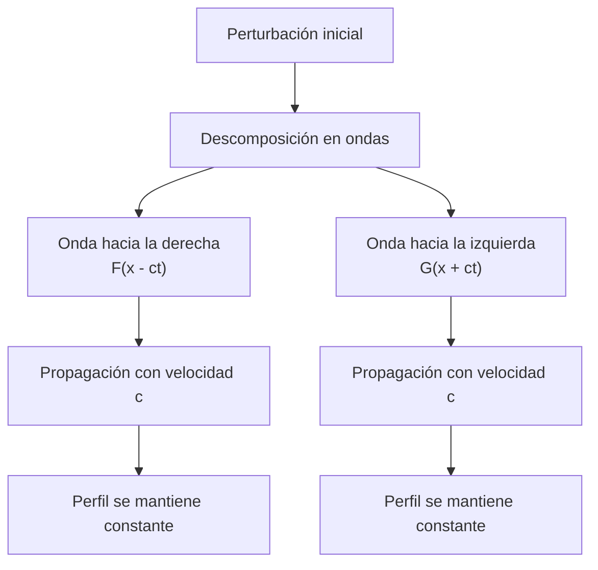
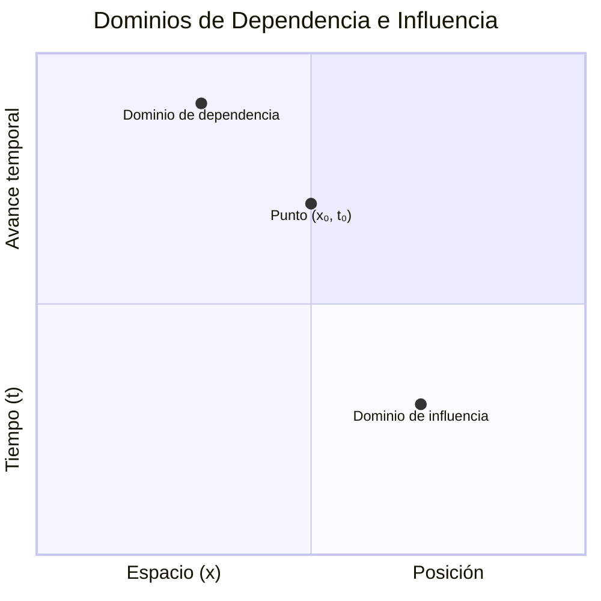

# Matemáticas para Ciencias Aplicadas IV - Ecuaciones de Tipo Hiperbólico

## 6.4 Método de propagación de las ondas.

---

### 1. Introducción al Método de Propagación

El método de propagación de ondas, también conocido como **método de D'Alembert**, proporciona una solución general para la ecuación de onda unidimensional. Este enfoque ofrece una interpretación física clara de la propagación de perturbaciones a través de un medio.

### 2. La Solución de D'Alembert

#### 2.1. Forma General de la Ecuación de Onda

La ecuación de onda unidimensional:

$$\frac{\partial^2 u}{\partial t^2} = c^2 \frac{\partial^2 u}{\partial x^2}$$

#### 2.2. Cambio de Variables

Introducimos nuevas variables:

$$\xi = x - ct \quad \text{y} \quad \eta = x + ct$$

#### 2.3. Transformación de la Ecuación

Aplicando la regla de la cadena:

$$\frac{\partial^2 u}{\partial \xi \partial \eta} = 0$$

#### 2.4. Solución General

Integrando dos veces:

$$u(\xi, \eta) = F(\xi) + G(\eta)$$

Volviendo a las variables originales:

$$u(x,t) = F(x - ct) + G(x + ct)$$

### 3. Interpretación Física

#### 3.1. Ondas Viajeras

- **$F(x - ct)$**: Onda que se propaga hacia la derecha con velocidad $c$
- **$G(x + ct)$**: Onda que se propaga hacia la izquierda con velocidad $c$

#### 3.2. Diagrama de Propagación



### 4. Solución del Problema de Valor Inicial

#### 4.1. Condiciones Iniciales

$$u(x,0) = f(x) \quad \text{y} \quad \frac{\partial u}{\partial t}(x,0) = g(x)$$

#### 4.2. Solución de D'Alembert

$$u(x,t) = \frac{1}{2}[f(x - ct) + f(x + ct)] + \frac{1}{2c} \int_{x-ct}^{x+ct} g(s) ds$$

#### 4.3. Dominio de Dependencia

El valor de $u(x,t)$ depende solo de los valores iniciales en el intervalo $[x-ct, x+ct]$.

### 5. Ejemplo Resuelto

**Problema:** Resolver la ecuación de onda con condiciones iniciales:

- $u(x,0) = e^{-x^2}$
- $\frac{\partial u}{\partial t}(x,0) = 0$

**Solución:**
Aplicando la fórmula de D'Alembert:

$$u(x,t) = \frac{1}{2}[e^{-(x-ct)^2} + e^{-(x+ct)^2}]$$

### 6. Visualización de la Propagación

```python
import numpy as np
import matplotlib.pyplot as plt
from matplotlib.animation import FuncAnimation

# Parámetros
c = 1
x = np.linspace(-10, 10, 1000)

# Función inicial
def f(x):
    return np.exp(-x**2)

# Solución de D'Alembert
def u(x, t):
    return 0.5 * (f(x - c*t) + f(x + c*t))

# Configuración de la animación
fig, ax = plt.subplots(figsize=(10, 6))
ax.set_xlim(-10, 10)
ax.set_ylim(-0.1, 1.1)
ax.set_xlabel('Posición x')
ax.set_ylabel('Amplitud u(x,t)')
ax.set_title('Propagación de una Onda Gaussiana')
ax.grid(True)

line, = ax.plot(x, u(x, 0))
time_text = ax.text(0.02, 0.95, '', transform=ax.transAxes)

def animate(t):
    line.set_ydata(u(x, t/2))
    time_text.set_text(f'Tiempo = {t/2:.2f} s')
    return line, time_text

ani = FuncAnimation(fig, animate, frames=100, interval=50, blit=True)
plt.show()
```

### 7. Casos Especiales

#### 7.1. Onda que Viaja en una Dirección

Si $g(x) = \pm c f'(x)$, entonces:

$$u(x,t) = f(x \mp ct)$$

#### 7.2. Perturbación Localizada

Para una perturbación inicial localizada, la solución se divide en dos ondas de mitad de amplitud que viajan en direcciones opuestas.

### 8. Dominio de Influencia y Dependencia

#### 8.1. Dominio de Dependencia

Para un punto $(x,t)$, el dominio de dependencia es el intervalo $[x-ct, x+ct]$ en el eje inicial.

#### 8.2. Dominio de Influencia

Para un punto $(x_0, 0)$, el dominio de influencia es la región $|x - x_0| \leq ct$.

#### 8.3. Diagrama de Dominios



### 9. Velocidad de Propagación

#### 9.1. Velocidad de Fase

$$v_f = \frac{\omega}{k} = c$$

#### 9.2. Velocidad de Grupo

$$v_g = \frac{d\omega}{dk} = c$$

Para la ecuación de onda clásica, ambas velocidades son iguales a $c$.

### 10. Ejercicios Propuestos

#### Ejercicio 1

Resolver mediante el método de D'Alembert la ecuación de onda con condiciones:

- $u(x,0) = \sin(x)$
- $\frac{\partial u}{\partial t}(x,0) = 0$

#### Ejercicio 2

Encontrar la solución para:

- $u(x,0) = 0$
- $\frac{\partial u}{\partial t}(x,0) = \cos(x)$

#### Ejercicio 3

Demostrar que la solución de D'Alembert satisface la ecuación de onda.

#### Ejercicio 4

Analizar la propagación de una perturbación triangular definida por:

$$ f(x) = \begin{cases} 1 - |x| & \text{si } |x| \leq 1 \\\ 0 & \text{si } |x| > 1 \end{cases}$$

con velocidad inicial cero.

### 11. Aplicaciones del Método

- Análisis de señales en transmission lines
- Estudio de ondas sísmicas
- Propagación de ondas en cuerdas y membranas
- Acústica y ultrasonido
- Óptica de rayos

### 12. Limitaciones y Extensiones

#### 12.1. Limitaciones
- Solo aplicable a problemas en una dimensión espacial
- Medio infinito o semi-infinito
- No considera efectos disipativos

#### 12.2. Extensiones
- Ecuación de onda con amortiguamiento
- Medios no homogéneos
- Problemas en dimensiones superiores

### 13. Implementación Computacional

```python
import numpy as np
import matplotlib.pyplot as plt

def dAlembert_solution(x, t, f, g, c):
    """
    Solución de D'Alembert para la ecuación de onda

    Parameters:
    x: array de posiciones
    t: tiempo
    f: función de posición inicial
    g: función de velocidad inicial
    c: velocidad de propagación
    """
    term1 = 0.5 * (f(x - c*t) + f(x + c*t))
    term2 = 0.5 * np.array([np.trapz(g(s), s=np.linspace(x_i-c*t, x_i+c*t, 1000))
                           for x_i in x]) / c
    return term1 + term2

# Ejemplo de uso
x = np.linspace(-10, 10, 1000)
t = 2
c = 1

def f(x):
    return np.exp(-x**2)

def g(x):
    return np.zeros_like(x)

u = dAlembert_solution(x, t, f, g, c)

plt.figure(figsize=(10, 6))
plt.plot(x, u)
plt.xlabel('Posición x')
plt.ylabel('u(x,t)')
plt.title('Solución de D\'Alembert en t = 2')
plt.grid(True)
plt.show()
```

### 14. Referencias

#### Bibliografía Básica:
1. **Boice, W., DiPrima, R.** (2004). *Elementary Differential Equations and Boundary Value Problems*. Wiley, New York. (Capítulo 10, Sección 10.6)
2. **Edwards, C. H., Penney, D. E.** (2002). *Ecuaciones diferenciales elementales y problemas con condiciones a la frontera*. Prentice Hall, México. (Capítulo 12, Sección 12.4)

#### Bibliografía Complementaria:
1. **Cooper, J. M.** (1998). *Introduction to Partial Differential Equations with MatLab*. Birkhäuser, Boston. (Capítulo 4)
2. **Hubbard, J. H., West, B. H.** (1995). *Differential Equations: A Dynamical Systems Approach*. Springer-Verlag, Berlin. (Sección 8.4)
3. **Zill, D. G., Wright, W. S.** (1995). *Differential Equations with Computer Lab Experiments*. PWS Publishing Company, Boston. (Capítulo 13)

