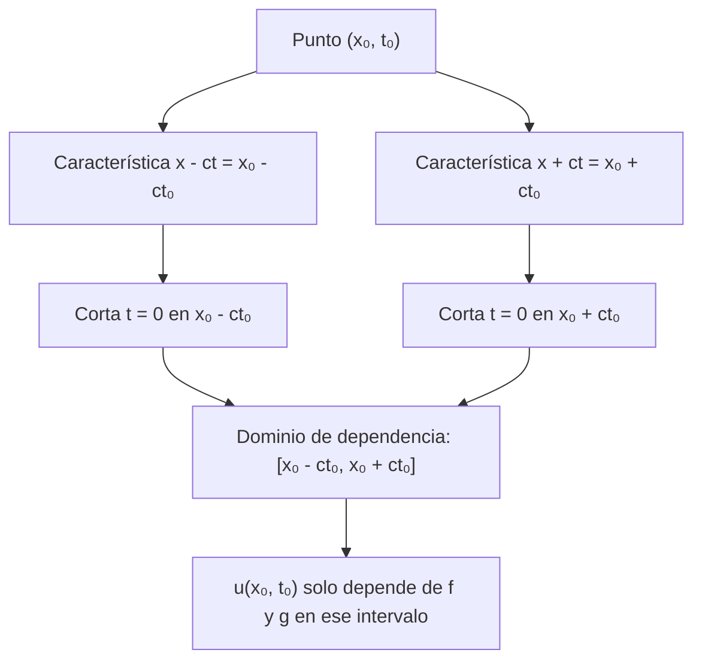

# Matemáticas para Ciencias Aplicadas IV - Ecuaciones de Tipo Hiperbólico

## 6.4 Método de propagación de las ondas.

---

El **método de propagación de las ondas**, o de d'Alembert, resuelve la ecuación de onda escribiendo la solución como la suma de dos ondas que viajan en sentidos opuestos sin deformarse. A diferencia de la separación de variables, da una fórmula cerrada, muestra directamente que las perturbaciones viajan con velocidad finita y explica la reflexión en los extremos. Este tema deduce la fórmula de d'Alembert, estudia los dominios de dependencia e influencia, la extiende a cuerdas semi-infinitas y finitas mediante reflexiones, y la usa para comprobar un método numérico.

### La fórmula de d'Alembert

Se considera la cuerda infinita

$$ u_{tt} = c^2 u_{xx}, \quad -\infty \lt x \lt \infty, \qquad u(x, 0) = f(x), \qquad u_t(x, 0) = g(x) $$

**Paso 1: forma canónica.** Con las variables características $\xi = x - ct$ y $\eta = x + ct,$ la regla de la cadena da $u_x = u_\xi + u_\eta$ y $u_t = c(u_\eta - u_\xi),$ y derivando de nuevo,

$$ u_{xx} = u_{\xi\xi} + 2u_{\xi\eta} + u_{\eta\eta}, \qquad u_{tt} = c^2 \big( u_{\xi\xi} - 2u_{\xi\eta} + u_{\eta\eta} \big) $$

así que $u_{tt} - c^2 u_{xx} = -4c^2 u_{\xi\eta}$ y la ecuación se reduce a $u_{\xi\eta} = 0.$

**Paso 2: solución general.** $u_{\xi\eta} = 0$ dice que $u_\xi$ no depende de $\eta,$ y al integrar, $u = F(\xi) + G(\eta):$

$$ u(x, t) = F(x - ct) + G(x + ct) $$

$F(x - ct)$ es una forma fija que se desplaza a la derecha con velocidad $c;$ $G(x + ct),$ una que se desplaza a la izquierda.

**Paso 3: datos iniciales.** En $t = 0,$ $F + G = f$ y $-cF' + cG' = g.$ Integrando la segunda, $-F + G = \frac{1}{c} \int_0^x g(s)\, ds + K,$ y resolviendo el sistema con la primera se obtienen $F$ y $G.$ Sustituyendo,

$$ u(x, t) = \frac{f(x - ct) + f(x + ct)}{2} + \frac{1}{2c} \int_{x - ct}^{x + ct} g(s)\, ds $$

Es la **fórmula de d'Alembert** (1747). Si $f$ es dos veces derivable y $g$ una vez, $u$ es solución clásica; y como depende continuamente de los datos, el problema está **bien planteado** en el sentido de Hadamard: existe solución, es única (por la conservación de la energía, tema 6.2) y cambios pequeños en los datos producen cambios pequeños en la solución.

**Interpretación.** Si la cuerda parte del reposo, es decir, si $g = 0,$ la forma inicial se parte en dos copias de **la mitad de altura** que se separan, una hacia cada lado. Si $g = -c f',$ toda la perturbación viaja a la derecha: $u = f(x - ct).$

### Dominios de dependencia e influencia

La fórmula dice que $u(x_0, t_0)$ solo depende de los datos en el intervalo $[x_0 - ct_0, x_0 + ct_0],$ el **dominio de dependencia**, que es la base del triángulo formado por las dos características que pasan por $(x_0, t_0).$ Recíprocamente, los datos en un punto $x_0$ solo afectan a la región $|x - x_0| \leq ct,$ el **dominio de influencia**, un cono que se abre con velocidad $c.$



**Velocidad finita de propagación.** Si los datos iniciales son cero fuera de $[-a, a],$ la solución es cero para $|x| > a + ct:$ ninguna señal viaja más rápido que $c.$ Es la diferencia esencial con la ecuación del calor (tema 7), donde una perturbación se siente instantáneamente en todas partes.

**Huygens en una dimensión.** Con $g = 0,$ cuando el pulso pasa, el punto vuelve al reposo. Con $g \neq 0$ no: la integral deja una "estela" constante. Por ejemplo, un golpe en un intervalo deja la cuerda desplazada de forma permanente detrás de los frentes de onda.

### Cuerda semi-infinita: reflexión

Para $x > 0$ con extremo fijo, $u(0, t) = 0,$ se extienden los datos a toda la recta de forma **impar**: $\tilde{f}(-x) = -f(x),$ $\tilde{g}(-x) = -g(x).$ La solución de d'Alembert con los datos extendidos es impar en $x$ para todo $t$ (por la simetría de la fórmula), así que se anula en $x = 0,$ y en $x > 0$ es la solución buscada. El efecto es que un pulso que llega al extremo fijo **se refleja invertido**: es la onda "imagen", que venía de $x \lt 0,$ la que sale.

Con extremo libre, $u_x(0, t) = 0,$ se usa la extensión **par**, y el pulso se refleja sin invertirse.

**Cuerda finita.** Para $[0, L]$ con ambos extremos fijos, se extiende de forma impar respecto a $0$ y a $L,$ lo que da una función impar y periódica de período $2L.$ La fórmula de d'Alembert con esa extensión coincide con la serie de Fourier del tema 6.5: los modos $\sin \frac{n\pi x}{L} \cos \frac{n\pi c t}{L}$ son exactamente $\frac{1}{2} \left[ \sin \frac{n\pi(x - ct)}{L} + \sin \frac{n\pi(x + ct)}{L} \right],$ la superposición de dos ondas viajeras. Una **onda estacionaria** es la suma de dos ondas viajeras iguales en sentidos opuestos.

### Ejemplo resuelto

Con $f(x) = e^{-x^2}$ y $g = 0,$

$$ u(x, t) = \frac{1}{2} \left[ e^{-(x - ct)^2} + e^{-(x + ct)^2} \right] $$

Al principio los dos medios pulsos se superponen; para $ct$ mayor que unas pocas unidades se ven dos campanas de altura $\tfrac{1}{2}$ centradas en $\pm ct.$

### Implementación en Python

El programa implementa la fórmula de d'Alembert con SymPy, comprueba simbólicamente que la fórmula general cumple la ecuación y los datos (ejercicio 3), resuelve los ejercicios 1 y 2 y el ejemplo, sigue el pulso triangular del ejercicio 4, muestra la reflexión invertida en un extremo fijo y, por último, compara la solución exacta con el método numérico de **salto de rana**

$$ u_j^{k + 1} = 2u_j^k - u_j^{k - 1} + r^2 \left( u_{j + 1}^k - 2u_j^k + u_{j - 1}^k \right), \qquad r = \frac{c\, \Delta t}{\Delta x} $$

```python
import numpy as np
import sympy as sp

x, t, s = sp.symbols("x t s", real=True)
c = sp.symbols("c", positive=True)
F, G = sp.Function("f"), sp.Function("g")


def dalembert(f, g):
    return (f.subs(x, x - c * t) + f.subs(x, x + c * t)) / 2 \
        + sp.integrate(g.subs(x, s), (s, x - c * t, x + c * t)) / (2 * c)


# Ejercicio 3: la fórmula general cumple la ecuación y los datos
u = (F(x - c * t) + F(x + c * t)) / 2 + sp.Integral(G(s), (s, x - c * t, x + c * t)) / (2 * c)
print("ejercicio 3: u_tt - c² u_xx =", sp.simplify((sp.diff(u, t, 2) - c**2 * sp.diff(u, x, 2)).doit()))
print("             u(x, 0) =", sp.simplify(u.subs(t, 0).doit()), "  u_t(x, 0) =", sp.simplify(sp.diff(u, t).subs(t, 0).doit()))

for nombre, f, g in [("ejercicio 1", sp.sin(x), sp.S(0)), ("ejercicio 2", sp.S(0), sp.cos(x)),
                     ("ejemplo", sp.exp(-x**2), sp.S(0))]:
    sol = dalembert(f, g)
    if sol.has(sp.sin, sp.cos):
        sol = sp.simplify(sp.expand_trig(sol))
    print(f"{nombre}: u =", sol)

# Ejercicio 4: triángulo de altura 1 en [-1, 1], c = 1
tri = lambda z: np.maximum(0.0, 1 - np.abs(z))
ut = lambda xx, tt: 0.5 * (tri(xx - tt) + tri(xx + tt))
print("triángulo, u(x, t) en x = -2, -1, -0.5, 0, 0.5, 1, 2:")
xs = np.array([-2, -1, -0.5, 0, 0.5, 1, 2])
for tt in (0, 0.5, 1, 2):
    print(f"   t = {tt}:", " ".join(f"{v:5.2f}" for v in ut(xs, tt)))

# Cuerda semi-infinita x > 0 con extremo fijo: extensión impar del pulso centrado en x = 5
pulso = lambda z: np.exp(-(z - 5) ** 2)
impar = lambda z: np.sign(z) * pulso(np.abs(z))
ur = lambda xx, tt: 0.5 * (impar(xx - tt) + impar(xx + tt))
xx = np.linspace(0, 20, 2001)
for tt in (0, 3, 5, 10):
    v = ur(xx, tt)
    i, j = np.argmax(v), np.argmin(v)
    print(f"semi-infinita, t = {tt:2d}: u(0) = {ur(np.array([0.0]), tt)[0]:.1f}, "
          f"máximo {v[i]:+.3f} en x = {xx[i]:5.2f}, mínimo {v[j]:+.3f} en x = {xx[j]:5.2f}")

# Diferencias finitas (salto de rana) frente a d'Alembert, cuerda infinita, f = e^{-x²}, c = 1
def leapfrog(r, T=4.0, dx=0.05):
    X = np.arange(-15, 15 + dx / 2, dx)
    dt = r * dx
    nt = int(round(T / dt))
    u0 = np.exp(-X**2)
    u1 = u0.copy()
    u1[1:-1] = u0[1:-1] + 0.5 * r**2 * (u0[2:] - 2 * u0[1:-1] + u0[:-2])
    for _ in range(nt - 1):
        u2 = np.zeros_like(u1)
        u2[1:-1] = 2 * u1[1:-1] - u0[1:-1] + r**2 * (u1[2:] - 2 * u1[1:-1] + u1[:-2])
        u0, u1 = u1, u2
    exacta = 0.5 * (np.exp(-(X - nt * dt) ** 2) + np.exp(-(X + nt * dt) ** 2))
    return np.max(np.abs(u1 - exacta))


for r in (0.5, 0.9, 1.0, 1.05):
    print(f"salto de rana, r = c dt/dx = {r:4.2f}: error máximo en t = 4: {leapfrog(r):.2e}")
```

Salida:

```text
ejercicio 3: u_tt - c² u_xx = 0
             u(x, 0) = f(x)   u_t(x, 0) = g(x)
ejercicio 1: u = sin(x)*cos(c*t)
ejercicio 2: u = sin(c*t)*cos(x)/c
ejemplo: u = exp(-(c*t + x)**2)/2 + exp(-(-c*t + x)**2)/2
triángulo, u(x, t) en x = -2, -1, -0.5, 0, 0.5, 1, 2:
   t = 0:  0.00  0.00  0.50  1.00  0.50  0.00  0.00
   t = 0.5:  0.00  0.25  0.50  0.50  0.50  0.25  0.00
   t = 1:  0.00  0.50  0.25  0.00  0.25  0.50  0.00
   t = 2:  0.50  0.00  0.00  0.00  0.00  0.00  0.50
semi-infinita, t =  0: u(0) = 0.0, máximo +1.000 en x =  5.00, mínimo +0.000 en x =  0.00
semi-infinita, t =  3: u(0) = 0.0, máximo +0.500 en x =  8.00, mínimo +0.000 en x =  0.00
semi-infinita, t =  5: u(0) = 0.0, máximo +0.500 en x = 10.00, mínimo -0.000 en x =  1.06
semi-infinita, t = 10: u(0) = 0.0, máximo +0.500 en x = 15.00, mínimo -0.500 en x =  5.00
salto de rana, r = c dt/dx = 0.50: error máximo en t = 4: 6.10e-04
salto de rana, r = c dt/dx = 0.90: error máximo en t = 4: 1.55e-04
salto de rana, r = c dt/dx = 1.00: error máximo en t = 4: 2.48e-14
salto de rana, r = c dt/dx = 1.05: error máximo en t = 4: 1.96e+03
```

La reflexión se ve en la cuerda semi-infinita: en $t = 5$ el pulso que viajaba a la izquierda llega al extremo y se cancela con su imagen, y en $t = 10$ aparece en $x = 5$ invertido, con valor $-0.5.$ En el método numérico, con $r = 1$ el error es de redondeo: en ese caso el esquema coincide con d'Alembert, porque los puntos de la malla están justo sobre las características. Con $r \lt 1$ es estable pero tiene un pequeño error de dispersión, y con $r > 1$ la solución numérica explota. Es la **condición CFL** (Courant, Friedrichs y Lewy, 1928): el dominio de dependencia numérico, de ancho $2\Delta x$ por paso, debe contener al físico, de ancho $2c\, \Delta t;$ si no, el método ignora datos de los que la solución sí depende.

### Ejercicios Propuestos

1. **Dato senoidal.** Resuelve con la fórmula de d'Alembert $u_{tt} = c^2 u_{xx}$ con $u(x, 0) = \sin x$ y $u_t(x, 0) = 0.$

2. **Velocidad inicial.** Resuelve el problema con $u(x, 0) = 0$ y $u_t(x, 0) = \cos x.$

3. **Verificación.** Demuestra que la fórmula de d'Alembert satisface la ecuación de onda y las dos condiciones iniciales.

4. **Pulso triangular.** Con $c = 1,$ $f(x) = 1 - |x|$ para $|x| \leq 1,$ $f(x) = 0$ en otro caso, y $g = 0,$ describe $u(x, t)$ para $t = 0.5,$ $1$ y $2.$

5. **Reflexión.** En una cuerda semi-infinita $x > 0$ con extremo fijo y $c = 1,$ un pulso centrado en $x = 5$ se suelta desde el reposo. ¿Cuándo y dónde aparece el pulso reflejado, y con qué signo?

6. **Dominio de dependencia.** Si $f$ y $g$ son cero fuera de $[0, 1]$ y $c = 2,$ ¿en qué instantes puede ser distinto de cero $u(5, t)?$

### Soluciones

**Ejercicio 1.** $u = \frac{1}{2} \left[ \sin(x - ct) + \sin(x + ct) \right] = \sin x \cos ct:$ una onda estacionaria.

**Ejercicio 2.** $u = \frac{1}{2c} \int_{x - ct}^{x + ct} \cos s\, ds = \frac{1}{2c} \left[ \sin(x + ct) - \sin(x - ct) \right] = \frac{1}{c} \cos x \sin ct.$

**Ejercicio 3.** Derivando dos veces bajo el signo de integral (regla de Leibniz), con $\Phi(x, t) = \int_{x - ct}^{x + ct} g,$ se tiene $\Phi_t = c[g(x + ct) + g(x - ct)]$ y $\Phi_x = g(x + ct) - g(x - ct),$ de donde $\Phi_{tt} = c^2 [g'(x + ct) - g'(x - ct)] = c^2 \Phi_{xx}.$ La parte de $f$ es de la forma $F(x - ct) + G(x + ct).$ En $t = 0$ la integral es cero y $u = f;$ y $u_t(x, 0) = \frac{-c f'(x) + c f'(x)}{2} + \frac{1}{2c} \cdot 2c\, g(x) = g(x).$ El programa lo confirma simbólicamente.

**Ejercicio 4.** $u = \frac{1}{2} [f(x - t) + f(x + t)].$ En $t = 0.5$ los dos medios triángulos se solapan y forman un trapecio de altura $0.5$ sobre $[-0.5, 0.5];$ en $t = 1$ son dos triángulos de altura $0.5$ centrados en $\pm 1$ que se tocan en el origen; en $t = 2,$ dos triángulos separados centrados en $\pm 2,$ con $u = 0$ entre ellos.

**Ejercicio 5.** La mitad que viaja a la izquierda llega a $x = 0$ en $t = 5,$ y la imagen invertida emerge; en $t = 10$ está centrada en $x = 5$ con altura $-\tfrac{1}{2},$ mientras la otra mitad está en $x = 15$ con altura $+\tfrac{1}{2}.$

**Ejercicio 6.** $u(5, t)$ depende de los datos en $[5 - 2t, 5 + 2t],$ que corta a $[0, 1]$ cuando $5 - 2t \leq 1,$ es decir, $t \geq 2.$ Antes de $t = 2$ es cero. Si $g = 0,$ solo contribuye $f(5 - 2t),$ que es nula salvo para $0 \leq 5 - 2t \leq 1:$ $u(5, t)$ puede ser distinto de cero solo para $2 \leq t \leq 2.5.$ Si $g \neq 0,$ para $t > 2.5$ el intervalo contiene todo $[0, 1]$ y queda la estela constante $\frac{1}{2c} \int_0^1 g.$

### Referencias

1. Strauss, W. A., _Partial Differential Equations: An Introduction_. Wiley, 2008. Capítulos 2 y 3.
2. Tijonov, A. N., y Samarski, A. A., _Ecuaciones de la física matemática_. Mir, 1980. Capítulo 2.
3. LeVeque, R. J., _Finite Difference Methods for Ordinary and Partial Differential Equations_. SIAM, 2007. Capítulo 10.
4. Courant, R., Friedrichs, K., und Lewy, H., Über die partiellen Differenzengleichungen der mathematischen Physik. _Mathematische Annalen_ 100, 1928.
