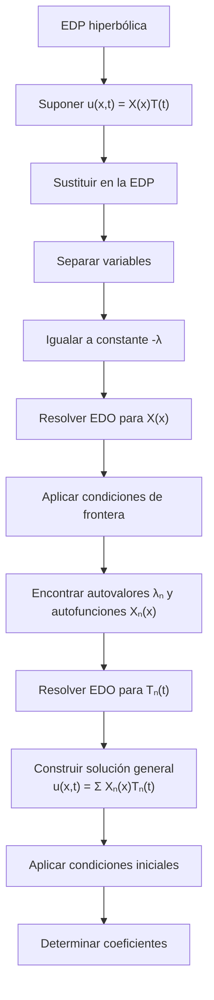

# Matemáticas para Ciencias Aplicadas IV - Ecuaciones de Tipo Hiperbólico

## 6.5 Método de separación de variables.

---

### 1. Introducción al Método

El método de separación de variables es una técnica fundamental para resolver ecuaciones diferenciales parciales (EDP) lineales, particularmente ecuaciones de tipo hiperbólico como la ecuación de onda. Este método transforma una EDP en un sistema de ecuaciones diferenciales ordinarias (EDO) más simples.

### 2. Fundamentos del Método

#### 2.1. Idea Central

Suponer que la solución $u(x,t)$ puede expresarse como el producto de funciones que dependen solo de una variable cada una:

$$u(x,t) = X(x)T(t)$$

#### 2.2. Aplicabilidad

El método es aplicable a EDPs lineales y homogéneas con condiciones de frontera también lineales y homogéneas.

### 3. Algoritmo del Método



### 4. Aplicación a la Ecuación de Onda

#### 4.1. Ecuación de Onda Unidimensional

$$\frac{\partial^2 u}{\partial t^2} = c^2 \frac{\partial^2 u}{\partial x^2}$$

#### 4.2. Sustitución de Separación

Sea $u(x,t) = X(x)T(t)$, entonces:

$$X(x)T''(t) = c^2 X''(x)T(t)$$

#### 4.3. Separación de Variables

$$\frac{T''(t)}{c^2 T(t)} = \frac{X''(x)}{X(x)} = -\lambda$$

#### 4.4. Sistema de EDOs

1. **Problema espacial**: $X''(x) + \lambda X(x) = 0$
2. **Problema temporal**: $T''(t) + c^2 \lambda T(t) = 0$

### 5. Problema de Autovalores de Sturm-Liouville

#### 5.1. Condiciones de Frontera Comunes

- **Extremos fijos**: $X(0) = 0$, $X(L) = 0$
- **Extremos libres**: $X'(0) = 0$, $X'(L) = 0$
- **Mixtas**: $X(0) = 0$, $X'(L) = 0$

#### 5.2. Solución del Problema Espacial

Para extremos fijos:

- **Autovalores**: $\lambda_n = \left( \frac{n\pi}{L} \right)^2$
- **Autofunciones**: $X_n(x) = \sin\left( \frac{n\pi x}{L} \right)$

#### 5.3. Solución del Problema Temporal

Para cada autovalor $\lambda_n$:

$$T_n(t) = A_n \cos\left( \frac{n\pi c t}{L} \right) + B_n \sin\left( \frac{n\pi c t}{L} \right)$$

### 6. Solución General

#### 6.1. Serie de Fourier

$$u(x,t) = \sum_{n=1}^{\infty} \left[ A_n \cos\left( \frac{n\pi c t}{L} \right) + B_n \sin\left( \frac{n\pi c t}{L} \right) \right] \sin\left( \frac{n\pi x}{L} \right)$$

#### 6.2. Coeficientes de Fourier

A partir de las condiciones iniciales:

- $u(x,0) = f(x) = \sum_{n=1}^{\infty} A_n \sin\left( \frac{n\pi x}{L} \right)$
- $\frac{\partial u}{\partial t}(x,0) = g(x) = \sum_{n=1}^{\infty} \frac{n\pi c}{L} B_n \sin\left( \frac{n\pi x}{L} \right)$

#### 6.3. Fórmulas de los Coeficientes

$$A_n = \frac{2}{L} \int_0^L f(x) \sin\left( \frac{n\pi x}{L} \right) dx$$

$$B_n = \frac{2}{n\pi c} \int_0^L g(x) \sin\left( \frac{n\pi x}{L} \right) dx$$

### 7. Ejemplo Resuelto

**Problema:** Resolver la ecuación de onda con:

- $\frac{\partial^2 u}{\partial t^2} = 4 \frac{\partial^2 u}{\partial x^2}$
- $u(0,t) = u(\pi,t) = 0$
- $u(x,0) = \sin(3x)$
- $\frac{\partial u}{\partial t}(x,0) = 0$

**Solución:**

1. $c = 2$, $L = \pi$
2. $A_n = \frac{2}{\pi} \int_0^\pi \sin(3x) \sin(nx) dx = \delta_{n3}$
3. $B_n = 0$ para todo $n$
4. Solución: $u(x,t) = \cos(6t) \sin(3x)$

### 8. Implementación Computacional

```python
import numpy as np
import matplotlib.pyplot as plt
from matplotlib.animation import FuncAnimation

# Parámetros
L = np.pi
c = 2
n_terms = 10  # Número de términos en la serie

# Coeficientes de Fourier
def calcular_coeficientes(f, g, L, c, n_terms):
    n_values = np.arange(1, n_terms + 1)
    A_n = np.zeros(n_terms)
    B_n = np.zeros(n_terms)

    for i, n in enumerate(n_values):
        # Integración numérica para A_n
        x = np.linspace(0, L, 1000)
        integrando_A = f(x) * np.sin(n * np.pi * x / L)
        A_n[i] = (2/L) * np.trapz(integrando_A, x)

        # Integración numérica para B_n
        integrando_B = g(x) * np.sin(n * np.pi * x / L)
        B_n[i] = (2/(n * np.pi * c)) * np.trapz(integrando_B, x)

    return A_n, B_n

# Solución por separación de variables
def u_series(x, t, A_n, B_n, L, c):
    suma = 0
    for n in range(1, len(A_n) + 1):
        term = (A_n[n-1] * np.cos(n * np.pi * c * t / L) +
                B_n[n-1] * np.sin(n * np.pi * c * t / L)) * np.sin(n * np.pi * x / L)
        suma += term
    return suma

# Visualización
def visualizar_solucion():
    # Funciones iniciales
    def f(x):
        return np.sin(3*x)

    def g(x):
        return np.zeros_like(x)

    # Calcular coeficientes
    A_n, B_n = calcular_coeficientes(f, g, L, c, n_terms)

    # Crear animación
    x = np.linspace(0, L, 1000)
    fig, ax = plt.subplots(figsize=(10, 6))
    ax.set_xlim(0, L)
    ax.set_ylim(-1.5, 1.5)
    ax.set_xlabel('x')
    ax.set_ylabel('u(x,t)')
    ax.set_title('Solución por Separación de Variables')
    ax.grid(True)

    line, = ax.plot(x, u_series(x, 0, A_n, B_n, L, c))
    time_text = ax.text(0.02, 0.95, '', transform=ax.transAxes)

    def animate(t):
        line.set_ydata(u_series(x, t/10, A_n, B_n, L, c))
        time_text.set_text(f'Tiempo = {t/10:.2f}')
        return line, time_text

    ani = FuncAnimation(fig, animate, frames=200, interval=50, blit=True)
    plt.show()

visualizar_solucion()
```

### 9. Casos Especiales y Consideraciones

#### 9.1. Convergencia de la Serie

La serie de Fourier converge uniformemente si $f(x)$ y $g(x)$ son suficientemente suaves.

#### 9.2. Fenómeno de Gibbs

Oscilaciones en las discontinuidades de las condiciones iniciales.

#### 9.3. Velocidad de Convergencia

Depende de la suavidad de las condiciones iniciales.

### 10. Ejercicios Propuestos

#### Ejercicio 1

Resolver por separación de variables:

- $\frac{\partial^2 u}{\partial t^2} = 9 \frac{\partial^2 u}{\partial x^2}$
- $u(0,t) = u(2,t) = 0$
- $u(x,0) = x(2-x)$
- $\frac{\partial u}{\partial t}(x,0) = 0$

#### Ejercicio 2

Encontrar la solución para una cuerda con:

- Extremo izquierdo fijo, extremo derecho libre
- $u(x,0) = 0$
- $\frac{\partial u}{\partial t}(x,0) = v_0$ (constante)

#### Ejercicio 3

Demostrar que el método de separación de variables conduce a un problema de autovalores de Sturm-Liouville.

#### Ejercicio 4

Analizar cómo cambian las frecuencias naturales cuando se modifican las condiciones de frontera.

### 11. Extensiones del Método

#### 11.1. Problemas Multidimensionales

Para la ecuación de onda en 2D:

$$u(x,y,t) = X(x)Y(y)T(t)$$

#### 11.2. Coordenadas No Cartesianas

Uso de funciones especiales (Bessel, Legendre, etc.) en geometrías no rectangulares.

#### 11.3. Problemas No Homogéneos

Método de eigenfunciones para ecuaciones no homogéneas.

### 12. Limitaciones del Método

- Requiere linealidad y homogeneidad
- Las condiciones de frontera deben ser separables
- Dificultad con geometrías complejas
- Problemas con coeficientes variables

### 13. Referencias

#### Bibliografía Básica:

1. **Boice, W., DiPrima, R.** (2004). _Elementary Differential Equations and Boundary Value Problems_. Wiley, New York. (Capítulo 10)
2. **Edwards, C. H., Penney, D. E.** (2002). _Ecuaciones diferenciales elementales y problemas con condiciones a la frontera_. Prentice Hall, México. (Capítulo 12)

#### Bibliografía Complementaria:

1. **Cooper, J. M.** (1998). _Introduction to Partial Differential Equations with MatLab_. Birkhäuser, Boston. (Capítulo 4)
2. **Hubbard, J. H., West, B. H.** (1995). _Differential Equations: A Dynamical Systems Approach_. Springer-Verlag, Berlin. (Sección 8.4)
3. **Zill, D. G., Wright, W. S.** (1995). _Differential Equations with Computer Lab Experiments_. PWS Publishing Company, Boston. (Capítulo 13)
