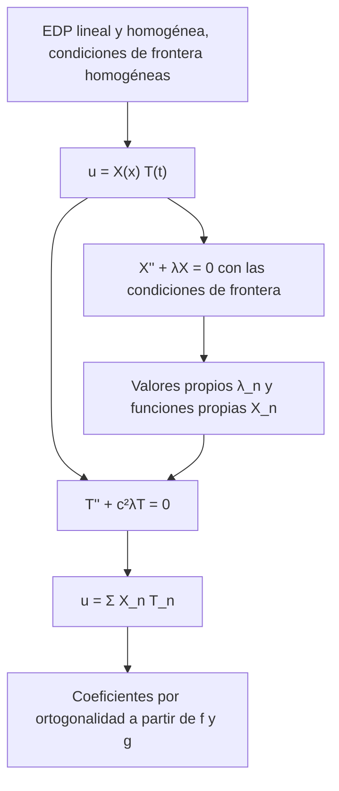

# Matemáticas para Ciencias Aplicadas IV - Ecuaciones de Tipo Hiperbólico

## 6.5 Método de separación de variables.

---

El **método de separación de variables**, o de Fourier, busca soluciones de la forma $u(x, t) = X(x)\, T(t),$ con lo que una EDP se convierte en dos EDO, y luego construye la solución del problema completo sumando infinitas de esas soluciones. Funciona cuando la ecuación es lineal y homogénea, el dominio es un rectángulo en las variables adecuadas y las condiciones de frontera son homogéneas. Este tema presenta el método en general, su fundamento en la **teoría de Sturm-Liouville**, cómo tratar fuerzas externas y condiciones no homogéneas, y su extensión a la membrana rectangular.

### El método paso a paso

Para $u_{tt} = c^2 u_{xx}$ en $0 \lt x \lt L$ con $u(0, t) = u(L, t) = 0,$ $u(x, 0) = f(x),$ $u_t(x, 0) = g(x):$

1. **Separar.** Con $u = X(x)\, T(t),$ la ecuación es $X T'' = c^2 X'' T,$ es decir

   $$ \frac{T''}{c^2 T} = \frac{X''}{X} $$

   El lado izquierdo solo depende de $t$ y el derecho solo de $x,$ así que ambos son iguales a una constante, que se escribe $-\lambda.$

2. **Problema espacial.** $X'' + \lambda X = 0$ con las condiciones de frontera $X(0) = X(L) = 0,$ que salen de exigir $u(0, t) = X(0) T(t) = 0$ para todo $t.$ Solo tiene soluciones no nulas para ciertos $\lambda,$ los **valores propios**:

   - Si $\lambda \lt 0,$ $X = a \cosh(\sqrt{-\lambda}\, x) + b \sinh(\sqrt{-\lambda}\, x),$ y las condiciones dan $a = b = 0.$
   - Si $\lambda = 0,$ $X = a + bx,$ y también $a = b = 0.$
   - Si $\lambda > 0,$ $X = a \cos(\sqrt{\lambda}\, x) + b \sin(\sqrt{\lambda}\, x);$ $X(0) = 0$ da $a = 0,$ y $X(L) = b \sin(\sqrt{\lambda} L) = 0$ con $b \neq 0$ exige $\sqrt{\lambda} L = n\pi.$

   Así $\lambda_n = (n\pi/L)^2$ y $X_n = \sin(n\pi x/L).$

3. **Problema temporal.** $T'' + c^2 \lambda_n T = 0$ da $T_n = A_n \cos \omega_n t + B_n \sin \omega_n t,$ con $\omega_n = c n\pi / L.$

4. **Superponer.** Por linealidad, $u = \sum_n X_n T_n$ cumple la ecuación y las condiciones de frontera.

5. **Ajustar los datos iniciales.** $u(x, 0) = \sum A_n X_n = f$ y $u_t(x, 0) = \sum \omega_n B_n X_n = g$ son desarrollos en serie de Fourier de senos, y por la ortogonalidad de los $X_n,$

   $$ A_n = \frac{\int_0^L f X_n\, dx}{\int_0^L X_n^2\, dx}, \qquad B_n = \frac{\int_0^L g X_n\, dx}{\omega_n \int_0^L X_n^2\, dx} $$

**Ejemplo.** $u_{tt} = 4 u_{xx}$ en $[0, \pi]$ con extremos fijos, $u(x, 0) = \sin 3x$ y $u_t(x, 0) = 0.$ Aquí $c = 2,$ $X_n = \sin nx$ y $\omega_n = 2n.$ El dato ya es $X_3,$ así que $A_3 = 1,$ los demás coeficientes son cero y $u = \cos(6t) \sin(3x).$



### Fundamento: problemas de Sturm-Liouville

El paso 2 es un caso del **problema de Sturm-Liouville** regular

$$ \big( p(x) X' \big)' - q(x) X + \lambda\, w(x) X = 0, \qquad \alpha_1 X(a) + \alpha_2 X'(a) = 0, \qquad \beta_1 X(b) + \beta_2 X'(b) = 0 $$

con $p > 0,$ $w > 0$ en $[a, b].$ Aparece al separar variables en ecuaciones con coeficientes variables (una cuerda de densidad no uniforme, una barra de sección variable) y en otras geometrías.

**Teorema.**

1. Los valores propios son reales y forman una sucesión creciente $\lambda_1 \lt \lambda_2 \lt \cdots \to \infty.$
2. Las funciones propias de valores propios distintos son **ortogonales** con peso $w:$ $\int_a^b X_m X_n w\, dx = 0.$
3. Toda función de cuadrado integrable se desarrolla en serie de funciones propias, que converge en media cuadrática.

**Demostración de la ortogonalidad.** Sea $\mathcal{L} X = (p X')' - q X.$ Para dos funciones $X, Y$ que cumplen las condiciones de frontera, la **identidad de Lagrange** da

$$ \int_a^b \big( Y \mathcal{L} X - X \mathcal{L} Y \big)\, dx = \Big[ p \big( Y X' - X Y' \big) \Big]_a^b = 0 $$

donde el corchete es cero porque, en cada extremo, los vectores $(X, X')$ y $(Y, Y')$ son ambos ortogonales al vector no nulo $(\alpha_1, \alpha_2),$ o a $(\beta_1, \beta_2)$ en el otro extremo, así que son proporcionales y el determinante $Y X' - X Y'$ se anula. Si $\mathcal{L} X_m = -\lambda_m w X_m$ y $\mathcal{L} X_n = -\lambda_n w X_n,$ se obtiene $(\lambda_n - \lambda_m) \int_a^b X_m X_n w\, dx = 0,$ y si $\lambda_m \neq \lambda_n$ la integral es cero. Con $Y = \overline{X}$ el mismo argumento muestra que los valores propios son reales. $\blacksquare$

### Condiciones de frontera y frecuencias

| Condiciones en $0$ y $L$ | $\lambda_n$ | $X_n$ | Frecuencias $\omega_n$ |
| --- | --- | --- | --- |
| fijo, fijo | $(n\pi/L)^2,$ $n \geq 1$ | $\sin(n\pi x/L)$ | $n\pi c/L$ |
| libre, libre | $(n\pi/L)^2,$ $n \geq 0$ | $\cos(n\pi x/L)$ | $n\pi c/L$ |
| fijo, libre | $((2n - 1)\pi/(2L))^2$ | $\sin((2n - 1)\pi x/(2L))$ | $(2n - 1)\pi c/(2L)$ |
| fijo, elástica $X' + hX = 0$ | $\mu_n^2$ con $\tan \mu L = -\mu/h$ | $\sin(\mu_n x)$ | $c \mu_n,$ no armónicas |

Cuanto más "sujeta" está la cuerda, más altas son las frecuencias: la fundamental de fijo-libre es la mitad de la de fijo-fijo, y la de la condición elástica queda entre las dos.

### Problemas no homogéneos

**Fuerza externa.** Para $u_{tt} = c^2 u_{xx} + F(x, t)$ con extremos fijos, se desarrolla todo en las funciones propias: $u = \sum T_n(t) X_n(x)$ y $F = \sum F_n(t) X_n(x).$ Cada coeficiente cumple una EDO de oscilador forzado,

$$ T_n'' + \omega_n^2 T_n = F_n(t) $$

que se resuelve como en el tema 3. Si la fuerza es periódica con frecuencia igual a una de las $\omega_n$ y tiene componente en ese modo, hay **resonancia**: la amplitud crece linealmente con $t.$ Así se rompe una copa con la voz o se excita un puente con el viento.

**Condiciones de frontera no homogéneas.** Si $u(0, t) = a$ y $u(L, t) = b$ son constantes, se resta la **solución estática** $s(x) = a + (b - a) x / L,$ que cumple la ecuación y las condiciones. $v = u - s$ tiene condiciones homogéneas y datos $f - s$ y $g,$ y se resuelve por separación de variables.

### Membrana rectangular

Para $u_{tt} = c^2 (u_{xx} + u_{yy})$ en $[0, a] \times [0, b]$ con borde fijo, la separación $u = X(x)\, Y(y)\, T(t)$ da dos problemas espaciales como el de la cuerda, con modos

$$ u_{mn} = \sin \frac{m\pi x}{a} \sin \frac{n\pi y}{b} \big( A_{mn} \cos \omega_{mn} t + B_{mn} \sin \omega_{mn} t \big), \qquad \omega_{mn} = c\pi \sqrt{\frac{m^2}{a^2} + \frac{n^2}{b^2}} $$

Las frecuencias **no son múltiplos** de la fundamental, y en una membrana cuadrada hay modos distintos con la misma frecuencia, como $\omega_{12} = \omega_{21},$ lo que permite figuras de Chladni de formas muy variadas.

### Implementación en Python

El programa resuelve los ejercicios 1 y 2, comprueba que la serie del ejercicio 1 coincide con la fórmula de d'Alembert aplicada a la extensión impar y periódica del dato (tema 6.4), calcula los valores propios de una condición elástica y verifica su ortogonalidad, resuelve la EDO de un modo forzado dentro y fuera de resonancia, y lista las frecuencias de dos membranas rectangulares divididas entre la fundamental.

```python
import numpy as np
import sympy as sp
from scipy.optimize import brentq

x, t = sp.symbols("x t", real=True)
n = sp.symbols("n", integer=True, positive=True)
L, c, v0, w = sp.symbols("L c v_0 omega", positive=True)

# Ejercicio 1: u_tt = 9 u_xx en [0, 2], u(x,0) = x(2 - x), u_t = 0
An = sp.simplify(sp.integrate(x * (2 - x) * sp.sin(n * sp.pi * x / 2), (x, 0, 2)))  # 2/L = 1
print("ejercicio 1: A_n =", An, "  frecuencias angulares 3nπ/2")


def serie(xx, tt, N=60):
    s = 0.0
    for k in range(1, N + 1):
        a = float(An.subs(n, k))
        s += a * np.sin(k * np.pi * xx / 2) * np.cos(3 * k * np.pi * tt / 2)
    return s


def extension(z):  # extensión impar y 4-periódica de x(2 - x)
    z = np.mod(z, 4.0)
    return np.where(z <= 2, z * (2 - z), -(z - 2) * (4 - z))


xs = np.linspace(0, 2, 9)
for tt in (0.3, 0.7):
    dal = 0.5 * (extension(xs - 3 * tt) + extension(xs + 3 * tt))
    print(f"   t = {tt}: máx |serie - d'Alembert| = {np.max(np.abs(serie(xs, tt) - dal)):.1e}")

# Ejercicio 2: fijo en 0, libre en L, u(x,0) = 0, u_t(x,0) = v0
mu = (2 * n - 1) * sp.pi / (2 * L)
Bn = sp.simplify(2 / (L * c * mu) * sp.integrate(v0 * sp.sin(mu * x), (x, 0, L)))
print("ejercicio 2: B_n =", Bn)

# Ejercicio 3: ortogonalidad para las condiciones fijo-libre y para X(0) = 0, X'(1) + X(1) = 0
m1, m2 = sp.symbols("m1 m2", positive=True)
I = sp.integrate(sp.sin(m1 * x) * sp.sin(m2 * x), (x, 0, 1))
raices = [brentq(lambda z: np.tan(z) + z, k * np.pi + np.pi / 2 + 1e-9, (k + 1) * np.pi - 1e-9) for k in range(3)]
print("Robin X'(1) + X(1) = 0: raíces de tan μ = -μ:", [round(r, 4) for r in raices])
print("   ∫ X_1 X_2 dx =", f"{float(I.subs({m1: raices[0], m2: raices[1]})):.1e}",
      "  ∫ X_1 X_3 dx =", f"{float(I.subs({m1: raices[0], m2: raices[2]})):.1e}")

# Cuerda forzada: modo con T'' + T = sin(ω t), T(0) = T'(0) = 0
T = sp.Function("T")
for om in (sp.Rational(1, 2), sp.S(1)):
    sol = sp.dsolve(T(t).diff(t, 2) + T(t) - sp.sin(om * t), T(t), ics={T(0): 0, T(t).diff(t).subs(t, 0): 0})
    print(f"forzada, ω = {om}: T(t) =", sp.simplify(sol.rhs))

# Membrana rectangular a x b con c = 1: ω_mn = π sqrt((m/a)² + (n/b)²)
for a, b in ((1, 1), (2, 1)):
    fr = sorted(((np.pi * np.hypot(m / a, k / b)), m, k) for m in range(1, 5) for k in range(1, 5))[:6]
    w1 = fr[0][0]
    print(f"membrana {a} x {b}: " + ", ".join(f"({m},{k}) {f / w1:.3f}" for f, m, k in fr))
```

Salida:

```text
ejercicio 1: A_n = 16*(1 - (-1)**n)/(pi**3*n**3)   frecuencias angulares 3nπ/2
   t = 0.3: máx |serie - d'Alembert| = 1.4e-05
   t = 0.7: máx |serie - d'Alembert| = 3.5e-06
ejercicio 2: B_n = 8*L*v_0/(pi**2*c*(2*n - 1)**2)
Robin X'(1) + X(1) = 0: raíces de tan μ = -μ: [2.0288, 4.9132, 7.9787]
   ∫ X_1 X_2 dx = -1.4e-17   ∫ X_1 X_3 dx = 3.5e-18
forzada, ω = 1/2: T(t) = 4*sin(t/2)/3 - 2*sin(t)/3
forzada, ω = 1: T(t) = -t*cos(t)/2 + sin(t)/2
membrana 1 x 1: (1,1) 1.000, (1,2) 1.581, (2,1) 1.581, (2,2) 2.000, (1,3) 2.236, (3,1) 2.236
membrana 2 x 1: (1,1) 1.000, (2,1) 1.265, (3,1) 1.612, (1,2) 1.844, (2,2) 2.000, (4,1) 2.000
```

Fuera de resonancia, la respuesta del modo forzado es acotada; con $\omega = 1,$ igual a su frecuencia propia, aparece el término $-\tfrac{1}{2} t \cos t,$ que crece sin límite. En la membrana cuadrada los modos $(1, 2)$ y $(2, 1)$ tienen la misma frecuencia, $\sqrt{5/2} \approx 1.581$ veces la fundamental.

### Ejercicios Propuestos

1. **Cuerda de 2 m.** Resuelve $u_{tt} = 9 u_{xx}$ en $[0, 2]$ con $u(0, t) = u(2, t) = 0,$ $u(x, 0) = x(2 - x)$ y $u_t(x, 0) = 0.$

2. **Extremo libre golpeado.** Resuelve $u_{tt} = c^2 u_{xx}$ en $[0, L]$ con $u(0, t) = 0,$ $u_x(L, t) = 0,$ $u(x, 0) = 0$ y $u_t(x, 0) = v_0$ constante.

3. **Sturm-Liouville.** Demuestra que al separar variables en $\rho(x)\, u_{tt} = \big( T(x)\, u_x \big)_x$ con extremos fijos se obtiene un problema de Sturm-Liouville, e identifica $p,$ $q$ y $w.$

4. **Frecuencias y condiciones de frontera.** Compara las frecuencias fundamentales de una cuerda de longitud $L$ con extremos fijo-fijo, fijo-libre y fijo-elástico con $h = 1/L.$

5. **Resonancia.** Resuelve $u_{tt} = u_{xx} + \sin x \sin(\omega t)$ en $[0, \pi]$ con extremos fijos y datos iniciales nulos. ¿Qué pasa si $\omega = 1?$

6. **Membrana.** Calcula las cinco frecuencias más bajas de una membrana de $2 \times 1$ con $c = 1,$ divididas entre la fundamental. ¿Hay alguna repetida?

### Soluciones

**Ejercicio 1.** $A_n = \frac{16 (1 - (-1)^n)}{\pi^3 n^3},$ que es $\frac{32}{\pi^3 n^3}$ para $n$ impar y 0 para $n$ par, y

$$ u(x, t) = \frac{32}{\pi^3} \sum_{n \text{ impar}} \frac{1}{n^3} \sin \frac{n\pi x}{2} \cos \frac{3n\pi t}{2} $$

El programa comprueba que coincide con d'Alembert hasta el error de truncamiento.

**Ejercicio 2.** $X_n = \sin \mu_n x$ con $\mu_n = \frac{(2n - 1)\pi}{2L},$ $A_n = 0$ y $B_n = \frac{2}{L c \mu_n} \int_0^L v_0 \sin \mu_n x\, dx = \frac{8 L v_0}{c \pi^2 (2n - 1)^2},$ así que

$$ u(x, t) = \frac{8 L v_0}{c \pi^2} \sum_{n = 1}^{\infty} \frac{1}{(2n - 1)^2} \sin \frac{(2n - 1)\pi x}{2L} \sin \frac{(2n - 1)\pi c t}{2L} $$

**Ejercicio 3.** Con $u = X(x) T(t),$ $\rho X T'' = (T X')' T(t)$ (la tensión $T(x)$ y la función $T(t)$ son distintas), y dividiendo entre $\rho X T(t),$ $\frac{T''}{T} = \frac{(T X')'}{\rho X} = -\lambda.$ Así $(T(x) X')' + \lambda \rho X = 0:$ Sturm-Liouville con $p = T(x),$ $q = 0$ y $w = \rho(x).$

**Ejercicio 4.** Fijo-fijo: $\mu_1 L = \pi.$ Fijo-libre: $\mu_1 L = \pi/2.$ Fijo-elástico con $hL = 1:$ $\tan z = -z$ con $z = \mu L,$ cuya primera raíz es $z \approx 2.0288,$ entre las dos. Las frecuencias son $c \mu_1.$

**Ejercicio 5.** Solo se excita el modo $n = 1:$ $u = T_1(t) \sin x$ con $T_1'' + T_1 = \sin \omega t$ y $T_1(0) = T_1'(0) = 0.$ Si $\omega \neq 1,$ $T_1 = \frac{\sin \omega t - \omega \sin t}{1 - \omega^2}$ (con $\omega = 1/2$ es $\frac{4}{3} \sin \frac{t}{2} - \frac{2}{3} \sin t,$ como da el programa). Si $\omega = 1,$ $T_1 = \frac{1}{2} (\sin t - t \cos t):$ resonancia, la amplitud crece como $t/2.$

**Ejercicio 6.** Con $\omega_{mn} = \pi \sqrt{m^2/4 + n^2},$ dividiendo entre $\omega_{11}:$ $(1, 1)$ 1, $(2, 1)$ 1.265, $(3, 1)$ 1.612, $(1, 2)$ 1.844 y $(2, 2)$ 2. El siguiente, $(4, 1),$ también vale 2: $\omega_{22} = \omega_{41} = \pi\sqrt{5}.$

### Referencias

1. Boyce, W. E., DiPrima, R. C., and Meade, D. B., _Elementary Differential Equations and Boundary Value Problems_. Wiley, 2017. Capítulos 10 y 11.
2. Haberman, R., _Applied Partial Differential Equations with Fourier Series and Boundary Value Problems_. Pearson, 2013. Capítulos 2, 4 y 5.
3. Strauss, W. A., _Partial Differential Equations: An Introduction_. Wiley, 2008. Capítulos 4 y 5.
4. Tijonov, A. N., y Samarski, A. A., _Ecuaciones de la física matemática_. Mir, 1980. Capítulo 2.
