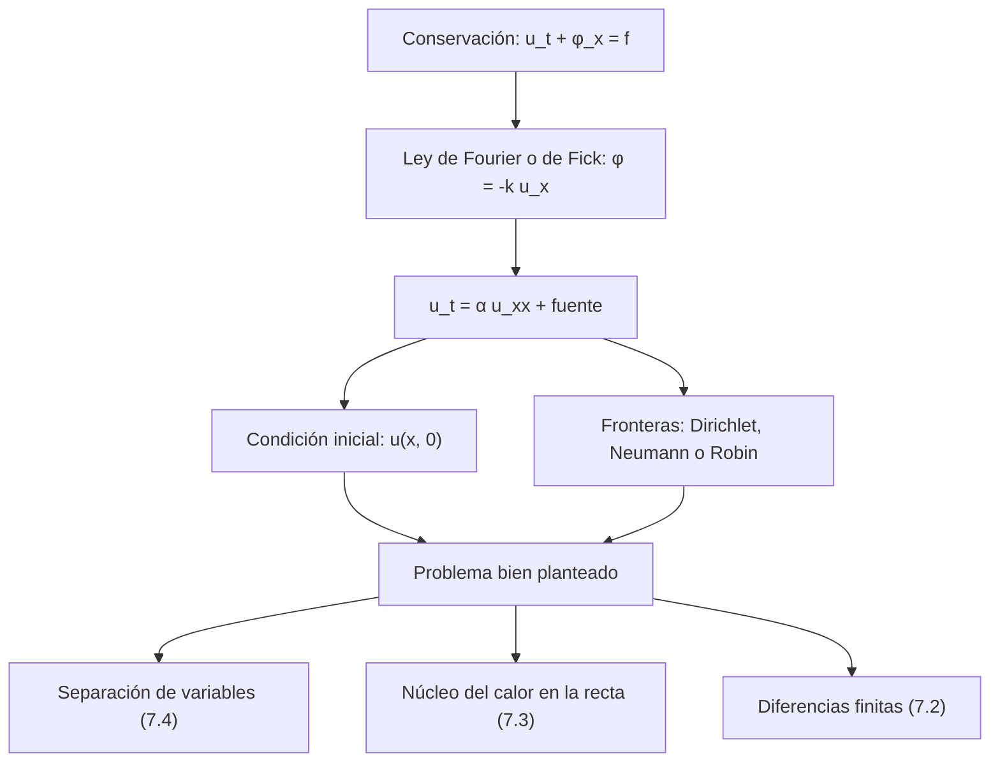

# Matemáticas para Ciencias Aplicadas IV - Ecuaciones de tipo Parabólico

## 7.1 Problemas que conducen a ecuaciones de tipo parabólico.

---

Las ecuaciones **parabólicas** describen procesos de **difusión**: el calor que fluye de lo caliente a lo frío, una sustancia que se dispersa en un líquido, una población que se expande al azar, el precio de una opción financiera. Su modelo es la **ecuación del calor** $u_t = \alpha\, u_{xx},$ que es parabólica porque su parte principal, $\alpha\, u_{xx},$ tiene discriminante $B^2 - 4AC = 0$ (tema 6.1). A diferencia de las ondas, la difusión es **irreversible** y suaviza: borra los detalles de la condición inicial y tiende a un equilibrio. Este tema deduce la ecuación a partir de una ley de conservación, explica las condiciones de frontera y las variantes con fuentes, decaimiento y convección.

### Deducción: conservación más ley constitutiva

Toda ecuación de difusión sale de combinar dos ingredientes.

**1. Ley de conservación.** Sea $u(x, t)$ la densidad de una cantidad (energía térmica, masa de soluto) en una barra delgada de sección $A,$ $\phi(x, t)$ su **flujo** (cantidad que atraviesa la sección $x$ por unidad de área y de tiempo, positivo hacia la derecha) y $f(x, t)$ lo que se crea por unidad de volumen y de tiempo. En el tramo $[a, b],$ la variación de la cantidad es lo que entra menos lo que sale más lo que se crea:

$$ \frac{d}{dt} \int_a^b u\, A\, dx = A\, \phi(a, t) - A\, \phi(b, t) + \int_a^b f\, A\, dx $$

Escribiendo $\phi(a) - \phi(b) = -\int_a^b \phi_x\, dx,$ queda $\int_a^b \left( u_t + \phi_x - f \right) dx = 0$ para **todo** intervalo $[a, b],$ y si el integrando es continuo tiene que ser cero:

$$ u_t + \phi_x = f $$

**2. Ley constitutiva.** El flujo va de donde hay más a donde hay menos, proporcionalmente al gradiente. Para el calor es la **ley de Fourier**, $\phi = -k\, T_x,$ con $k$ la conductividad térmica; para un soluto, la **ley de Fick**, $\phi = -D\, c_x.$

**Ecuación del calor.** La energía térmica por unidad de volumen es $\rho c_p T,$ con $\rho$ la densidad y $c_p$ el calor específico, así que $\rho c_p T_t - (k T_x)_x = f.$ Con coeficientes constantes,

$$ T_t = \alpha\, T_{xx} + \frac{f}{\rho c_p}, \qquad \alpha = \frac{k}{\rho c_p} $$

$\alpha$ es la **difusividad térmica** (m²/s): unos $10^{-4}$ en el cobre, $10^{-5}$ en el acero, $1.4 \times 10^{-7}$ en el agua. La **ecuación de difusión** de Fick es la misma con $D$ en lugar de $\alpha.$

### Condiciones iniciales y de frontera

La ecuación es de primer orden en $t,$ así que basta **una** condición inicial, la distribución $u(x, 0) = f(x).$ En cada extremo se da una condición de frontera:

| Tipo | Condición | Significado físico |
| --- | --- | --- |
| Dirichlet | $u = T_0$ | extremo en contacto con un baño a temperatura fija |
| Neumann | $-k u_x = q$ | flujo de calor impuesto; $u_x = 0$ es un extremo **aislado** |
| Robin | $-k u_x = h (u - T_\infty)$ en el extremo derecho | **convección** hacia un fluido a temperatura $T_\infty,$ con coeficiente $h$ (ley de enfriamiento de Newton) |

En el extremo izquierdo de la condición de Robin el signo cambia: $k u_x = h(u - T_\infty),$ porque el flujo hacia afuera apunta en el sentido negativo.

### Variantes de la ecuación

| Situación | Ecuación |
| --- | --- |
| fuente de calor o de sustancia | $u_t = \alpha u_{xx} + f(x, t)$ |
| decaimiento (radiactivo, reacción de primer orden) | $c_t = D c_{xx} - \lambda c$ |
| pérdida lateral por convección en una aleta | $u_t = \alpha u_{xx} - \beta (u - u_\infty)$ |
| transporte por una corriente de velocidad $v$ | $c_t + v c_x = D c_{xx}$ (advección-difusión) |
| varias dimensiones | $u_t = \alpha \nabla^2 u$ |
| finanzas: ecuación de Black-Scholes | $V_t + \frac{1}{2} \sigma^2 S^2 V_{SS} + r S V_S - r V = 0$ |

**Análisis dimensional.** Con $\tilde{x} = x/L$ y $\tilde{t} = \alpha t / L^2,$ la ecuación $u_t = \alpha u_{xx}$ se convierte en $u_{\tilde{t}} = u_{\tilde{x}\tilde{x}}.$ El tiempo adimensional $\text{Fo} = \alpha t / L^2$ es el **número de Fourier**, y la escala de tiempo de difusión es $L^2/\alpha:$ el tiempo crece con el **cuadrado** de la distancia. Calentar el centro de un pavo del doble de tamaño (lineal) tarda unas cuatro veces más.



### Ejemplos resueltos

**Ejemplo 1: barra con extremos a cero.** Con $u(x, 0) = 100 \sin(\pi x / L)$ y $u(0, t) = u(L, t) = 0,$ se prueba $u = T(t) \sin(\pi x / L):$ sustituyendo, $T' = -\alpha (\pi/L)^2 T,$ y

$$ u(x, t) = 100\, e^{-\alpha (\pi/L)^2 t} \sin \frac{\pi x}{L} $$

El perfil conserva su forma y decae exponencialmente, con tiempo característico $L^2 / (\alpha \pi^2).$

**Ejemplo 2: contaminante con fuente constante.** Un contaminante se produce a ritmo constante $S_0$ en un canal de longitud $L$ cuyos extremos lo eliminan, $c(0, t) = c(L, t) = 0:$ $c_t = D c_{xx} + S_0.$ El **estado estacionario** cumple $D c'' + S_0 = 0$ con $c(0) = c(L) = 0,$ es decir

$$ c_{\text{est}}(x) = \frac{S_0}{2D}\, x (L - x) $$

con máximo $S_0 L^2 / (8D)$ en el centro.

**Atención con las condiciones.** Si los extremos estuvieran **aislados**, $c_x(0, t) = c_x(L, t) = 0,$ no habría estado estacionario: integrando la ecuación en $[0, L],$ la masa total cumple $\frac{d}{dt} \int_0^L c\, dx = D \big[ c_x \big]_0^L + S_0 L = S_0 L,$ y crece sin límite. De hecho $c = S_0 t$ es la solución con $c(x, 0) = 0.$ El perfil $x(L - x)$ no cumple esas condiciones, ya que su derivada en $x = 0$ es $S_0 L / (2D) \neq 0.$

### Implementación en Python

El programa verifica con SymPy las soluciones de los ejemplos y de los ejercicios, y resuelve numéricamente el ejemplo 2 con un método implícito (tema 7.2) para comparar los dos tipos de extremo.

```python
import numpy as np
import sympy as sp

x, t = sp.symbols("x t", real=True)
L, a, D, S0, lam, Q0, k, T0, h, Tinf, c0 = sp.symbols(
    "L alpha D S_0 lambda Q_0 k T_0 h T_inf c_0", positive=True)


def residuo(u, fuente=0, coef=a):
    return sp.simplify(sp.diff(u, t) - coef * sp.diff(u, x, 2) - fuente)


# Ejemplo 1: u(x,0) = 100 sin(πx/L), extremos a 0
u1 = 100 * sp.exp(-a * (sp.pi / L) ** 2 * t) * sp.sin(sp.pi * x / L)
print("ejemplo 1: residuo", residuo(u1), "| extremos", u1.subs(x, 0), sp.simplify(u1.subs(x, L)))

# Ejemplo 2: fuente S0 con extremos a concentración cero: estado estacionario
css = S0 / (2 * D) * x * (L - x)
print("ejemplo 2: D c'' + S0 =", sp.simplify(D * sp.diff(css, x, 2) + S0),
      "| c(0), c(L) =", css.subs(x, 0), sp.simplify(css.subs(x, L)),
      "| c'(0) =", sp.diff(css, x).subs(x, 0))

# Ejercicio 2: decaimiento, c = e^{-λt} K(x, t) con K el núcleo del calor
K = c0 / sp.sqrt(4 * sp.pi * D * t) * sp.exp(-x**2 / (4 * D * t))
c2 = sp.exp(-lam * t) * K
tp = sp.symbols("t", positive=True)
print("ejercicio 2: residuo con -λc:", residuo(c2, -lam * c2, D),
      "| masa:", sp.simplify(sp.integrate(c2.subs(t, tp), (x, -sp.oo, sp.oo))))

# Ejercicio 3: u_t = α u_xx + e^{-t} sin x en [0, π], datos nulos
T = sp.Function("T")
sol = sp.dsolve(T(t).diff(t) + a * T(t) - sp.exp(-t), T(t), ics={T(0): 0}).rhs
u3 = (sp.exp(-t) - sp.exp(-a * t)) / (a - 1) * sp.sin(x)
print("ejercicio 3: u = (e^{-t} - e^{-αt}) sin(x)/(α - 1); diferencia con dsolve:",
      sp.simplify(u3 - sol * sp.sin(x)), "| residuo", residuo(u3, sp.exp(-t) * sp.sin(x)),
      "| u(x, 0) =", u3.subs(t, 0))
print("   con α = 1:", sp.limit(sol, a, 1) * sp.sin(x))

# Ejercicio 5: generación Q0 con extremos a T0: k u'' + Q0 = 0
u5 = T0 + Q0 / (2 * k) * x * (L - x)
print("ejercicio 5: k u'' + Q0 =", sp.simplify(k * sp.diff(u5, x, 2) + Q0),
      "| máximo en x = L/2:", sp.simplify(u5.subs(x, L / 2)))

# Ejercicio 1: estacionario con u(0) = T0 y -k u'(L) = h (u(L) - T_inf)
A, B = sp.symbols("A B")
w = A + B * x
s = sp.solve([w.subs(x, 0) - T0, -k * B - h * (w.subs(x, L) - Tinf)], [A, B])
print("ejercicio 1, estacionario:", sp.simplify(w.subs(s)))

# Fuente constante con extremos aislados: no hay estado estacionario (implícito)
def implicito(neumann, Lx=1.0, Dv=1.0, S=1.0, nx=51, dt=0.01, tf=2.0):
    dx = Lx / (nx - 1)
    r = Dv * dt / dx**2
    M = np.diag((1 + 2 * r) * np.ones(nx)) + np.diag(-r * np.ones(nx - 1), 1) + np.diag(-r * np.ones(nx - 1), -1)
    if neumann:  # nodo fantasma: c_{-1} = c_1
        M[0, 1] = M[-1, -2] = -2 * r
    else:
        M[0, :], M[-1, :] = 0, 0
        M[0, 0] = M[-1, -1] = 1
    c = np.zeros(nx)
    for paso in range(1, int(round(tf / dt)) + 1):
        b = c + dt * S
        if not neumann:
            b[0] = b[-1] = 0
        c = np.linalg.solve(M, b)
        if paso % 50 == 0:
            yield paso * dt, c[nx // 2], np.trapezoid(c, dx=dx)


print("fuente S0 = 1, D = 1, L = 1: (t, c(L/2), masa)")
for nombre, neu in (("extremos a cero  ", False), ("extremos aislados", True)):
    print("  ", nombre, " ".join(f"({tt:.1f}, {cm:.4f}, {m:.4f})" for tt, cm, m in implicito(neu)))
print("   estacionario con extremos a cero: c(L/2) = S0 L²/(8D) =", 1 / 8)
```

Salida:

```text
ejemplo 1: residuo 0 | extremos 0 0
ejemplo 2: D c'' + S0 = 0 | c(0), c(L) = 0 0 | c'(0) = L*S_0/(2*D)
ejercicio 2: residuo con -λc: 0 | masa: c_0*exp(-lambda*t)
ejercicio 3: u = (e^{-t} - e^{-αt}) sin(x)/(α - 1); diferencia con dsolve: 0 | residuo 0 | u(x, 0) = 0
   con α = 1: t*exp(-t)*sin(x)
ejercicio 5: k u'' + Q0 = 0 | máximo en x = L/2: L**2*Q_0/(8*k) + T_0
ejercicio 1, estacionario: (T_0*(L*h + k) - h*x*(T_0 - T_inf))/(L*h + k)
fuente S0 = 1, D = 1, L = 1: (t, c(L/2), masa)
   extremos a cero   (0.5, 0.1238, 0.0826) (1.0, 0.1250, 0.0833) (1.5, 0.1250, 0.0833) (2.0, 0.1250, 0.0833)
   extremos aislados (0.5, 0.5000, 0.5000) (1.0, 1.0000, 1.0000) (1.5, 1.5000, 1.5000) (2.0, 2.0000, 2.0000)
   estacionario con extremos a cero: c(L/2) = S0 L²/(8D) = 0.125
```

Con los extremos a cero, la concentración en el centro se estabiliza en $0.125 = S_0 L^2 / (8D);$ con los extremos aislados crece como $S_0 t,$ igual que la masa total.

### Ejercicios Propuestos

1. **Convección en un extremo.** Una barra de longitud $L$ tiene su extremo izquierdo a temperatura $T_0$ y el derecho en contacto con un fluido a temperatura $T_\infty,$ con coeficiente de transferencia $h.$ Plantea el problema completo y encuentra el estado estacionario.

2. **Difusión con decaimiento.** Una cantidad $c_0$ de un contaminante que decae con tasa $\lambda$ se libera en $x = 0$ de un medio infinito. Plantea la EDP y comprueba que $c = e^{-\lambda t} \frac{c_0}{\sqrt{4\pi D t}} e^{-x^2/(4Dt)}$ es solución. ¿Cuánta masa queda en el instante $t?$

3. **Fuente que se apaga.** Resuelve $u_t = \alpha u_{xx} + e^{-t} \sin x$ en $[0, \pi]$ con $u(0, t) = u(\pi, t) = 0$ y $u(x, 0) = 0.$

4. **Número de Fourier.** Demuestra que $\text{Fo} = \alpha t / L^2$ es adimensional. Si un bloque de acero de 10 cm tarda una hora en calentarse en su interior, ¿cuánto tardaría uno de 20 cm?

5. **Generación de calor.** Un alambre genera calor uniformemente a razón $Q_0$ W/m³ (por efecto Joule) y sus extremos se mantienen a $T_0.$ Encuentra la temperatura en estado estacionario y la temperatura máxima.

### Soluciones

**Ejercicio 1.** $u_t = \alpha u_{xx}$ en $0 \lt x \lt L,$ con $u(0, t) = T_0,$ $-k u_x(L, t) = h \big( u(L, t) - T_\infty \big)$ y $u(x, 0) = f(x).$ El estado estacionario es lineal, $w = T_0 + Bx,$ y la condición de Robin da $-kB = h(T_0 + BL - T_\infty),$ así que

$$ w(x) = T_0 - \frac{h (T_0 - T_\infty)}{k + hL}\, x $$

Si $h \to \infty$ (contacto perfecto) se recupera la recta entre $T_0$ y $T_\infty;$ si $h = 0$ (extremo aislado), la barra entera queda a $T_0.$

**Ejercicio 2.** $c_t = D c_{xx} - \lambda c.$ Si $K$ es el núcleo del calor, que cumple $K_t = D K_{xx},$ entonces $(e^{-\lambda t} K)_t = e^{-\lambda t} (D K_{xx} - \lambda K),$ que es la ecuación. La masa es $\int c\, dx = c_0 e^{-\lambda t}:$ la difusión la reparte sin cambiarla y el decaimiento la reduce exponencialmente.

**Ejercicio 3.** Con $u = T(t) \sin x,$ $T' + \alpha T = e^{-t}$ con $T(0) = 0,$ de donde

$$ u(x, t) = \frac{e^{-t} - e^{-\alpha t}}{\alpha - 1} \sin x \quad (\alpha \neq 1), \qquad u(x, t) = t e^{-t} \sin x \quad (\alpha = 1) $$

**Ejercicio 4.** $\alpha$ tiene unidades m²/s, $t$ segundos y $L^2$ metros cuadrados: el cociente es adimensional. Para el mismo grado de calentamiento hace falta el mismo $\text{Fo},$ así que $t$ es proporcional a $L^2:$ el bloque de 20 cm tarda unas 4 horas.

**Ejercicio 5.** $k u'' + Q_0 = 0$ con $u(0) = u(L) = T_0$ da $u(x) = T_0 + \frac{Q_0}{2k} x (L - x),$ con máximo $T_0 + \frac{Q_0 L^2}{8k}$ en el centro.

### Referencias

1. Haberman, R., _Applied Partial Differential Equations with Fourier Series and Boundary Value Problems_. Pearson, 2013. Capítulo 1.
2. Incropera, F. P., DeWitt, D. P., Bergman, T. L., and Lavine, A. S., _Fundamentos de transferencia de calor_. Pearson, 1999. Capítulos 2 y 5.
3. Crank, J., _The Mathematics of Diffusion_. Oxford University Press, 1975. Capítulos 1 y 2.
4. Boyce, W. E., DiPrima, R. C., and Meade, D. B., _Elementary Differential Equations and Boundary Value Problems_. Wiley, 2017. Secciones 10.5 y 10.6.
