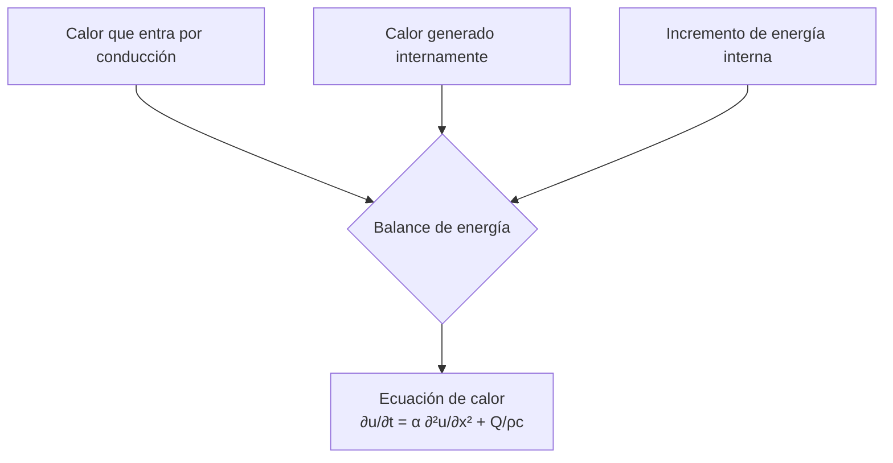
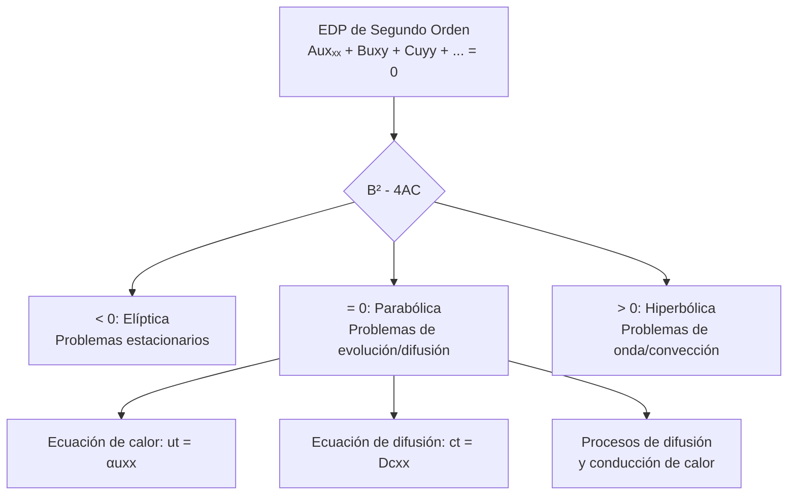

# Matemáticas para Ciencias Aplicadas IV - Ecuaciones de tipo Parabólico

## 7.1 Problemas que conducen a ecuaciones de tipo parabólico.

---

Las ecuaciones diferenciales parciales (EDP) parabólicas son fundamentales en la modelización de fenómenos de difusión y transferencia de calor. Estas ecuaciones describen cómo una cantidad física (como temperatura o concentración) se distribuye espacialmente y evoluciona temporalmente.

### Definición de ecuación parabólica

Una EDP de segundo orden en dos variables:

$$A\frac{\partial^2 u}{\partial x^2} + B\frac{\partial^2 u}{\partial x \partial y} + C\frac{\partial^2 u}{\partial y^2} + D\frac{\partial u}{\partial x} + E\frac{\partial u}{\partial y} + Fu + G = 0$$

Se clasifica como **parabólica** cuando el discriminante es cero:

$$B^2 - 4AC = 0$$

La forma canónica más simple es:

$$\frac{\partial u}{\partial t} = \alpha \frac{\partial^2 u}{\partial x^2}$$

donde $\alpha > 0$ es el coeficiente de difusividad.

### Problema de conducción de calor

#### Ley de Fourier y deducción de la ecuación

La ley de Fourier establece que el flujo de calor $\vec{q}$ es proporcional al gradiente de temperatura:

$$\vec{q} = -k \nabla u$$

donde:

- $k:$ conductividad térmica
- $u(x,t):$ temperatura en posición $x$ y tiempo $t$

**Balance de energía** en un elemento infinitesimal:



Matemáticamente, para una barra unidimensional:

$$\frac{\partial u}{\partial t} = \alpha \frac{\partial^2 u}{\partial x^2} + \frac{Q(x,t)}{\rho c}$$

donde:

- $\alpha = \frac{k}{\rho c}:$ difusividad térmica
- $Q(x,t):$ fuente de calor interna
- $\rho:$ densidad
- $c:$ calor específico

#### Condiciones iniciales y de frontera

**Condición inicial:**

$$u(x,0) = f(x), \quad 0 \leq x \leq L$$

**Condiciones de frontera comunes:**

1. **Dirichlet:** Temperatura especificada

   $$u(0,t) = g(t), \quad u(L,t) = h(t)$$

2. **Neumann:** Flujo de calor especificado

   $$\frac{\partial u}{\partial x}(0,t) = g(t), \quad \frac{\partial u}{\partial x}(L,t) = h(t)$$

3. **Robin:** Condición de convección

   $$-k\frac{\partial u}{\partial x}(0,t) = h[u(0,t) - u_{\infty}]$$

### Problema de difusión de contaminantes

#### Ley de Fick y ecuación de difusión

La primera ley de Fick establece que el flujo de partículas $J$ es proporcional al gradiente de concentración:

$$J = -D \frac{\partial c}{\partial x}$$

donde:

- $D:$ coeficiente de difusión
- $c(x,t):$ concentración

**Ecuación de difusión unidimensional:**

$$\frac{\partial c}{\partial t} = D \frac{\partial^2 c}{\partial x^2} + S(x,t)$$

donde $S(x,t)$ representa fuentes o sumideros de contaminante.

### Formulación matemática general

La ecuación parabólica general tiene la forma:

$$\frac{\partial u}{\partial t} = \nabla \cdot (D \nabla u) + F(u,\nabla u,x,t)$$

Para coeficiente $D$ constante:

$$\frac{\partial u}{\partial t} = D\nabla^2 u + F(u,\nabla u,x,t)$$

### Ejemplos resueltos

#### Ejemplo 1: Barra con extremos a temperatura fija

**Problema:** Barra de longitud $L$ con condiciones:

- $u(x,0) = 100\sin\left(\frac{\pi x}{L}\right)$
- $u(0,t) = 0,$ $u(L,t) = 0$

**Solución:** Aplicando separación de variables, obtenemos:

$$u(x,t) = 100e^{-\alpha\left(\frac{\pi}{L}\right)^2 t}\sin\left(\frac{\pi x}{L}\right)$$

#### Ejemplo 2: Difusión con fuente constante

**Problema:** Contaminante que se difunde con fuente constante $S_0:$

$$\frac{\partial c}{\partial t} = D\frac{\partial^2 c}{\partial x^2} + S_0$$

con $c(x,0) = 0$ y $\frac{\partial c}{\partial x}(0,t) = \frac{\partial c}{\partial x}(L,t) = 0$

**Solución en estado estacionario:**

$$c_{ss}(x) = \frac{S_0}{2D}x(L-x)$$

### Ejercicios propuestos

1. **Problema de calor con convección:**
   Una barra de longitud $L$ tiene su extremo izquierdo a temperatura $T_0$ y el derecho en contacto con un medio a temperatura $T_{\infty}$ con coeficiente de transferencia $h.$ Deduzca las condiciones de frontera y plantee el problema completo.

2. **Difusión con decaimiento:**
   Un contaminante se difunde en un medio donde decae con tasa $\lambda.$ Plantee la EDP:

   $$\frac{\partial c}{\partial t} = D\frac{\partial^2 c}{\partial x^2} - \lambda c$$

   con $c(x,0) = c_0\delta(x)$ (contaminante inicialmente localizado).

3. **Problema no homogéneo:**
   Resuelva la ecuación de calor con fuente:

   $$\frac{\partial u}{\partial t} = \alpha\frac{\partial^2 u}{\partial x^2} + e^{-t}\sin x$$
   
   para $0 < x < \pi,$ $t > 0,$ con condiciones:
   
   $$u(0,t) = u(\pi,t) = 0, \quad u(x,0) = 0$$

4. **Análisis dimensional:**
   Para la ecuación de calor $\frac{\partial u}{\partial t} = \alpha\frac{\partial^2 u}{\partial x^2},$ demuestre que el número de Fourier $Fo = \frac{\alpha t}{L^2}$ es adimensional y discuta su significado físico.

5. **Problema con generación de calor:**
   Una barra genera calor uniformemente a razón $Q_0$ W/m³. Los extremos se mantienen a temperatura $T_0.$ Encuentre la distribución de temperatura en estado estacionario.

### Diagrama: Clasificación de EDPs



### Código de ejemplo (Python)

```python
import numpy as np
import matplotlib.pyplot as plt
from scipy.sparse import diags
from scipy.sparse.linalg import spsolve

# Resolución numérica de la ecuación de calor
def resolver_calor(L, T, alpha, nx, nt, u0, cond_frontera):
    """
    Resuelve la ecuación de calor usando diferencias finitas
    """
    dx = L / (nx - 1)
    dt = T / nt
    r = alpha * dt / dx**2

    # Matriz del sistema
    diagonales = [-r * np.ones(nx-2), (1 + 2*r) * np.ones(nx-2), -r * np.ones(nx-2)]
    A = diags(diagonales, [-1, 0, 1], shape=(nx-2, nx-2)).toarray()

    # Solución
    u = u0.copy()
    soluciones = [u.copy()]

    for _ in range(nt):
        # Aplicar condiciones de frontera
        u[0] = cond_frontera[0](t)
        u[-1] = cond_frontera[1](t)

        # Resolver sistema
        u[1:-1] = spsolve(A, u[1:-1] + r * np.array([u[0]] + [0]*(nx-4) + [u[-1]]))

        soluciones.append(u.copy())

    return np.array(soluciones)

# Ejemplo de uso
L = 1.0          # Longitud de la barra
T = 0.5          # Tiempo total
alpha = 0.01     # Difusividad térmica
nx = 50          # Puntos espaciales
nt = 1000        # Pasos temporales

# Condición inicial
x = np.linspace(0, L, nx)
u0 = np.sin(np.pi * x / L)

# Condiciones de frontera (Dirichlet homogéneas)
def frontera_izq(t): return 0.0
def frontera_der(t): return 0.0

# Resolver
sol = resolver_calor(L, T, alpha, nx, nt, u0, [frontera_izq, frontera_der])
```

### Referencias

**Bibliografía básica:**

1. Boyce, W., DiPrima, R. (2004). _Elementary Differential Equations and Boundary Value Problems_. Wiley, New York. (Capítulo 10)
2. Edwards, C. H., Penney, D. E. (2002). _Ecuaciones diferenciales elementales y problemas con condiciones a la frontera_. Prentice Hall, México. (Capítulo 9)

**Bibliografía complementaria:**

1. Cooper, J. M. (1998). _Introduction to Partial Differential Equations with MatLab_. Birkhäuser, Boston. (Capítulo 4)
2. Hubbard, J. H., West, B. H. (1995). _Differential Equations: A Dynamical Systems Approach_. Springer-Verlag, Berlin. (Sección 6.4)
3. Zill, D. G., Wright, W. S. (1995). _Differential Equations with Computer Lab Experiments_. PWS Publishing Company, Boston. (Capítulo 13)

**Recursos adicionales:**

- Métodos de separación de variables y series de Fourier
- Transformada de Laplace para EDPs parabólicas
- Métodos numéricos: diferencias finitas, elementos finitos
- Aplicaciones en ingeniería: transferencia de calor, difusión de contaminantes, finanzas (modelo de Black-Scholes)
