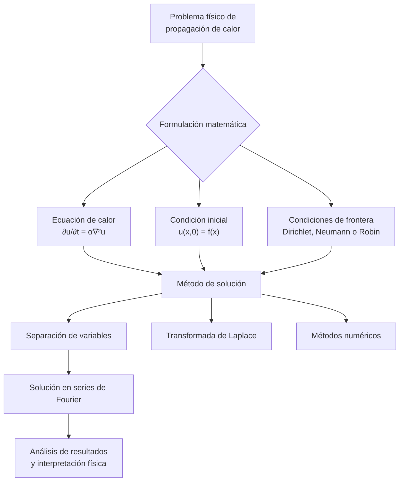

# Matemáticas para Ciencias Aplicadas IV - Ecuaciones de tipo Parabólico

## 7.2 Propagación del calor.

---

La propagación del calor es uno de los fenómenos físicos más importantes modelados por ecuaciones diferenciales parciales parabólicas. Este proceso de transferencia de energía térmica tiene aplicaciones en ingeniería, física, biología y muchas otras disciplinas científicas.

### Ley Fundamental de Conducción de Calor

#### Ley de Fourier

La ley fundamental que gobierna la conducción de calor fue establecida por Joseph Fourier en 1822:

$$\vec{q} = -k \nabla T$$

donde:

- $\vec{q}$: vector de flujo de calor (W/m²)
- $k$: conductividad térmica del material (W/m·K)
- $\nabla T$: gradiente de temperatura (K/m)
- El signo negativo indica que el calor fluye de regiones calientes a frías

#### Ecuación de Calor Unidimensional

Para una barra delgada de longitud $L$, la ecuación de calor es:

$$\frac{\partial u}{\partial t} = \alpha \frac{\partial^2 u}{\partial x^2}$$

donde:

- $u(x,t)$: temperatura en posición $x$ y tiempo $t$
- $\alpha = \frac{k}{\rho c_p}$: difusividad térmica (m²/s)
- $\rho$: densidad del material (kg/m³)
- $c_p$: calor específico a presión constante (J/kg·K)

#### Ecuación de Calor General

En tres dimensiones, con fuente de calor $Q(x,y,z,t)$:

$$\frac{\partial u}{\partial t} = \alpha \nabla^2 u + \frac{Q}{\rho c_p}$$

donde $\nabla^2 = \frac{\partial^2}{\partial x^2} + \frac{\partial^2}{\partial y^2} + \frac{\partial^2}{\partial z^2}$ es el operador Laplaciano.

### Condiciones Iniciales y de Frontera

#### Condición Inicial

$$u(x,0) = f(x), \quad 0 \leq x \leq L$$

#### Condiciones de Frontera Comunes

1. **Dirichlet (Temperatura especificada):**
   $$u(0,t) = g(t), \quad u(L,t) = h(t)$$

2. **Neumann (Flujo de calor especificado):**
   $$\frac{\partial u}{\partial x}(0,t) = g(t), \quad \frac{\partial u}{\partial x}(L,t) = h(t)$$
   Caso especial: Extremo aislado $\frac{\partial u}{\partial x} = 0$

3. **Robin (Convección):**
   $$-k\frac{\partial u}{\partial x} = h[u - u_{\infty}]$$
   donde $h$ es el coeficiente de transferencia de calor y $u_{\infty}$ la temperatura ambiente.

### Solución por Separación de Variables

Para el problema:

$$\frac{\partial u}{\partial t} = \alpha \frac{\partial^2 u}{\partial x^2}, \quad 0 < x < L, \quad t > 0$$

$$u(0,t) = 0, \quad u(L,t) = 0, \quad u(x,0) = f(x)$$

Suponemos una solución de la forma:

$$u(x,t) = X(x)T(t)$$

Sustituyendo en la EDP:

$$\frac{1}{\alpha}\frac{T'}{T} = \frac{X''}{X} = -\lambda$$

Obtenemos dos ecuaciones ordinarias:

$$X'' + \lambda X = 0, \quad T' + \alpha\lambda T = 0$$

Las condiciones de frontera implican:

$$X(0) = 0, \quad X(L) = 0$$

La solución para los autovalores y autofunciones es:

$$\lambda_n = \left(\frac{n\pi}{L}\right)^2, \quad X_n(x) = \sin\left(\frac{n\pi x}{L}\right), \quad n = 1, 2, 3, \ldots$$

La solución completa es:

$$u(x,t) = \sum_{n=1}^{\infty} B_n e^{-\alpha\left(\frac{n\pi}{L}\right)^2 t} \sin\left(\frac{n\pi x}{L}\right)$$

donde:

$$B_n = \frac{2}{L} \int_0^L f(x) \sin\left(\frac{n\pi x}{L}\right) dx$$

### Diagrama del Proceso de Propagación de Calor



### Ejemplo Resuelto: Barra con Extremos a Temperatura Cero

**Problema:** Una barra de longitud $L$ con difusividad térmica $\alpha$ tiene una distribución inicial de temperatura $u(x,0) = 100\sin\left(\frac{\pi x}{L}\right)$ y sus extremos se mantienen a 0°C.

**Solución:** Aplicando separación de variables:

$$u(x,t) = 100e^{-\alpha\left(\frac{\pi}{L}\right)^2 t} \sin\left(\frac{\pi x}{L}\right)$$

**Interpretación:** La temperatura decae exponencialmente en el tiempo mientras mantiene su perfil sinusoidal espacial.

### Ejemplo con Condición de Neumann

**Problema:** Barra de longitud $L$ con extremo izquierdo aislado y extremo derecho a temperatura constante $T_0$:

$$\frac{\partial u}{\partial x}(0,t) = 0, \quad u(L,t) = T_0, \quad u(x,0) = f(x)$$

**Solución:** Usamos autofunciones coseno:

$$u(x,t) = A_0 + \sum_{n=1}^{\infty} A_n e^{-\alpha\left(\frac{n\pi}{L}\right)^2 t} \cos\left(\frac{n\pi x}{L}\right)$$

### Código de Simulación (Python)

```python
import numpy as np
import matplotlib.pyplot as plt
from scipy.sparse import diags
from scipy.sparse.linalg import spsolve

def resolver_ecuacion_calor(L, T, alpha, nx, nt, u0, cond_frontera):
    """
    Resuelve la ecuación de calor unidimensional usando diferencias finitas

    Parámetros:
    L: Longitud de la barra
    T: Tiempo total de simulación
    alpha: Difusividad térmica
    nx: Número de puntos espaciales
    nt: Número de pasos temporales
    u0: Condición inicial (array de tamaño nx)
    cond_frontera: Lista con condiciones de frontera [izquierda, derecha]
    """
    dx = L / (nx - 1)
    dt = T / nt
    r = alpha * dt / dx**2

    # Matriz del sistema (método implícito)
    diagonales = [-r * np.ones(nx-2), (1 + 2*r) * np.ones(nx-2), -r * np.ones(nx-2)]
    A = diags(diagonales, [-1, 0, 1], shape=(nx-2, nx-2)).toarray()

    u = u0.copy()
    soluciones = [u.copy()]

    for i in range(nt):
        t = i * dt

        # Aplicar condiciones de frontera
        u[0] = cond_frontera[0](t) if callable(cond_frontera[0]) else cond_frontera[0]
        u[-1] = cond_frontera[1](t) if callable(cond_frontera[1]) else cond_frontera[1]

        # Resolver sistema
        b = u[1:-1].copy()
        b[0] += r * u[0]
        b[-1] += r * u[-1]

        u[1:-1] = np.linalg.solve(A, b)
        soluciones.append(u.copy())

    return np.array(soluciones)

# Ejemplo de uso
L = 1.0
T = 0.5
alpha = 0.01
nx = 50
nt = 1000

x = np.linspace(0, L, nx)
u0 = np.sin(np.pi * x / L)  # Condición inicial sinusoidal

# Condiciones de frontera (Dirichlet homogéneas)
frontera_izq = 0.0
frontera_der = 0.0

sol = resolver_ecuacion_calor(L, T, alpha, nx, nt, u0, [frontera_izq, frontera_der])

# Visualización
plt.figure(figsize=(10, 6))
for i in range(0, nt, 200):
    plt.plot(x, sol[i], label=f't = {i*dt:.3f}')
plt.xlabel('Posición (m)')
plt.ylabel('Temperatura (°C)')
plt.title('Propagación de calor en una barra')
plt.legend()
plt.grid(True)
plt.show()
```

### Ejercicios Propuestos

1. **Problema de calor con condiciones mixtas:**
   Resuelva la ecuación de calor para una barra de longitud $L$ con:
   - $u(0,t) = 0$ (temperatura fija en extremo izquierdo)
   - $\frac{\partial u}{\partial x}(L,t) = 0$ (extremo derecho aislado)
   - $u(x,0) = T_0(1 - \frac{x}{L})$ (distribución lineal inicial)

2. **Barra con fuente de calor:**
   Resuelva la ecuación de calor con fuente constante:

   $$\frac{\partial u}{\partial t} = \alpha \frac{\partial^2 u}{\partial x^2} + Q$$

   para $0 < x < L$, $t > 0$, con condiciones:

   $$u(0,t) = u(L,t) = 0, \quad u(x,0) = 0$$

3. **Análisis de estado estacionario:**
   Para el problema anterior, encuentre la solución de estado estacionario y discuta su significado físico.

4. **Problema de convección:**
   Una barra pierde calor por convección desde su superficie lateral. La ecuación resultante es:
   
   $$\frac{\partial u}{\partial t} = \alpha \frac{\partial^2 u}{\partial x^2} - \beta(u - u_{\infty})$$
   
   donde $\beta$ es el coeficiente de pérdida de calor. Resuelva este problema con condiciones apropiadas.

5. **Comparación de métodos numéricos:**
   Implemente los métodos de diferencias finitas explícito e implícito para la ecuación de calor y compare su estabilidad y precisión.

### Referencias

**Bibliografía básica:**

1. Boyce, W., DiPrima, R. (2004). _Elementary Differential Equations and Boundary Value Problems_. Wiley, New York. (Capítulo 10: Partial Differential Equations and Fourier Series)
2. Edwards, C. H., Penney, D. E. (2002). _Ecuaciones diferenciales elementales y problemas con condiciones a la frontera_. Prentice Hall, México. (Capítulo 9: Método de Fourier)

**Bibliografía complementaria:**

1. Cooper, J. M. (1998). _Introduction to Partial Differential Equations with MatLab_. Birkhäuser, Boston. (Capítulo 4: Parabolic Equations)
2. Hubbard, J. H., West, B. H. (1995). _Differential Equations: A Dynamical Systems Approach_. Springer-Verlag, Berlin. (Sección 6.4: The Heat Equation)
3. Zill, D. G., Wright, W. S. (1995). _Differential Equations with Computer Lab Experiments_. PWS Publishing Company, Boston. (Capítulo 13: Boundary-Value Problems in Rectangular Coordinates)

**Recursos adicionales:**

- Método de transformada de Laplace para problemas de calor
- Soluciones fundamentales y método de Green
- Aplicaciones en ingeniería: diseño de intercambiadores de calor, análisis térmico de estructuras
- Problemas multidimensionales y métodos de separación de variables en coordenadas cilíndricas y esféricas
