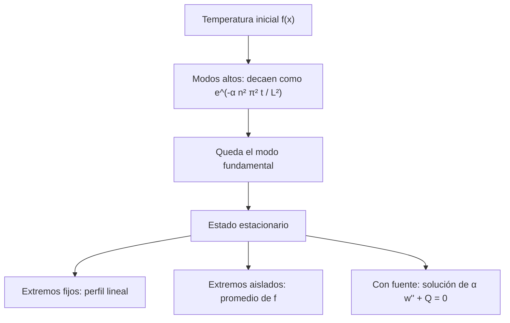

# Matemáticas para Ciencias Aplicadas IV - Ecuaciones de tipo Parabólico

## 7.2 Propagación del calor.

---

Este tema estudia cómo se propaga el calor en una barra: qué forma tienen las soluciones de la ecuación del calor, qué propiedades cualitativas tienen (el **principio del máximo**, la unicidad, el suavizado y la irreversibilidad) y cómo se calculan numéricamente con diferencias finitas, incluida la condición de estabilidad que limita el paso de tiempo del método explícito.

### El problema de la barra

Para una barra de longitud $L$ con difusividad $\alpha,$

$$ u_t = \alpha u_{xx}, \quad 0 \lt x \lt L, \; t > 0, \qquad u(x, 0) = f(x) $$

más una condición en cada extremo. Con los extremos a temperatura cero, la separación de variables (tema 7.4) da

$$ u(x, t) = \sum_{n = 1}^{\infty} b_n\, e^{-\alpha (n\pi/L)^2 t} \sin \frac{n\pi x}{L}, \qquad b_n = \frac{2}{L} \int_0^L f(x) \sin \frac{n\pi x}{L}\, dx $$

Comparada con la cuerda (tema 6.5), cada modo **decae** en lugar de oscilar, y el modo $n$ decae con tasa $\alpha n^2 \pi^2 / L^2,$ proporcional a $n^2:$ los detalles finos (modos altos) desaparecen enseguida y, al cabo de un tiempo del orden de $L^2 / (\alpha \pi^2),$ solo queda el primer modo, que decae a su vez. Si $u(x, 0) = 100 \sin(\pi x / L),$ por ejemplo, la solución es $u = 100\, e^{-\alpha (\pi/L)^2 t} \sin(\pi x / L).$

**Extremos aislados.** Con $u_x(0, t) = u_x(L, t) = 0$ las funciones propias son cosenos, y

$$ u(x, t) = a_0 + \sum_{n = 1}^{\infty} a_n\, e^{-\alpha (n\pi/L)^2 t} \cos \frac{n\pi x}{L}, \qquad a_0 = \frac{1}{L} \int_0^L f\, dx $$

La temperatura tiende al **promedio** inicial: el calor no sale de la barra, solo se redistribuye.

**Extremos a temperaturas distintas.** Si $u(0, t) = T_1$ y $u(L, t) = T_2,$ la solución tiende al perfil lineal $w(x) = T_1 + (T_2 - T_1) x / L,$ y $v = u - w$ resuelve el problema con extremos a cero.



### Propiedades cualitativas

**Principio del máximo.** Si $u_t = \alpha u_{xx}$ en el rectángulo $R = [0, L] \times [0, T],$ el máximo de $u$ en $R$ se alcanza en $t = 0$ o en los extremos $x = 0,$ $x = L.$ Físicamente: sin fuentes, en el interior no puede aparecer un punto más caliente que lo que había al principio o en los bordes.

**Demostración.** Sea $M$ el máximo de $u$ en la parte del borde formada por $t = 0,$ $x = 0$ y $x = L,$ y sea $v = u + \varepsilon x^2$ con $\varepsilon > 0.$ Entonces $v_t - \alpha v_{xx} = -2\alpha\varepsilon \lt 0.$ Si $v$ tuviera su máximo en un punto interior $(x_0, t_0)$ con $0 \lt t_0 \leq T,$ ahí sería $v_{xx} \leq 0$ y $v_t \geq 0,$ porque $v_t = 0$ si $t_0 \lt T$ y $v_t \geq 0$ si $t_0 = T,$ así que $v_t - \alpha v_{xx} \geq 0,$ una contradicción. Por lo tanto, el máximo de $v$ está en esa parte del borde, donde $v \leq M + \varepsilon L^2.$ Así, $u \leq v \leq M + \varepsilon L^2$ para todo $\varepsilon > 0,$ y $u \leq M.$ $\blacksquare$

Aplicado a $-u,$ también el mínimo está en esa parte del borde.

**Unicidad y estabilidad.** Si $u_1$ y $u_2$ resuelven el mismo problema, $w = u_1 - u_2$ tiene datos nulos, y por el principio del máximo aplicado a $w$ y a $-w,$ $w = 0.$ Más aún, si los datos difieren a lo sumo en $\delta,$ las soluciones difieren a lo sumo en $\delta$ para todo $t:$ el problema está bien planteado.

**Suavizado e irreversibilidad.** Para $t > 0,$ los factores $e^{-\alpha n^2 \pi^2 t / L^2}$ hacen que la serie converja muy rápido, y la solución es infinitamente derivable aunque $f$ tenga saltos. El proceso inverso, recuperar la temperatura en el pasado a partir de la actual, es **mal planteado**: habría que multiplicar cada modo por $e^{+\alpha n^2 \pi^2 t / L^2},$ y cualquier error pequeño en los modos altos se amplificaría sin control. La difusión no se puede deshacer.

### Métodos numéricos: diferencias finitas

Con una malla $x_j = j\, \Delta x,$ $t_k = k\, \Delta t$ y $u_j^k \approx u(x_j, t_k),$ se aproxima $u_{xx}$ por $\frac{u_{j + 1} - 2u_j + u_{j - 1}}{\Delta x^2}$ y $u_t$ de varias formas. Sea $r = \alpha\, \Delta t / \Delta x^2.$

| Método | Esquema | Estabilidad | Error |
| --- | --- | --- | --- |
| explícito (FTCS) | $u_j^{k + 1} = u_j^k + r \left( u_{j + 1}^k - 2u_j^k + u_{j - 1}^k \right)$ | solo si $r \leq \tfrac{1}{2}$ | $O(\Delta t + \Delta x^2)$ |
| implícito | $u_j^{k + 1} - r \left( u_{j + 1}^{k + 1} - 2u_j^{k + 1} + u_{j - 1}^{k + 1} \right) = u_j^k$ | siempre | $O(\Delta t + \Delta x^2)$ |
| Crank-Nicolson | promedio de los dos | siempre | $O(\Delta t^2 + \Delta x^2)$ |

**Condición de estabilidad del método explícito.** El modo de la malla $u_j^k = G^k \sin(j \theta)$ es solución del esquema explícito con

$$ G = 1 + r \big( 2\cos\theta - 2 \big) = 1 - 4r \sin^2 \frac{\theta}{2} $$

Para que ningún modo crezca hace falta $|G| \leq 1$ para todo $\theta,$ es decir, $1 - 4r \geq -1,$ que es $r \leq \tfrac{1}{2}.$ Si $r > \tfrac{1}{2},$ el modo más oscilante de la malla, con $\theta$ cerca de $\pi,$ se multiplica en cada paso por un número de valor absoluto mayor que 1 y el error de redondeo crece hasta destruir la solución. En el implícito, el factor es $G = 1 / \left( 1 + 4r \sin^2 \frac{\theta}{2} \right),$ siempre entre 0 y 1. La condición $\Delta t \leq \Delta x^2 / (2\alpha)$ es muy restrictiva: dividir $\Delta x$ entre 10 obliga a dividir $\Delta t$ entre 100. Por eso, en la práctica, se usan métodos implícitos, que exigen resolver un sistema tridiagonal en cada paso, algo muy barato con el algoritmo de Thomas.

### Implementación en Python

El programa calcula los coeficientes de los ejercicios 1 y 2, verifica la sustitución del ejercicio 4 y compara los tres métodos de diferencias finitas en un problema con solución exacta conocida, midiendo el error y el máximo de $|u|$ (que, por el principio del máximo, no debería pasar de 1).

```python
import numpy as np
import sympy as sp

x, t = sp.symbols("x t", real=True)
n = sp.symbols("n", integer=True, positive=True)
L, a, T0, Q = sp.symbols("L alpha T_0 Q", positive=True)

# Ejercicio 1: u(0,t) = 0, u_x(L,t) = 0, u(x,0) = T0 (1 - x/L)
mu = (2 * n - 1) * sp.pi / (2 * L)
Bn = sp.simplify(2 / L * sp.integrate(T0 * (1 - x / L) * sp.sin(mu * x), (x, 0, L)))
print("ejercicio 1: B_n =", Bn)
print("   B_1..B_4 / T0:", [f"{float((Bn / T0).subs(n, k)):.4f}" for k in range(1, 5)])

# Ejercicio 2: u_t = α u_xx + Q, extremos y dato inicial nulos
w = Q * x * (L - x) / (2 * a)
bn = sp.simplify(2 / L * sp.integrate(w * sp.sin(n * sp.pi * x / L), (x, 0, L)))
print("ejercicio 2: estacionario w =", w, "; coeficientes de w:", bn)
print("   el transitorio decae como e^{-α π² t / L²}: tiempo característico L²/(α π²)")

# Ejercicio 4: u_t = α u_xx - β (u - u_inf); v = e^{-βt} w con w_t = α w_xx
beta, uinf = sp.symbols("beta u_inf", positive=True)
W = sp.Function("W")(x, t)
u = uinf + sp.exp(-beta * t) * W
res = sp.diff(u, t) - a * sp.diff(u, x, 2) + beta * (u - uinf)
print("ejercicio 4: residuo =", sp.simplify(res.subs(sp.diff(W, t), a * sp.diff(W, x, 2))))


# Ejercicio 5: explícito, implícito y Crank-Nicolson para u_t = u_xx, u0 = sin(πx), t = 0.1
def resolver(metodo, r, nx=51, tf=0.1):
    dx = 1 / (nx - 1)
    dt = r * dx**2
    pasos = int(round(tf / dt))
    dt = tf / pasos
    r = dt / dx**2
    X = np.linspace(0, 1, nx)
    u = np.sin(np.pi * X)
    m = nx - 2
    Lap = (np.diag(-2 * np.ones(m)) + np.diag(np.ones(m - 1), 1) + np.diag(np.ones(m - 1), -1))
    I = np.eye(m)
    if metodo == "explícito":
        M = I + r * Lap
    elif metodo == "implícito":
        M = np.linalg.inv(I - r * Lap)
    else:
        M = np.linalg.solve(I - r / 2 * Lap, I + r / 2 * Lap)
    v = u[1:-1]
    maximo = v.max()
    for _ in range(pasos):
        v = M @ v
        maximo = max(maximo, np.abs(v).max())
    exacta = np.exp(-np.pi**2 * tf) * np.sin(np.pi * X[1:-1])
    return pasos, np.abs(v - exacta).max(), maximo


print("ejercicio 5: u_t = u_xx, u(x,0) = sin(πx), dx = 0.02, error en t = 0.1")
for metodo, r in [("explícito", 0.4), ("explícito", 0.5), ("explícito", 0.6),
                  ("implícito", 0.5), ("implícito", 5.0), ("Crank-Nicolson", 0.5), ("Crank-Nicolson", 5.0)]:
    pasos, err, mx = resolver(metodo, r)
    print(f"   {metodo:15s} r = {r:3.1f}: {pasos:4d} pasos, error {err:.2e}, máx |u| {mx:.3g}")
```

Salida:

```text
ejercicio 1: B_n = 4*T_0*(2*(-1)**n + 2*pi*n - pi)/(pi**2*(4*n**2 - 4*n + 1))
   B_1..B_4 / T0: ['0.4627', '0.5145', '0.2222', '0.1984']
ejercicio 2: estacionario w = Q*x*(L - x)/(2*alpha) ; coeficientes de w: 2*L**2*Q*(1 - (-1)**n)/(pi**3*alpha*n**3)
   el transitorio decae como e^{-α π² t / L²}: tiempo característico L²/(α π²)
ejercicio 4: residuo = 0
ejercicio 5: u_t = u_xx, u(x,0) = sin(πx), dx = 0.02, error en t = 0.1
   explícito       r = 0.4:  625 pasos, error 1.70e-04, máx |u| 1
   explícito       r = 0.5:  500 pasos, error 2.42e-04, máx |u| 1
   explícito       r = 0.6:  417 pasos, error 6.87e+43, máx |u| 6.87e+43
   implícito       r = 0.5:  500 pasos, error 4.84e-04, máx |u| 1
   implícito       r = 5.0:   50 pasos, error 3.72e-03, máx |u| 1
   Crank-Nicolson  r = 0.5:  500 pasos, error 1.21e-04, máx |u| 1
   Crank-Nicolson  r = 5.0:   50 pasos, error 1.09e-04, máx |u| 1
```

El explícito funciona con $r = 0.4$ y $r = 0.5,$ pero con $r = 0.6$ explota hasta $10^{43}.$ El implícito y Crank-Nicolson son estables con pasos diez veces mayores; con $r = 5,$ Crank-Nicolson mantiene el error de $10^{-4}$ (dominado ya por el error espacial), mientras que el del implícito, de primer orden en el tiempo, es unas 30 veces mayor.

### Ejercicios Propuestos

1. **Condiciones mixtas.** Resuelve $u_t = \alpha u_{xx}$ con $u(0, t) = 0$ (extremo a temperatura fija), $u_x(L, t) = 0$ (extremo aislado) y $u(x, 0) = T_0 (1 - x/L).$

2. **Barra con fuente.** Resuelve $u_t = \alpha u_{xx} + Q,$ con $Q$ constante, $u(0, t) = u(L, t) = 0$ y $u(x, 0) = 0.$

3. **Estado estacionario.** Para el ejercicio 2, describe el estado estacionario y su significado físico. ¿Cuánto calor sale por los extremos?

4. **Pérdida lateral.** Una barra pierde calor por su superficie lateral hacia un ambiente a $u_\infty:$ $u_t = \alpha u_{xx} - \beta (u - u_\infty).$ Con $u(0, t) = u(L, t) = u_\infty,$ muestra que $u = u_\infty + e^{-\beta t} w,$ donde $w$ resuelve la ecuación del calor ordinaria.

5. **Métodos numéricos.** Implementa los métodos explícito e implícito y compara su estabilidad y precisión.

### Soluciones

**Ejercicio 1.** Con $\mu_n = \frac{(2n - 1)\pi}{2L},$ las funciones propias son $\sin \mu_n x$ y

$$ u(x, t) = \sum_{n = 1}^{\infty} B_n\, e^{-\alpha \mu_n^2 t} \sin \mu_n x, \qquad B_n = \frac{4 T_0 \big( (2n - 1)\pi + 2(-1)^n \big)}{(2n - 1)^2 \pi^2} $$

Los primeros son $B_1 \approx 0.4627\, T_0,$ $B_2 \approx 0.5145\, T_0,$ $B_3 \approx 0.2222\, T_0.$ La temperatura tiende a cero: el calor sale por el extremo izquierdo.

**Ejercicio 2.** $u = w + v,$ con $w = \frac{Q}{2\alpha} x (L - x)$ el estado estacionario y $v$ la solución con extremos a cero y dato $-w:$

$$ u(x, t) = \frac{Q}{2\alpha} x (L - x) - \sum_{n \text{ impar}} \frac{4 Q L^2}{\alpha \pi^3 n^3} e^{-\alpha (n\pi/L)^2 t} \sin \frac{n\pi x}{L} $$

**Ejercicio 3.** El estado estacionario es la parábola $w,$ con máximo $Q L^2 / (8\alpha)$ en el centro: el calor generado en el interior fluye hacia los extremos fríos. Por la ley de Fourier, el flujo en cada extremo es proporcional a $|w'| = Q L / (2\alpha),$ y entre los dos sale exactamente lo que se genera en la barra, $Q L$ (en las unidades de la ecuación).

**Ejercicio 4.** Con $u = u_\infty + e^{-\beta t} w,$ $u_t = -\beta e^{-\beta t} w + e^{-\beta t} w_t$ y $\beta (u - u_\infty) = \beta e^{-\beta t} w,$ así que la ecuación queda $e^{-\beta t} (w_t - \alpha w_{xx}) = 0.$ Las condiciones para $w$ son $w(0, t) = w(L, t) = 0$ y $w(x, 0) = f(x) - u_\infty:$ cada modo decae con tasa $\alpha n^2 \pi^2 / L^2 + \beta.$

**Ejercicio 5.** Ver el programa: el explícito es estable solo con $r \leq 1/2;$ el implícito, siempre, pero con error de primer orden en $\Delta t;$ Crank-Nicolson, siempre y con segundo orden.

### Referencias

1. Haberman, R., _Applied Partial Differential Equations with Fourier Series and Boundary Value Problems_. Pearson, 2013. Capítulos 2 y 6.
2. Strauss, W. A., _Partial Differential Equations: An Introduction_. Wiley, 2008. Capítulo 2 y sección 8.2.
3. Burden, R. L., Faires, J. D., and Burden, A. M., _Análisis numérico_. Cengage, 2017. Sección 12.2.
4. Incropera, F. P., DeWitt, D. P., Bergman, T. L., and Lavine, A. S., _Fundamentos de transferencia de calor_. Pearson, 1999. Capítulo 5.
