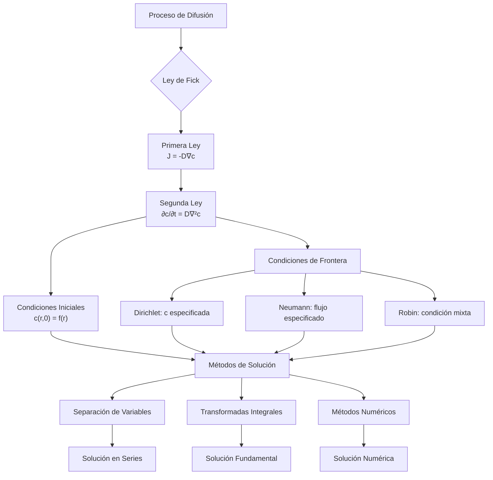

# Matemáticas para Ciencias Aplicadas IV - Ecuaciones de tipo Parabólico

## 7.3 Ecuación de difusión.

---

La ecuación de difusión es una ecuación diferencial parcial parabólica fundamental que describe cómo se dispersan las partículas o sustancias en un medio a lo largo del tiempo. Es matemáticamente idéntica a la ecuación de calor pero con interpretación física diferente.

### Definición y Formulación Matemática

#### Ley de Fick de la Difusión

**Primera Ley de Fick:** Establece que el flujo de partículas $J$ es proporcional al gradiente de concentración:

$$\vec{J} = -D \nabla c$$

donde:

- $\vec{J}:$ vector de flujo de partículas (partículas/m²·s)
- $D:$ coeficiente de difusión (m²/s)
- $c:$ concentración (partículas/m³)
- $\nabla c:$ gradiente de concentración

**Segunda Ley de Fick (Ecuación de Difusión):**

$$\frac{\partial c}{\partial t} = D \nabla^2 c$$

Para difusión unidimensional:

$$\frac{\partial c}{\partial t} = D \frac{\partial^2 c}{\partial x^2}$$

#### Forma General con Fuentes/Sumideros

$$\frac{\partial c}{\partial t} = D \nabla^2 c + S(\vec{r}, t)$$

donde $S(\vec{r}, t)$ representa fuentes o sumideros de partículas.

### Interpretación Física y Parámetros Clave

#### Coeficiente de Difusión $D$

El coeficiente de difusión depende de:

- Temperatura ( a mayor temperatura, mayor $D$ )
- Tamaño de partícula ( a menor tamaño, mayor $D$ )
- Viscosidad del medio ( a menor viscosidad, mayor $D$ )

**Ecuación de Einstein-Stokes** para partículas esféricas:

$$D = \frac{k_B T}{6\pi\eta r}$$

donde:

- $k_B:$ constante de Boltzmann
- $T:$ temperatura absoluta
- $\eta:$ viscosidad del fluido
- $r:$ radio de la partícula

#### Tiempo Característico de Difusión

El tiempo típico para que una partícula se difunda una distancia $L:$

$$\tau \sim \frac{L^2}{D}$$

### Solución Fundamental de la Ecuación de Difusión

Para una condición inicial de tipo delta de Dirac:

$$c(x,0) = M\delta(x)$$

La solución es una distribución Gaussiana:

$$c(x,t) = \frac{M}{\sqrt{4\pi D t}} e^{-\frac{x^2}{4Dt}}$$

Para dimensión $n:$

$$c(\vec{r},t) = \frac{M}{(4\pi D t)^{n/2}} e^{-\frac{|\vec{r}|^2}{4Dt}}$$

### Condiciones de Frontera para Problemas de Difusión

#### Tipos de Condiciones de Frontera

1. **Dirichlet:** Concentración especificada

   $$c(0,t) = c_0$$

2. **Neumann:** Flujo especificado

   $$-D\frac{\partial c}{\partial x}(0,t) = J_0$$

3. **Robin:** Condición de mixeda/absorción

   $$-D\frac{\partial c}{\partial x}(0,t) = h[c(0,t) - c_{\infty}]$$

### Diagrama del Proceso de Difusión



### Método de Separación de Variables

Para el problema en una dimensión:

$$\frac{\partial c}{\partial t} = D\frac{\partial^2 c}{\partial x^2}, \quad 0 < x < L, \quad t > 0$$

$$c(0,t) = 0, \quad c(L,t) = 0, \quad c(x,0) = f(x)$$

Suponemos $c(x,t) = X(x)T(t)$ y obtenemos:

$$X'' + \lambda X = 0, \quad T' + D\lambda T = 0$$

Autovalores y autofunciones:

$$\lambda_n = \left(\frac{n\pi}{L}\right)^2, \quad X_n(x) = \sin\left(\frac{n\pi x}{L}\right)$$

Solución completa:

$$c(x,t) = \sum_{n=1}^{\infty} B_n e^{-D\left(\frac{n\pi}{L}\right)^2 t} \sin\left(\frac{n\pi x}{L}\right)$$

donde:

$$B_n = \frac{2}{L} \int_0^L f(x) \sin\left(\frac{n\pi x}{L}\right) dx$$

### Ejemplos Resueltos

#### Ejemplo 1: Difusión desde una Fuente Puntual

**Problema:** Una cantidad $M$ de contaminante se libera instantáneamente en el origen en $t=0.$ Encuentre la concentración para $t>0.$

**Solución:**

$$c(x,t) = \frac{M}{\sqrt{4\pi D t}} e^{-\frac{x^2}{4Dt}}$$

**Interpretación:** La concentración sigue una distribución Gaussiana que se ensancha con el tiempo.

#### Ejemplo 2: Difusión en un Dominio Finito

**Problema:** Una barra de longitud $L$ tiene concentración inicial $c(x,0) = c_0\sin(\pi x/L)$ y los extremos se mantienen a concentración cero.

**Solución:**

$$c(x,t) = c_0 e^{-D(\pi/L)^2 t} \sin\left(\frac{\pi x}{L}\right)$$

### Código de Simulación (Python)

```python
import numpy as np
import matplotlib.pyplot as plt
from scipy.sparse import diags
from scipy.sparse.linalg import spsolve

def simular_difusion(L, T, D, nx, nt, c0, cond_frontera, fuente=None):
    """
    Simula el proceso de difusión en 1D usando diferencias finitas implícitas

    Parámetros:
    L: Longitud del dominio
    T: Tiempo total de simulación
    D: Coeficiente de difusión
    nx: Número de puntos espaciales
    nt: Número de pasos temporales
    c0: Condición inicial (función o array)
    cond_frontera: Lista con condiciones de frontera [izquierda, derecha]
    fuente: Función de fuente opcional S(x,t)
    """
    dx = L / (nx - 1)
    dt = T / nt
    r = D * dt / dx**2

    # Matriz del sistema (esquema implícito)
    diagonales = [-r * np.ones(nx-2), (1 + 2*r) * np.ones(nx-2), -r * np.ones(nx-2)]
    A = diags(diagonales, [-1, 0, 1], shape=(nx-2, nx-2)).toarray()

    # Inicialización
    x = np.linspace(0, L, nx)
    if callable(c0):
        c = c0(x)
    else:
        c = c0.copy()

    soluciones = [c.copy()]

    for i in range(nt):
        t = i * dt

        # Aplicar condiciones de frontera
        if callable(cond_frontera[0]):
            c[0] = cond_frontera[0](t)
        else:
            c[0] = cond_frontera[0]

        if callable(cond_frontera[1]):
            c[-1] = cond_frontera[1](t)
        else:
            c[-1] = cond_frontera[1]

        # Término de fuente
        S = np.zeros(nx-2)
        if fuente is not None:
            for j in range(1, nx-1):
                S[j-1] = fuente(x[j], t) * dt

        # Resolver sistema
        b = c[1:-1] + S
        b[0] += r * c[0]
        b[-1] += r * c[-1]

        c[1:-1] = np.linalg.solve(A, b)
        soluciones.append(c.copy())

    return np.array(soluciones), x

# Ejemplo: Difusión desde una concentración inicial gaussiana
L = 10.0
T = 5.0
D = 0.1
nx = 100
nt = 500

# Condición inicial gaussiana
def concentracion_inicial(x):
    return np.exp(-(x - L/2)**2 / 0.5)

# Condiciones de frontera de Dirichlet homogéneas
frontera_izq = 0.0
frontera_der = 0.0

sol, x = simular_difusion(L, T, D, nx, nt, concentracion_inicial,
                         [frontera_izq, frontera_der])

# Visualización
plt.figure(figsize=(12, 8))
for i in range(0, nt, 100):
    plt.plot(x, sol[i], label=f't = {i*T/nt:.2f}')
plt.xlabel('Posición (m)')
plt.ylabel('Concentración')
plt.title('Evolución temporal de la difusión')
plt.legend()
plt.grid(True)
plt.show()
```

### Ejercicios Propuestos

1. **Difusión con decaimiento radioactivo:**
   Resuelva la ecuación de difusión con decaimiento:

   $$\frac{\partial c}{\partial t} = D\frac{\partial^2 c}{\partial x^2} - \lambda c$$

   para $0 < x < L,$ $t > 0,$ con condiciones:

   $$c(0,t) = c(L,t) = 0, \quad c(x,0) = f(x)$$

2. **Problema de contaminación en río:**
   Un contaminante se vierte constantemente en un río en $x=0.$ Modele este problema con la condición de frontera:

   $$-D\frac{\partial c}{\partial x}(0,t) = J_0$$

   y encuentre el perfil de concentración en estado estacionario.

3. **Difusión en medio semi-infinito:**
   Resuelva el problema de difusión en $x > 0$ con condición inicial $c(x,0) = 0$ y condición de frontera:

   $$c(0,t) = c_0$$

   usando el método de la transformada de Laplace.

4. **Coeficiente de difusión variable:**
   Formule y resuelva numéricamente la ecuación de difusión cuando $D$ depende de la posición:

   $$\frac{\partial c}{\partial t} = \frac{\partial}{\partial x}\left(D(x)\frac{\partial c}{\partial x}\right)$$

5. **Difusión en 2D:**
   Extienda el método numérico para resolver la ecuación de difusión en 2D:

   $$\frac{\partial c}{\partial t} = D\left(\frac{\partial^2 c}{\partial x^2} + \frac{\partial^2 c}{\partial y^2}\right)$$
   
   en un dominio rectangular.

### Aplicaciones de la Ecuación de Difusión

1. **Contaminación ambiental:** Dispersión de contaminantes en aire y agua
2. **Neurociencia:** Difusión de neurotransmisores en sinapsis
3. **Ciencia de materiales:** Difusión de impurezas en semiconductores
4. **Biología:** Difusión de nutrientes en células y tejidos
5. **Finanzas:** Modelos de difusión para precios de activos

### Referencias

**Bibliografía básica:**

1. Boyce, W., DiPrima, R. (2004). _Elementary Differential Equations and Boundary Value Problems_. Wiley, New York. (Capítulo 10.5: Separation of Variables; Heat Conduction in a Rod)
2. Edwards, C. H., Penney, D. E. (2002). _Ecuaciones diferenciales elementales y problemas con condiciones a la frontera_. Prentice Hall, México. (Capítulo 9.5: La ecuación de calor)

**Bibliografía complementaria:**

1. Cooper, J. M. (1998). _Introduction to Partial Differential Equations with MatLab_. Birkhäuser, Boston. (Capítulo 4: Parabolic Equations)
2. Hubbard, J. H., West, B. H. (1995). _Differential Equations: A Dynamical Systems Approach_. Springer-Verlag, Berlin. (Sección 6.4: The Heat Equation)
3. Zill, D. G., Wright, W. S. (1995). _Differential Equations with Computer Lab Experiments_. PWS Publishing Company, Boston. (Capítulo 13: Boundary-Value Problems in Rectangular Coordinates)

**Referencias especializadas:**

- Crank, J. (1975). _The Mathematics of Diffusion_. Oxford University Press.
- Carslaw, H. S., Jaeger, J. C. (1959). _Conduction of Heat in Solids_. Oxford University Press.
