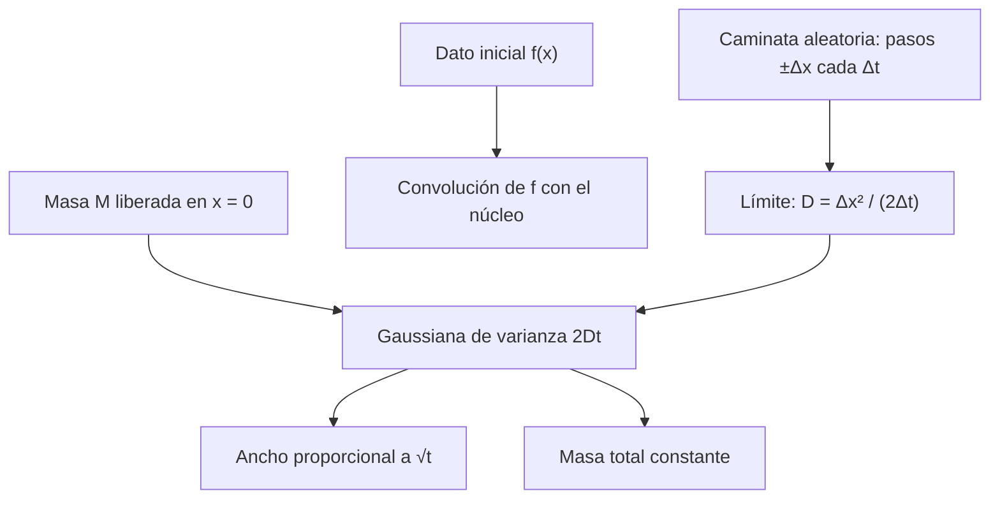

# Matemáticas para Ciencias Aplicadas IV - Ecuaciones de tipo Parabólico

## 7.3 Ecuación de difusión.

---

La **ecuación de difusión** $c_t = D c_{xx}$ describe cómo se dispersa una sustancia (un colorante en agua, un contaminante en el aire, un dopante en un semiconductor) por el movimiento aleatorio de sus partículas. Matemáticamente es la ecuación del calor, pero el punto de vista es otro: interesa la **solución fundamental**, que describe una cantidad liberada en un punto, y su relación con las **caminatas aleatorias**. Este tema deduce esa solución, estudia sus propiedades, resuelve el problema de un medio semi-infinito con la transformada de Laplace y comprueba numéricamente la conexión con el azar.

### La ley de Fick

El flujo de soluto es proporcional al gradiente de concentración y va de mayor a menor concentración (Fick, 1855):

$$ J = -D\, c_x $$

Combinada con la conservación de la masa, $c_t + J_x = 0,$ da $c_t = (D c_x)_x,$ que con $D$ constante es $c_t = D c_{xx}.$ El **coeficiente de difusión** $D$ (m²/s) vale unos $10^{-5}$ para gases en aire, $10^{-9}$ para moléculas pequeñas en agua y $10^{-20}$ o menos para átomos en sólidos a temperatura ambiente.

### La solución fundamental

Se busca la concentración producida por una masa $M$ liberada en $x = 0$ en el instante $t = 0,$ en un medio infinito.

**Deducción por semejanza.** Si $c(x, t)$ es solución, también lo es $c(\lambda x, \lambda^2 t):$ la ecuación no cambia si las distancias se multiplican por $\lambda$ y los tiempos por $\lambda^2.$ Además la masa $\int c\, dx$ debe ser constante. Eso sugiere probar

$$ c(x, t) = \frac{1}{\sqrt{Dt}}\, \varphi(\eta), \qquad \eta = \frac{x}{\sqrt{Dt}} $$

donde el factor $1/\sqrt{Dt}$ mantiene la masa constante. Sustituyendo, la ecuación se convierte en la EDO $\varphi'' + \frac{\eta}{2} \varphi' + \frac{1}{2} \varphi = 0,$ que se puede escribir $\left( \varphi' + \frac{\eta}{2} \varphi \right)' = 0.$ Con $\varphi \to 0$ en el infinito, $\varphi' + \frac{\eta}{2} \varphi = 0$ y $\varphi = A e^{-\eta^2/4}.$ Ajustando $A$ para que la masa sea $M:$

$$ K(x, t) = \frac{M}{\sqrt{4\pi D t}}\, e^{-x^2 / (4Dt)} $$

**Propiedades.**

- Es una **gaussiana** con media 0 y varianza $\sigma^2 = 2Dt:$ el ancho crece como $\sqrt{t}.$ Para que la mancha se ensanche el doble hay que esperar cuatro veces más.
- La masa se conserva: $\int K\, dx = M$ para todo $t.$
- Cuando $t \to 0^+$ se concentra en el origen: tiende a la delta de Dirac $M \delta(x).$
- Para cualquier $t > 0,$ es positiva en **todo** $x:$ la difusión propaga la información con velocidad infinita, aunque con amplitud despreciable lejos.

**Dato inicial general.** Por linealidad, una concentración inicial $c(x, 0) = f(x)$ es una suma de masas $f(y)\, dy$ en cada punto $y,$ y

$$ c(x, t) = \int_{-\infty}^{\infty} \frac{f(y)}{\sqrt{4\pi D t}}\, e^{-(x - y)^2 / (4Dt)}\, dy $$

la **convolución** del dato con el núcleo del calor.



### Difusión y caminatas aleatorias

Si cada partícula da un paso $\pm \Delta x$ al azar cada $\Delta t,$ la probabilidad $p(x, t)$ de estar en $x$ cumple

$$ p(x, t + \Delta t) = \tfrac{1}{2} p(x - \Delta x, t) + \tfrac{1}{2} p(x + \Delta x, t) $$

Restando $p(x, t)$ y dividiendo entre $\Delta t,$

$$ \frac{p(x, t + \Delta t) - p(x, t)}{\Delta t} = \frac{\Delta x^2}{2\Delta t} \cdot \frac{p(x + \Delta x, t) - 2p(x, t) + p(x - \Delta x, t)}{\Delta x^2} $$

y en el límite, con $D = \Delta x^2 / (2\Delta t)$ fijo, $p_t = D p_{xx}.$ Es la explicación de Einstein (1905) del movimiento browniano: la difusión macroscópica es el promedio de muchos movimientos microscópicos al azar. Por el teorema central del límite, la posición después de $n$ pasos es aproximadamente normal con varianza $n\, \Delta x^2 = 2Dt,$ justo la gaussiana anterior.

### Medio semi-infinito: la función error

Un sólido que ocupa $x > 0,$ sin soluto al principio, se pone en contacto en $t = 0$ con una fuente a concentración $c_0:$

$$ c_t = D c_{xx}, \quad x > 0, \qquad c(0, t) = c_0, \qquad c(x, 0) = 0 $$

Con la transformada de Laplace en $t,$ $C(x, s) = \mathcal{L}\{c\},$ la ecuación se vuelve la EDO $s C = D C''$ con $C(0, s) = c_0 / s$ y $C$ acotada, cuya solución es

$$ C(x, s) = \frac{c_0}{s}\, e^{-x\sqrt{s/D}} \quad \Rightarrow \quad c(x, t) = c_0\, \operatorname{erfc} \left( \frac{x}{2\sqrt{Dt}} \right) $$

donde $\operatorname{erfc}(z) = 1 - \frac{2}{\sqrt{\pi}} \int_0^z e^{-s^2}\, ds$ es la **función error complementaria**. La concentración vale $c_0/2$ en $x = 2(0.4769) \sqrt{Dt}:$ el frente avanza como $\sqrt{t}.$ Es el modelo de la carburación del acero, del dopado de silicio y de la penetración de cloruros en el concreto.

### Ejemplos resueltos

**Ejemplo 1: liberación instantánea.** Una masa $M$ de contaminante se libera en el origen. Su concentración es $K(x, t),$ y la fracción de la masa que está a más de una distancia $d$ es $\operatorname{erfc}\left( d / (2\sqrt{Dt}) \right).$

**Ejemplo 2: canal con extremos limpios.** En $[0, L]$ con $c(0, t) = c(L, t) = 0$ y $c(x, 0) = c_0 \sin(\pi x / L),$ la solución es $c = c_0\, e^{-D (\pi/L)^2 t} \sin(\pi x / L):$ la sustancia sale por los extremos.

### Implementación en Python

El programa verifica la solución fundamental y sus momentos, resuelve el ejercicio 3 con la transformada inversa de Laplace de SymPy, simula 20 000 caminatas aleatorias y compara su histograma con la gaussiana, resuelve el ejercicio 4 (coeficiente variable) con un esquema implícito conservativo hasta el estado estacionario, y obtiene el perfil del ejercicio 2.

```python
import numpy as np
import sympy as sp

x = sp.symbols("x", real=True)
t, D, M, c0, s = sp.symbols("t D M c_0 s", positive=True)

# Solución fundamental
K = M / sp.sqrt(4 * sp.pi * D * t) * sp.exp(-x**2 / (4 * D * t))
print("núcleo: K_t - D K_xx =", sp.simplify(sp.diff(K, t) - D * sp.diff(K, x, 2)))
print("   masa =", sp.simplify(sp.integrate(K, (x, -sp.oo, sp.oo))),
      "| ∫ x² K dx / M =", sp.simplify(sp.integrate(x**2 * K, (x, -sp.oo, sp.oo)) / M))

# Ejercicio 3: medio semi-infinito con c(0,t) = c0, c(x,0) = 0, por Laplace
xp = sp.symbols("x", positive=True)
C = c0 / s * sp.exp(-xp * sp.sqrt(s / D))
print("   C(x, s) =", C, "cumple s C - D C'' =", sp.simplify(s * C - D * sp.diff(C, xp, 2)))
c = sp.simplify(sp.inverse_laplace_transform(C, s, t))
ce = c0 * sp.erfc(xp / (2 * sp.sqrt(D * t)))
dif = [abs(float((c - ce).subs({xp: X0, t: T0, D: D0, c0: 1}))) for X0, T0, D0 in ((1, 2, 0.5), (0.3, 1, 2), (2, 5, 1))]
print("ejercicio 3: |transformada inversa - c0 erfc(x/(2 sqrt(Dt)))| máxima en tres puntos:", f"{max(dif):.0e}")
print("   residuo:", sp.simplify(sp.diff(ce, t) - D * sp.diff(ce, xp, 2)),
      "| c(0, t) =", ce.subs(xp, 0), "| límite t -> 0+:", sp.limit(ce, t, 0, "+"))
print("   profundidad donde c = c0/2 con D = 1e-9 m²/s:",
      ", ".join(f"t = {T} s: {2 * 0.4769362762 * np.sqrt(1e-9 * T) * 1000:.2f} mm" for T in (60, 3600, 86400)))

# Caminata aleatoria: pasos ±dx cada dt equivalen a D = dx²/(2 dt)
rng = np.random.default_rng(1)
dx, dt, pasos, N = 0.1, 0.005, 400, 20000
Dc = dx**2 / (2 * dt)
pos = dx * rng.choice([-1, 1], size=(N, pasos)).sum(axis=1)
T = pasos * dt
print(f"caminata: D = dx²/(2dt) = {Dc:.1f}, t = {T}: varianza {pos.var():.3f} frente a 2Dt = {2 * Dc * T:.3f}")
hist, bordes = np.histogram(pos, bins=np.arange(-6.1, 6.2, 1.0), density=True)
centros = (bordes[:-1] + bordes[1:]) / 2
gauss = np.exp(-centros**2 / (4 * Dc * T)) / np.sqrt(4 * np.pi * Dc * T)
for cx, hh, g in zip(centros, hist, gauss):
    if cx >= 0:
        print(f"   x ≈ {cx:4.1f}: densidad simulada {hh:.4f}, gaussiana {g:.4f}")

# Ejercicio 4: D(x) = 1 + x en [0, 1], c(0) = 1, c(1) = 0, hasta el estado estacionario
nx = 101
X = np.linspace(0, 1, nx)
h = X[1] - X[0]
Dm = 1 + (X[:-1] + X[1:]) / 2          # D en los puntos medios
dtn = 0.002
A = np.zeros((nx, nx))
for j in range(1, nx - 1):
    A[j, j - 1] = -dtn * Dm[j - 1] / h**2
    A[j, j + 1] = -dtn * Dm[j] / h**2
    A[j, j] = 1 + dtn * (Dm[j - 1] + Dm[j]) / h**2
A[0, 0] = A[-1, -1] = 1
cn = np.zeros(nx)
for k in range(2000):
    b = cn.copy()
    b[0], b[-1] = 1.0, 0.0
    cn = np.linalg.solve(A, b)
exacta = 1 - np.log(1 + X) / np.log(2)
print(f"ejercicio 4: t = {2000 * dtn:.0f}, máx |numérica - (1 - ln(1+x)/ln 2)| = {np.abs(cn - exacta).max():.1e}")
print(f"   flujo J = D c' constante: numérico en x = 0.25, 0.75: "
      f"{-(Dm[25] * (cn[26] - cn[25]) / h):.4f}, {-(Dm[75] * (cn[76] - cn[75]) / h):.4f};"
      f" exacto 1/ln 2 = {1 / np.log(2):.4f}")

# Ejercicio 2: estacionario con -D c'(0) = J0 y c(L) = 0
J0, L = sp.symbols("J_0 L", positive=True)
A1, B1 = sp.symbols("A B")
w = A1 + B1 * xp
sol = sp.solve([-D * B1 - J0, w.subs(xp, L)], [A1, B1])
print("ejercicio 2: c_est - J0 (L - x)/D =", sp.simplify(w.subs(sol) - J0 * (L - xp) / D))
```

Salida:

```text
núcleo: K_t - D K_xx = 0
   masa = M | ∫ x² K dx / M = 2*D*t
   C(x, s) = c_0*exp(-sqrt(s)*x/sqrt(D))/s cumple s C - D C'' = 0
ejercicio 3: |transformada inversa - c0 erfc(x/(2 sqrt(Dt)))| máxima en tres puntos: 8e-17
   residuo: 0 | c(0, t) = c_0 | límite t -> 0+: 0
   profundidad donde c = c0/2 con D = 1e-9 m²/s: t = 60 s: 0.23 mm, t = 3600 s: 1.81 mm, t = 86400 s: 8.87 mm
caminata: D = dx²/(2dt) = 1.0, t = 2.0: varianza 4.021 frente a 2Dt = 4.000
   x ≈  0.4: densidad simulada 0.1955, gaussiana 0.1955
   x ≈  1.4: densidad simulada 0.1576, gaussiana 0.1561
   x ≈  2.4: densidad simulada 0.0969, gaussiana 0.0971
   x ≈  3.4: densidad simulada 0.0482, gaussiana 0.0470
   x ≈  4.4: densidad simulada 0.0181, gaussiana 0.0177
   x ≈  5.4: densidad simulada 0.0056, gaussiana 0.0052
ejercicio 4: t = 4, máx |numérica - (1 - ln(1+x)/ln 2)| = 7.6e-07
   flujo J = D c' constante: numérico en x = 0.25, 0.75: 1.4427, 1.4427; exacto 1/ln 2 = 1.4427
ejercicio 2: c_est - J0 (L - x)/D = 0
```

La varianza de las caminatas, $4.02,$ coincide con $2Dt = 4$ dentro del error estadístico, y el histograma sigue a la gaussiana. Con $D = 10^{-9}$ m²/s, un valor típico en agua, el frente avanza apenas 9 mm en un día: la difusión es muy lenta a escalas humanas, y por eso hay que remover el café.

### Ejercicios Propuestos

1. **Decaimiento radiactivo.** Resuelve $c_t = D c_{xx} - \lambda c$ en $[0, L]$ con $c(0, t) = c(L, t) = 0$ y $c(x, 0) = f(x).$

2. **Vertido continuo.** Un contaminante se vierte de forma continua en $x = 0$ de un canal de longitud $L,$ con flujo $-D c_x(0, t) = J_0,$ y en $x = L$ se elimina, $c(L, t) = 0.$ Encuentra el perfil de concentración en estado estacionario.

3. **Medio semi-infinito.** Resuelve con la transformada de Laplace $c_t = D c_{xx}$ en $x > 0$ con $c(x, 0) = 0$ y $c(0, t) = c_0.$

4. **Coeficiente variable.** Para $c_t = \big( D(x)\, c_x \big)_x$ con $D(x) = 1 + x$ en $[0, 1],$ $c(0, t) = 1$ y $c(1, t) = 0,$ encuentra el estado estacionario exacto y compáralo con una solución numérica.

5. **Difusión en el plano.** Comprueba que $K_2 = \frac{M}{4\pi D t} e^{-(x^2 + y^2)/(4Dt)}$ resuelve $c_t = D (c_{xx} + c_{yy})$ y calcula la distancia cuadrática media al origen.

### Soluciones

**Ejercicio 1.** Con $c = e^{-\lambda t} w,$ $w$ resuelve la ecuación sin decaimiento (como en el ejercicio 4 del tema 7.2), así que

$$ c(x, t) = \sum_{n = 1}^{\infty} b_n\, e^{-\left( D n^2 \pi^2 / L^2 + \lambda \right) t} \sin \frac{n\pi x}{L}, \qquad b_n = \frac{2}{L} \int_0^L f(x) \sin \frac{n\pi x}{L}\, dx $$

**Ejercicio 2.** En el estado estacionario $D c'' = 0,$ así que $c = A + Bx;$ el flujo da $B = -J_0 / D$ y $c(L) = 0$ da $c(x) = \frac{J_0}{D} (L - x).$ El flujo es el mismo en todo el canal: lo que entra por $x = 0$ sale por $x = L.$

**Ejercicio 3.** $c(x, t) = c_0 \operatorname{erfc} \left( \frac{x}{2\sqrt{Dt}} \right),$ deducida arriba y confirmada por el programa.

**Ejercicio 4.** En el estado estacionario el flujo $J = -D(x)\, c'$ es constante, así que $c' = -J / (1 + x)$ y $c = 1 - J \ln(1 + x).$ Con $c(1) = 0,$ $J = 1/\ln 2,$ y

$$ c(x) = 1 - \frac{\ln(1 + x)}{\ln 2} $$

El perfil no es lineal: la concentración cae más rápido donde $D$ es pequeño. El esquema numérico, que evalúa $D$ en los puntos medios para conservar la masa exactamente, lo reproduce con error $10^{-6}$ y da el flujo constante $1.4427.$

**Ejercicio 5.** $K_2$ es el producto de dos núcleos unidimensionales en $x$ y en $y,$ cada uno solución de su ecuación, y $(K_x K_y)_t = D (K_x)_{xx} K_y + D K_x (K_y)_{yy}.$ La distancia cuadrática media es $\langle x^2 + y^2 \rangle = 2Dt + 2Dt = 4Dt;$ en $n$ dimensiones, $2nDt.$

### Referencias

1. Crank, J., _The Mathematics of Diffusion_. Oxford University Press, 1975. Capítulos 2 y 3.
2. Strauss, W. A., _Partial Differential Equations: An Introduction_. Wiley, 2008. Secciones 2.4 y 2.5.
3. Berg, H. C., _Random Walks in Biology_. Princeton University Press, 1993. Capítulo 1.
4. Einstein, A., Über die von der molekularkinetischen Theorie der Wärme geforderte Bewegung von in ruhenden Flüssigkeiten suspendierten Teilchen. _Annalen der Physik_ 17, 1905.
