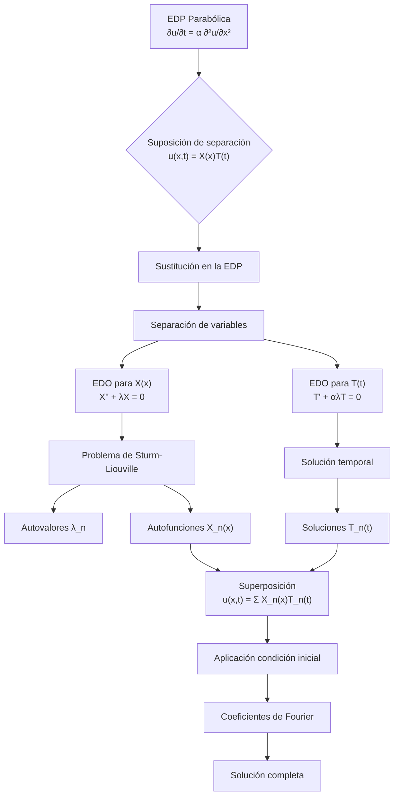

# Matemáticas para Ciencias Aplicadas IV - Ecuaciones de tipo Parabólico

## 7.4 Método de separación de variables.

---

El método de separación de variables es una técnica fundamental para resolver ecuaciones diferenciales parciales (EDPs) lineales, particularmente ecuaciones parabólicas como la ecuación de calor y de difusión. Este método transforma una EDP en un conjunto de ecuaciones diferenciales ordinarias (EDOs) más simples.

### Fundamentos del Método

#### Idea Central

El método supone que la solución $u(x,t)$ puede expresarse como el producto de funciones que dependen solo de una variable:

$$u(x,t) = X(x)T(t)$$

Al sustituir esta forma en la EDP, se obtienen EDOs separadas para $X(x)$ y $T(t).$

#### Procedimiento General

Para la ecuación de calor unidimensional:

$$\frac{\partial u}{\partial t} = \alpha \frac{\partial^2 u}{\partial x^2}$$

con condiciones de frontera homogéneas:

$$u(0,t) = 0, \quad u(L,t) = 0$$

y condición inicial:

$$u(x,0) = f(x)$$

### Diagrama del Proceso de Separación de Variables



### Desarrollo Matemático Detallado

#### Paso 1: Sustitución y Separación

Sustituimos $u(x,t) = X(x)T(t)$ en la ecuación de calor:

$$X(x)T'(t) = \alpha X''(x)T(t)$$

Dividimos ambos lados por $\alpha X(x)T(t):$

$$\frac{1}{\alpha}\frac{T'(t)}{T(t)} = \frac{X''(x)}{X(x)} = -\lambda$$

Obtenemos dos EDOs:

1. $\frac{X''(x)}{X(x)} = -\lambda$ → $X''(x) + \lambda X(x) = 0$
2. $\frac{T'(t)}{T(t)} = -\alpha\lambda$ → $T'(t) + \alpha\lambda T(t) = 0$

#### Paso 2: Solución del Problema Espacial

Resolvemos el problema de valores propios:

$$X'' + \lambda X = 0, \quad X(0) = 0, \quad X(L) = 0$$

**Autovalores:**

$$\lambda_n = \left(\frac{n\pi}{L}\right)^2, \quad n = 1, 2, 3, \ldots$$

**Autofunciones:**

$$X_n(x) = \sin\left(\frac{n\pi x}{L}\right), \quad n = 1, 2, 3, \ldots$$

#### Paso 3: Solución del Problema Temporal

Para cada autovalor $\lambda_n,$ resolvemos:

$$T'(t) + \alpha\lambda_n T(t) = 0$$

**Solución:**

$$T_n(t) = B_n e^{-\alpha\lambda_n t} = B_n e^{-\alpha\left(\frac{n\pi}{L}\right)^2 t}$$

#### Paso 4: Superposición y Coeficientes

La solución general es la superposición:

$$u(x,t) = \sum_{n=1}^{\infty} B_n e^{-\alpha\left(\frac{n\pi}{L}\right)^2 t} \sin\left(\frac{n\pi x}{L}\right)$$

Aplicamos la condición inicial $u(x,0) = f(x):$

$$f(x) = \sum_{n=1}^{\infty} B_n \sin\left(\frac{n\pi x}{L}\right)$$

Los coeficientes $B_n$ son los coeficientes de Fourier de seno:

$$B_n = \frac{2}{L} \int_0^L f(x) \sin\left(\frac{n\pi x}{L}\right) dx$$

### Ejemplos Resueltos

#### Ejemplo 1: Temperatura Inicial Sinusoidal

**Problema:** Resolver la ecuación de calor con:

- $u(x,0) = 100\sin\left(\frac{\pi x}{L}\right)$
- $u(0,t) = 0,$ $u(L,t) = 0$

**Solución:**

$$u(x,t) = 100e^{-\alpha\left(\frac{\pi}{L}\right)^2 t} \sin\left(\frac{\pi x}{L}\right)$$

#### Ejemplo 2: Temperatura Inicial Constante

**Problema:** Resolver la ecuación de calor con:

- $u(x,0) = U_0$ (constante)
- $u(0,t) = 0,$ $u(L,t) = 0$

**Solución:**

$$u(x,t) = \sum_{n=1}^{\infty} B_n e^{-\alpha\left(\frac{n\pi}{L}\right)^2 t} \sin\left(\frac{n\pi x}{L}\right)$$

donde:

$$ B_n = \frac{2U_0}{L} \int_0^L \sin\left(\frac{n\pi x}{L}\right) dx = \begin{cases} \frac{4U_0}{n\pi} & \text{si } n \text{ es impar} \\\ 0 & \text{si } n \text{ es par} \end{cases}$$

### Código Python para Visualizar Soluciones

```python
import numpy as np
import matplotlib.pyplot as plt

def coeficiente_fourier_seno(f, n, L, puntos=1000):
    """Calcula el coeficiente de Fourier de seno B_n"""
    x = np.linspace(0, L, puntos)
    integrando = f(x) * np.sin(n * np.pi * x / L)
    return (2/L) * np.trapz(integrando, x)

def solucion_calor_serie(x, t, alpha, L, f, terminos=50):
    """Calcula la solución en serie de la ecuación de calor"""
    suma = 0
    for n in range(1, terminos + 1):
        B_n = coeficiente_fourier_seno(f, n, L)
        termino = B_n * np.exp(-alpha * (n * np.pi / L)**2 * t) * np.sin(n * np.pi * x / L)
        suma += termino
    return suma

# Parámetros
L = 1.0
alpha = 0.01
terminos = 20

# Condición inicial constante
def f(x):
    return 100 * np.ones_like(x)  # Temperatura constante inicial

# Visualización
x = np.linspace(0, L, 100)
t_valores = [0, 0.1, 0.5, 1.0, 2.0]

plt.figure(figsize=(12, 8))
for t in t_valores:
    u = solucion_calor_serie(x, t, alpha, L, f, terminos)
    plt.plot(x, u, label=f't = {t}')

plt.xlabel('Posición x')
plt.ylabel('Temperatura u(x,t)')
plt.title('Evolución temporal de la temperatura')
plt.legend()
plt.grid(True)
plt.show()
```

### Ejercicios Propuestos

1. **Problema con condición inicial lineal:**
   Resuelva la ecuación de calor con:

   $$u(x,0) = \begin{cases} \frac{2U_0}{L}x & \text{para } 0 \leq x \leq L/2 \\\ 2U_0\left(1 - \frac{x}{L}\right) & \text{para } L/2 \leq x \leq L \end{cases}$$

   y condiciones de frontera homogéneas.

2. **Problema con condiciones de frontera no homogéneas:**
   Resuelva la ecuación de calor con:
   
   $$u(0,t) = T_1, \quad u(L,t) = T_2, \quad u(x,0) = f(x)$$
   
   Sugerencia: Use la transformación $u(x,t) = v(x,t) + w(x)$ donde $w(x)$ es la solución de estado estacionario.

3. **Problema con fuente de calor:**
   Resuelva la ecuación no homogénea:
   
   $$\frac{\partial u}{\partial t} = \alpha \frac{\partial^2 u}{\partial x^2} + Q(x,t)$$
   
   con condiciones de frontera homogéneas.

4. **Problema con condiciones de Neumann:**
   Resuelva la ecuación de calor con condiciones de frontera:
   
   $$\frac{\partial u}{\partial x}(0,t) = 0, \quad \frac{\partial u}{\partial x}(L,t) = 0$$
   
   y condición inicial $u(x,0) = f(x).$

5. **Análisis de convergencia:**
   Para la solución en serie del Ejemplo 2, investigue cómo el número de términos necesarios para una aproximación precisa depende del tiempo $t.$

### Limitaciones y Extensiones del Método

#### Limitaciones:
1. Solo aplicable a EDPs lineales
2. Requiere condiciones de frontera homogéneas (o transformables a homogéneas)
3. El dominio debe ser separable (generalmente rectangular)

#### Extensiones:
1. **Coordenadas curvilíneas:** Separación en coordenadas cilíndricas y esféricas
2. **Problemas multidimensionales:** $u(x,y,t) = X(x)Y(y)T(t)$
3. **Ecuaciones no homogéneas:** Método de eigenfunciones

### Referencias

**Bibliografía básica:**
1. Boyce, W., DiPrima, R. (2004). *Elementary Differential Equations and Boundary Value Problems*. Wiley, New York. (Capítulo 10.5: Separation of Variables; Heat Conduction in a Rod)
2. Edwards, C. H., Penney, D. E. (2002). *Ecuaciones diferenciales elementales y problemas con condiciones a la frontera*. Prentice Hall, México. (Capítulo 9.5: La ecuación de calor)

**Bibliografía complementaria:**
1. Cooper, J. M. (1998). *Introduction to Partial Differential Equations with MatLab*. Birkhäuser, Boston. (Capítulo 4: Parabolic Equations)
2. Hubbard, J. H., West, B. H. (1995). *Differential Equations: A Dynamical Systems Approach*. Springer-Verlag, Berlin. (Sección 6.4: The Heat Equation)
3. Zill, D. G., Wright, W. S. (1995). *Differential Equations with Computer Lab Experiments*. PWS Publishing Company, Boston. (Capítulo 13: Boundary-Value Problems in Rectangular Coordinates)

**Referencias avanzadas:**
- Strauss, W. A. (2007). *Partial Differential Equations: An Introduction*. Wiley.
- Haberman, R. (2012). *Applied Partial Differential Equations with Fourier Series and Boundary Value Problems*. Pearson.
