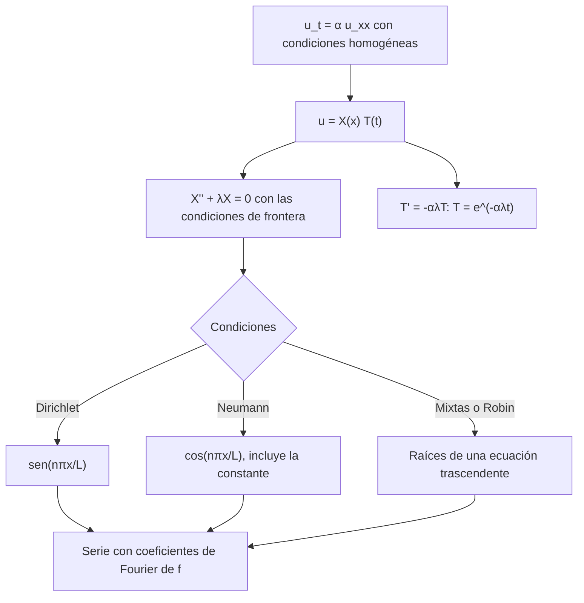

# Matemáticas para Ciencias Aplicadas IV - Ecuaciones de tipo Parabólico

## 7.4 Método de separación de variables.

---

La separación de variables fue inventada precisamente para la ecuación del calor: Fourier la presentó en 1807 y la publicó en su _Teoría analítica del calor_ (1822), junto con la afirmación, entonces escandalosa, de que cualquier función se puede escribir como una serie de senos y cosenos. Este tema aplica el método a la ecuación del calor con los distintos tipos de condiciones de frontera, muestra cómo tratar condiciones no homogéneas y fuentes, y estudia cuántos términos de la serie hacen falta según el instante.

### El método

Para $u_t = \alpha u_{xx}$ en $0 \lt x \lt L$ con $u(0, t) = u(L, t) = 0$ y $u(x, 0) = f(x):$

1. Con $u = X(x)\, T(t),$ la ecuación es $X T' = \alpha X'' T,$ y separando, $\frac{T'}{\alpha T} = \frac{X''}{X} = -\lambda.$
2. El problema espacial $X'' + \lambda X = 0,$ $X(0) = X(L) = 0$ da, como en el tema 6.5, $\lambda_n = (n\pi/L)^2$ y $X_n = \sin(n\pi x/L).$
3. El problema temporal $T' = -\alpha \lambda_n T$ da $T_n = e^{-\alpha \lambda_n t}:$ una exponencial decreciente, no una oscilación, porque la ecuación es de primer orden en $t.$
4. Superponiendo y ajustando el dato inicial por ortogonalidad,

$$ u(x, t) = \sum_{n = 1}^{\infty} b_n\, e^{-\alpha (n\pi/L)^2 t} \sin \frac{n\pi x}{L}, \qquad b_n = \frac{2}{L} \int_0^L f(x) \sin \frac{n\pi x}{L}\, dx $$

**Convergencia.** Para $t > 0,$ si $f$ es integrable, los coeficientes están acotados y los factores exponenciales hacen que la serie y todas sus derivadas converjan uniformemente: se puede derivar término a término, así que $u$ es una solución clásica, infinitamente derivable. En $t = 0$ la serie solo converge en el sentido de Fourier, y en los saltos de $f$ aparece el fenómeno de Gibbs.



### Tabla de casos

| Condiciones en $0$ y $L$ | $X_n$ | $\lambda_n$ | Límite cuando $t \to \infty$ |
| --- | --- | --- | --- |
| $u = 0,$ $u = 0$ | $\sin(n\pi x/L),$ $n \geq 1$ | $(n\pi/L)^2$ | 0 |
| $u_x = 0,$ $u_x = 0$ | $\cos(n\pi x/L),$ $n \geq 0$ | $(n\pi/L)^2$ | promedio de $f$ |
| $u = 0,$ $u_x = 0$ | $\sin((2n - 1)\pi x / (2L))$ | $((2n - 1)\pi / (2L))^2$ | 0 |
| $u = 0,$ $u_x + hu = 0$ | $\sin(\mu_n x)$ con $\tan \mu L = -\mu/h$ | $\mu_n^2$ | 0 |

### Ejemplos resueltos

**Ejemplo 1: modo único.** Con $f(x) = 100 \sin(\pi x / L),$ solo $b_1 = 100$ es distinto de cero y $u = 100\, e^{-\alpha (\pi/L)^2 t} \sin(\pi x / L).$

**Ejemplo 2: temperatura inicial uniforme.** Una barra a temperatura $U_0$ se pone en contacto en sus dos extremos con hielo. Con $f = U_0,$

$$ b_n = \frac{2U_0}{L} \int_0^L \sin \frac{n\pi x}{L}\, dx = \frac{2U_0 \big( 1 - (-1)^n \big)}{n\pi} $$

que vale $\frac{4U_0}{n\pi}$ para $n$ impar y 0 para $n$ par:

$$ u(x, t) = \frac{4U_0}{\pi} \sum_{n \text{ impar}} \frac{1}{n}\, e^{-\alpha (n\pi/L)^2 t} \sin \frac{n\pi x}{L} $$

El dato no se anula en los extremos, de modo que en $t = 0$ la serie converge lentamente, con coeficientes que decrecen como $1/n,$ y con fenómeno de Gibbs; para $t > 0$ la barra se enfría primero cerca de los extremos y el perfil se vuelve enseguida una senoide.

### Condiciones no homogéneas y fuentes

**Extremos a temperatura constante.** Si $u(0, t) = T_1$ y $u(L, t) = T_2,$ el estado estacionario $w(x) = T_1 + (T_2 - T_1) x / L$ cumple la ecuación y las condiciones. Entonces $v = u - w$ cumple la ecuación del calor con extremos a cero y dato $f - w,$ y se resuelve como antes:

$$ u(x, t) = w(x) + \sum_{n = 1}^{\infty} c_n\, e^{-\alpha (n\pi/L)^2 t} \sin \frac{n\pi x}{L}, \qquad c_n = \frac{2}{L} \int_0^L \big( f - w \big) \sin \frac{n\pi x}{L}\, dx $$

**Fuentes.** Para $u_t = \alpha u_{xx} + Q(x, t)$ con extremos a cero se desarrolla todo en funciones propias, $u = \sum T_n(t) X_n(x)$ y $Q = \sum Q_n(t) X_n(x).$ Cada coeficiente cumple la EDO lineal $T_n' + \alpha \lambda_n T_n = Q_n(t),$ cuya solución con $T_n(0) = b_n$ es

$$ T_n(t) = b_n\, e^{-\alpha \lambda_n t} + \int_0^t e^{-\alpha \lambda_n (t - s)}\, Q_n(s)\, ds $$

el **principio de Duhamel**: la respuesta a la fuente es la suma de las respuestas a los impulsos $Q_n(s)\, ds$ de cada instante, cada uno amortiguado durante el tiempo $t - s.$ A diferencia de la cuerda, no hay resonancia: los modos se amortiguan siempre.

### Implementación en Python

El programa calcula con SymPy los coeficientes de los ejemplos y ejercicios, mide cuántos términos hacen falta para un error menor que $10^{-6}$ en distintos instantes (ejercicio 5), sigue la temperatura del ejercicio 2 hacia su estado estacionario, resuelve el modo forzado del ejercicio 3 y lo compara con la fórmula de Duhamel, y comprueba que con extremos aislados el promedio se conserva (ejercicio 4).

```python
import numpy as np
import sympy as sp

x, t, s = sp.symbols("x t s", real=True)
n = sp.symbols("n", integer=True, positive=True)
L, U0 = sp.symbols("L U_0", positive=True)

# Ejemplo 2: u(x,0) = U0 constante
bn = sp.simplify(2 / L * sp.integrate(U0 * sp.sin(n * sp.pi * x / L), (x, 0, L)))
print("dato constante: b_n =", bn)

# Ejercicio 1: dato triangular de altura U0
tri = sp.Piecewise((2 * U0 * x / L, x <= L / 2), (2 * U0 * (1 - x / L), True))
bt = sp.simplify(2 / L * (sp.integrate(2 * U0 * x / L * sp.sin(n * sp.pi * x / L), (x, 0, L / 2))
                          + sp.integrate(2 * U0 * (1 - x / L) * sp.sin(n * sp.pi * x / L), (x, L / 2, L))))
print("ejercicio 1: b_n =", bt)

# Ejercicio 5: términos necesarios para error < 1e-6 (U0 = 1, L = 1, α = 1), en x = 0.5
def u_serie(xx, tt, N):
    k = np.arange(1, N + 1, 2)
    return np.sum(4 / (k * np.pi) * np.exp(-(k * np.pi) ** 2 * tt) * np.sin(k * np.pi * xx))


print("ejercicio 5: términos (impares) necesarios para error < 1e-6 en x = 0.5")
for tt in (1e-4, 1e-3, 1e-2, 1e-1, 1.0):
    ref = u_serie(0.5, tt, 200001)
    N = 1
    while abs(u_serie(0.5, tt, N) - ref) >= 1e-6:
        N += 2
    print(f"   t = {tt:7.4f}: N = {N:5d}  (u = {ref:.6f})")

# Ejercicio 2: u(0) = 100, u(1) = 0, u(x,0) = 0 (α = 1)
cn = sp.simplify(2 * sp.integrate(-100 * (1 - x) * sp.sin(n * sp.pi * x), (x, 0, 1)))
print("ejercicio 2: v_n =", cn)
for tt in (0.01, 0.1, 0.5):
    val = 100 * 0.5 + sum(float(cn.subs(n, k)) * np.exp(-(k * np.pi) ** 2 * tt) * np.sin(k * np.pi / 2) for k in range(1, 200))
    print(f"   u(0.5, {tt}) = {val:.4f}")

# Ejercicio 3: fuente Q = sin(πx) cos t (α = 1, L = 1): T' + π² T = cos t, T(0) = 0
T = sp.Function("T")
sol = sp.dsolve(T(t).diff(t) + sp.pi**2 * T(t) - sp.cos(t), T(t), ics={T(0): 0}).rhs
duhamel = sp.integrate(sp.exp(-sp.pi**2 * (t - s)) * sp.cos(s), (s, 0, t))
print("ejercicio 3: T(t) =", sp.simplify(sol))
print("   coincide con Duhamel:", sp.simplify(sol - duhamel) == 0,
      "| amplitud periódica 1/sqrt(π⁴ + 1) =", f"{1 / np.sqrt(np.pi**4 + 1):.5f}")

# Ejercicio 4: Neumann, u(x,0) = x en [0, 1]
an = sp.simplify(2 * sp.integrate(x * sp.cos(n * sp.pi * x), (x, 0, 1)))
a0 = sp.integrate(x, (x, 0, 1))
print("ejercicio 4: a_0 =", a0, " a_n =", an)
xs = np.linspace(0, 1, 2001)
for tt in (0.0, 0.05, 0.5):
    u = float(a0) + sum(float(an.subs(n, k)) * np.exp(-(k * np.pi) ** 2 * tt) * np.cos(k * np.pi * xs)
                        for k in range(1, 400))
    print(f"   t = {tt:4.2f}: promedio {np.trapezoid(u, xs):.4f}, u(0) = {u[0]:.4f}, u(1) = {u[-1]:.4f}")
```

Salida:

```text
dato constante: b_n = 2*U_0*(1 - (-1)**n)/(pi*n)
ejercicio 1: b_n = 8*U_0*sin(pi*n/2)/(pi**2*n**2)
ejercicio 5: términos (impares) necesarios para error < 1e-6 en x = 0.5
   t =  0.0001: N =    95  (u = 1.000000)
   t =  0.0010: N =    31  (u = 1.000000)
   t =  0.0100: N =     9  (u = 0.999186)
   t =  0.1000: N =     3  (u = 0.474487)
   t =  1.0000: N =     1  (u = 0.000066)
ejercicio 2: v_n = -200/(pi*n)
   u(0.5, 0.01) = 0.0407
   u(0.5, 0.1) = 26.2756
   u(0.5, 0.5) = 49.5422
ejercicio 3: T(t) = (exp(pi**2*t)*sin(t) + pi**2*exp(pi**2*t)*cos(t) - pi**2)*exp(-pi**2*t)/(1 + pi**4)
   coincide con Duhamel: True | amplitud periódica 1/sqrt(π⁴ + 1) = 0.10081
ejercicio 4: a_0 = 1/2  a_n = 2*((-1)**n - 1)/(pi**2*n**2)
   t = 0.00: promedio 0.5000, u(0) = 0.0005, u(1) = 0.9995
   t = 0.05: promedio 0.5000, u(0) = 0.2520, u(1) = 0.7480
   t = 0.50: promedio 0.5000, u(0) = 0.4971, u(1) = 0.5029
```

Cuanto más pequeño es $t,$ más términos hacen falta: con $t = 10^{-4}$ se necesitan modos hasta $n = 95,$ mientras que con $t = 0.1$ bastan los modos 1 y 3. Por eso, para tiempos muy cortos conviene usar otra representación (la del núcleo del calor, tema 7.3), y para tiempos largos basta el primer término.

### Ejercicios Propuestos

1. **Dato triangular.** Resuelve la ecuación del calor con extremos a cero y

   $$ u(x, 0) = \begin{cases} \dfrac{2U_0}{L} x & 0 \leq x \leq L/2 \\ 2U_0 \left( 1 - \dfrac{x}{L} \right) & L/2 \leq x \leq L \end{cases} $$

2. **Extremos a temperaturas distintas.** Resuelve $u_t = u_{xx}$ en $[0, 1]$ con $u(0, t) = 100,$ $u(1, t) = 0$ y $u(x, 0) = 0.$ ¿Cuánto vale la temperatura en el centro en $t = 0.01,$ $0.1$ y $0.5?$

3. **Fuente periódica.** Resuelve $u_t = u_{xx} + \sin(\pi x) \cos t$ en $[0, 1]$ con extremos y dato inicial nulos. Describe el comportamiento para $t$ grande.

4. **Extremos aislados.** Resuelve $u_t = u_{xx}$ en $[0, 1]$ con $u_x(0, t) = u_x(1, t) = 0$ y $u(x, 0) = x.$ Demuestra que el promedio de $u$ no cambia.

5. **Convergencia.** Para el ejemplo 2 con $U_0 = L = \alpha = 1,$ investiga cómo depende del instante $t$ el número de términos necesarios para una buena aproximación.

### Soluciones

**Ejercicio 1.** Integrando por partes en cada mitad, $b_n = \frac{8U_0}{\pi^2 n^2} \sin \frac{n\pi}{2},$ así que

$$ u(x, t) = \frac{8U_0}{\pi^2} \sum_{n \text{ impar}} \frac{(-1)^{(n - 1)/2}}{n^2}\, e^{-\alpha (n\pi/L)^2 t} \sin \frac{n\pi x}{L} $$

Los coeficientes decrecen como $1/n^2,$ más rápido que en el ejemplo 2, porque el dato es continuo y se anula en los extremos.

**Ejercicio 2.** $w = 100(1 - x)$ y $c_n = -\frac{200}{n\pi},$ así que $u = 100(1 - x) - \sum_{n \geq 1} \frac{200}{n\pi} e^{-n^2\pi^2 t} \sin n\pi x.$ En el centro, $u \approx 0.04,$ $26.28$ y $49.54$ en los tres instantes, acercándose al valor estacionario 50.

**Ejercicio 3.** Solo se excita el modo $n = 1:$ $u = T(t) \sin \pi x$ con $T' + \pi^2 T = \cos t,$ $T(0) = 0,$ cuya solución es

$$ T(t) = \frac{\pi^2 \cos t + \sin t - \pi^2 e^{-\pi^2 t}}{1 + \pi^4} $$

Para $t$ grande el transitorio desaparece y queda una oscilación periódica de amplitud $1/\sqrt{1 + \pi^4} \approx 0.1008,$ con un retraso respecto a la fuente: así se propagan, amortiguadas y retrasadas, las oscilaciones de temperatura del día y de las estaciones bajo tierra.

**Ejercicio 4.** Con cosenos, $a_0 = \frac{1}{2}$ y $a_n = 2 \int_0^1 x \cos n\pi x\, dx = \frac{2 \big( (-1)^n - 1 \big)}{\pi^2 n^2},$ que vale $-\frac{4}{\pi^2 n^2}$ para $n$ impar. Así $u = \frac{1}{2} - \frac{4}{\pi^2} \sum_{n \text{ impar}} \frac{1}{n^2} e^{-n^2\pi^2 t} \cos n\pi x,$ que tiende a $\frac{1}{2}.$ El promedio se conserva porque $\frac{d}{dt} \int_0^1 u\, dx = \int_0^1 u_{xx}\, dx = u_x(1, t) - u_x(0, t) = 0:$ no entra ni sale calor.

**Ejercicio 5.** Para un error menor que $10^{-6}$ en el centro de la barra, el programa necesita modos hasta $n = 95$ con $t = 10^{-4},$ $n = 31$ con $t = 10^{-3},$ $n = 9$ con $t = 0.01,$ $n = 3$ con $t = 0.1$ y solo el primero con $t = 1.$ El término $n$ es de orden $e^{-n^2\pi^2 t},$ así que basta con $n$ del orden de $1/\sqrt{t}.$

### Referencias

1. Fourier, J., _Théorie analytique de la chaleur_. Firmin Didot, 1822.
2. Haberman, R., _Applied Partial Differential Equations with Fourier Series and Boundary Value Problems_. Pearson, 2013. Capítulos 2 y 8.
3. Boyce, W. E., DiPrima, R. C., and Meade, D. B., _Elementary Differential Equations and Boundary Value Problems_. Wiley, 2017. Secciones 10.5 y 10.6.
4. Tijonov, A. N., y Samarski, A. A., _Ecuaciones de la física matemática_. Mir, 1980. Capítulo 3.
