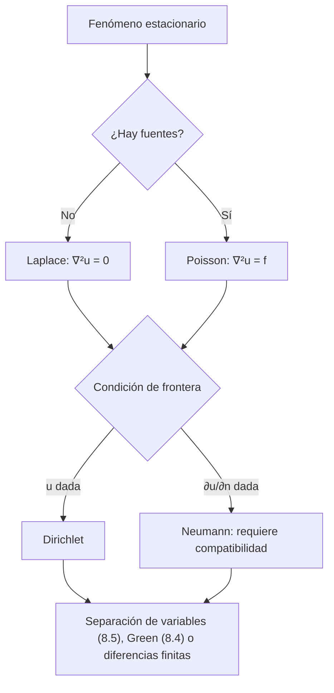

# Matemáticas para Ciencias Aplicadas IV - Ecuaciones de tipo Elíptico

## 8.1 Problemas que se reducen a la ecuación de Laplace.

---

La **ecuación de Laplace**

$$ \nabla^2 u = u_{xx} + u_{yy} = 0 $$

(con $u_{zz}$ en tres dimensiones) es el modelo de las ecuaciones **elípticas**: su discriminante es $B^2 - 4AC = -4 \lt 0.$ Describe estados de **equilibrio**, en los que nada cambia con el tiempo: la temperatura estacionaria, el potencial eléctrico en una región sin cargas, el flujo de un fluido ideal, la forma de una membrana tensa en reposo. Sus soluciones se llaman funciones **armónicas**. Con una fuente, $\nabla^2 u = f,$ es la **ecuación de Poisson**. Este tema presenta los problemas físicos que conducen a ella, las propiedades de las funciones armónicas y los problemas de frontera típicos.

### Problemas que conducen a la ecuación de Laplace

**Temperatura estacionaria.** La ecuación del calor en el plano es $u_t = \alpha \nabla^2 u.$ Si la temperatura ya no cambia, $u_t = 0$ y $\nabla^2 u = 0.$ Con una fuente de calor $q,$ $\nabla^2 u = -q/k$ (tema 8.2).

**Electrostática.** El campo eléctrico es $\mathbf{E} = -\nabla V$ y cumple la ley de Gauss $\nabla \cdot \mathbf{E} = \rho / \varepsilon_0.$ Juntas dan $\nabla^2 V = -\rho / \varepsilon_0:$ Poisson donde hay carga y Laplace donde no la hay (tema 8.3).

**Gravitación.** El potencial gravitatorio cumple $\nabla^2 \Phi = 4\pi G \rho,$ y fuera de las masas es armónico. Por eso el campo de una esfera es el mismo que el de una masa puntual: $1/r$ es armónica en el espacio sin el origen.

**Flujo potencial.** Si un fluido es incompresible, $\nabla \cdot \mathbf{v} = 0,$ e irrotacional, con velocidad $\mathbf{v} = \nabla \phi,$ su potencial cumple $\nabla^2 \phi = 0.$ Es la base de la aerodinámica clásica de perfiles.

**Membrana en equilibrio.** Una membrana tensa con borde deformado, en reposo, cumple la ecuación de onda de la membrana (tema 6.1) con $u_{tt} = 0,$ es decir, $\nabla^2 u = 0.$

**Difusión estacionaria y flujo en medios porosos.** Una concentración en estado estacionario, o la presión del agua subterránea según la ley de Darcy, también son armónicas.

### El laplaciano en otras coordenadas

| Coordenadas | $\nabla^2 u$ |
| --- | --- |
| cartesianas | $u_{xx} + u_{yy} + u_{zz}$ |
| polares | $u_{rr} + \frac{1}{r} u_r + \frac{1}{r^2} u_{\theta\theta}$ |
| cilíndricas | $u_{rr} + \frac{1}{r} u_r + \frac{1}{r^2} u_{\theta\theta} + u_{zz}$ |
| esféricas | $\frac{1}{r^2} (r^2 u_r)_r + \frac{1}{r^2 \sin\theta} (\sin\theta\, u_\theta)_\theta + \frac{1}{r^2 \sin^2\theta} u_{\varphi\varphi}$ |

**Soluciones radiales.** Si $u$ solo depende de $r,$ en el plano $(r u')' = 0$ da $u = A + B \ln r,$ y en el espacio $(r^2 u')' = 0$ da $u = A + B/r.$ Estas son, salvo constantes, las **soluciones fundamentales**: el potencial de una carga lineal y de una carga puntual.

### Propiedades de las funciones armónicas

**Valor medio.** Si $u$ es armónica en un disco de centro $P$ y radio $\rho,$ su valor en $P$ es el promedio de sus valores en la circunferencia.

**Demostración.** Sea $m(\rho) = \frac{1}{2\pi} \int_0^{2\pi} u(P + \rho e^{i\varphi})\, d\varphi.$ Derivando bajo la integral, $m'(\rho) = \frac{1}{2\pi} \int_0^{2\pi} \frac{\partial u}{\partial r}\, d\varphi = \frac{1}{2\pi\rho} \oint \frac{\partial u}{\partial n}\, ds,$ y por el teorema de la divergencia esa integral es $\frac{1}{2\pi\rho} \iint \nabla^2 u\, dA = 0.$ Así $m$ es constante, y como $m(\rho) \to u(P)$ cuando $\rho \to 0,$ $m(\rho) = u(P).$ $\blacksquare$

**Principio del máximo.** Una función armónica no constante en una región acotada y conexa alcanza su máximo y su mínimo solo en la frontera. Si tuviera un máximo en un punto interior $P,$ por el valor medio sería igual a su máximo en todo un disco alrededor de $P,$ y extendiendo el argumento, en toda la región. Físicamente: en equilibrio, el punto más caliente de una placa sin fuentes está en el borde.

**Unicidad.** Si $u_1$ y $u_2$ resuelven el mismo problema de Dirichlet, $w = u_1 - u_2$ es armónica y vale 0 en el borde; por el principio del máximo, su máximo y su mínimo son 0, y $w = 0.$

**Suavidad.** Toda función armónica es infinitamente derivable, incluso analítica, en el interior de su dominio, aunque los datos de frontera sean discontinuos.

### Problemas de frontera

| Problema | Condición en el borde | Significado | Solución |
| --- | --- | --- | --- |
| Dirichlet | $u = f$ | temperatura o potencial dados | única |
| Neumann | $\partial u / \partial n = g$ | flujo dado | única salvo constante, si $\oint g\, ds = 0$ |
| Robin | $\partial u / \partial n + h u = g$ | convección | única si $h > 0$ |

La condición de **compatibilidad** del problema de Neumann se obtiene integrando: $\oint \frac{\partial u}{\partial n}\, ds = \iint \nabla^2 u\, dA = 0.$ Físicamente, en equilibrio el calor que entra tiene que ser igual al que sale.



### Ejemplos resueltos

**Ejemplo 1: placa rectangular.** En $[0, a] \times [0, b]$ con $u = 0$ en tres lados y $u(x, b) = f(x),$ la separación de variables (tema 8.5) da

$$ u(x, y) = \sum_{n = 1}^{\infty} c_n \frac{\sinh(n\pi y / a)}{\sinh(n\pi b / a)} \sin \frac{n\pi x}{a}, \qquad c_n = \frac{2}{a} \int_0^a f(x) \sin \frac{n\pi x}{a}\, dx $$

**Ejemplo 2: disco.** En el disco $r \lt R$ con $u(R, \theta) = f(\theta),$ las soluciones separadas acotadas son $r^n \cos n\theta$ y $r^n \sin n\theta,$ y

$$ u(r, \theta) = \frac{a_0}{2} + \sum_{n = 1}^{\infty} \left( \frac{r}{R} \right)^n \big( a_n \cos n\theta + b_n \sin n\theta \big) $$

con $a_n,$ $b_n$ los coeficientes de Fourier de $f.$ En el centro, $u(0) = a_0/2,$ el promedio de $f:$ es la propiedad del valor medio.

### Implementación en Python

El programa comprueba con SymPy que varias funciones son armónicas, verifica numéricamente la propiedad del valor medio, resuelve el ejercicio 1 en un caso concreto y resuelve el ejercicio 4 de dos formas: con una serie doble de senos y con diferencias finitas de cinco puntos, $\frac{u_{i + 1, j} + u_{i - 1, j} + u_{i, j + 1} + u_{i, j - 1} - 4u_{i, j}}{h^2} = f_{i, j}.$

```python
import numpy as np
import sympy as sp

x, y, z = sp.symbols("x y z", real=True)
r, th = sp.symbols("r theta", positive=True)


def lap2(u):
    return sp.simplify(sp.diff(u, x, 2) + sp.diff(u, y, 2))


def lap_polar(u):
    return sp.simplify(sp.diff(u, r, 2) + sp.diff(u, r) / r + sp.diff(u, th, 2) / r**2)


print("funciones armónicas:")
for u in (x**2 - y**2, x * y, sp.exp(x) * sp.cos(y), sp.log(x**2 + y**2), x**3 - 3 * x * y**2):
    print(f"   Δ({u}) =", lap2(u))
for u in (r**3 * sp.cos(3 * th), sp.log(r), r**-2 * sp.sin(2 * th)):
    print(f"   Δ({u}) en polares =", lap_polar(u))
R3 = sp.sqrt(x**2 + y**2 + z**2)
print("   Δ(1/r) en el espacio =", sp.simplify(sum(sp.diff(1 / R3, v, 2) for v in (x, y, z))))

# Propiedad del valor medio: u = e^x cos y en la circunferencia de centro (0.3, 0.2) y radio 0.5
f = lambda X, Y: np.exp(X) * np.cos(Y)
phi = np.linspace(0, 2 * np.pi, 4001)[:-1]
media = f(0.3 + 0.5 * np.cos(phi), 0.2 + 0.5 * np.sin(phi)).mean()
print(f"valor medio en la circunferencia {media:.10f}, valor en el centro {f(0.3, 0.2):.10f}")

# Ejercicio 1: anillo 1 < r < 2 con u(1) = 0, u(2) = cos θ + 1
A, B, C, Dd = sp.symbols("A B C D")
u = A + B * sp.log(r) + (C * r + Dd / r) * sp.cos(th)
sol = sp.solve([A, B * sp.log(2) + A - 1, C + Dd, 2 * C + Dd / 2 - 1], [A, B, C, Dd])
ua = u.subs(sol)
print("ejercicio 1, anillo: u =", sp.simplify(ua), "| Δu =", lap_polar(ua),
      "| u(1) =", sp.simplify(ua.subs(r, 1)), "| u(2) =", sp.simplify(ua.subs(r, 2)))

# Ejercicio 4: Δu = xy en el cuadrado unitario, u = 0 en el borde
# Serie doble: xy = Σ c_mn sen(mπx) sen(nπy), u_mn = -c_mn / (π²(m² + n²))
m, n = sp.symbols("m n", integer=True, positive=True)
cx = sp.simplify(2 * sp.integrate(x * sp.sin(m * sp.pi * x), (x, 0, 1)))
print("ejercicio 4: coeficiente de x en senos:", cx)


def serie(X, Y, N=80):
    k = np.arange(1, N + 1)
    c1 = 2 * (-1.0) ** (k + 1) / (k * np.pi)
    M, Nn = np.meshgrid(k, k, indexing="ij")
    coef = -np.outer(c1, c1) / (np.pi**2 * (M**2 + Nn**2))
    return np.sum(coef * np.outer(np.sin(k * np.pi * X), np.sin(k * np.pi * Y)))


# Diferencias finitas de cinco puntos
nx = 41
h = 1 / (nx - 1)
X = np.linspace(0, 1, nx)
idx = lambda i, j: (i - 1) * (nx - 2) + (j - 1)
Nint = (nx - 2) ** 2
Am = np.zeros((Nint, Nint))
b = np.zeros(Nint)
for i in range(1, nx - 1):
    for j in range(1, nx - 1):
        k = idx(i, j)
        Am[k, k] = -4 / h**2
        for di, dj in ((1, 0), (-1, 0), (0, 1), (0, -1)):
            ii, jj = i + di, j + dj
            if 0 < ii < nx - 1 and 0 < jj < nx - 1:
                Am[k, idx(ii, jj)] = 1 / h**2
        b[k] = X[i] * X[j]
U = np.linalg.solve(Am, b)
for (px, py) in ((0.5, 0.5), (0.25, 0.75), (0.75, 0.75)):
    i, j = int(round(px / h)), int(round(py / h))
    print(f"   u({px}, {py}): serie {serie(px, py):.6f}, diferencias finitas {U[idx(i, j)]:.6f}")
```

Salida:

```text
funciones armónicas:
   Δ(x**2 - y**2) = 0
   Δ(x*y) = 0
   Δ(exp(x)*cos(y)) = 0
   Δ(log(x**2 + y**2)) = 0
   Δ(x**3 - 3*x*y**2) = 0
   Δ(r**3*cos(3*theta)) en polares = 0
   Δ(log(r)) en polares = 0
   Δ(sin(2*theta)/r**2) en polares = 0
   Δ(1/r) en el espacio = 0
valor medio en la circunferencia 1.3229515021, valor en el centro 1.3229515021
ejercicio 1, anillo: u = 2*r*cos(theta)/3 + log(r)/log(2) - 2*cos(theta)/(3*r) | Δu = 0 | u(1) = 0 | u(2) = cos(theta) + 1
ejercicio 4: coeficiente de x en senos: -2*(-1)**m/(pi*m)
   u(0.5, 0.5): serie -0.018418, diferencias finitas -0.018409
   u(0.25, 0.75): serie -0.010170, diferencias finitas -0.010166
   u(0.75, 0.75): serie -0.018542, diferencias finitas -0.018528
```

La serie y las diferencias finitas con $h = 1/40$ coinciden en cuatro cifras. La solución es negativa: como $\nabla^2 u = xy \geq 0,$ $u$ es **subarmónica** y su máximo, 0, está en el borde.

### Ejercicios Propuestos

1. **Anillo.** Resuelve $\nabla^2 u = 0$ en el anillo $a \lt r \lt b$ con $u(a, \theta) = f(\theta)$ y $u(b, \theta) = g(\theta).$ Aplica el resultado a $a = 1,$ $b = 2,$ $f = 0$ y $g = 1 + \cos\theta.$

2. **Problema de Neumann en el semiplano.** Resuelve $\nabla^2 u = 0$ en $y > 0$ con $u_y(x, 0) = g(x),$ sabiendo que la solución acotada del problema de Dirichlet con $u(x, 0) = h(x)$ es la integral de Poisson $u = \frac{1}{\pi} \int_{-\infty}^{\infty} \frac{y\, h(\xi)}{(x - \xi)^2 + y^2}\, d\xi.$

3. **Simetría axial.** Encuentra las soluciones separadas de $\nabla^2 u = 0$ en coordenadas esféricas cuando $u$ no depende de $\varphi.$

4. **Poisson.** Resuelve $\nabla^2 u = xy$ en el cuadrado unitario con $u = 0$ en el borde.

5. **Compatibilidad.** ¿Tiene solución el problema de Neumann en el disco unitario con $\partial u / \partial n = 1$ en todo el borde? Interpreta físicamente.

### Soluciones

**Ejercicio 1.** En el anillo no hace falta descartar las soluciones que no están acotadas en el origen, y la solución general es

$$ u = A_0 + B_0 \ln r + \sum_{n = 1}^{\infty} \Big[ \big( A_n r^n + B_n r^{-n} \big) \cos n\theta + \big( C_n r^n + D_n r^{-n} \big) \sin n\theta \Big] $$

Para cada modo, las dos condiciones dan un sistema de $2 \times 2$ con los coeficientes de Fourier de $f$ y $g.$ En el caso concreto, el término constante da $A_0 = 0$ y $B_0 = 1/\ln 2,$ y el término en $\cos\theta$ da $A_1 + B_1 = 0$ y $2A_1 + B_1/2 = 1,$ así que

$$ u = \frac{\ln r}{\ln 2} + \frac{2}{3} \left( r - \frac{1}{r} \right) \cos\theta $$

**Ejercicio 2.** $v = u_y$ también es armónica, acotada y vale $g$ en el borde, así que es la integral de Poisson de $g.$ Integrando respecto a $y,$ usando $\frac{\partial}{\partial y} \frac{1}{2} \ln \big( (x - \xi)^2 + y^2 \big) = \frac{y}{(x - \xi)^2 + y^2},$ resulta

$$ u(x, y) = \frac{1}{2\pi} \int_{-\infty}^{\infty} g(\xi) \ln \big( (x - \xi)^2 + y^2 \big)\, d\xi + C $$

que es acotada solo si $\int g = 0,$ la versión de la compatibilidad para el semiplano.

**Ejercicio 3.** Con $u = R(r)\, \Theta(\theta),$ la parte angular es la ecuación de Legendre en $\cos\theta,$ con soluciones acotadas $P_n(\cos\theta)$ solo si la constante de separación es $n(n + 1)$ (tema 4.4). La parte radial es la ecuación de Euler $r^2 R'' + 2r R' - n(n + 1) R = 0,$ con soluciones $r^n$ y $r^{-n - 1}.$ Así

$$ u(r, \theta) = \sum_{n = 0}^{\infty} \big( A_n r^n + B_n r^{-n - 1} \big) P_n(\cos\theta) $$

**Ejercicio 4.** Desarrollando $xy$ en la serie doble de senos, con $x = \sum \frac{2(-1)^{m + 1}}{m\pi} \sin m\pi x,$ y dividiendo cada término entre el valor propio $-\pi^2 (m^2 + n^2):$

$$ u(x, y) = -\sum_{m, n \geq 1} \frac{4 (-1)^{m + n}}{mn\, \pi^4 (m^2 + n^2)} \sin m\pi x \sin n\pi y $$

En el centro vale $-0.01842,$ como da el programa.

**Ejercicio 5.** No: $\oint \frac{\partial u}{\partial n}\, ds = 2\pi \neq 0.$ Sería una placa que recibe calor por todo su borde sin perderlo por ningún lado, así que no puede estar en equilibrio: su temperatura subiría indefinidamente.

### Referencias

1. Strauss, W. A., _Partial Differential Equations: An Introduction_. Wiley, 2008. Capítulo 6.
2. Haberman, R., _Applied Partial Differential Equations with Fourier Series and Boundary Value Problems_. Pearson, 2013. Secciones 2.5 y 9.5.
3. Tijonov, A. N., y Samarski, A. A., _Ecuaciones de la física matemática_. Mir, 1980. Capítulo 4.
4. Evans, L. C., _Partial Differential Equations_. AMS, 2010. Sección 2.2.
