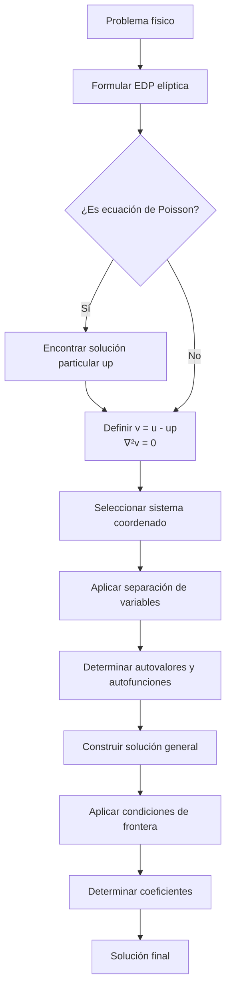

# Matemáticas para Ciencias Aplicadas IV - Ecuaciones de tipo Elíptico

## 8.1 Problemas que se reducen a la ecuación de Laplace.

---

Las ecuaciones diferenciales parciales (EDP) elípticas son fundamentales en la modelización de sistemas en estado estacionario. Entre estas, la **ecuación de Laplace** es la más representativa y aparece en numerosos problemas físicos donde se busca una solución de equilibrio.

### Definición de la Ecuación de Laplace

La ecuación de Laplace en dos dimensiones se define como:

$$\nabla^2 u = \frac{\partial^2 u}{\partial x^2} + \frac{\partial^2 u}{\partial y^2} = 0$$

Y en tres dimensiones:

$$\nabla^2 u = \frac{\partial^2 u}{\partial x^2} + \frac{\partial^2 u}{\partial y^2} + \frac{\partial^2 u}{\partial z^2} = 0$$

### Problemas que se Reducen a la Ecuación de Laplace

#### 1. Problema de Dirichlet para la Ecuación de Poisson

La ecuación de Poisson $\nabla^2 u = f(x,y)$ puede reducirse a Laplace mediante el método de **función de Green** o mediante la **sustracción de una solución particular**.

**Ejemplo**: Si $u_p$ es una solución particular de $\nabla^2 u = f$, entonces $v = u - u_p$ satisface $\nabla^2 v = 0$.

#### 2. Problema de Temperatura en Estado Estacionario

La ecuación de calor en estado estacionario (sin fuentes) se reduce a Laplace:

$$\frac{\partial u}{\partial t} = 0 \Rightarrow \nabla^2 u = 0$$

#### 3. Problemas de Potencial Electrostático

En una región sin cargas, el potencial eléctrico $\phi$ satisface:

$$\nabla^2 \phi = 0$$

#### 4. Problemas de Mecánica de Fluidos

Para flujos irrotacionales e incompresibles, el potencial de velocidad $\phi$ satisface:

$$\nabla^2 \phi = 0$$

### Técnicas de Solución

#### Separación de Variables

Para resolver $\nabla^2 u = 0$ en coordenadas cartesianas:

$$u(x,y) = X(x)Y(y)$$

Sustituyendo en Laplace:

$$\frac{X''}{X} = -\frac{Y''}{Y} = -\lambda$$

#### Solución en Coordenadas Polares

La ecuación de Laplace en polares:

$$\nabla^2 u = \frac{1}{r}\frac{\partial}{\partial r}\left(r\frac{\partial u}{\partial r}\right) + \frac{1}{r^2}\frac{\partial^2 u}{\partial \theta^2} = 0$$

Con solución general:

$$u(r,\theta) = A_0 + B_0\ln r + \sum_{n=1}^{\infty}[(A_n r^n + B_n r^{-n})\cos(n\theta) + (C_n r^n + D_n r^{-n})\sin(n\theta)]$$

### Ejemplos Resueltos

#### Ejemplo 1: Problema de Dirichlet en un Rectángulo

Resolver $\nabla^2 u = 0$ en $0 < x < a$, $0 < y < b$ con condiciones:

- $u(0,y) = u(a,y) = 0$
- $u(x,0) = 0$, $u(x,b) = f(x)$

**Solución**: Por separación de variables, obtenemos:

$$u(x,y) = \sum_{n=1}^{\infty} A_n \sin\left(\frac{n\pi x}{a}\right) \sinh\left(\frac{n\pi y}{a}\right)$$

Donde:

$$A_n = \frac{2}{a\sinh(n\pi b/a)} \int_0^a f(x) \sin\left(\frac{n\pi x}{a}\right) dx$$

#### Ejemplo 2: Problema en un Disco

Resolver $\nabla^2 u = 0$ en $r < a$ con $u(a,\theta) = f(\theta)$

**Solución**: Usando la fórmula integral de Poisson:

$$u(r,\theta) = \frac{1}{2\pi} \int_0^{2\pi} \frac{a^2 - r^2}{a^2 - 2ar\cos(\theta-\phi) + r^2} f(\phi) d\phi$$

### Diagrama de Flujo para Resolver Problemas de Laplace



### Ejercicios Propuestos

1. **Problema de Dirichlet en un anillo**: Resuelva $\nabla^2 u = 0$ en el anulo $a < r < b$ con condiciones $u(a,\theta) = f(\theta)$, $u(b,\theta) = g(\theta)$.

2. **Problema de Neumann**: Resuelva $\nabla^2 u = 0$ en el semiplano $y > 0$ con condición $\frac{\partial u}{\partial y}(x,0) = g(x)$.

3. **Problema con simetría axial**: Resuelva $\nabla^2 u = 0$ en coordenadas esféricas para un problema con simetría axial.

4. **Problema de Poisson**: Resuelva $\nabla^2 u = xy$ en el cuadrado unitario con condiciones de Dirichlet homogéneas.

### Implementación Computacional

#### Código en Python para Resolver Laplace en un Rectángulo

```python
import numpy as np
import matplotlib.pyplot as plt
from scipy.linalg import solve

def solve_laplace_rectangular(nx, ny, bc_top, bc_bottom, bc_left, bc_right):
    """
    Resuelve la ecuación de Laplace en un rectángulo usando diferencias finitas
    """
    # Crear matriz del sistema y vector derecho
    N = (nx-1)*(ny-1)
    A = np.zeros((N, N))
    b = np.zeros(N)

    # Llenar matriz A y vector b
    for i in range(1, nx):
        for j in range(1, ny):
            idx = (j-1)*(nx-1) + (i-1)
            A[idx, idx] = -4  # Punto central

            # Vecinos
            if i > 1: A[idx, idx-1] = 1  # Oeste
            if i < nx-1: A[idx, idx+1] = 1  # Este
            if j > 1: A[idx, idx-(nx-1)] = 1  # Sur
            if j < ny-1: A[idx, idx+(nx-1)] = 1  # Norte

            # Condiciones de frontera
            if j == 1: b[idx] -= bc_bottom[i]  # Frontera inferior
            if j == ny-1: b[idx] -= bc_top[i]  # Frontera superior
            if i == 1: b[idx] -= bc_left[j]  # Frontera izquierda
            if i == nx-1: b[idx] -= bc_right[j]  # Frontera derecha

    # Resolver sistema
    u_inner = solve(A, b)

    # Reconstruir solución completa
    u = np.zeros((ny, nx))
    u[0,:] = bc_bottom
    u[-1,:] = bc_top
    u[:,0] = bc_left
    u[:,-1] = bc_right

    for i in range(1, nx):
        for j in range(1, ny):
            u[j,i] = u_inner[(j-1)*(nx-1) + (i-1)]

    return u

# Ejemplo de uso
nx, ny = 21, 21
x = np.linspace(0, 1, nx)
y = np.linspace(0, 1, ny)

# Condiciones de frontera
bc_top = np.sin(np.pi * x)
bc_bottom = np.zeros_like(x)
bc_left = np.zeros_like(y)
bc_right = np.zeros_like(y)

u = solve_laplace_rectangular(nx, ny, bc_top, bc_bottom, bc_left, bc_right)

# Visualización
plt.contourf(x, y, u, levels=50, cmap='viridis')
plt.colorbar()
plt.title('Solución de la ecuación de Laplace')
plt.xlabel('x')
plt.ylabel('y')
plt.show()
```

### Referencias

#### Bibliografía Básica

1. Boyce, W., DiPrima, R. (2004). _Elementary Differential Equations and Boundary Value Problems_. Wiley, New York. (Capítulo 10)
2. Edwards, C. H., Penney, D. E. (2002). _Ecuaciones diferenciales elementales y problemas con condiciones a la frontera_. Prentice Hall, México. (Capítulo 9)

#### Bibliografía Complementaria

1. Cooper, J. M. (1998). _Introduction to Partial Differential Equations with MatLab_. Birkhäuser, Boston. (Capítulo 4)
2. Hubbard, J. H., West, B. H. (1995). _Differential Equations: A Dynamical Systems Approach_. Springer-Verlag, Berlin. (Capítulo 6)
3. Zill, D. G., Wright, W. S. (1995). _Differential Equations with Computer Lab Experiments_. PWS Publishing Company, Boston. (Capítulo 13)

### Consejos para el Estudio

1. **Domina las técnicas de separación de variables** en diferentes sistemas coordenados.
2. **Practica la interpretación física** de las condiciones de frontera.
3. **Familiarízate con las funciones especiales** que aparecen (polinomios de Legendre, funciones de Bessel).
4. **Utiliza software computacional** para visualizar soluciones y verificar resultados.
