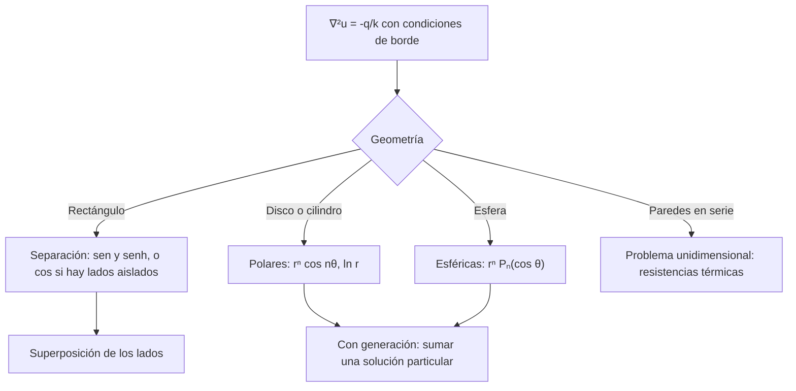

# Matemáticas para Ciencias Aplicadas IV - Ecuaciones de tipo Elíptico

## 8.2 Campo térmico estacionario.

---

Cuando un cuerpo lleva mucho tiempo con las mismas condiciones en su superficie, su temperatura deja de cambiar: alcanza un **campo térmico estacionario**. Como $u_t = 0,$ la ecuación del calor se reduce a la de Laplace, o a la de Poisson si hay generación interna de calor. Este tema plantea esos problemas, los resuelve en placas rectangulares con distintos tipos de borde, en cilindros y esferas con generación de calor, y en paredes compuestas, donde aparece la idea de **resistencia térmica**.

### Planteamiento

Con conductividad $k$ constante y una generación de calor $q$ (W/m³), la temperatura estacionaria cumple

$$ \nabla^2 u = -\frac{q}{k} $$

con una condición en cada parte del borde:

| Borde | Condición |
| --- | --- |
| temperatura impuesta | $u = f$ |
| aislado | $\partial u / \partial n = 0$ |
| flujo impuesto | $-k\, \partial u / \partial n = q_s$ |
| convección hacia un fluido a $T_\infty$ | $-k\, \partial u / \partial n = h (u - T_\infty)$ |

El flujo de calor es $\mathbf{q} = -k \nabla u:$ va perpendicular a las **isotermas**, de lo caliente a lo frío.

### Placa rectangular

En $[0, a] \times [0, b]$ con $u = 0$ en tres lados y $u(x, b) = f(x),$ la separación $u = X(x)\, Y(y)$ da $X'' + \lambda X = 0$ con $X(0) = X(a) = 0,$ es decir $X_n = \sin(n\pi x/a),$ y $Y'' - \lambda_n Y = 0$ con $Y(0) = 0,$ es decir $Y_n = \sinh(n\pi y/a).$ Ajustando el lado superior,

$$ u(x, y) = \sum_{n = 1}^{\infty} c_n\, \frac{\sinh(n\pi y/a)}{\sinh(n\pi b/a)} \sin \frac{n\pi x}{a}, \qquad c_n = \frac{2}{a} \int_0^a f(x) \sin \frac{n\pi x}{a}\, dx $$

A diferencia de la ecuación del calor, en la dirección $y$ no hay exponenciales que decaen sino senos hiperbólicos: el modo $n$ penetra en la placa una distancia del orden de $a/(n\pi)$ desde el borde caliente. Los detalles finos del borde solo se notan cerca de él.

**Superposición.** Si los cuatro lados tienen temperaturas no nulas, se resuelven cuatro problemas, cada uno con un solo lado caliente, y se suman las soluciones.

**Ejemplo.** Para la placa cuadrada de lado 1 con el lado superior a 100 °C y los demás a 0 °C, $c_n = \frac{400}{n\pi}$ para $n$ impar. En el centro, $u = 25$ °C exactamente: si los cuatro lados estuvieran a 100 °C la placa entera estaría a 100 °C, y por simetría cada lado aporta la cuarta parte en el centro.



### Cuerpos con generación de calor

Si la temperatura solo depende del radio, la ecuación de Poisson se vuelve una EDO.

**Cilindro.** Un cable de radio $R$ que genera calor $q$ por efecto Joule, con superficie a $T_0:$ $\frac{1}{r} (r u')' = -q/k,$ de donde $r u' = -\frac{q r^2}{2k} + C.$ Para que $u$ esté acotada en el eje, $C = 0,$ y

$$ u(r) = T_0 + \frac{q}{4k} \big( R^2 - r^2 \big) $$

La temperatura máxima, en el eje, es $T_0 + q R^2 / (4k).$

**Esfera.** Análogamente, $\frac{1}{r^2} (r^2 u')' = -q/k$ da $u = C - \frac{q r^2}{6k}.$ Si la superficie pierde calor por convección, $-k u'(R) = h \big( u(R) - T_\infty \big),$ y como $-k u'(R) = qR/3,$

$$ u(r) = T_\infty + \frac{qR}{3h} + \frac{q}{6k} \big( R^2 - r^2 \big) $$

El término $qR/(3h)$ es el salto de temperatura en la capa de fluido, y el último, el salto dentro de la esfera. Su cociente, $hR/k,$ es el **número de Biot**: si es pequeño, la esfera es casi isoterma.

### Paredes compuestas y resistencia térmica

En una pared plana de espesor $L$ y conductividad $k,$ el problema unidimensional $u'' = 0$ da un perfil lineal y un flujo $q = k\, \Delta T / L.$ Por analogía con la ley de Ohm, $\Delta T = q R_t$ con **resistencia térmica** $R_t = L/k.$ Varias capas en serie suman sus resistencias, y en cada interfaz la temperatura es continua y el flujo es el mismo a ambos lados.

### Implementación en Python

El programa evalúa la serie de la placa (escribiendo el cociente de senos hiperbólicos de forma estable), confirma el valor 25 en el centro, resuelve el ejercicio 1 y comprueba sus condiciones de borde y el balance de calor, verifica las soluciones del cilindro y de la esfera con SymPy y calcula una pared compuesta.

```python
import numpy as np
import sympy as sp

# Ejemplo: placa cuadrada 1 x 1, u = 100 en el lado superior y 0 en los demás
def placa(x, y, N=401):
    k = np.arange(1, N + 1, 2)
    # sinh(kπy)/sinh(kπ) escrito de forma estable
    razon = np.exp(k * np.pi * (y - 1)) * (1 - np.exp(-2 * k * np.pi * y)) / (1 - np.exp(-2 * k * np.pi))
    return np.sum(400 / (k * np.pi) * razon * np.sin(k * np.pi * x))


print("placa con lado superior a 100:")
for (x, y) in ((0.5, 0.5), (0.5, 0.25), (0.5, 0.75), (0.5, 0.95), (0.1, 0.9)):
    print(f"   u({x}, {y}) = {placa(x, y):8.4f}")
print(f"   suma de los cuatro lados en el centro: {4 * placa(0.5, 0.5):.4f}")

# Ejercicio 1: lados verticales aislados, u(x,0) = 0, u(x,1) = x
xs = sp.symbols("x", positive=True)
n = sp.symbols("n", integer=True, positive=True)
a0 = sp.integrate(xs, (xs, 0, 1))
an = sp.simplify(2 * sp.integrate(xs * sp.cos(n * sp.pi * xs), (xs, 0, 1)))
print("ejercicio 1: término constante", a0, "* y,  a_n =", an)


def aislada(x, y, N=200):
    s = float(a0) * y
    for k in range(1, N + 1):
        s += float(an.subs(n, k)) * np.sinh(k * np.pi * y) / np.sinh(k * np.pi) * np.cos(k * np.pi * x)
    return s


h = 1e-5
print("   u(0.3, 1) =", f"{aislada(0.3, 1):.4f}", "| u(0.3, 0) =", f"{aislada(0.3, 0):.4f}",
      "| u_x(0, 0.5) ≈", f"{(aislada(h, 0.5) - aislada(0, 0.5)) / h:.1e}",
      "| flujo neto por el lado inferior (∫ u_y dx en y = 0):",
      f"{np.trapezoid([(aislada(xx, h) - aislada(xx, 0)) / h for xx in np.linspace(0, 1, 201)], dx=1 / 200):.4f}")

# Ejercicio 2: cilindro con generación q y superficie a T0
r, R, q, k, T0, hc, Tinf = sp.symbols("r R q k T_0 h T_inf", positive=True)
Tc = T0 + q * (R**2 - r**2) / (4 * k)
print("ejercicio 2: (1/r)(r T')' + q/k =", sp.simplify(sp.diff(r * sp.diff(Tc, r), r) / r + q / k),
      "| T(R) =", Tc.subs(r, R), "| T(0) =", Tc.subs(r, 0))

# Ejercicio 3: esfera con generación q y convección -k T'(R) = h (T(R) - T_inf)
Te = Tinf + q * R / (3 * hc) + q * (R**2 - r**2) / (6 * k)
print("ejercicio 3: (1/r²)(r² T')' + q/k =", sp.simplify(sp.diff(r**2 * sp.diff(Te, r), r) / r**2 + q / k),
      "| convección:", sp.simplify(-k * sp.diff(Te, r).subs(r, R) - hc * (Te.subs(r, R) - Tinf)))

# Ejercicio 4: pared compuesta, cobre 10 cm y aislante 5 cm
k1, L1, k2, L2, T1, T2 = 400.0, 0.10, 0.04, 0.05, 100.0, 20.0
Ti = (k1 * T1 / L1 + k2 * T2 / L2) / (k1 / L1 + k2 / L2)
flujo = (T1 - T2) / (L1 / k1 + L2 / k2)
print(f"ejercicio 4: T en la interfaz = {Ti:.3f} °C, flujo = {flujo:.3f} W/m², "
      f"caídas de temperatura {T1 - Ti:.3f} y {Ti - T2:.3f} °C")
```

Salida:

```text
placa con lado superior a 100:
   u(0.5, 0.5) =  25.0000
   u(0.5, 0.25) =   9.5414
   u(0.5, 0.75) =  54.0529
   u(0.5, 0.95) =  89.9657
   u(0.1, 0.9) =  48.9060
   suma de los cuatro lados en el centro: 100.0000
ejercicio 1: término constante 1/2 * y,  a_n = 2*((-1)**n - 1)/(pi**2*n**2)
   u(0.3, 1) = 0.3000 | u(0.3, 0) = 0.0000 | u_x(0, 0.5) ≈ 4.2e-06 | flujo neto por el lado inferior (∫ u_y dx en y = 0): 0.5000
ejercicio 2: (1/r)(r T')' + q/k = 0 | T(R) = T_0 | T(0) = R**2*q/(4*k) + T_0
ejercicio 3: (1/r²)(r² T')' + q/k = 0 | convección: 0
ejercicio 4: T en la interfaz = 99.984 °C, flujo = 63.987 W/m², caídas de temperatura 0.016 y 79.984 °C
```

En el ejercicio 1, el flujo neto que sale por el lado inferior es $0.5,$ igual al que entra por el superior: como los lados verticales están aislados, todo el calor atraviesa la placa. En la pared compuesta, casi toda la caída de temperatura ocurre en el aislante, porque su resistencia, $L_2/k_2 = 1.25,$ es 5 000 veces la del cobre.

### Ejercicios Propuestos

1. **Lados aislados.** Resuelve $\nabla^2 u = 0$ en $0 \lt x \lt a,$ $0 \lt y \lt b$ con $u(x, 0) = 0,$ $u(x, b) = f(x)$ y $u_x(0, y) = u_x(a, y) = 0.$ Aplícalo a $a = b = 1$ y $f(x) = x.$

2. **Cilindro con generación.** Encuentra la temperatura en un cilindro largo de radio $R$ con generación uniforme $q$ y superficie a $T_0.$

3. **Esfera con convección.** Una esfera de radio $R$ genera calor uniformemente a razón $q$ y lo pierde por convección hacia un fluido a $T_\infty$ con coeficiente $h.$ Encuentra la temperatura estacionaria.

4. **Contacto entre dos materiales.** Una placa de cobre de 10 cm, con $k_1 = 400$ W/(m·K), está pegada a una capa de aislante de 5 cm, con $k_2 = 0.04$ W/(m·K). La cara exterior del cobre está a 100 °C y la del aislante a 20 °C. Encuentra la temperatura en la interfaz y el flujo de calor.

### Soluciones

**Ejercicio 1.** Los lados aislados dan $X'' + \lambda X = 0$ con $X'(0) = X'(a) = 0:$ $X_0 = 1,$ con $\lambda_0 = 0,$ y $X_n = \cos(n\pi x/a).$ Para $n = 0,$ $Y'' = 0$ con $Y(0) = 0$ da $Y = y.$ Así

$$ u(x, y) = a_0 \frac{y}{b} + \sum_{n = 1}^{\infty} a_n \frac{\sinh(n\pi y/a)}{\sinh(n\pi b/a)} \cos \frac{n\pi x}{a}, \qquad a_0 = \frac{1}{a} \int_0^a f, \quad a_n = \frac{2}{a} \int_0^a f \cos \frac{n\pi x}{a} $$

Con $f = x$ en el cuadrado unidad, $a_0 = \frac{1}{2}$ y $a_n = \frac{2 \big( (-1)^n - 1 \big)}{\pi^2 n^2}.$ El término $a_0 y / b$ lleva el flujo neto de arriba abajo; los cosenos solo redistribuyen el calor.

**Ejercicio 2.** $u(r) = T_0 + \frac{q}{4k} (R^2 - r^2),$ con máximo $T_0 + \frac{qR^2}{4k}$ en el eje.

**Ejercicio 3.** $u(r) = T_\infty + \frac{qR}{3h} + \frac{q}{6k} (R^2 - r^2).$ El calor generado, $\frac{4}{3}\pi R^3 q,$ es igual al que sale por convección, $4\pi R^2 h \big( u(R) - T_\infty \big) = 4\pi R^2 h \cdot \frac{qR}{3h}.$

**Ejercicio 4.** Las resistencias son $L_1/k_1 = 2.5 \times 10^{-4}$ y $L_2/k_2 = 1.25$ m²·K/W, así que el flujo es $\frac{80}{1.25025} \approx 63.99$ W/m² y la interfaz está a $100 - 63.99 \times 2.5 \times 10^{-4} \approx 99.984$ °C: el cobre está prácticamente a temperatura uniforme. Nota: si las dos placas fueran **semi-infinitas** con temperaturas dadas en el infinito, no habría solución estacionaria acotada no constante, porque el perfil lineal crece sin límite; hace falta dar espesores finitos.

### Referencias

1. Incropera, F. P., DeWitt, D. P., Bergman, T. L., and Lavine, A. S., _Fundamentos de transferencia de calor_. Pearson, 1999. Capítulos 3 y 4.
2. Haberman, R., _Applied Partial Differential Equations with Fourier Series and Boundary Value Problems_. Pearson, 2013. Sección 2.5.
3. Carslaw, H. S., and Jaeger, J. C., _Conduction of Heat in Solids_. Oxford University Press, 1959. Capítulos 2 y 5.
4. Boyce, W. E., DiPrima, R. C., and Meade, D. B., _Elementary Differential Equations and Boundary Value Problems_. Wiley, 2017. Sección 10.8.
