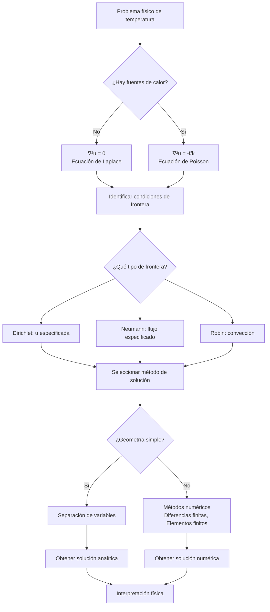

# Matemáticas para Ciencias Aplicadas IV - Ecuaciones de tipo Elíptico

## 8.2 Campo térmico estacionario.

---

El estudio del **campo térmico estacionario** es una aplicación fundamental de las ecuaciones diferenciales parciales elípticas. En régimen estacionario, la distribución de temperatura en un cuerpo no cambia con el tiempo, lo que conduce naturalmente a la ecuación de Laplace y sus variantes.

### Definición del Problema de Temperatura Estacionaria

En un medio homogéneo e isótropo, la distribución de temperatura $u(\mathbf{x})$ en estado estacionario satisface:

#### Ecuación de Laplace (sin fuentes de calor)

$$\nabla^2 u = 0$$

#### Ecuación de Poisson (con fuentes de calor)

$$\nabla^2 u = -\frac{f(\mathbf{x})}{k}$$

donde $f(\mathbf{x})$ representa la densidad de fuentes de calor y $k$ es la conductividad térmica.

### Condiciones de Frontera

#### 1. Condición de Dirichlet (Temperatura prescrita)

$$u(\mathbf{x}) = g(\mathbf{x}) \quad \text{para } \mathbf{x} \in \partial\Omega$$

#### 2. Condición de Neumann (Flujo de calor prescrito)

$$-k\frac{\partial u}{\partial n} = h(\mathbf{x}) \quad \text{para } \mathbf{x} \in \partial\Omega$$

donde $\frac{\partial u}{\partial n}$ es la derivada normal.

#### 3. Condición de Robin (Convección)

$$-k\frac{\partial u}{\partial n} = h[u - u_{\infty}] \quad \text{para } \mathbf{x} \in \partial\Omega$$

donde $h$ es el coeficiente de transferencia de calor y $u_{\infty}$ es la temperatura ambiente.

### Solución por Separación de Variables

#### Ejemplo: Placa Rectangular

Para una placa rectangular $0 < x < a,$ $0 < y < b$ con condiciones:

- $u(0,y) = u(a,y) = 0$
- $u(x,0) = 0,$ $u(x,b) = f(x)$

La solución es:

$$u(x,y) = \sum_{n=1}^{\infty} A_n \sin\left(\frac{n\pi x}{a}\right) \sinh\left(\frac{n\pi y}{a}\right)$$

con coeficientes:

$$A_n = \frac{2}{a\sinh(n\pi b/a)} \int_0^a f(x) \sin\left(\frac{n\pi x}{a}\right) dx$$

### Diagrama de Flujo: Resolución de Problemas de Temperatura Estacionaria



### Ejemplos Resueltos

#### Ejemplo 1: Placa con una frontera a temperatura variable

**Problema**: Resolver la ecuación de Laplace en una placa rectangular con:

- $u(0,y) = u(a,y) = u(x,0) = 0$
- $u(x,b) = T_0 \sin(\pi x/a)$

**Solución**:

$$u(x,y) = T_0 \frac{\sin(\pi x/a) \sinh(\pi y/a)}{\sinh(\pi b/a)}$$

#### Ejemplo 2: Cilindro con temperatura interior y exterior constantes

**Problema**: Temperatura en un cilindro largo con radio interno $r_i,$ externo $r_o,$ temperaturas $T_i$ y $T_o$ respectivamente.

**Solución**:

$$u(r) = T_i + (T_o - T_i) \frac{\ln(r/r_i)}{\ln(r_o/r_i)}$$

### Implementación Computacional

#### Código en Python para Placa Rectangular

```python
import numpy as np
import matplotlib.pyplot as plt
from scipy.linalg import solve

def solve_heat_equation(a, b, nx, ny, top_bc, left_bc=0, right_bc=0, bottom_bc=0):
    """
    Resuelve la ecuación de calor estacionaria en una placa rectangular
    usando diferencias finitas
    """
    # Espaciado de la malla
    dx = a / (nx - 1)
    dy = b / (ny - 1)

    # Crear malla
    x = np.linspace(0, a, nx)
    y = np.linspace(0, b, ny)
    X, Y = np.meshgrid(x, y)

    # Inicializar matriz de temperatura
    U = np.zeros((ny, nx))

    # Aplicar condiciones de frontera
    U[-1, :] = top_bc(x)  # Frontera superior
    U[0, :] = bottom_bc  # Frontera inferior
    U[:, 0] = left_bc  # Frontera izquierda
    U[:, -1] = right_bc  # Frontera derecha

    # Coeficientes para diferencias finitas
    alpha = dy**2 / (2*(dx**2 + dy**2))
    beta = dx**2 / (2*(dx**2 + dy**2))

    # Iterar hasta convergencia
    max_iter = 1000
    tolerance = 1e-5

    for _ in range(max_iter):
        U_old = U.copy()

        # Aplicar método de relajación
        for i in range(1, nx-1):
            for j in range(1, ny-1):
                U[j, i] = alpha*(U[j, i+1] + U[j, i-1]) + beta*(U[j+1, i] + U[j-1, i])

        # Verificar convergencia
        if np.max(np.abs(U - U_old)) < tolerance:
            break

    return X, Y, U

# Ejemplo de uso
a, b = 1.0, 1.0  # Dimensiones de la placa
nx, ny = 50, 50  # Número de puntos en la malla

# Condición de frontera superior
def top_temperature(x):
    return np.sin(np.pi * x)

X, Y, U = solve_heat_equation(a, b, nx, ny, top_temperature)

# Visualización
plt.figure(figsize=(10, 8))
contour = plt.contourf(X, Y, U, levels=50, cmap='hot')
plt.colorbar(contour, label='Temperatura')
plt.xlabel('x')
plt.ylabel('y')
plt.title('Distribución de Temperatura Estacionaria')
plt.show()
```

### Ejercicios Propuestos

1. **Placa con frontera aislada**: Resuelva la ecuación de Laplace en una placa rectangular $0 < x < a,$ $0 < y < b$ con:
   - $u(x,0) = 0,$ $u(x,b) = f(x)$
   - $\frac{\partial u}{\partial x}(0,y) = \frac{\partial u}{\partial x}(a,y) = 0$

2. **Cilindro con generación de calor**: Encuentre la distribución de temperatura en un cilindro largo de radio $R$ con generación uniforme de calor $q$ y superficie mantenida a temperatura $T_0.$

3. **Esfera con condiciones de convección**: Resuelva para la temperatura en una esfera de radio $R$ con convección en la superficie $(h, T_{\infty}).$

4. **Problema de contacto entre dos materiales**: Dos placas semi-infinitas de diferentes materiales en contacto en $x=0.$ La placa izquierda $(x<0)$ tiene temperatura $T_1$ en $x=-\infty,$ la derecha $(x>0)$ tiene $T_2$ en $x=\infty.$ Encuentre la distribución de temperatura.

### Aplicaciones Físicas

1. **Diseño de intercambiadores de calor**: Cálculo de distribución de temperatura en aletas y superficies extendidas.

2. **Geotermia**: Estudio del flujo de calor en la corteza terrestre.

3. **Electrónica**: Análisis térmico de componentes electrónicos y disipación de calor.

4. **Procesos industriales**: Diseño de hornos, reactores químicos y sistemas de aislamiento térmico.

### Referencias

#### Bibliografía Básica

1. Boyce, W., DiPrima, R. (2004). _Elementary Differential Equations and Boundary Value Problems_. Wiley, New York. (Capítulo 10 - Problemas de temperatura)
2. Edwards, C. H., Penney, D. E. (2002). _Ecuaciones diferenciales elementales y problemas con condiciones a la frontera_. Prentice Hall, México. (Capítulo 9 - Aplicaciones físicas)

#### Bibliografía Complementaria

1. Cooper, J. M. (1998). _Introduction to Partial Differential Equations with MatLab_. Birkhäuser, Boston. (Capítulo 4 - Problemas de valor de frontera)
2. Hubbard, J. H., West, B. H. (1995). _Differential Equations: A Dynamical Systems Approach_. Springer-Verlag, Berlin. (Capítulo 6 - Sistemas conservativos)
3. Zill, D. G., Wright, W. S. (1995). _Differential Equations with Computer Lab Experiments_. PWS Publishing Company, Boston. (Capítulo 13 - Ecuaciones elípticas)

### Consejos para el Estudio

1. **Comprende la física subyacente**: Antes de resolver matemáticamente, entiende el significado físico de cada término en la ecuación y condiciones de frontera.

2. **Domina las técnicas de separación de variables**: Es la herramienta principal para resolver problemas con geometrías simples.

3. **Familiarízate con diferentes sistemas coordenados**: Cartesianas, cilíndricas y esféricas, según la geometría del problema.

4. **Practica la interpretación de resultados**: Aprende a extraer información física de las soluciones matemáticas (gradientes de temperatura, flujos de calor).

5. **Utiliza software de visualización**: Herramientas como Matplotlib o MATLAB ayudan a comprender las distribuciones de temperatura en 2D y 3D.
