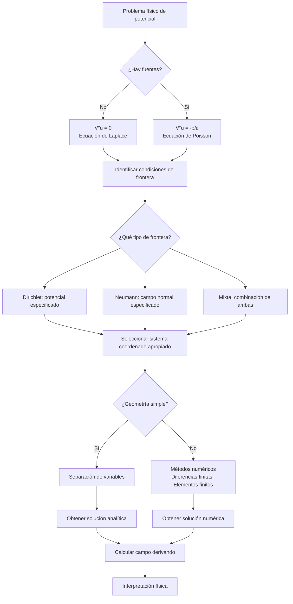

# Matemáticas para Ciencias Aplicadas IV - Ecuaciones de tipo Elíptico

## 8.3 Problemas de potencial.

---

Los **problemas de potencial** son aplicaciones fundamentales de las ecuaciones diferenciales parciales elípticas. Estos problemas surgen en diversos campos de la física donde se modelan fenómenos de equilibrio, como electrostática, gravitación, mecánica de fluidos y teoría de elasticidad.

### Definición del Problema de Potencial

El potencial $u(\mathbf{x})$ en una región sin fuentes satisface la ecuación de Laplace:

#### Ecuación de Laplace

$$\nabla^2 u = 0$$

Para regiones con fuentes o sumideros, el potencial satisface la ecuación de Poisson:

#### Ecuación de Poisson

$$\nabla^2 u = -\frac{\rho(\mathbf{x})}{\varepsilon}$$

donde $\rho(\mathbf{x})$ representa la densidad de fuentes y $\varepsilon$ es una constante que depende del medio.

### Formulación Matemática en Diferentes Contextos

#### 1. Electrostática

- **Campo eléctrico**: $\mathbf{E} = -\nabla u$
- **Ecuación de Poisson**: $\nabla^2 u = -\frac{\rho}{\varepsilon_0}$

#### 2. Gravitación

- **Campo gravitatorio**: $\mathbf{g} = -\nabla u$
- **Ecuación de Poisson**: $\nabla^2 u = 4\pi G\rho$

#### 3. Mecánica de Fluidos

- **Flujo potencial**: $\mathbf{v} = \nabla u$
- **Ecuación de Laplace**: $\nabla^2 u = 0$ (para fluidos incompresibles e irrotacionales)

### Condiciones de Frontera para Problemas de Potencial

#### 1. Condición de Dirichlet (Potencial prescrito)

$$u(\mathbf{x}) = V(\mathbf{x}) \quad \text{para } \mathbf{x} \in \partial\Omega$$

#### 2. Condición de Neumann (Campo prescrito)

$$-\frac{\partial u}{\partial n} = E_n(\mathbf{x}) \quad \text{para } \mathbf{x} \in \partial\Omega$$

#### 3. Condiciones Mixtas

Combinación de Dirichlet y Neumann en diferentes partes de la frontera.

### Solución por Separación de Variables

#### Ejemplo: Potencial entre dos placas paralelas

Para dos placas paralelas infinitas en $y=0$ y $y=b$ con potenciales $V_1$ y $V_2$ respectivamente:

$$u(y) = V_1 + (V_2 - V_1)\frac{y}{b}$$

#### Ejemplo: Potencial en coordenadas cilíndricas

Para un problema con simetría axial, la ecuación de Laplace se reduce a:

$$\frac{1}{r}\frac{\partial}{\partial r}\left(r\frac{\partial u}{\partial r}\right) + \frac{\partial^2 u}{\partial z^2} = 0$$

### Diagrama de Flujo: Resolución de Problemas de Potencial



### Ejemplos Resueltos

#### Ejemplo 1: Potencial entre cilindros coaxiales

**Problema**: Dos cilindros coaxiales de radios $a$ y $b$ $(a < b)$ con potenciales $V_a$ y $V_b$ respectivamente.

**Solución**:

$$u(r) = V_a + (V_b - V_a) \frac{\ln(r/a)}{\ln(b/a)}$$

**Campo eléctrico**:

$$\mathbf{E} = -\nabla u = -\frac{V_b - V_a}{\ln(b/a)} \frac{1}{r} \hat{r}$$

#### Ejemplo 2: Esfera con potencial prescrito en superficie

**Problema**: Esfera de radio $R$ con potencial $V(\theta) = V_0 \cos\theta$ en la superficie.

**Solución**:

$$u(r,\theta) = V_0 \frac{r}{R} \cos\theta \quad \text{para } r < R$$

### Implementación Computacional

#### Código en Python para Potencial en Geometría Cartesiana

```python
import numpy as np
import matplotlib.pyplot as plt
from scipy.linalg import solve

def solve_potential_equation(nx, ny, bc_top, bc_bottom, bc_left, bc_right, source=None):
    """
    Resuelve la ecuación de potencial en 2D usando diferencias finitas
    """
    # Crear matriz del sistema y vector derecho
    N = (nx-2)*(ny-2)
    A = np.zeros((N, N))
    b = np.zeros(N)

    # Llenar matriz A (operador Laplaciano discreto)
    for i in range(1, nx-1):
        for j in range(1, ny-1):
            idx = (j-1)*(nx-2) + (i-1)
            A[idx, idx] = -4  # Punto central

            # Vecinos
            if i > 1: A[idx, idx-1] = 1  # Oeste
            if i < nx-2: A[idx, idx+1] = 1  # Este
            if j > 1: A[idx, idx-(nx-2)] = 1  # Sur
            if j < ny-2: A[idx, idx+(nx-2)] = 1  # Norte

            # Término fuente
            if source is not None:
                b[idx] = -source(i, j)

            # Condiciones de frontera
            if j == 1: b[idx] -= bc_bottom[i]  # Frontera inferior
            if j == ny-2: b[idx] -= bc_top[i]  # Frontera superior
            if i == 1: b[idx] -= bc_left[j]  # Frontera izquierda
            if i == nx-2: b[idx] -= bc_right[j]  # Frontera derecha

    # Resolver sistema
    u_inner = solve(A, b)

    # Reconstruir solución completa
    u = np.zeros((ny, nx))
    u[0,:] = bc_bottom
    u[-1,:] = bc_top
    u[:,0] = bc_left
    u[:,-1] = bc_right

    for i in range(1, nx-1):
        for j in range(1, ny-1):
            u[j,i] = u_inner[(j-1)*(nx-2) + (i-1)]

    return u

# Ejemplo: Potencial entre placas paralelas
nx, ny = 51, 51
x = np.linspace(0, 1, nx)
y = np.linspace(0, 1, ny)

# Condiciones de frontera: placas a 0V y 1V
bc_top = np.ones(nx)  # 1V
bc_bottom = np.zeros(nx)  # 0V
bc_left = np.zeros(ny)  # 0V
bc_right = np.zeros(ny)  # 0V

u = solve_potential_equation(nx, ny, bc_top, bc_bottom, bc_left, bc_right)

# Calcular campo eléctrico
Ey, Ex = np.gradient(-u)  # E = -∇u

# Visualización
plt.figure(figsize=(12, 5))

plt.subplot(1, 2, 1)
plt.contourf(x, y, u, levels=50, cmap='viridis')
plt.colorbar(label='Potencial (V)')
plt.title('Distribución de Potencial')
plt.xlabel('x')
plt.ylabel('y')

plt.subplot(1, 2, 2)
plt.streamplot(x, y, Ex, Ey, density=2, color='white')
plt.title('Campo Eléctrico')
plt.xlabel('x')
plt.ylabel('y')

plt.tight_layout()
plt.show()
```

### Ejercicios Propuestos

1. **Potencial entre esferas concéntricas**: Resuelva el potencial entre dos esferas concéntricas de radios $a$ y $b$ $(a < b)$ con potenciales $V_a$ y $V_b$ respectivamente.

2. **Cilindro en campo uniforme**: Encuentre el potencial alrededor de un cilindro conductor de radio $R$ colocado en un campo eléctrico uniforme $\mathbf{E} = E_0 \hat{x}$.

3. **Plano semi-infinito a potencial constante**: Resuelva el potencial en el semiplano $y > 0$ cuando el borde $y=0$ está a potencial $V(x) = V_0$ para $|x| < a$ y $0$ para $|x| > a$.

4. **Problema con simetría azimutal**: Encuentre el potencial dentro de una esfera de radio $R$ cuando la mitad superior $(0 < \theta < \pi/2)$ está a potencial $+V_0$ y la mitad inferior $(\pi/2 < \theta < \pi)$ a $-V_0$.

### Aplicaciones Físicas

1. **Electrostática**: Cálculo de campos eléctricos en condensadores, cables coaxiales y otros arreglos de electrodos.

2. **Gravitación**: Determinación de campos gravitatorios en astronomía y geofísica.

3. **Mecánica de Fluidos**: Flujos potenciales alrededor de obstáculos y perfiles aerodinámicos.

4. **Teoría de Elasticidad**: Problemas de deformación en medios elásticos.

5. **Procesamiento de Imágenes**: Filtrado y suavizado usando operadores elípticos.

### Referencias

#### Bibliografía Básica

1. Boyce, W., DiPrima, R. (2004). _Elementary Differential Equations and Boundary Value Problems_. Wiley, New York. (Capítulo 10 - Problemas de potencial)
2. Edwards, C. H., Penney, D. E. (2002). _Ecuaciones diferenciales elementales y problemas con condiciones a la frontera_. Prentice Hall, México. (Capítulo 9 - Aplicaciones físicas)

#### Bibliografía Complementaria

1. Cooper, J. M. (1998). _Introduction to Partial Differential Equations with MatLab_. Birkhäuser, Boston. (Capítulo 4 - Problemas de valor de frontera)
2. Hubbard, J. H., West, B. H. (1995). _Differential Equations: A Dynamical Systems Approach_. Springer-Verlag, Berlin. (Capítulo 6 - Sistemas conservativos)
3. Zill, D. G., Wright, W. S. (1995). _Differential Equations with Computer Lab Experiments_. PWS Publishing Company, Boston. (Capítulo 13 - Ecuaciones elípticas)

### Consejos para el Estudio

1. **Comprende la física subyacente**: Relaciona el potencial con cantidades físicas medibles (campo eléctrico, fuerza gravitatoria, velocidad de flujo).

2. **Domina diferentes sistemas coordenados**: Aprende a expresar el Laplaciano en coordenadas cartesianas, cilíndricas y esféricas.

3. **Practica con problemas de valores de frontera**: Desarrolla habilidad para aplicar condiciones de Dirichlet, Neumann y mixtas.

4. **Aprende a calcular campos a partir de potenciales**: Domina las técnicas para calcular $\mathbf{E} = -\nabla u$ y interpretar los resultados.

5. **Utiliza visualización**: Emplea herramientas gráficas para visualizar superficies equipotenciales y líneas de campo.
