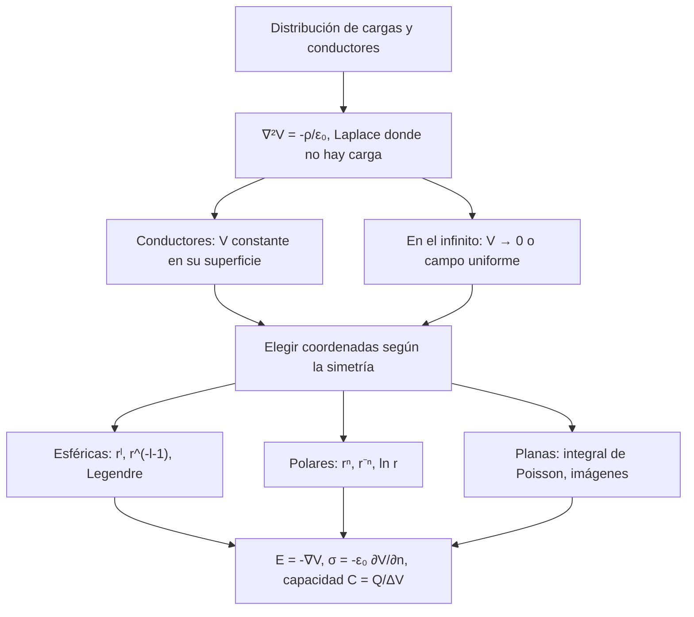

# Matemáticas para Ciencias Aplicadas IV - Ecuaciones de tipo Elíptico

## 8.3 Problemas de potencial.

---

Muchos campos de la física son el gradiente de un **potencial**: el campo eléctrico es $\mathbf{E} = -\nabla V,$ el gravitatorio $\mathbf{g} = -\nabla \Phi,$ la velocidad de un flujo ideal $\mathbf{v} = \nabla \phi.$ Trabajar con el potencial, una función escalar, es mucho más sencillo que con el campo vectorial, y en las regiones sin fuentes el potencial cumple la ecuación de Laplace. Este tema plantea los problemas de potencial más comunes en electrostática, con conductores y condensadores, y los resuelve en geometrías esféricas, cilíndricas y planas.

### Formulación

**Electrostática.** De la ley de Gauss $\nabla \cdot \mathbf{E} = \rho/\varepsilon_0$ y de $\mathbf{E} = -\nabla V$ se obtiene

$$ \nabla^2 V = -\frac{\rho}{\varepsilon_0} $$

En las regiones sin carga, $\nabla^2 V = 0.$ Un **conductor** en equilibrio tiene el mismo potencial en todos sus puntos (si no, las cargas libres se moverían), así que su superficie es una condición de Dirichlet. La carga se acumula en la superficie con densidad $\sigma = \varepsilon_0 E_n = -\varepsilon_0 \frac{\partial V}{\partial n},$ con $n$ la normal hacia afuera del conductor.

**Otras situaciones.**

| Campo | Potencial | Ecuación | Condiciones típicas |
| --- | --- | --- | --- |
| eléctrico | $V,$ $\mathbf{E} = -\nabla V$ | $\nabla^2 V = -\rho/\varepsilon_0$ | conductores a potencial fijo |
| gravitatorio | $\Phi,$ $\mathbf{g} = -\nabla \Phi$ | $\nabla^2 \Phi = 4\pi G \rho$ | $\Phi \to 0$ en el infinito |
| flujo ideal | $\phi,$ $\mathbf{v} = \nabla \phi$ | $\nabla^2 \phi = 0$ | $\partial \phi / \partial n = 0$ en obstáculos |
| magnético sin corrientes | $\psi,$ $\mathbf{H} = -\nabla \psi$ | $\nabla^2 \psi = 0$ | continuidad en interfaces |



### Ejemplos resueltos

**Ejemplo 1: condensador de placas paralelas.** Entre dos placas planas en $x = 0$ y $x = d,$ a potenciales $0$ y $V_0,$ con dimensiones grandes comparadas con $d,$ el problema es unidimensional: $V'' = 0,$ así que $V = V_0 x / d$ y el campo es uniforme, $E = -V_0/d.$ La carga por unidad de área es $\varepsilon_0 V_0 / d,$ y la capacidad de placas de área $A$ es $C = \varepsilon_0 A / d.$

**Ejemplo 2: cable coaxial.** Entre dos cilindros de radios $a \lt b,$ a potenciales $V_0$ y $0,$ la solución radial en el plano es $V = A + B \ln r,$ y con las condiciones,

$$ V(r) = V_0 \frac{\ln(b/r)}{\ln(b/a)} $$

La carga por unidad de longitud del cilindro interior es $2\pi a \varepsilon_0 E(a) = \frac{2\pi \varepsilon_0 V_0}{\ln(b/a)},$ y la capacidad por unidad de longitud, $\frac{2\pi\varepsilon_0}{\ln(b/a)}.$

### Implementación en Python

El programa resuelve con SymPy los cuatro ejercicios: el condensador esférico y su capacidad, el cilindro conductor en un campo uniforme y la carga que se induce en él, la franja cargada en el borde de un semiplano (comprobando sus valores límite) y la esfera con dos hemisferios a potenciales opuestos, cuya serie de Legendre se compara con la fórmula cerrada en el eje.

```python
import numpy as np
import sympy as sp
from scipy.special import eval_legendre

r, th, a, b, Va, Vb, E0, R, eps = sp.symbols("r theta a b V_a V_b E_0 R epsilon_0", positive=True)
x, y = sp.symbols("x y", real=True)

# Ejercicio 1: esferas concéntricas, V = A + B/r
A, B = sp.symbols("A B")
V = A + B / r
s = sp.solve([V.subs(r, a) - Va, V.subs(r, b) - Vb], [A, B])
V1 = sp.simplify(V.subs(s))
print("ejercicio 1: V(r) =", V1)
print("   laplaciano radial:", sp.simplify(sp.diff(r**2 * sp.diff(V1, r), r) / r**2))
Q = sp.simplify(4 * sp.pi * eps * a**2 * (-sp.diff(V1, r)).subs(r, a))
print("   carga en la esfera interior Q =", Q, "; capacidad Q/(Va - Vb) =", sp.simplify(Q / (Va - Vb)))

# Ejercicio 2: cilindro conductor (V = 0) en un campo uniforme E0 en la dirección x
V2 = -E0 * (r - R**2 / r) * sp.cos(th)
print("ejercicio 2: Δ V =", sp.simplify(sp.diff(V2, r, 2) + sp.diff(V2, r) / r + sp.diff(V2, th, 2) / r**2),
      "| V(R) =", V2.subs(r, R), "| lejos, V ≈", sp.limit(V2 / r, r, sp.oo), "* r")
sigma = sp.simplify(eps * (-sp.diff(V2, r)).subs(r, R))
print("   densidad de carga superficial σ = ε0 E_r(R) =", sigma)

# Ejercicio 3: semiplano y > 0, V = V0 en |x| < a, 0 fuera
V0 = sp.symbols("V_0", positive=True)
V3 = V0 / sp.pi * (sp.atan((x + a) / y) - sp.atan((x - a) / y))
print("ejercicio 3: Δ V =", sp.simplify(sp.diff(V3, x, 2) + sp.diff(V3, y, 2)))
f3 = sp.lambdify((x, y), V3.subs({V0: 1, a: 1}))
print("   cerca del borde: V(0, 1e-6) =", f"{f3(0, 1e-6):.6f}", " V(2, 1e-6) =", f"{f3(2, 1e-6):.6f}",
      " V(1, 1e-6) =", f"{f3(1, 1e-6):.4f}", " V(0, 1) =", f"{f3(0, 1):.4f}")

# Ejercicio 4: esfera con hemisferio superior a +V0 e inferior a -V0
t = sp.symbols("t")
coef = {k: (2 * k + 1) * sp.integrate(sp.legendre(k, t), (t, 0, 1)) for k in range(1, 10, 2)}
print("ejercicio 4: c_l para l impar =", coef, "(para l par, c_l = 0)")
# (2l + 1) ∫_0^1 P_l = P_{l-1}(0) - P_{l+1}(0), por (2l + 1) P_l = (P_{l+1} - P_{l-1})'
cnum = {k: eval_legendre(k - 1, 0.0) - eval_legendre(k + 1, 0.0) for k in range(1, 402, 2)}
print("   comprobación de la fórmula:", [round(float(cnum[k]), 6) for k in (1, 3, 5, 7, 9)])


def V4(rr, tt, L=401):
    return sum(cnum[k] * rr**k * eval_legendre(k, np.cos(tt)) for k in range(1, L + 1, 2))


eje = lambda z: (1 - (1 - z**2) / np.sqrt(1 + z**2)) / z
for z in (0.2, 0.5, 0.9):
    print(f"   V/V0 en el eje, r = {z}: serie {V4(z, 0):.6f}, fórmula cerrada {eje(z):.6f}")
print("   V/V0 en el ecuador:", f"{V4(0.7, np.pi / 2):.6f}",
      "| cerca del borde, r = 0.98: θ = 30°", f"{V4(0.98, np.pi / 6):.4f}", " θ = 150°", f"{V4(0.98, 5 * np.pi / 6):.4f}")
```

Salida:

```text
ejercicio 1: V(r) = (a*b*(-V_a + V_b) + r*(V_a*a - V_b*b))/(r*(a - b))
   laplaciano radial: 0
   carga en la esfera interior Q = 4*pi*a*b*epsilon_0*(-V_a + V_b)/(a - b) ; capacidad Q/(Va - Vb) = -4*pi*a*b*epsilon_0/(a - b)
ejercicio 2: Δ V = 0 | V(R) = 0 | lejos, V ≈ -E_0*cos(theta) * r
   densidad de carga superficial σ = ε0 E_r(R) = 2*E_0*epsilon_0*cos(theta)
ejercicio 3: Δ V = 0
   cerca del borde: V(0, 1e-6) = 0.999999  V(2, 1e-6) = 0.000000  V(1, 1e-6) = 0.5000  V(0, 1) = 0.5000
ejercicio 4: c_l para l impar = {1: 3/2, 3: -7/8, 5: 11/16, 7: -75/128, 9: 133/256} (para l par, c_l = 0)
   comprobación de la fórmula: [1.5, -0.875, 0.6875, -0.585938, 0.519531]
   V/V0 en el eje, r = 0.2: serie 0.293213, fórmula cerrada 0.293213
   V/V0 en el eje, r = 0.5: serie 0.658359, fórmula cerrada 0.658359
   V/V0 en el eje, r = 0.9: serie 0.954193, fórmula cerrada 0.954193
   V/V0 en el ecuador: 0.000000 | cerca del borde, r = 0.98: θ = 30° 0.9899  θ = 150° -0.9899
```

En el ejercicio 3, el potencial en el borde vale $V_0$ sobre la franja, 0 fuera de ella y $V_0/2$ justo en el salto, $x = \pm a;$ en $(0, 1)$ también es $1/2,$ porque desde ese punto la franja $[-1, 1]$ se ve bajo un ángulo de $90°$ y la fracción del ángulo total $\pi$ es la mitad. En el ejercicio 4 la serie converge lentamente cerca de la superficie, donde el dato tiene un salto, pero da $\pm 0.99$ a $r = 0.98,$ muy cerca de los valores del borde.

### Ejercicios Propuestos

1. **Condensador esférico.** Encuentra el potencial entre dos esferas concéntricas de radios $a \lt b$ con potenciales $V_a$ y $V_b,$ y la capacidad del condensador.

2. **Cilindro en un campo uniforme.** Un cilindro conductor largo de radio $R,$ a potencial 0, se coloca en un campo eléctrico uniforme $\mathbf{E} = E_0 \hat{\mathbf{x}}.$ Encuentra el potencial alrededor del cilindro y la carga inducida en su superficie.

3. **Franja en el borde de un semiplano.** Encuentra el potencial en $y > 0$ si el borde $y = 0$ está a potencial $V_0$ para $|x| \lt a$ y a 0 para $|x| > a.$

4. **Hemisferios.** Encuentra el potencial dentro de una esfera de radio $R$ cuya mitad superior, $0 \lt \theta \lt \pi/2,$ está a potencial $+V_0$ y la inferior a $-V_0.$

### Soluciones

**Ejercicio 1.** Con simetría esférica, $V = A + B/r;$ con las condiciones,

$$ V(r) = \frac{a V_a - b V_b}{a - b} + \frac{ab (V_b - V_a)}{(a - b)\, r} $$

El campo en $r = a$ es $-V'(a),$ la carga en la esfera interior es $Q = 4\pi a^2 \varepsilon_0 E(a) = \frac{4\pi\varepsilon_0 ab (V_a - V_b)}{b - a},$ y la capacidad es $C = \frac{4\pi \varepsilon_0 ab}{b - a}.$ Si $b \to \infty,$ queda $4\pi\varepsilon_0 a,$ la capacidad de una esfera aislada.

**Ejercicio 2.** Lejos del cilindro $V \approx -E_0 x = -E_0 r \cos\theta.$ Se buscan soluciones $\left( A r + B/r \right) \cos\theta$ con $A = -E_0$ y $V(R) = 0,$ lo que da

$$ V(r, \theta) = -E_0 \left( r - \frac{R^2}{r} \right) \cos\theta $$

El término $R^2/r$ es el campo de las cargas inducidas, que tienen densidad $\sigma = 2\varepsilon_0 E_0 \cos\theta:$ positiva del lado hacia el que apunta el campo y negativa del otro, con carga total cero. El campo en la superficie, en $\theta = 0,$ es $2E_0,$ el doble del campo aplicado.

**Ejercicio 3.** Por la integral de Poisson del semiplano,

$$ V(x, y) = \frac{V_0}{\pi} \int_{-a}^{a} \frac{y\, d\xi}{(x - \xi)^2 + y^2} = \frac{V_0}{\pi} \left[ \arctan \frac{x + a}{y} - \arctan \frac{x - a}{y} \right] $$

Geométricamente, $V = V_0 \frac{\alpha}{\pi},$ donde $\alpha$ es el ángulo bajo el que se ve la franja desde el punto $(x, y).$

**Ejercicio 4.** Con simetría axial y acotada en el centro, $V = V_0 \sum_l c_l (r/R)^l P_l(\cos\theta),$ con $c_l = \frac{2l + 1}{2} \int_{-1}^1 f(\mu) P_l(\mu)\, d\mu,$ donde $f = \pm 1$ es el dato en función de $\mu = \cos\theta.$ Como $f$ es impar, solo hay términos impares, con $c_l = (2l + 1) \int_0^1 P_l(\mu)\, d\mu.$ Usando la relación $(2l + 1) P_l = \left( P_{l + 1} - P_{l - 1} \right)'$ y $P_k(1) = 1,$ esa integral es $c_l = P_{l - 1}(0) - P_{l + 1}(0),$ lo que da

$$ V(r, \theta) = V_0 \left[ \frac{3}{2} \frac{r}{R} P_1(\cos\theta) - \frac{7}{8} \left( \frac{r}{R} \right)^3 P_3(\cos\theta) + \frac{11}{16} \left( \frac{r}{R} \right)^5 P_5(\cos\theta) - \cdots \right] $$

En el eje, la integral de Poisson para la esfera da la forma cerrada $V(z) = \frac{V_0 R}{z} \left( 1 - \frac{R^2 - z^2}{R\sqrt{R^2 + z^2}} \right),$ que coincide con la serie.

### Referencias

1. Griffiths, D. J., _Introduction to Electrodynamics_. Cambridge University Press, 2017. Capítulo 3.
2. Jackson, J. D., _Classical Electrodynamics_. Wiley, 1999. Capítulos 2 y 3.
3. Strauss, W. A., _Partial Differential Equations: An Introduction_. Wiley, 2008. Capítulos 6 y 10.
4. Tijonov, A. N., y Samarski, A. A., _Ecuaciones de la física matemática_. Mir, 1980. Capítulo 4.
