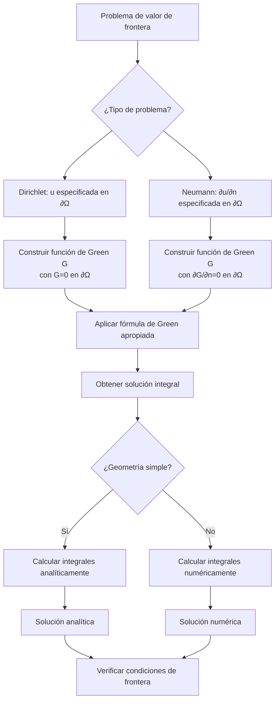

# Matemáticas para Ciencias Aplicadas IV - Ecuaciones de tipo Elíptico

## 8.4 Fórmulas de Green.

---

Las **fórmulas de Green** son herramientas matemáticas fundamentales en la teoría de ecuaciones diferenciales parciales elípticas. Proporcionan relaciones integrales entre funciones y sus derivadas que son esenciales para la formulación débil de problemas de valor de frontera y para el desarrollo de métodos numéricos como el de elementos finitos.

### Identidades Fundamentales de Green

#### Primera Identidad de Green

Para funciones $u, v \in C^2(\Omega) \cap C^1(\bar{\Omega}),$ donde $\Omega$ es un dominio acotado con frontera $\partial\Omega$ suave:

$$\int_{\Omega} (u \nabla^2 v + \nabla u \cdot \nabla v)  dV = \oint_{\partial\Omega} u \frac{\partial v}{\partial n}  dS$$

Donde $\frac{\partial v}{\partial n} = \nabla v \cdot \mathbf{n}$ es la derivada normal.

#### Segunda Identidad de Green (Teorema de Green)

$$\int_{\Omega} (u \nabla^2 v - v \nabla^2 u)  dV = \oint_{\partial\Omega} \left(u \frac{\partial v}{\partial n} - v \frac{\partial u}{\partial n}\right)  dS$$

#### Tercera Identidad de Green

Para cualquier función $u \in C^2(\Omega) \cap C^1(\bar{\Omega}):$

$$u(\mathbf{x}) = \int_{\Omega} G(\mathbf{x}, \mathbf{y}) \nabla^2 u(\mathbf{y})  dV(\mathbf{y}) - \oint_{\partial\Omega} \left[u(\mathbf{y}) \frac{\partial G}{\partial n}(\mathbf{x}, \mathbf{y}) - G(\mathbf{x}, \mathbf{y}) \frac{\partial u}{\partial n}(\mathbf{y})\right]  dS(\mathbf{y})$$

Donde $G(\mathbf{x}, \mathbf{y})$ es la función de Green.

### Función de Green para el Operador de Laplace

#### Definición

La función de Green $G(\mathbf{x}, \mathbf{y})$ para el operador de Laplace en un dominio $\Omega$ satisface:

$$\nabla^2 G(\mathbf{x}, \mathbf{y}) = -\delta(\mathbf{x} - \mathbf{y})$$

$$G(\mathbf{x}, \mathbf{y}) = 0 \quad \text{para } \mathbf{x} \in \partial\Omega$$

Donde $\delta$ es la delta de Dirac.

#### Función de Green para el Espacio Libre

En $\mathbb{R}^3:$

$$G(\mathbf{x}, \mathbf{y}) = \frac{1}{4\pi |\mathbf{x} - \mathbf{y}|}$$

En $\mathbb{R}^2:$

$$G(\mathbf{x}, \mathbf{y}) = -\frac{1}{2\pi} \ln|\mathbf{x} - \mathbf{y}|$$

### Aplicación a Problemas de Valor de Frontera

#### Solución del Problema de Dirichlet

$$u(\mathbf{x}) = \int_{\Omega} G(\mathbf{x}, \mathbf{y}) f(\mathbf{y})  dV(\mathbf{y}) + \oint_{\partial\Omega} u(\mathbf{y}) \frac{\partial G}{\partial n}(\mathbf{x}, \mathbf{y})  dS(\mathbf{y})$$

#### Solución del Problema de Neumann

$$u(\mathbf{x}) = \int_{\Omega} G(\mathbf{x}, \mathbf{y}) f(\mathbf{y})  dV(\mathbf{y}) - \oint_{\partial\Omega} G(\mathbf{x}, \mathbf{y}) \frac{\partial u}{\partial n}(\mathbf{y})  dS(\mathbf{y}) + C$$

### Diagrama de Flujo: Aplicación de las Fórmulas de Green



### Ejemplos Resueltos

#### Ejemplo 1: Aplicación de la Primera Identidad

Sea $u$ una función armónica $(\nabla^2 u = 0)$ en $\Omega.$ Demostrar que:

$$\int_{\Omega} |\nabla u|^2  dV = \oint_{\partial\Omega} u \frac{\partial u}{\partial n}  dS$$

**Solución**: Aplicando la primera identidad de Green con $v = u:$

$$\int_{\Omega} (u \nabla^2 u + \nabla u \cdot \nabla u)  dV = \oint_{\partial\Omega} u \frac{\partial u}{\partial n}  dS$$

Como $\nabla^2 u = 0,$ obtenemos:

$$\int_{\Omega} |\nabla u|^2  dV = \oint_{\partial\Omega} u \frac{\partial u}{\partial n}  dS$$

#### Ejemplo 2: Función de Green para el Semiespacio

Encontrar la función de Green para el problema de Dirichlet en el semiespacio $z > 0.$

**Solución**: Usando el método de imágenes:

$$G(\mathbf{x}, \mathbf{y}) = \frac{1}{4\pi|\mathbf{x} - \mathbf{y}|} - \frac{1}{4\pi|\mathbf{x} - \mathbf{y}'|}$$

Donde $\mathbf{y} = (y_1, y_2, y_3)$ y $\mathbf{y}' = (y_1, y_2, -y_3)$ es la imagen reflejada.

### Implementación Computacional

#### Código en Python para Calcular Integrales de Green

```python
import numpy as np
import matplotlib.pyplot as plt
from scipy import integrate
from sympy import symbols, diff, ln, pi, sqrt

def green_function_2d(x, y):
    """
    Función de Green en 2D: G(x,y) = -1/(2π) ln|x-y|
    """
    r = np.linalg.norm(np.array(x) - np.array(y))
    return -1/(2*np.pi) * np.log(r) if r > 0 else 0

def solve_dirichlet_2d(domain, boundary_condition, source_term=None, n_points=100):
    """
    Resolver problema de Dirichlet en 2D usando fórmula de Green
    """
    # Generar puntos en el dominio y la frontera
    x_vals = np.linspace(domain['x_min'], domain['x_max'], n_points)
    y_vals = np.linspace(domain['y_min'], domain['y_max'], n_points)

    # Matriz para almacenar la solución
    u_solution = np.zeros((n_points, n_points))

    for i, x in enumerate(x_vals):
        for j, y in enumerate(y_vals):
            if source_term is not None:
                # Término de volumen (integral sobre Ω)
                def integrand(xi, eta):
                    return (green_function_2d([x, y], [xi, eta]) *
                            source_term(xi, eta))

                volume_term = integrate.dblquad(integrand,
                                              domain['x_min'], domain['x_max'],
                                              domain['y_min'], domain['y_max'])[0]
            else:
                volume_term = 0

            # Término de frontera (integral sobre ∂Ω)
            # Para simplificar, asumimos frontera rectangular
            boundary_term = 0

            # Integrar sobre los cuatro lados del rectángulo
            for side in ['bottom', 'top', 'left', 'right']:
                if side == 'bottom':
                    def boundary_integral_bottom(s):
                        xi = s
                        eta = domain['y_min']
                        dGdn = derivative_normal_green([x, y], [xi, eta], 'bottom')
                        return (boundary_condition(xi, eta) * dGdn)

                    boundary_term += integrate.quad(boundary_integral_bottom,
                                                  domain['x_min'], domain['x_max'])[0]

                # Similar para los otros lados...

            u_solution[j, i] = volume_term + boundary_term

    return x_vals, y_vals, u_solution

def derivative_normal_green(x, y, side):
    """
    Calcular ∂G/∂n en el punto y de la frontera
    """
    # Implementar cálculo de la derivada normal de G
    # Depende de la geometría de la frontera
    pass

# Ejemplo de uso
domain = {'x_min': 0, 'x_max': 1, 'y_min': 0, 'y_max': 1}

def boundary_condition(x, y):
    # Ejemplo: frontera a potencial 1 en y=1, 0 en otros lados
    if y == 1:
        return 1.0
    else:
        return 0.0

# Resolver (nota: esta es una implementación simplificada)
x, y, u = solve_dirichlet_2d(domain, boundary_condition)

# Visualización
plt.contourf(x, y, u, levels=50, cmap='viridis')
plt.colorbar(label='Potencial u(x,y)')
plt.title('Solución usando Método de Green')
plt.xlabel('x')
plt.ylabel('y')
plt.show()
```

### Ejercicios Propuestos

1. **Verificación de la Segunda Identidad**: Para $u(x,y) = x^2 - y^2$ y $v(x,y) = e^x \cos y$ en el disco unitario, verificar la segunda identidad de Green.

2. **Función de Green para el Círculo**: Encontrar la función de Green para el problema de Dirichlet en un círculo de radio $R.$

3. **Problema de Neumann**: Usando las fórmulas de Green, resolver el problema de Neumann para la ecuación de Laplace en el semiplano $y > 0$ con $\frac{\partial u}{\partial n} = g(x)$ en $y=0.$

4. **Aplicación a la Ecuación de Poisson**: Resolver $\nabla^2 u = -1$ en el cuadrado unitario con condiciones de Dirichlet homogéneas usando el método de Green.

5. **Relación de Reciprocidad**: Demostrar que la función de Green satisface $G(\mathbf{x}, \mathbf{y}) = G(\mathbf{y}, \mathbf{x})$ para $\mathbf{x} \neq \mathbf{y}.$

### Aplicaciones de las Fórmulas de Green

1. **Teoría de Potencial**: Fundamentación matemática de los potenciales de capa simple y doble.

2. **Métodos de Elementos Finitos**: Formulación débil de problemas de valor de frontera.

3. **Teoría de Scattering**: Solución de la ecuación de Helmholtz en problemas de propagación de ondas.

4. **Electromagnetismo**: Cálculo de campos electromagnéticos usando potenciales.

5. **Mecánica de Fluidos**: Formulación integral de ecuaciones de flujo potencial.

### Referencias

#### Bibliografía Básica

1. Boyce, W., DiPrima, R. (2004). _Elementary Differential Equations and Boundary Value Problems_. Wiley, New York. (Capítulo 10 - Teorema de Green)
2. Edwards, C. H., Penney, D. E. (2002). _Ecuaciones diferenciales elementales y problemas con condiciones a la frontera_. Prentice Hall, México. (Capítulo 9 - Aplicaciones físicas)

#### Bibliografía Complementaria

1. Cooper, J. M. (1998). _Introduction to Partial Differential Equations with MatLab_. Birkhäuser, Boston. (Capítulo 4 - Problemas de valor de frontera)
2. Hubbard, J. H., West, B. H. (1995). _Differential Equations: A Dynamical Systems Approach_. Springer-Verlag, Berlin. (Capítulo 6 - Sistemas conservativos)
3. Zill, D. G., Wright, W. S. (1995). _Differential Equations with Computer Lab Experiments_. PWS Publishing Company, Boston. (Capítulo 13 - Ecuaciones elípticas)

### Consejos para el Estudio

1. **Domina el Teorema de la Divergencia**: Las fórmulas de Green son consecuencias directas de este teorema fundamental.

2. **Practica con Diferentes Geometrías**: Resuelve problemas en coordenadas cartesianas, cilíndricas y esféricas.

3. **Comprende el Significado Físico**: Interpreta las fórmulas de Green en términos de balances de flujo y conservación.

4. **Aprende Técnicas de Cálculo de Integrales**: Desarrolla habilidad en el cálculo de integrales de volumen y superficie.

5. **Familiarízate con Funciones Especiales**: Muchas funciones de Green involucran funciones especiales como polinomios de Legendre y funciones de Bessel.
