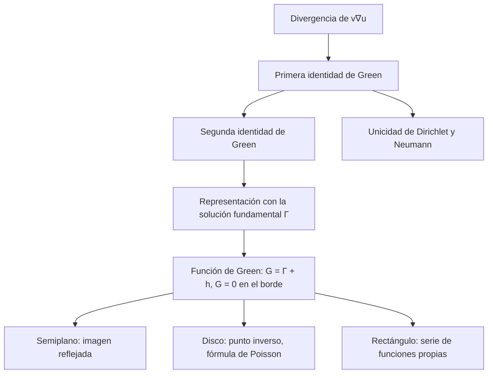

# Matemáticas para Ciencias Aplicadas IV - Ecuaciones de tipo Elíptico

## 8.4 Fórmulas de Green.

---

Las **fórmulas de Green** (George Green, 1828) son versiones del teorema de la divergencia adaptadas al laplaciano, el equivalente en varias variables de la integración por partes. Con ellas se demuestra la unicidad de los problemas de frontera, se expresa el valor de una función armónica en términos de sus valores en el borde y se construye la **función de Green**, que da la solución de la ecuación de Poisson como una integral. Este tema deduce las identidades, construye la función de Green para el semiplano y el disco, y obtiene la fórmula integral de Poisson.

### Las identidades de Green

Sea $\Omega$ una región acotada con frontera $\partial\Omega$ suave y normal exterior $\mathbf{n},$ y sean $u,$ $v$ funciones dos veces derivables. El **teorema de la divergencia** aplicado al campo $v \nabla u,$ cuya divergencia es $\nabla v \cdot \nabla u + v \nabla^2 u,$ da la **primera identidad de Green**:

$$ \iint_\Omega \left( v\, \nabla^2 u + \nabla u \cdot \nabla v \right) dA = \oint_{\partial\Omega} v\, \frac{\partial u}{\partial n}\, ds $$

Intercambiando $u$ y $v$ y restando, los términos con gradientes se cancelan y queda la **segunda identidad de Green**:

$$ \iint_\Omega \left( u\, \nabla^2 v - v\, \nabla^2 u \right) dA = \oint_{\partial\Omega} \left( u\, \frac{\partial v}{\partial n} - v\, \frac{\partial u}{\partial n} \right) ds $$

**Consecuencias inmediatas.**

- Con $v = 1:$ $\iint \nabla^2 u\, dA = \oint \frac{\partial u}{\partial n}\, ds.$ Si $u$ es armónica, el flujo neto por el borde es cero: es la condición de compatibilidad del problema de Neumann (tema 8.1).
- Con $v = u$ armónica: $\iint |\nabla u|^2\, dA = \oint u\, \frac{\partial u}{\partial n}\, ds.$ Si $u = 0$ en el borde (Dirichlet) o $\partial u / \partial n = 0$ (Neumann), $\nabla u = 0$ y $u$ es constante. Esto demuestra la **unicidad**: dos soluciones del problema de Dirichlet coinciden, y dos del de Neumann difieren en una constante.

### La solución fundamental

La **solución fundamental** del laplaciano en el plano es

$$ \Gamma(P, Q) = -\frac{1}{2\pi} \ln |P - Q| $$

Es armónica para $P \neq Q$ (tema 8.1) y cumple $-\nabla^2 \Gamma = \delta_Q$ en el sentido de que su flujo por cualquier circunferencia alrededor de $Q$ es $-1:$ $\oint \frac{\partial \Gamma}{\partial n}\, ds = -\frac{1}{2\pi\varepsilon} \cdot 2\pi\varepsilon = -1.$ Físicamente es el potencial de una carga lineal unitaria, o la temperatura producida por una fuente puntual de calor. En el espacio es $\frac{1}{4\pi |P - Q|}.$

**Fórmula de representación.** Aplicando la segunda identidad a $u$ y a $v = \Gamma(\cdot, P)$ en $\Omega$ menos un disco pequeño alrededor de $P,$ y haciendo tender el radio a cero, se obtiene

$$ u(P) = \iint_\Omega \Gamma\, \big( -\nabla^2 u \big)\, dA + \oint_{\partial\Omega} \left( \Gamma \frac{\partial u}{\partial n} - u \frac{\partial \Gamma}{\partial n} \right) ds $$

El valor de $u$ en cualquier punto depende de su laplaciano en el interior y de $u$ y $\partial u / \partial n$ en el borde. Pero en un problema de Dirichlet no se conoce $\partial u / \partial n;$ la función de Green elimina ese término.

### La función de Green

La **función de Green** de $\Omega$ para el problema de Dirichlet es

$$ G(P, Q) = \Gamma(P, Q) + h(P, Q) $$

donde $h$ es armónica en $P$ y se elige para que $G(P, Q) = 0$ cuando $P$ está en el borde. Con ella, la solución de $-\nabla^2 u = F$ en $\Omega$ con $u = f$ en el borde es

$$ u(Q) = \iint_\Omega G(P, Q)\, F(P)\, dA_P - \oint_{\partial\Omega} f(P)\, \frac{\partial G}{\partial n_P}(P, Q)\, ds_P $$

El primer término es la respuesta a la fuente: la suma de las respuestas a fuentes puntuales. El segundo, la respuesta a los datos de borde.

**Simetría.** $G(P, Q) = G(Q, P):$ la temperatura en $Q$ producida por una fuente en $P$ es igual a la temperatura en $P$ producida por la misma fuente en $Q.$

**Demostración.** Se aplica la segunda identidad a $u = G(\cdot, P)$ y $v = G(\cdot, Q)$ en $\Omega$ menos dos discos pequeños alrededor de $P$ y de $Q.$ Ambas son armónicas ahí y se anulan en el borde de $\Omega,$ así que solo quedan las integrales sobre las dos circunferencias pequeñas. Cuando los radios tienden a cero, la de alrededor de $P$ tiende a $-G(P, Q),$ por el flujo $-1$ de $G(\cdot, P),$ y la de alrededor de $Q$ tiende a $G(Q, P),$ y la suma es cero. $\blacksquare$

### Construcción por imágenes

**Semiplano superior.** En el semiplano $y > 0,$ si $Q = (\xi, \eta),$ su **imagen** respecto al borde es $Q^* = (\xi, -\eta).$ La función $G(P, Q) = -\frac{1}{2\pi} \big( \ln |P - Q| - \ln |P - Q^*| \big)$ es armónica en el semiplano salvo en $Q$ y se anula en $y = 0,$ donde $|P - Q| = |P - Q^*|.$ Calculando $-\partial G / \partial n,$ con $n$ hacia abajo, se obtiene la **integral de Poisson del semiplano**,

$$ u(x, y) = \frac{1}{\pi} \int_{-\infty}^{\infty} \frac{y\, f(\xi)}{(x - \xi)^2 + y^2}\, d\xi $$

**Disco.** En el disco de radio $R,$ la imagen de $Q$ es su punto inverso $Q^* = \frac{R^2}{|Q|^2} Q.$ Para $P$ en la circunferencia, por semejanza de triángulos, $|P - Q^*| = \frac{R}{|Q|} |P - Q|,$ así que

$$ G(P, Q) = -\frac{1}{2\pi} \left[ \ln |P - Q| - \ln \left( \frac{|Q|}{R} |P - Q^*| \right) \right] $$

se anula en el borde. Su derivada normal da la **fórmula integral de Poisson**: en coordenadas polares, para $Q = (r, \theta),$

$$ u(r, \theta) = \frac{1}{2\pi} \int_0^{2\pi} \frac{R^2 - r^2}{R^2 - 2Rr \cos(\theta - \varphi) + r^2}\, f(\varphi)\, d\varphi $$

En el centro, $r = 0,$ el núcleo vale 1 y se recupera la propiedad del valor medio.



### Función de Green por funciones propias

Si $\varphi_k$ son las funciones propias normalizadas de $-\nabla^2$ con condición de Dirichlet en $\Omega,$ con valores propios $\lambda_k,$

$$ G(P, Q) = \sum_k \frac{\varphi_k(P)\, \varphi_k(Q)}{\lambda_k} $$

En el cuadrado unitario, $\varphi_{mn} = 2 \sin m\pi x \sin n\pi y$ y $\lambda_{mn} = \pi^2 (m^2 + n^2).$ La fórmula muestra de nuevo la simetría de $G.$

### Implementación en Python

El programa verifica numéricamente la segunda identidad en el disco unitario, construye la función de Green del disco y comprueba su simetría y que se anula en el borde, evalúa la fórmula de Poisson con un dato cuya solución se conoce, resuelve un problema de Neumann en el semiplano con la fórmula del ejercicio 3 y calcula la solución del ejercicio 4 con la función de Green en serie.

```python
import numpy as np
from scipy.integrate import quad

# Ejercicio 1: segunda identidad de Green en el disco unitario
phi = np.linspace(0, 2 * np.pi, 20001)[:-1]
dphi = phi[1] - phi[0]
cx, cy = np.cos(phi), np.sin(phi)


def lado_borde(u, ux, uy, v, vx, vy):
    un = ux(cx, cy) * cx + uy(cx, cy) * cy        # derivada normal: n = (cos φ, sin φ)
    vn = vx(cx, cy) * cx + vy(cx, cy) * cy
    return np.sum(u(cx, cy) * vn - v(cx, cy) * un) * dphi


v = lambda x, y: np.exp(x) * np.cos(y)
vx = lambda x, y: np.exp(x) * np.cos(y)
vy = lambda x, y: -np.exp(x) * np.sin(y)
u1 = lambda x, y: x**2 - y**2
print("ejercicio 1, u = x² - y², v = e^x cos y:  borde =",
      f"{lado_borde(u1, lambda x, y: 2 * x, lambda x, y: -2 * y, v, vx, vy):.2e}", " interior = 0 (ambas armónicas)")
u2 = lambda x, y: x**2 + y**2
print("   u = x² + y² (Δu = 4):  borde =",
      f"{lado_borde(u2, lambda x, y: 2 * x, lambda x, y: 2 * y, v, vx, vy):.8f}",
      " interior -4 ∬ v dA = -4π =", f"{-4 * np.pi:.8f}")

# Ejercicio 2: función de Green del disco y fórmula de Poisson
def G(P, Q, R=1.0):
    P, Q = np.asarray(P, float), np.asarray(Q, float)
    d = np.linalg.norm(P - Q)
    if np.allclose(Q, 0):
        return -np.log(d / R) / (2 * np.pi)
    Qs = R**2 * Q / np.dot(Q, Q)                 # punto inverso
    return -(np.log(d) - np.log(np.linalg.norm(P - Qs)) + np.log(R / np.linalg.norm(Q))) / (2 * np.pi)


P, Q = (0.3, 0.4), (-0.5, 0.1)
print(f"ejercicio 5, simetría: G(P, Q) = {G(P, Q):.10f}, G(Q, P) = {G(Q, P):.10f}")
print(f"   G en el borde: G((0.6, 0.8), Q) = {abs(G((0.6, 0.8), Q)):.1e}, G((0, -1), Q) = {abs(G((0, -1), Q)):.1e}")


def poisson_disco(f, r, th, R=1.0):
    integrando = lambda t: (R**2 - r**2) / (R**2 - 2 * R * r * np.cos(th - t) + r**2) * f(t)
    return quad(integrando, 0, 2 * np.pi, limit=200)[0] / (2 * np.pi)


f = lambda t: np.cos(t) ** 2
r, th = 0.6, 0.7
print(f"   Poisson con f = cos²θ en (r, θ) = (0.6, 0.7): {poisson_disco(f, r, th):.10f},"
      f" exacta 1/2 + r² cos 2θ / 2 = {0.5 + 0.5 * r**2 * np.cos(2 * th):.10f}")

# Ejercicio 3: Neumann en el semiplano con u_y(x, 0) = 1/(1 + x²)
g = lambda s: 1 / (1 + s**2)


def neumann(x, y):
    return quad(lambda s: g(s) * np.log((x - s) ** 2 + y**2), -np.inf, np.inf, limit=400)[0] / (2 * np.pi)


exacta = lambda x, y: 0.5 * np.log(x**2 + (y + 1) ** 2)
print("ejercicio 3: fórmula - ½ ln(x² + (y+1)²) en tres puntos:",
      [f"{neumann(x, y) - exacta(x, y):.6f}" for x, y in ((0, 1), (2, 0.5), (-1, 3))])

# Ejercicio 4: Δu = -1 en el cuadrado unitario por la función de Green en serie
def u_green(x, y, N=199):
    k = np.arange(1, N + 1, 2)
    M, Nn = np.meshgrid(k, k, indexing="ij")
    coef = 16 / (np.pi**4 * M * Nn * (M**2 + Nn**2))
    return np.sum(coef * np.outer(np.sin(k * np.pi * x), np.sin(k * np.pi * y)))


print(f"ejercicio 4: u(1/2, 1/2) = {u_green(0.5, 0.5):.7f}, u(1/4, 1/4) = {u_green(0.25, 0.25):.7f}")
```

Salida:

```text
ejercicio 1, u = x² - y², v = e^x cos y:  borde = 7.14e-16  interior = 0 (ambas armónicas)
   u = x² + y² (Δu = 4):  borde = -12.56637061  interior -4 ∬ v dA = -4π = -12.56637061
ejercicio 5, simetría: G(P, Q) = 0.0449986301, G(Q, P) = 0.0449986301
   G en el borde: G((0.6, 0.8), Q) = 0.0e+00, G((0, -1), Q) = 3.5e-17
   Poisson con f = cos²θ en (r, θ) = (0.6, 0.7): 0.5305940857, exacta 1/2 + r² cos 2θ / 2 = 0.5305940857
ejercicio 3: fórmula - ½ ln(x² + (y+1)²) en tres puntos: ['0.000000', '-0.000000', '-0.000000']
ejercicio 4: u(1/2, 1/2) = 0.0736713, u(1/4, 1/4) = 0.0452861
```

En el ejercicio 3 la diferencia con $\frac{1}{2} \ln \big( x^2 + (y + 1)^2 \big)$ es la misma constante, 0, en los tres puntos: la fórmula reproduce la solución. Esa solución crece como $\ln r$ porque $\int g = \pi \neq 0:$ el semiplano recibe calor neto por su borde, que se dispersa hacia el infinito.

### Ejercicios Propuestos

1. **Segunda identidad.** Verifica la segunda identidad de Green en el disco unitario para $u = x^2 - y^2$ y $v = e^x \cos y,$ y luego para $u = x^2 + y^2$ y la misma $v.$

2. **Función de Green del círculo.** Construye la función de Green del problema de Dirichlet en un círculo de radio $R$ y deduce la fórmula integral de Poisson.

3. **Neumann en el semiplano.** Usando la función de Green con imagen par, $N(P, Q) = -\frac{1}{2\pi} \big( \ln |P - Q| + \ln |P - Q^*| \big),$ resuelve $\nabla^2 u = 0$ en $y > 0$ con $u_y(x, 0) = g(x).$

4. **Poisson en el cuadrado.** Resuelve $\nabla^2 u = -1$ en el cuadrado unitario con $u = 0$ en el borde usando la función de Green en serie de funciones propias.

5. **Reciprocidad.** Demuestra que $G(P, Q) = G(Q, P).$

### Soluciones

**Ejercicio 1.** Para el primer par, ambas funciones son armónicas, el lado izquierdo es 0 y el programa obtiene $7 \times 10^{-16}$ en el borde. Para el segundo, $\nabla^2 u = 4$ y $\nabla^2 v = 0,$ así que el lado izquierdo es $-4 \iint v\, dA = -4 \pi v(0, 0) = -4\pi$ por el valor medio, y la integral sobre el borde da $-12.56637061 = -4\pi.$

**Ejercicio 2.** Es la construcción por el punto inverso de arriba. Para $P$ en el borde, la derivada normal de $G$ respecto a $P$ es $-\frac{R^2 - |Q|^2}{2\pi R |P - Q|^2},$ y con $|P - Q|^2 = R^2 - 2Rr\cos(\theta - \varphi) + r^2$ y $ds = R\, d\varphi$ resulta la fórmula de Poisson.

**Ejercicio 3.** $N$ tiene derivada normal nula en $y = 0,$ y la fórmula de representación da $u(Q) = -\int g(\xi) N\big( (\xi, 0), Q \big)\, d\xi + C.$ En el borde $|P - Q| = |P - Q^*|,$ así que

$$ u(x, y) = \frac{1}{2\pi} \int_{-\infty}^{\infty} g(\xi) \ln \big( (x - \xi)^2 + y^2 \big)\, d\xi + C $$

la misma fórmula que se obtuvo en el tema 8.1 integrando la de Poisson.

**Ejercicio 4.** Con $F = 1,$ $u(Q) = \iint G(P, Q)\, dA_P = \sum_{m, n} \frac{\varphi_{mn}(Q)}{\lambda_{mn}} \iint \varphi_{mn}\, dA,$ y como $\iint \varphi_{mn} = \frac{8}{mn\pi^2}$ para $m,$ $n$ impares y 0 en otro caso,

$$ u(x, y) = \frac{16}{\pi^4} \sum_{m, n \text{ impares}} \frac{\sin m\pi x \sin n\pi y}{mn (m^2 + n^2)} $$

En el centro, $u(1/2, 1/2) \approx 0.0736713.$

**Ejercicio 5.** Es la demostración de la simetría del tema; el programa la comprueba en el disco con dos puntos concretos.

### Referencias

1. Strauss, W. A., _Partial Differential Equations: An Introduction_. Wiley, 2008. Capítulo 7.
2. Evans, L. C., _Partial Differential Equations_. AMS, 2010. Sección 2.2.
3. Green, G., _An Essay on the Application of Mathematical Analysis to the Theories of Electricity and Magnetism_. Nottingham, 1828.
4. Tijonov, A. N., y Samarski, A. A., _Ecuaciones de la física matemática_. Mir, 1980. Capítulo 4.
