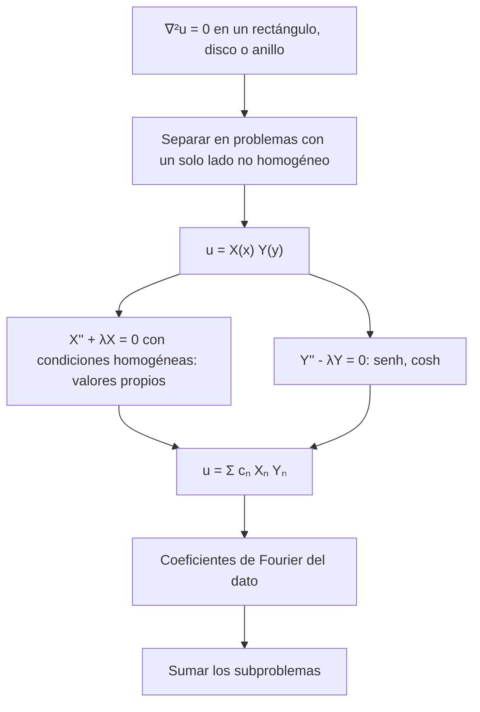

# Matemáticas para Ciencias Aplicadas IV - Ecuaciones de tipo Elíptico

## 8.5 Resolución de problemas simples por método de separación de variables.

---

La separación de variables resuelve la ecuación de Laplace en dominios donde el borde está formado por curvas coordenadas: rectángulos en cartesianas, discos, anillos y sectores en polares, cilindros y esferas en el espacio. A diferencia de las ecuaciones de onda y del calor, aquí las dos variables son espaciales y ninguna es "el tiempo": una de ellas da el problema de valores propios, con senos y cosenos, y la otra da funciones hiperbólicas o potencias de $r.$ Este tema presenta el procedimiento general, lo aplica a rectángulos con distintas condiciones, al problema de Poisson, a la ecuación de Helmholtz y al disco, y estudia la convergencia de las series.

### Procedimiento general

1. **Elegir coordenadas** en las que el borde esté formado por líneas coordenadas.
2. **Homogeneizar.** El método necesita que la condición sea homogénea en dos lados opuestos, los de la variable que dará el problema de valores propios. Si hay datos no nulos en varios lados, se descompone el problema en varios, uno por lado (superposición).
3. **Separar** $u = X(x)\, Y(y)$ en $u_{xx} + u_{yy} = 0:$ $\frac{X''}{X} = -\frac{Y''}{Y} = -\lambda.$
4. **Resolver el problema de valores propios** en la variable con condiciones homogéneas: $X'' + \lambda X = 0.$
5. **Resolver la otra EDO**, $Y'' - \lambda Y = 0,$ con soluciones $\sinh,$ $\cosh$ o exponenciales, imponiendo la condición homogénea de su lado.
6. **Superponer** y ajustar el dato del lado restante con los coeficientes de Fourier.



### Ejemplos resueltos

**Ejemplo 1: rectángulo con un lado caliente.** En $[0, a] \times [0, b]$ con $u = 0$ en $x = 0,$ $x = a,$ $y = 0$ y $u(x, b) = f(x):$ con $X_n = \sin(n\pi x/a),$ $\lambda_n = (n\pi/a)^2,$ y $Y_n = \sinh(n\pi y/a),$ que se anula en $y = 0,$ se obtiene

$$ u(x, y) = \sum_{n = 1}^{\infty} c_n \frac{\sinh(n\pi y/a)}{\sinh(n\pi b/a)} \sin \frac{n\pi x}{a}, \qquad c_n = \frac{2}{a} \int_0^a f(x) \sin \frac{n\pi x}{a}\, dx $$

**Ejemplo 2: el disco.** En polares, $u = R(r)\, \Theta(\theta)$ en $u_{rr} + \frac{1}{r} u_r + \frac{1}{r^2} u_{\theta\theta} = 0$ da $\Theta'' + \lambda \Theta = 0$ con $\Theta$ periódica de período $2\pi,$ así que $\lambda = n^2$ y $\Theta = \cos n\theta,$ $\sin n\theta;$ y $r^2 R'' + r R' - n^2 R = 0,$ una ecuación de Euler con soluciones $r^n$ y $r^{-n},$ o $1$ y $\ln r$ si $n = 0.$ Dentro del disco se descartan $r^{-n}$ y $\ln r,$ que no están acotadas en el origen:

$$ u(r, \theta) = \frac{a_0}{2} + \sum_{n = 1}^{\infty} \left( \frac{r}{R} \right)^n \big( a_n \cos n\theta + b_n \sin n\theta \big) $$

Fuera del disco se usan $r^{-n},$ y en un anillo todas.

**Ejemplo 3: la ecuación de Poisson por reducción.** Para $\nabla^2 u = -1$ en el cuadrado unitario con $u = 0$ en el borde, la función $w = x(1 - x)/2$ cumple $\nabla^2 w = -1$ y se anula en $x = 0$ y $x = 1.$ Entonces $v = u - w$ es armónica, vale 0 en los lados verticales y $-w$ en los horizontales. Por simetría respecto a $y = 1/2$ conviene usar $\cosh(n\pi(y - 1/2)):$

$$ u(x, y) = \frac{x(1 - x)}{2} - \sum_{n \text{ impar}} \frac{4}{n^3 \pi^3} \frac{\cosh\big( n\pi (y - \tfrac{1}{2}) \big)}{\cosh(n\pi/2)} \sin n\pi x $$

usando que los coeficientes de seno de $x(1 - x)/2$ son $\frac{4}{n^3\pi^3}$ para $n$ impar. Esta serie simple converge mucho más rápido que la doble del tema 8.4.

### Convergencia y suavidad

En el interior del dominio, el factor $\frac{\sinh(n\pi y/a)}{\sinh(n\pi b/a)} \approx e^{-n\pi(b - y)/a}$ decae exponencialmente con $n,$ y la serie converge muy rápido aunque el dato sea discontinuo: es el efecto suavizante de la ecuación de Laplace. Cerca del lado con el dato, el decaimiento desaparece y la convergencia depende de la **suavidad del dato**: coeficientes como $1/n$ para un dato con saltos (incluido un dato que no se anula en las esquinas), $1/n^3$ para uno continuo con derivada continua que se anula en los extremos.

### Implementación en Python

El programa mide la convergencia de la serie del ejemplo 1 en el centro y cerca del lado caliente para dos datos de distinta suavidad, resuelve el ejercicio 1 y comprueba su condición de Neumann, evalúa la serie del ejemplo 3 con pocos términos, calcula los valores propios de Helmholtz del ejercicio 3 por la fórmula y por diferencias finitas, y compara la serie del disco del ejercicio 4 con una forma cerrada.

```python
import numpy as np
import scipy.sparse as sps
from scipy.sparse.linalg import eigsh

pi = np.pi


def razon(n, y, b):  # sinh(n y)/sinh(n b) sin desbordamiento
    return np.exp(n * (y - b)) * (1 - np.exp(-2 * n * y)) / (1 - np.exp(-2 * n * b))


# Ejemplo 1 y ejercicio 5: cuadrado [0, π]², u = f(x) en y = π, 0 en los demás lados
def placa(f_n, x, y, N):
    n = np.arange(1, N + 1)
    return np.sum(f_n(n) * razon(n, y, pi) * np.sin(n * x))


f_const = lambda n: np.where(n % 2 == 1, 4 / (n * pi), 0.0)                 # f = 1
f_parab = lambda n: np.where(n % 2 == 1, 8 / (pi * n**3), 0.0)              # f = x(π - x)
print("ejercicio 5: error de la serie truncada en x = π/2 (referencia con N = 20000)")
for nombre, fn in (("f = 1       ", f_const), ("f = x(π - x)", f_parab)):
    for y in (pi / 2, 0.99 * pi):
        ref = placa(fn, pi / 2, y, 20000)
        errs = [abs(placa(fn, pi / 2, y, N) - ref) for N in (5, 25, 125)]
        print(f"   {nombre} y = {y / pi:.2f}π: N = 5, 25, 125 ->", " ".join(f"{e:.1e}" for e in errs))

# Ejercicio 1: u_y(x, π) = 1, u = 0 en los otros tres lados: b_n n cosh(nπ) = g_n
def mixta(x, y, N=2001, derivada=False):
    n = np.arange(1, N + 1, 2)
    g = 4 / (n * pi)
    # sinh(ny)/cosh(nπ) y cosh(ny)/cosh(nπ) escritos sin desbordamiento
    e = np.exp(n * (y - pi)) / (1 + np.exp(-2 * n * pi))
    if derivada:
        return np.sum(g * e * (1 + np.exp(-2 * n * y)) * np.sin(n * x))
    return np.sum(g / n * e * (1 - np.exp(-2 * n * y)) * np.sin(n * x))


print("ejercicio 1: u_y(x, π) en x = 0.5, 1.5, 2.5:",
      [f"{mixta(x, pi, derivada=True):.4f}" for x in (0.5, 1.5, 2.5)],
      "| u(π/2, π/2) =", f"{mixta(pi / 2, pi / 2):.6f}")

# Ejercicio 2: Δu = -1 en [0, 1]², u = 0 en el borde: u = x(1 - x)/2 + v, v armónica
def poisson(x, y, N=99):
    n = np.arange(1, N + 1, 2)
    b = 4 / (n**3 * pi**3)
    return x * (1 - x) / 2 - np.sum(b * np.cosh(n * pi * (y - 0.5)) / np.cosh(n * pi / 2) * np.sin(n * pi * x))


for N in (1, 3, 9):
    print(f"ejercicio 2: u(1/2, 1/2) con N = {N}: {poisson(0.5, 0.5, N):.7f}")
print("   en el borde: u(0.3, 0) =", f"{poisson(0.3, 0.0):.1e}", " u(0.3, 1) =", f"{poisson(0.3, 1.0):.1e}")

# Ejercicio 3: Helmholtz en [0, 2] x [0, 1]: k² = π²(m²/4 + n²), comparado con diferencias finitas
a, b = 2.0, 1.0
exactos = sorted(pi**2 * (m**2 / a**2 + n**2 / b**2) for m in range(1, 6) for n in range(1, 4))[:5]
nx, ny = 159, 79
hx, hy = a / (nx + 1), b / (ny + 1)
Tx = sps.diags([-1.0, 2.0, -1.0], [-1, 0, 1], shape=(nx, nx)) / hx**2
Ty = sps.diags([-1.0, 2.0, -1.0], [-1, 0, 1], shape=(ny, ny)) / hy**2
Lap = sps.kron(sps.identity(ny), Tx) + sps.kron(Ty, sps.identity(nx))
num = np.sort(eigsh(Lap.tocsc(), k=5, sigma=0, which="LM")[0])
print("ejercicio 3: k² exactos   ", " ".join(f"{v:8.4f}" for v in exactos))
print("             k² numéricos ", " ".join(f"{v:8.4f}" for v in num))

# Ejercicio 4: disco unitario, f = 1 en 0 < θ < π y 0 en π < θ < 2π
def disco(r, th, N=2001):
    n = np.arange(1, N + 1, 2)
    return 0.5 + 2 / pi * np.sum(r**n * np.sin(n * th) / n)


cerrada = lambda r, th: 0.5 + np.arctan(2 * r * np.sin(th) / (1 - r**2)) / pi
for r, th in ((0.5, 1.0), (0.9, 4.0), (0.0, 2.0)):
    print(f"ejercicio 4: u({r}, {th}) serie {disco(r, th):.6f}, forma cerrada {cerrada(r, th):.6f}")
```

Salida:

```text
ejercicio 5: error de la serie truncada en x = π/2 (referencia con N = 20000)
   f = 1        y = 0.50π: N = 5, 25, 125 -> 3.0e-06 0.0e+00 0.0e+00
   f = 1        y = 0.99π: N = 5, 25, 125 -> 8.5e-02 1.1e-02 9.6e-05
   f = x(π - x) y = 0.50π: N = 5, 25, 125 -> 1.2e-07 0.0e+00 0.0e+00
   f = x(π - x) y = 0.99π: N = 5, 25, 125 -> 4.2e-03 3.2e-05 1.2e-08
ejercicio 1: u_y(x, π) en x = 0.5, 1.5, 2.5: ['1.0003', '0.9997', '1.0005'] | u(π/2, π/2) = 0.251519
ejercicio 2: u(1/2, 1/2) con N = 1: 0.0735863
ejercicio 2: u(1/2, 1/2) con N = 3: 0.0736721
ejercicio 2: u(1/2, 1/2) con N = 9: 0.0736714
   en el borde: u(0.3, 0) = 8.0e-08  u(0.3, 1) = 8.0e-08
ejercicio 3: k² exactos     12.3370  19.7392  32.0762  41.9458  49.3480
             k² numéricos   12.3357  19.7367  32.0685  41.9255  49.3265
ejercicio 4: u(0.5, 1.0) serie 0.768275, forma cerrada 0.768275
ejercicio 4: u(0.9, 4.0) serie 0.044112, forma cerrada 0.044112
ejercicio 4: u(0.0, 2.0) serie 0.500000, forma cerrada 0.500000
```

En el centro, cinco términos bastan para ambos datos; a $0.99\pi,$ junto al lado caliente, el dato constante necesita unos 125 términos para un error de $10^{-4},$ mientras que el dato $x(\pi - x)$ llega a $10^{-8}.$ En el ejemplo 3, con solo dos términos no nulos, $N = 3,$ el valor en el centro ya tiene un error menor que $10^{-6}.$

### Ejercicios Propuestos

1. **Condición mixta.** Resuelve $\nabla^2 u = 0$ en $0 \lt x \lt \pi,$ $0 \lt y \lt \pi$ con $u(0, y) = u(\pi, y) = 0,$ $u(x, 0) = 0$ y $u_y(x, \pi) = g(x).$ Aplícalo a $g = 1.$

2. **Fuente constante.** Resuelve $\nabla^2 u = -1$ en el cuadrado unitario con $u = 0$ en el borde, reduciendo el problema a uno de Laplace.

3. **Ecuación de Helmholtz.** Encuentra los valores de $k$ para los que $\nabla^2 u + k^2 u = 0$ tiene soluciones no nulas en el rectángulo $0 \lt x \lt a,$ $0 \lt y \lt b$ con $u = 0$ en el borde.

4. **Disco.** Resuelve $\nabla^2 u = 0$ en el disco $r \lt 1$ con $u(1, \theta) = 1$ para $0 \lt \theta \lt \pi$ y $u(1, \theta) = 0$ para $\pi \lt \theta \lt 2\pi.$

5. **Convergencia.** Para el ejemplo 1 en el cuadrado $[0, \pi]^2,$ estudia cómo depende la convergencia del número de términos, de la distancia al lado con el dato y de la suavidad de $f.$

### Soluciones

**Ejercicio 1.** $X_n = \sin nx$ y $Y_n = \sinh ny.$ Con $u = \sum b_n \sinh(ny) \sin(nx),$ la condición superior da $b_n\, n \cosh(n\pi) = g_n,$ donde $g_n = \frac{2}{\pi} \int_0^\pi g(x) \sin nx\, dx.$ Para $g = 1,$ $g_n = \frac{4}{n\pi}$ si $n$ es impar, y

$$ u(x, y) = \sum_{n \text{ impar}} \frac{4}{\pi n^2} \frac{\sinh ny}{\cosh n\pi} \sin nx $$

El programa comprueba que $u_y(x, \pi) \approx 1.$

**Ejercicio 2.** Es el ejemplo 3: $u(1/2, 1/2) \approx 0.0736713,$ el mismo valor que con la función de Green en el tema 8.4.

**Ejercicio 3.** Con $u = X Y,$ $X'' + \mu X = 0$ y $Y'' + \nu Y = 0$ con $\mu + \nu = k^2$ y condiciones de Dirichlet: $X = \sin(m\pi x/a),$ $Y = \sin(n\pi y/b),$ y

$$ k^2_{mn} = \pi^2 \left( \frac{m^2}{a^2} + \frac{n^2}{b^2} \right), \qquad m, n \geq 1 $$

Son las frecuencias de la membrana rectangular (tema 6.5) y los niveles de energía de una partícula en una caja en mecánica cuántica. Para $a = 2,$ $b = 1,$ los primeros son $12.337,$ $19.739,$ $32.076;$ las diferencias finitas con $h = 1/80$ los aproximan con error relativo del orden de $10^{-4}.$

**Ejercicio 4.** Los coeficientes de Fourier del dato son $a_0 = 1,$ $a_n = 0$ y $b_n = \frac{2}{n\pi}$ para $n$ impar, así que

$$ u(r, \theta) = \frac{1}{2} + \frac{2}{\pi} \sum_{n \text{ impar}} \frac{r^n \sin n\theta}{n} = \frac{1}{2} + \frac{1}{\pi} \arctan \frac{2r \sin\theta}{1 - r^2} $$

donde la forma cerrada se obtiene sumando la serie con $\sum_{n \text{ impar}} \frac{z^n}{n} = \frac{1}{2} \ln \frac{1 + z}{1 - z}$ y tomando la parte imaginaria con $z = r e^{i\theta}.$ En el centro, $u = 1/2,$ el promedio del dato.

**Ejercicio 5.** Lejos del lado con el dato, la convergencia es exponencial para cualquier $f;$ cerca de él, los errores con $f = 1$ son de orden $10^{-2}$ con 25 términos, y con $f = x(\pi - x)$ de orden $10^{-5}:$ un dato más suave da coeficientes que decrecen más rápido, como en las series de Fourier.

### Referencias

1. Haberman, R., _Applied Partial Differential Equations with Fourier Series and Boundary Value Problems_. Pearson, 2013. Secciones 2.5, 7.3 y 8.6.
2. Boyce, W. E., DiPrima, R. C., and Meade, D. B., _Elementary Differential Equations and Boundary Value Problems_. Wiley, 2017. Sección 10.8.
3. Strauss, W. A., _Partial Differential Equations: An Introduction_. Wiley, 2008. Secciones 6.2 a 6.4.
4. Tijonov, A. N., y Samarski, A. A., _Ecuaciones de la física matemática_. Mir, 1980. Capítulo 4.
