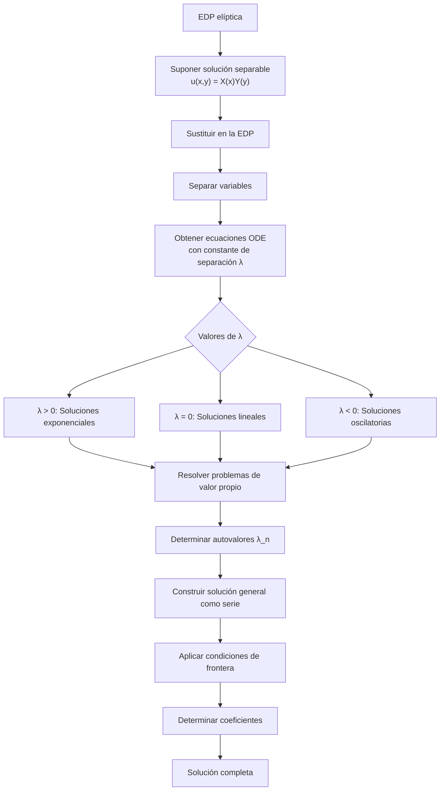

# Matemáticas para Ciencias Aplicadas IV - Ecuaciones de tipo Elíptico

## 8.5 Resolución de problemas simples por método de separación de variables.

---

El **método de separación de variables** es una técnica fundamental para resolver ecuaciones diferenciales parciales (EDP) elípticas. Este método permite reducir una EDP a un sistema de ecuaciones diferenciales ordinarias, facilitando su solución para problemas con geometrías simples y condiciones de frontera adecuadas.

### Fundamentos del Método de Separación de Variables

#### Idea Central

Supongamos que la solución $u(x,y)$ de una EDP puede expresarse como el producto de funciones que dependen de una sola variable:

$$u(x, y) = X(x)Y(y)$$

Al sustituir esta forma en la EDP, la ecuación se separa en ecuaciones ordinarias para $X(x)$ e $Y(y)$.

#### Ecuación de Laplace en Coordenadas Cartesianas

Para la ecuación de Laplace en 2D:

$$\nabla^2 u = \frac{\partial^2 u}{\partial x^2} + \frac{\partial^2 u}{\partial y^2} = 0$$

Sustituyendo $u(x, y) = X(x)Y(y)$:

$$X''(x)Y(y) + X(x)Y''(y) = 0$$

Dividiendo entre $X(x)Y(y)$:

$$\frac{X''(x)}{X(x)} = -\frac{Y''(y)}{Y(y)} = -\lambda$$

Donde $\lambda$ es la constante de separación.

### Procedimiento General



### Ejemplos Resueltos

#### Ejemplo 1: Placa Rectangular con Condiciones de Dirichlet

**Problema**: Resolver $\nabla^2 u = 0$ en el rectángulo $0 < x < a$, $0 < y < b$ con:

- $u(0,y) = u(a,y) = 0$
- $u(x,0) = 0$, $u(x,b) = f(x)$

**Solución**:

1. **Separación de variables**: $u(x,y) = X(x)Y(y)$
2. **Ecuaciones resultantes**:
   - $X'' + \lambda X = 0$
   - $Y'' - \lambda Y = 0$
3. **Condiciones de frontera**:
   - $X(0) = X(a) = 0$
   - $Y(0) = 0$
4. **Problema de autovalores para X(x)**:
   - $\lambda_n = \left(\frac{n\pi}{a}\right)^2$
   - $X_n(x) = \sin\left(\frac{n\pi x}{a}\right)$
5. **Solución para Y(y)**:
   - $Y_n(y) = A_n \sinh\left(\frac{n\pi y}{a}\right)$
6. **Solución general**:

   $$u(x,y) = \sum_{n=1}^{\infty} A_n \sin\left(\frac{n\pi x}{a}\right) \sinh\left(\frac{n\pi y}{a}\right)$$

7. **Determinar coeficientes**:

   $$A_n = \frac{2}{a\sinh(n\pi b/a)} \int_0^a f(x) \sin\left(\frac{n\pi x}{a}\right) dx$$

#### Ejemplo 2: Problema con Condiciones de Neumann

**Problema**: Resolver $\nabla^2 u = 0$ en $0 < x < \pi$, $0 < y < \pi$ con:

- $\frac{\partial u}{\partial x}(0,y) = \frac{\partial u}{\partial x}(\pi,y) = 0$
- $u(x,0) = 0$, $u(x,\pi) = g(x)$

**Solución**:

1. **Autovalores**: $\lambda_n = n^2$
2. **Autofunciones**: $X_n(x) = \cos(nx)$
3. **Solución**:

   $$u(x,y) = A_0 y + \sum_{n=1}^{\infty} A_n \cos(nx) \sinh(ny)$$

4. **Coeficientes**:

   $$A_0 = \frac{1}{\pi^2} \int_0^{\pi} g(x) dx$$

   $$A_n = \frac{2}{\pi\sinh(n\pi)} \int_0^{\pi} g(x) \cos(nx) dx$$

### Implementación Computacional

#### Código en Python para Resolver Problema de Dirichlet

```python
import numpy as np
import matplotlib.pyplot as plt

def solve_laplace_separation(a, b, f, N_terms=50, nx=100, ny=100):
    """
    Resuelve la ecuación de Laplace en un rectángulo usando separación de variables
    """
    # Puntos de la malla
    x = np.linspace(0, a, nx)
    y = np.linspace(0, b, ny)
    X, Y = np.meshgrid(x, y)

    # Inicializar solución
    u = np.zeros((ny, nx))

    # Calcular coeficientes de Fourier
    A_n = np.zeros(N_terms)
    for n in range(1, N_terms + 1):
        # Integrar para encontrar coeficientes
        integrand = lambda x: f(x) * np.sin(n * np.pi * x / a)
        A_n[n-1] = (2 / (a * np.sinh(n * np.pi * b / a)) * \
                   np.trapz(integrand(x), x)

    # Construir solución
    for n in range(1, N_terms + 1):
        u += A_n[n-1] * np.sin(n * np.pi * X / a) * np.sinh(n * np.pi * Y / a)

    return X, Y, u

# Ejemplo de uso
a, b = 1.0, 1.0  # Dimensiones del rectángulo

def f(x):
    # Condición de frontera en y = b
    return np.sin(np.pi * x)  # Ejemplo simple

X, Y, u = solve_laplace_separation(a, b, f, N_terms=20)

# Visualización
plt.figure(figsize=(10, 8))
contour = plt.contourf(X, Y, u, levels=50, cmap='viridis')
plt.colorbar(contour, label='u(x,y)')
plt.xlabel('x')
plt.ylabel('y')
plt.title('Solución por Separación de Variables')
plt.show()
```

#### Código para Calcular Coeficientes de Fourier

```python
def fourier_coefficients(f, a, n_terms, L):
    """
    Calcula coeficientes de Fourier para una función f en [0,L]
    """
    coefficients = np.zeros(n_terms)
    for n in range(1, n_terms + 1):
        integrand = lambda x: f(x) * np.sin(n * np.pi * x / L)
        coefficients[n-1] = (2 / L) * np.trapz(integrand(np.linspace(0, L, 1000)),
                                              np.linspace(0, L, 1000))
    return coefficients

# Ejemplo: coeficientes para diferentes funciones
L = 1.0
x_vals = np.linspace(0, L, 1000)

# Diferentes condiciones de frontera
f1 = lambda x: np.sin(np.pi * x)  # Senoidal
f2 = lambda x: np.where(x < 0.5, 1, 0)  # Escalón
f3 = lambda x: x * (1 - x)  # Parábola

# Calcular y visualizar coeficientes
n_terms = 10
coeffs1 = fourier_coefficients(f1, L, n_terms, L)
coeffs2 = fourier_coefficients(f2, L, n_terms, L)
coeffs3 = fourier_coefficients(f3, L, n_terms, L)

plt.figure(figsize=(12, 4))
plt.subplot(131)
plt.bar(range(1, n_terms+1), coeffs1)
plt.title('f(x) = sin(πx)')
plt.subplot(132)
plt.bar(range(1, n_terms+1), coeffs2)
plt.title('f(x) = escalón')
plt.subplot(133)
plt.bar(range(1, n_terms+1), coeffs3)
plt.title('f(x) = x(1-x)')
plt.tight_layout()
plt.show()
```

### Ejercicios Propuestos

1. **Placa con condiciones mixtas**: Resuelva $\nabla^2 u = 0$ en $0 < x < \pi$, $0 < y < \pi$ con:
   - $u(0,y) = u(\pi,y) = 0$
   - $u(x,0) = 0$, $\frac{\partial u}{\partial y}(x,\pi) = g(x)$

2. **Problema con fuente constante**: Resuelva $\nabla^2 u = -1$ en el cuadrado unitario con condiciones de Dirichlet homogéneas.

3. **Ecuación de Helmholtz**: Resuelva $\nabla^2 u + k^2 u = 0$ en el rectángulo $0 < x < a$, $0 < y < b$ con $u = 0$ en la frontera.

4. **Problema en coordenadas polares**: Resuelva $\nabla^2 u = 0$ en el disco $r < R$ con $u(R,\theta) = f(\theta)$.

5. **Análisis de convergencia**: Para el Ejemplo 1, estudie cómo la convergencia de la serie depende del número de términos y de la suavidad de $f(x)$.

### Aplicaciones del Método

1. **Problemas de temperatura estacionaria**: Distribución de temperatura en placas.
2. **Potencial electrostático**: Campos eléctricos en geometrías simples.
3. **Mecánica de fluidos**: Flujos potenciales.
4. **Elasticidad**: Deformaciones en placas delgadas.
5. **Difusión estacionaria**: Concentración en estado estable.

### Referencias

#### Bibliografía Básica

1. Boyce, W., DiPrima, R. (2004). _Elementary Differential Equations and Boundary Value Problems_. Wiley, New York. (Capítulo 10 - Separación de variables)
2. Edwards, C. H., Penney, D. E. (2002). _Ecuaciones diferenciales elementales y problemas con condiciones a la frontera_. Prentice Hall, México. (Capítulo 9 - EDP elípticas)

#### Bibliografía Complementaria

1. Cooper, J. M. (1998). _Introduction to Partial Differential Equations with MatLab_. Birkhäuser, Boston. (Capítulo 4 - Métodos de solución)
2. Hubbard, J. H., West, B. H. (1995). _Differential Equations: A Dynamical Systems Approach_. Springer-Verlag, Berlin. (Capítulo 6 - Sistemas conservativos)
3. Zill, D. G., Wright, W. S. (1995). _Differential Equations with Computer Lab Experiments_. PWS Publishing Company, Boston. (Capítulo 13 - EDP elípticas)

### Consejos para el Estudio

1. **Domina las técnicas de separación**: Practica con diferentes sistemas coordenados (cartesianas, polares, cilíndricas, esféricas).

2. **Comprende los problemas de autovalores**: Reconoce cómo las condiciones de frontera determinan los autovalores y autofunciones.

3. **Desarrolla habilidad con series de Fourier**: Aprende a calcular coeficientes para diferentes tipos de funciones.

4. **Analiza la convergencia**: Entiende cómo la suavidad de las condiciones de frontera afecta la convergencia de las series.

5. **Verifica soluciones**: Siempre comprueba que tu solución satisface la EDP y las condiciones de frontera.
