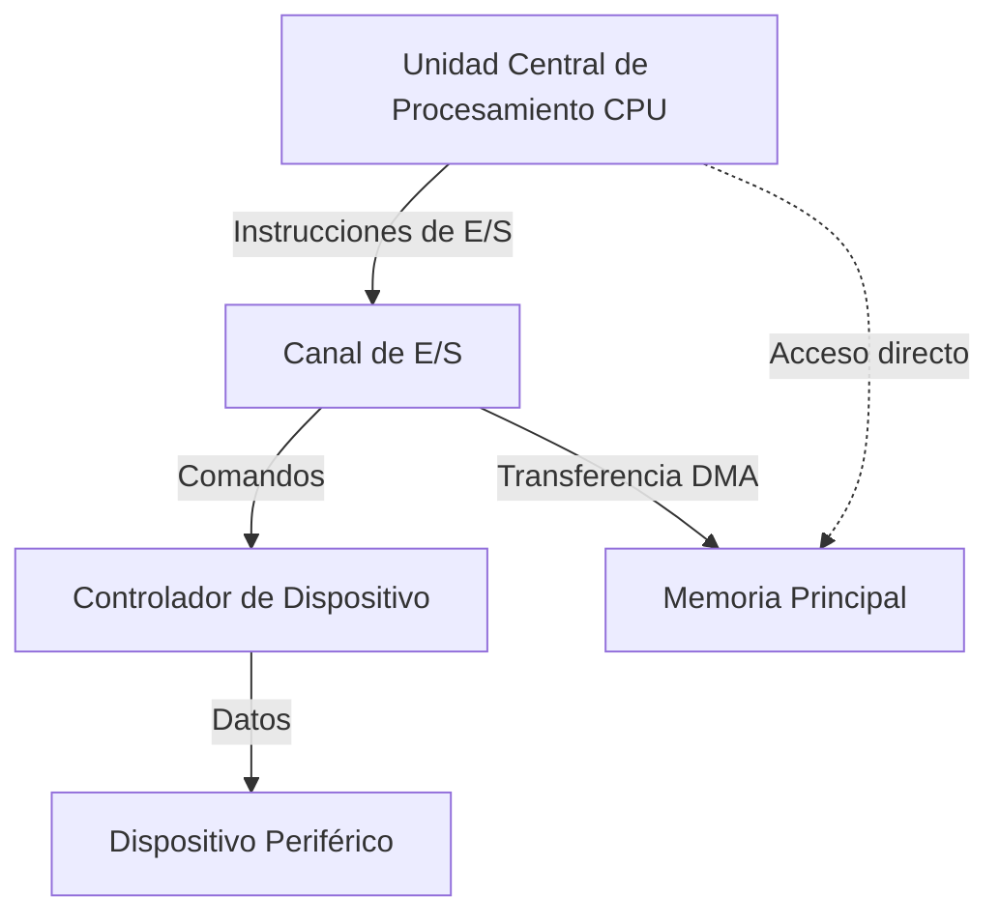
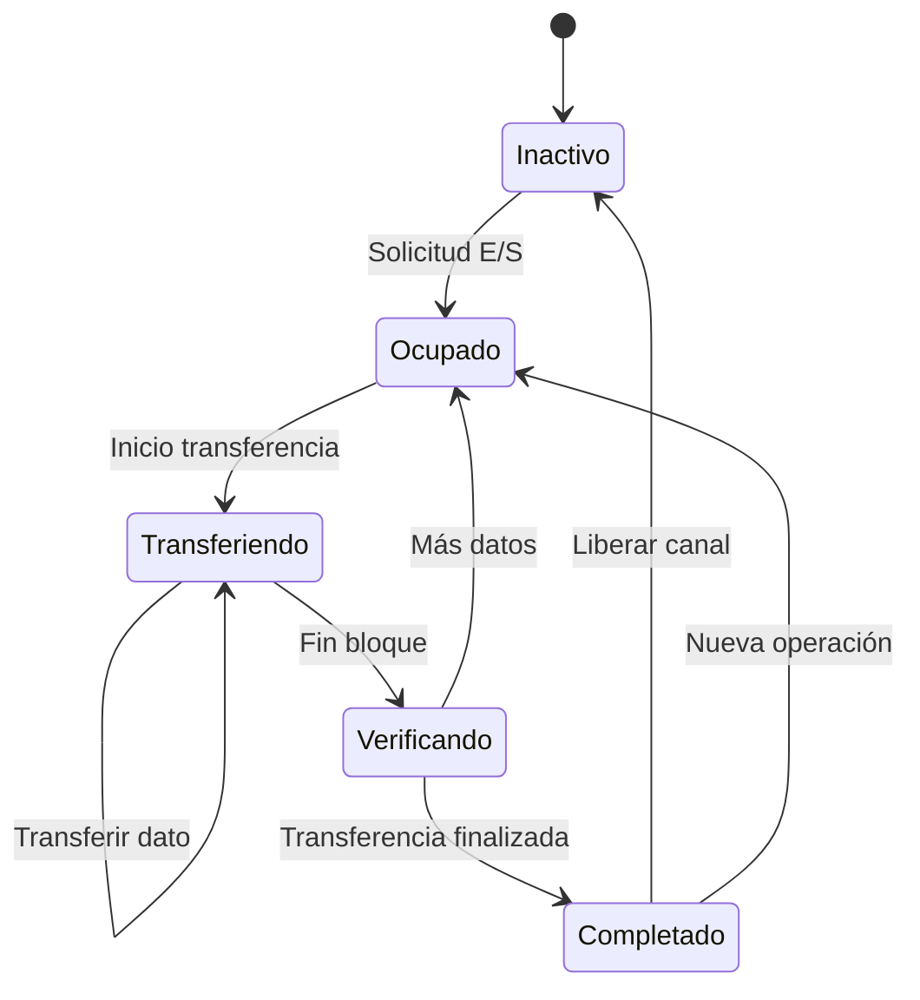

# Organización y Arquitectura de Computadoras - Entrada/Salida y canales

## 10.1 Canales, conceptos y sincronización

---

Los canales de entrada/salida son procesadores especializados que gestionan la comunicación entre los dispositivos periféricos y la memoria principal, liberando a la CPU de estas tareas. Constituyen un elemento fundamental en sistemas con requerimientos intensivos de E/S.

### Conceptos Fundamentales

#### Definición de Canal

Un canal es un procesador dedicado que ejecuta instrucciones de E/S (denominadas comandos de canal) independientemente de la CPU principal. Su función principal es controlar uno o más dispositivos periféricos y gestionar la transferencia de datos entre estos dispositivos y la memoria.

#### Arquitectura de Canales



#### Tipos de Canales

##### Canal Selector

Controla un único dispositivo de alta velocidad a la vez. Cuando un dispositivo está siendo servido, el canal está dedicado exclusivamente a ese dispositivo hasta que completa la operación.

##### Canal Multiplexor

Puede manejar múltiples dispositivos simultáneamente, intercalando transferencias de datos entre ellos. Ideal para dispositivos de baja y media velocidad.

##### Canal Multiplexor por Byte vs. por Bloque

- **Por byte**: Intercala bytes de diferentes dispositivos
- **Por bloque**: Asigna el canal completo a un dispositivo hasta transferir un bloque completo

### Sincronización en Canales de E/S

#### Mecanismos de Sincronización

La sincronización entre la CPU y los canales se gestiona principalmente mediante:

##### 1. Espera Activa (Polling)

La CPU verifica repetidamente el estado del canal hasta que indica que ha completado la operación.

##### 2. Interrupciones

El canal genera una interrupción cuando completa una operación, permitiendo a la CPU continuar con otras tareas.

##### 3. Acceso Directo a Memoria (DMA)

El canal transfiere datos directamente entre el dispositivo y la memoria sin intervención de la CPU.

#### Protocolos de Sincronización

##### Handshaking

Secuencia de señales de control entre el canal y el dispositivo:

1. Solicitud (Request)
2. Reconocimiento (Acknowledge)
3. Transferencia de datos
4. Finalización

### Fórmulas y Parámetros de Rendimiento

#### Tiempo de Transferencia

El tiempo total para transferir un bloque de datos:

$$T_{transferencia} = T_{inicio} + \frac{N}{R} + T_{finalizacion}$$

Donde:

- $T_{inicio}$ = Tiempo de inicialización (overhead)
- $N$ = Cantidad de datos a transferir
- $R$ = Tasa de transferencia del dispositivo
- $T_{finalizacion}$ = Tiempo de finalización

#### Ancho de Banda Efectivo

$$B_{efectivo} = \frac{N}{T_{transferencia}}$$

#### Overhead de CPU

Porcentaje de tiempo que la CPU dedica a gestionar operaciones de E/S:

$$ Overhead_{CPU} = \frac{T_{CPU-E/S}}{T_{total}} \times 100\% $$

### Ejemplos de Operación de Canales

#### Ejemplo 1: Transferencia con DMA

```python
# Pseudocódigo de una transferencia DMA típica
def transferencia_dma(origen, destino, tamaño):
    # Paso 1: CPU configura el controlador DMA
    dma_configurar_direccion(origen)    # Dirección fuente
    dma_configurar_destino(destino)     # Dirección destino
    dma_configurar_tamaño(tamaño)       # Cantidad de datos

    # Paso 2: CPU inicia transferencia y continúa procesamiento
    dma_iniciar()

    # Paso 3: DMA realiza transferencia directamente a memoria
    while dma_esta_activo():
        # La CPU puede ejecutar otras tareas
        ejecutar_otras_tareas()

    # Paso 4: DMA genera interrupción al finalizar
    if dma_completado():
        procesar_interrupcion_dma()
```

#### Ejemplo 2: Comandos de Canal CCW

Los Channel Command Words (CCW) son instrucciones que ejecuta el canal:

| Campo     | Función                                  | Tamaño típico |
| --------- | ---------------------------------------- | ------------- |
| Comando   | Operación a realizar (READ, WRITE, etc.) | 1 byte        |
| Dirección | Dirección en memoria para transferencia  | 4 bytes       |
| Contador  | Número de bytes a transferir             | 2 bytes       |
| Flags     | Modificadores de operación               | 1 byte        |

### Ejercicios Propuestos

#### Ejercicio 1: Cálculo de Tiempo de Transferencia

Un disco duro tiene una tasa de transferencia de 200 MB/s. El overhead de inicialización del canal es de 2 ms y el overhead de finalización es de 1.5 ms. Calcule:

a) El tiempo total para transferir un archivo de 800 MB
b) El ancho de banda efectivo de la transferencia
c) El porcentaje de tiempo dedicado a overhead

**Solución:**

a)

$$T_{transferencia} = 2ms + \frac{800 \times 10^6 bytes}{200 \times 10^6 bytes/s} + 1.5ms$$

$$T_{transferencia} = 0.002 + 4 + 0.0015 = 4.0035 segundos$$

b)

$$B_{efectivo} = \frac{800}{4.0035} \approx 199.82 MB/s$$

c)

$$ Overhead = \frac{0.002 + 0.0015}{4.0035} \times 100\% \approx 0.0875\% $$

#### Ejercicio 2: Planificación de Canales

Un canal multiplexor debe atender tres dispositivos con las siguientes características:

- Dispositivo A: transfiere bloques de 4 KB cada 10 ms
- Dispositivo B: transfiere bloques de 2 KB cada 5 ms
- Dispositivo C: transfiere bloques de 1 KB cada 2 ms

Calcule la tasa de transferencia mínima que debe tener el canal para atender todos los dispositivos sin pérdida de datos.

#### Ejercicio 3: Análisis de Rendimiento

Compare el overhead de CPU para transferir 1 GB de datos usando:
a) E/S programada (1 ciclo de CPU por byte transferido, CPU a 3 GHz)
b) DMA (1000 ciclos de overhead por transferencia, independiente del tamaño)

### Implementación de Mecanismos de Sincronización

#### Ejemplo de Implementación con Semáforos

```c
#include <pthread.h>
#include <semaphore.h>

// Estructura para gestionar canal de E/S
typedef struct {
    sem_t sem_disponible;    // Semáforo para controlar acceso al canal
    sem_t sem_completado;    // Semáforo para señalizar completado
    int dispositivo_activo;
    volatile int transferencia_completada;
} canal_io;

// Inicialización del canal
void canal_init(canal_io *canal) {
    sem_init(&canal->sem_disponible, 0, 1); // Inicialmente disponible
    sem_init(&canal->sem_completado, 0, 0); // Inicialmente no completado
    canal->dispositivo_activo = -1;
    canal->transferencia_completada = 0;
}

// Función para solicitar uso del canal
int solicitar_canal(canal_io *canal, int dispositivo_id) {
    sem_wait(&canal->sem_disponible); // Espera a que el canal esté disponible
    canal->dispositivo_activo = dispositivo_id;
    canal->transferencia_completada = 0;
    return 1; // Canal asignado
}

// Función para liberar el canal
void liberar_canal(canal_io *canal) {
    canal->dispositivo_activo = -1;
    sem_post(&canal->sem_disponible); // Libera el canal
}

// Simulación de transferencia completada
void transferencia_completada(canal_io *canal) {
    canal->transferencia_completada = 1;
    sem_post(&canal->sem_completado); // Señaliza completado
}
```

### Diagrama de Estados de un Canal



### Referencias

#### Bibliografía Básica

1. Hennessy, John L. y David A. Patterson. _Computer Architecture: A Quantitative Approach_, 4a Ed. (Capítulo 6: Storage Systems)
2. Patterson, David A. y John L. Hennessy. _Computer Organization and Design: The Hardware/Software Interface_, 4a Ed. (Capítulo 8: Input/Output Systems)

#### Bibliografía Complementaria

1. Stallings, William. _Computer Organization and Architecture: Designing for Performance_ (Capítulo 7: Input/Output)
2. Tanenbaum, Andrew S. _Structured Computer Organization_, 5a Ed. (Capítulo 5: Input/Output)

#### Recursos Adicionales

- IEEE Transactions on Computers: Artículos sobre arquitecturas de E/S
- ACM Computing Surveys: Estudios sobre performance de sistemas de E/S
- Documentación técnica de fabricantes: Intel, AMD, IBM sobre implementaciones de DMA y canales

### Tendencias Actuales

Los conceptos de canales de E/S han evolucionado hacia:

- Controladores DMA integrados en chipsets
- Tecnologías como PCI Express con transferencias punto a punto
- Canales virtualizados en entornos de nube
- Arquitecturas NVMe para almacenamiento de alta velocidad
