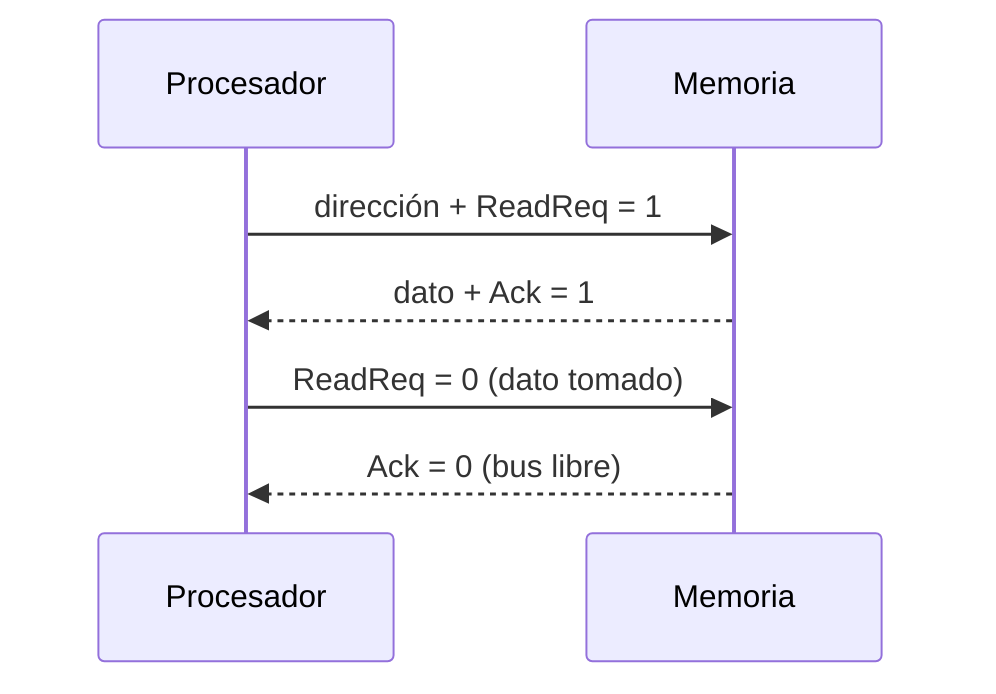

# Organización y Arquitectura de Computadoras - Entrada/Salida y canales

## 10.1 Canales, conceptos y sincronización

---

Los dispositivos de entrada y salida (E/S) son extremadamente variados: un teclado produce unos pocos bytes por segundo, un SSD varios gigabytes por segundo, y sus tiempos de respuesta van de nanosegundos a segundos. El procesador no puede tratar con cada uno directamente, así que entre ellos hay **módulos de E/S**, **buses** y, en los sistemas grandes, **canales**: procesadores especializados que ejecutan sus propios programas de E/S. Este tema presenta la organización de la E/S, las técnicas para transferir datos (E/S programada, interrupciones, DMA y canales), los tipos de canal y los mecanismos de **sincronización** entre el emisor y el receptor de un bus.

### Organización de la E/S

Cada dispositivo se conecta a un **controlador** (módulo de E/S) que ofrece al procesador una interfaz uniforme de **registros**: de datos, de estado (listo, ocupado, error) y de control (comandos). El procesador accede a esos registros con instrucciones de E/S específicas o, más comúnmente, como si fueran posiciones de memoria (**E/S mapeada en memoria**, tema 8.2).

**Técnicas de transferencia,** de menor a mayor autonomía del dispositivo:

| Técnica | Quién mueve los datos | Quién detecta que el dispositivo está listo | Uso del procesador |
| --- | --- | --- | --- |
| E/S programada con sondeo | el procesador, palabra a palabra | el procesador, consultando el estado | total durante la transferencia |
| E/S por interrupciones | el procesador, palabra a palabra | el dispositivo, con una interrupción | una interrupción por palabra o por pequeño bloque |
| acceso directo a memoria (DMA) | el controlador de DMA | el controlador | solo al iniciar y al terminar cada bloque |
| canal de E/S (procesador de E/S) | el canal, siguiendo un programa | el canal | solo al iniciar y terminar el programa completo |

### Canales de E/S

Un **canal** (introducido en el IBM 709 en 1958 y generalizado en el IBM System/360) es un procesador sencillo dedicado a la E/S. El procesador central escribe en memoria un **programa de canal**, una lista de **palabras de comando** (CCW) con la operación (leer, escribir, buscar, controlar), la dirección de memoria, la cantidad de bytes y bits de **encadenamiento**; luego ejecuta una sola instrucción para arrancar el canal y sigue con otro trabajo. El canal ejecuta los comandos, transfiere los datos por DMA y avisa con una interrupción al terminar todo el programa.

| Tipo de canal | Funcionamiento | Dispositivos |
| --- | --- | --- |
| **selector** | atiende a un dispositivo cada vez, durante toda su transferencia | rápidos: discos, cintas |
| **multiplexor** (de bytes) | intercala bytes de muchos dispositivos | lentos: terminales, impresoras |
| **multiplexor de bloques** | intercala bloques de varios dispositivos rápidos | discos modernos |

Un canal multiplexor debe tener una capacidad al menos igual a la **suma** de las tasas de sus dispositivos; uno selector, al menos igual a la del dispositivo más rápido. Las mainframes de IBM conservan los canales; en las computadoras personales y servidores, su papel lo cumplen los controladores con DMA y colas de comandos (como NVMe), que funcionan con el mismo principio: listas de comandos en memoria que el dispositivo procesa de forma autónoma.

### Sincronización

**Buses síncronos.** Todas las transferencias se rigen por una señal de **reloj** común, con un protocolo fijo: por ejemplo, la dirección en el ciclo 1 y el dato en el ciclo 3. Son sencillos y rápidos, pero todos los dispositivos deben poder seguir el reloj y, por el **desfase del reloj** (_clock skew_), el bus no puede ser muy largo. Así eran los buses entre procesador y memoria.

**Buses asíncronos.** No hay reloj: el emisor y el receptor se coordinan con un **protocolo de saludo** (_handshake_). En el saludo de **cuatro fases** para una lectura:

1. El procesador pone la dirección en el bus y activa `ReadReq`.
2. La memoria ve `ReadReq`, lee la dirección, pone el dato y activa `Ack`.
3. El procesador ve `Ack`, toma el dato y desactiva `ReadReq`.
4. La memoria ve `ReadReq` en 0 y desactiva `Ack`. El bus queda libre.

Cada fase espera a la anterior, así que el protocolo se adapta automáticamente a la velocidad de cada dispositivo y tolera buses largos, a costa de varios retardos de propagación por transferencia. Las señales asíncronas que llegan a un circuito síncrono deben pasar por **sincronizadores** (dos flip-flops en serie) para reducir el riesgo de metaestabilidad (tema 4.2).

**Enlaces serie modernos.** USB, SATA, PCI Express y Ethernet transmiten bits en serie a muy alta frecuencia por pares diferenciales, **recuperando el reloj** a partir de los propios datos (codificaciones 8b/10b o 128b/130b que garantizan suficientes transiciones), y organizan la comunicación en **paquetes** con control de flujo por créditos.



### Rendimiento

El tiempo de una transferencia de $n$ bytes con tasa $B$ y costos fijos de inicio y fin $t_0$ es $T = t_0 + n/B,$ y el **ancho de banda efectivo** es $n / T.$ Para transferencias pequeñas domina el costo fijo; para grandes, la tasa del dispositivo.

### Implementación en Python

El programa resuelve los tres ejercicios, muestra cómo el ancho de banda efectivo depende del tamaño de la transferencia, traza el saludo de cuatro fases con dos dispositivos de distinta velocidad y simula un pequeño programa de canal con dos comandos encadenados.

```python
# Ejercicio 1: transferencia con costos fijos de inicio y fin
tasa, inicio, fin, tam = 200e6, 2e-3, 1.5e-3, 800e6
T = inicio + tam / tasa + fin
print(f"ejercicio 1: T = {T:.4f} s, ancho de banda efectivo {tam / T / 1e6:.2f} MB/s, sobrecosto {(inicio + fin) / T:.4%}")
for t in (4e3, 64e3, 1e6, 800e6):                      # el sobrecosto pesa en transferencias pequeñas
    T = inicio + t / tasa + fin
    print(f"   {t / 1e3:>9.0f} KB: ancho de banda efectivo {t / T / 1e6:7.2f} MB/s")

# Ejercicio 2: canal multiplexor
dispositivos = {"A": (4096, 10e-3), "B": (2048, 5e-3), "C": (1024, 2e-3)}
total = 0
for nombre, (bloque, periodo) in dispositivos.items():
    total += bloque / periodo
    print(f"ejercicio 2, {nombre}: {bloque / periodo / 1024:.1f} KiB/s")
print(f"   tasa mínima del canal: {total / 1024:.1f} KiB/s = {total / 1e6:.4f} MB/s")

# Ejercicio 3: E/S programada frente a DMA para 1 GB a 3 GHz
f = 3e9
pio = 1e9 * 1
for bloque in (1e9, 4096):
    dma = (1e9 / bloque) * 1000
    print(f"ejercicio 3: E/S programada {pio / f:.3f} s de CPU; DMA en bloques de {bloque:.0f} B:"
          f" {dma:.0f} ciclos = {dma / f * 1e3:.4f} ms")


# Bus asíncrono: protocolo de saludo de cuatro fases (lectura de memoria)
def saludo(retardo_dispositivo, retardo_bus=5):
    t, eventos = 0, []
    for quien, accion, retardo in (("CPU", "pone la dirección y activa ReadReq", retardo_bus),
                                   ("memoria", "ve ReadReq, lee la dirección, prepara el dato y activa Ack", retardo_dispositivo),
                                   ("CPU", "ve Ack, toma el dato y desactiva ReadReq", retardo_bus),
                                   ("memoria", "ve ReadReq en 0 y desactiva Ack", retardo_bus)):
        t += retardo
        eventos.append(f"t = {t:3d} ns  {quien:8s} {accion}")
    return t, eventos


for r in (20, 80):
    t, ev = saludo(r)
    print(f"saludo de cuatro fases con un dispositivo de {r} ns: {t} ns")
    if r == 20:
        for e in ev:
            print("   ", e)


# Un programa de canal: lista de comandos encadenados que el canal ejecuta sin la CPU
memoria = bytearray(64)
disco = {7: b"HOLA", 8: b"MUNDO"}
programa = [("LEER", 7, 0, True), ("LEER", 8, 4, False)]    # (operación, bloque, dirección, encadenar)
for op, bloque, dirc, cadena in programa:
    datos = disco[bloque]
    memoria[dirc:dirc + len(datos)] = datos
    print(f"canal: {op} bloque {bloque} -> memoria[{dirc}] ({len(datos)} bytes){', encadenado' if cadena else ''}")
    if not cadena:
        print("canal: fin del programa, interrupción a la CPU; memoria =", bytes(memoria[:9]).decode())
```

Salida:

```text
ejercicio 1: T = 4.0035 s, ancho de banda efectivo 199.83 MB/s, sobrecosto 0.0874%
           4 KB: ancho de banda efectivo    1.14 MB/s
          64 KB: ancho de banda efectivo   16.75 MB/s
        1000 KB: ancho de banda efectivo  117.65 MB/s
      800000 KB: ancho de banda efectivo  199.83 MB/s
ejercicio 2, A: 400.0 KiB/s
ejercicio 2, B: 400.0 KiB/s
ejercicio 2, C: 500.0 KiB/s
   tasa mínima del canal: 1300.0 KiB/s = 1.3312 MB/s
ejercicio 3: E/S programada 0.333 s de CPU; DMA en bloques de 1000000000 B: 1000 ciclos = 0.0003 ms
ejercicio 3: E/S programada 0.333 s de CPU; DMA en bloques de 4096 B: 244140625 ciclos = 81.3802 ms
saludo de cuatro fases con un dispositivo de 20 ns: 35 ns
    t =   5 ns  CPU      pone la dirección y activa ReadReq
    t =  25 ns  memoria  ve ReadReq, lee la dirección, prepara el dato y activa Ack
    t =  30 ns  CPU      ve Ack, toma el dato y desactiva ReadReq
    t =  35 ns  memoria  ve ReadReq en 0 y desactiva Ack
saludo de cuatro fases con un dispositivo de 80 ns: 95 ns
canal: LEER bloque 7 -> memoria[0] (4 bytes), encadenado
canal: LEER bloque 8 -> memoria[4] (5 bytes)
canal: fin del programa, interrupción a la CPU; memoria = HOLAMUNDO
```

Con un costo fijo de 3.5 ms, un bloque de 4 KB solo aprovecha 1.14 MB/s de los 200 MB/s del dispositivo: por eso los sistemas agrupan las transferencias pequeñas.

### Ejercicios Propuestos

1. **Tiempo de transferencia.** Un disco transfiere a 200 MB/s y el canal tiene costos de 2 ms al iniciar y 1.5 ms al terminar. Para un archivo de 800 MB calcula el tiempo total, el ancho de banda efectivo y el porcentaje de tiempo de sobrecosto.

2. **Canal multiplexor.** Un canal atiende tres dispositivos: A transfiere bloques de 4 KiB cada 10 ms, B de 2 KiB cada 5 ms y C de 1 KiB cada 2 ms. ¿Qué tasa mínima necesita el canal?

3. **E/S programada frente a DMA.** Compara el tiempo de procesador para transferir 1 GB con E/S programada (1 ciclo por byte a 3 GHz) y con DMA (1000 ciclos por transferencia).

4. **Síncrono o asíncrono.** ¿Por qué un bus asíncrono puede conectar dispositivos de velocidades muy distintas sin desperdiciar tiempo con los rápidos?

### Soluciones

**Ejercicio 1.** $T = 0.002 + 800/200 + 0.0015 = 4.0035$ s; el ancho de banda efectivo es $800 / 4.0035 \approx 199.83$ MB/s y el sobrecosto $3.5 / 4003.5 \approx 0.087\,\%.$ Para un archivo tan grande el costo fijo es despreciable.

**Ejercicio 2.** A y B necesitan 400 KiB/s cada uno y C 500 KiB/s: un canal multiplexor necesita al menos $1300$ KiB/s (unos 1.33 MB/s). Un canal selector bastaría con 500 KiB/s si pudiera atender los dispositivos de uno en uno, pero C perdería datos mientras atiende a los demás.

**Ejercicio 3.** E/S programada: $10^9$ ciclos, 0.33 s de procesador. DMA: si todo se transfiere de una vez, 1000 ciclos (0.33 µs); en bloques de 4 KiB, unas 244 000 transferencias y 81 ms, todavía 4 veces menos que la E/S programada, y el procesador queda libre durante cada bloque.

**Ejercicio 4.** Porque cada fase del saludo empieza cuando el otro lado ha respondido: con un dispositivo rápido el ciclo dura poco (35 ns en el ejemplo) y con uno lento lo que el dispositivo necesite (95 ns), sin ajustar ningún reloj al más lento.

### Referencias

1. Stallings, W., _Organización y arquitectura de computadores_. Pearson, 2006. Capítulos 3 y 7.
2. Patterson, D. A., and Hennessy, J. L., _Computer Organization and Design: The Hardware/Software Interface_. Morgan Kaufmann, 2020. Capítulo 6 (en línea) y apéndice sobre E/S.
3. Hennessy, J. L., and Patterson, D. A., _Computer Architecture: A Quantitative Approach_. Morgan Kaufmann, 2019. Apéndice D.
4. IBM, _z/Architecture Principles of Operation_. IBM, 2022. Capítulos 13 a 17.
