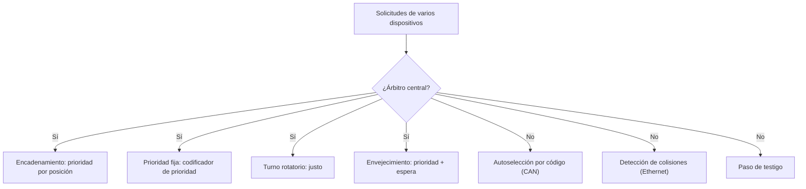

# Organización y Arquitectura de Computadoras - Entrada/Salida y canales

## 10.2 Esquemas de arbitraje de canal

---

Cuando varios dispositivos comparten un bus o un canal, solo uno puede transmitir a la vez. Los que quieren usarlo se llaman **maestros** potenciales, y el mecanismo que decide quién lo obtiene es el **arbitraje**. Un buen esquema de arbitraje debe ser rápido (para no desperdiciar ancho de banda), respetar las **prioridades** (atender pronto a los dispositivos con requisitos de tiempo estrictos) y ser **justo** (ningún dispositivo debe esperar indefinidamente, lo que se llama **inanición**). Este tema presenta los esquemas centralizados y distribuidos, su implementación, y los compara cuantitativamente.

### Esquemas centralizados

Un **árbitro** recibe las solicitudes (`BusReq`) de todos los dispositivos y concede el bus (`BusGrant`) a uno.

**Encadenamiento** (_daisy chain_): la señal de concesión recorre los dispositivos en serie; el primero que la recibe y tiene una solicitud la retiene, y si no, la pasa al siguiente. La prioridad la da la **posición física**. Es barato (una línea compartida de solicitud y una cadena de concesión) pero lento (la concesión atraviesa todos los dispositivos), no es justo (los últimos pueden sufrir inanición) y un dispositivo averiado corta la cadena.

**Prioridad fija con líneas independientes:** cada dispositivo tiene su propia línea de solicitud y de concesión, y el árbitro es un **codificador de prioridad**. Rápido, pero con las mismas limitaciones de justicia.

**Turno rotatorio** (_round robin_): después de atender a un dispositivo, la prioridad máxima pasa al siguiente. Garantiza que ningún dispositivo espere más de $n - 1$ turnos, pero ignora las urgencias.

**Prioridad con envejecimiento** (_aging_): la prioridad efectiva crece con el tiempo de espera, $P(t) = P_{\text{base}} + k \cdot t_{\text{espera}}.$ Combina prioridades y ausencia de inanición.

**Ponderado:** cada dispositivo recibe una fracción garantizada del ancho de banda (por ejemplo, con turnos proporcionales a un peso). Es lo que hace el arbitraje de PCI Express entre colas virtuales.

### Esquemas distribuidos

No hay un árbitro central: los dispositivos deciden entre ellos.

- **Autoselección:** cada dispositivo pone su código de prioridad en líneas compartidas de colector abierto (que hacen un OR o AND cableado); cada uno compara bit a bit el valor resultante con el suyo y se retira si ve un valor más prioritario. Al final solo queda el de mayor prioridad. Así arbitra el bus **CAN** de los automóviles, sin perder tiempo en colisiones.
- **Detección de colisiones:** cada dispositivo transmite cuando el medio está libre; si dos lo hacen a la vez, lo detectan, se detienen y reintentan tras un tiempo aleatorio (Ethernet clásica, CSMA/CD).
- **Paso de testigo** (_token passing_): un mensaje especial circula entre los dispositivos y solo quien lo tiene puede transmitir.



### Eficiencia del canal

El arbitraje consume tiempo en cada operación. Si una transferencia útil tarda $t_d$ y el arbitraje $t_a,$ la eficiencia es

$$ \eta = \frac{t_d}{t_d + t_a} $$

Para no desperdiciar el canal, o bien las transferencias deben ser largas, o bien el arbitraje de la siguiente transferencia debe **solaparse** con la actual (arbitraje oculto), como en PCI y en la mayoría de los buses modernos.

### Implementación en Python

El programa resuelve el ejercicio 1 con prioridad fija en ranuras de 1 ms, calcula los ejercicios 2 y 3, y simula cuatro dispositivos que piden el canal al azar con una carga superior a su capacidad, comparando la prioridad fija, el turno rotatorio y el envejecimiento.

```python
import random

# Ejercicio 1: prioridad fija (0 la más alta) en ranuras de 1 ms; cada dispositivo necesita
# tantos ms de canal como dura su intervalo de solicitud y empieza a pedir al inicio del intervalo.
peticiones = {1: (0, 10), 2: (5, 10), 0: (10, 10), 3: (12, 6)}    # dispositivo: (llegada, ms necesarios)
pendiente = {d: n for d, (_, n) in peticiones.items()}
fin, linea = {}, []
t = 0
while pendiente:
    listos = [d for d in pendiente if peticiones[d][0] <= t]
    if listos:
        d = min(listos)                     # prioridad fija
        pendiente[d] -= 1
        linea.append(str(d))
        if pendiente[d] == 0:
            del pendiente[d]
            fin[d] = t + 1
    else:
        linea.append(".")
    t += 1
print("ejercicio 1, dueño del canal en cada ms:", "".join(linea))
for d in sorted(peticiones):
    llegada, n = peticiones[d]
    print(f"   dispositivo {d}: llega en {llegada:2d}, termina en {fin[d]:2d}, espera {fin[d] - llegada - n:2d} ms")

# Ejercicio 2: eficiencia con 200 ns de arbitraje por operación a 100 MB/s
for tam in (64, 1024, 4096):
    tx = tam / 100e6
    print(f"ejercicio 2, bloques de {tam:4d} B: transferencia {tx * 1e9:7.0f} ns, eficiencia {tx / (tx + 200e-9):.1%}")

# Ejercicio 3: envejecimiento, prioridad = base + 0.1 por ms de espera
base = {0: 3, 1: 2, 2: 1, 3: 0}
for espera in (5, 10, 15):
    print(f"ejercicio 3, tras {espera:2d} ms de espera:", {d: round(b + 0.1 * espera, 1) for d, b in base.items()})


# Comparación de políticas con 4 dispositivos que piden al azar
def simular(politica, ciclos=10000, prob=(0.8, 0.6, 0.6, 0.6), semilla=2):
    rng = random.Random(semilla)
    cola = {d: [] for d in range(4)}         # instantes de llegada de las peticiones pendientes
    servidos = {d: 0 for d in range(4)}
    espera_max = {d: 0 for d in range(4)}
    turno, edad = 0, {d: 0 for d in range(4)}
    for t in range(ciclos):
        for d in range(4):
            if rng.random() < prob[d] / 2:
                cola[d].append(t)
        listos = [d for d in range(4) if cola[d]]
        if not listos:
            continue
        if politica == "prioridad fija":
            g = min(listos)
        elif politica == "turno rotatorio":
            g = min(listos, key=lambda d: (d - turno) % 4)
            turno = (g + 1) % 4
        else:                                # envejecimiento: base + 0.1 por ciclo esperado
            g = max(listos, key=lambda d: (3 - d) + 0.1 * (t - cola[d][0]))
        llegada = cola[g].pop(0)
        servidos[g] += 1
        espera_max[g] = max(espera_max[g], t - llegada)
    return servidos, espera_max, {d: len(cola[d]) for d in range(4)}


print("carga total de 1.3 peticiones por ciclo (el canal atiende 1): sobrecarga")
print(f"{'política':16s} {'servidas':26s} {'espera máxima':24s} pendientes al final")
for pol in ("prioridad fija", "turno rotatorio", "envejecimiento"):
    s, e, p = simular(pol)
    print(f"{pol:16s} {str(list(s.values())):26s} {str(list(e.values())):24s} {list(p.values())}")
```

Salida:

```text
ejercicio 1, dueño del canal en cada ms: 111111111100000000002222222222333333
   dispositivo 0: llega en 10, termina en 20, espera  0 ms
   dispositivo 1: llega en  0, termina en 10, espera  0 ms
   dispositivo 2: llega en  5, termina en 30, espera 15 ms
   dispositivo 3: llega en 12, termina en 36, espera 18 ms
ejercicio 2, bloques de   64 B: transferencia     640 ns, eficiencia 76.2%
ejercicio 2, bloques de 1024 B: transferencia   10240 ns, eficiencia 98.1%
ejercicio 2, bloques de 4096 B: transferencia   40960 ns, eficiencia 99.5%
ejercicio 3, tras  5 ms de espera: {0: 3.5, 1: 2.5, 2: 1.5, 3: 0.5}
ejercicio 3, tras 10 ms de espera: {0: 4.0, 1: 3.0, 2: 2.0, 3: 1.0}
ejercicio 3, tras 15 ms de espera: {0: 4.5, 1: 3.5, 2: 2.5, 3: 1.5}
carga total de 1.3 peticiones por ciclo (el canal atiende 1): sobrecarga
política         servidas                   espera máxima            pendientes al final
prioridad fija   [3932, 2970, 3048, 46]     [0, 10, 195, 9387]       [0, 0, 15, 3025]
turno rotatorio  [2498, 2500, 2497, 2501]   [3631, 1638, 1845, 1846] [1434, 470, 566, 570]
envejecimiento   [3022, 2290, 2343, 2341]   [2316, 2327, 2337, 2348] [910, 680, 720, 730]
```

Con prioridad fija y sobrecarga, el dispositivo 3 casi no es atendido: 46 servicios y más de 9000 ciclos de espera. El turno rotatorio reparte por igual, pero hace esperar al dispositivo 0, que es el que más pide; el envejecimiento da más servicio al más prioritario sin dejar a ninguno sin atender.

### Ejercicios Propuestos

1. **Prioridad fija.** Cuatro dispositivos con prioridades fijas (0 la máxima) piden el canal: el 1 de 0 a 10 ms, el 2 de 5 a 15 ms, el 0 de 10 a 20 ms y el 3 de 12 a 18 ms. Suponiendo que cada uno necesita tantos ms de canal como dura su intervalo, ¿quién tiene el canal en cada momento y cuánto espera cada uno?

2. **Eficiencia.** Un canal de 100 MB/s tarda 200 ns en arbitrar cada operación. Calcula su eficiencia con bloques de 64 bytes, 1 KiB y 4 KiB.

3. **Envejecimiento.** Con prioridades base 3, 2, 1 y 0 para los dispositivos 0 a 3 y un factor de envejecimiento de 0.1 por ms, calcula las prioridades dinámicas tras 5, 10 y 15 ms de espera. ¿Cuánto debe esperar el dispositivo 3 para superar al 0 si este acaba de ser atendido?

4. **Encadenamiento.** ¿Qué desventajas tiene el arbitraje por encadenamiento y cómo las resuelve el turno rotatorio?

### Soluciones

**Ejercicio 1.** De 0 a 10 ms el canal es del 1 (el 2, que llega a los 5 ms, tiene menos prioridad). De 10 a 20 ms, del 0, que es el más prioritario. De 20 a 30 ms, del 2, y de 30 a 36 ms, del 3. Esperas: 0 para el 1 y el 0, 15 ms para el 2 y 18 ms para el 3.

**Ejercicio 2.** Un bloque de 64 bytes tarda 640 ns: $\eta = 640 / 840 \approx 76\,\%.$ Con 1 KiB, 10.24 µs y 98.1 %; con 4 KiB, 40.96 µs y 99.5 %.

**Ejercicio 3.** Tras 5 ms: 3.5, 2.5, 1.5 y 0.5; tras 10 ms: 4, 3, 2 y 1; tras 15 ms: 4.5, 3.5, 2.5 y 1.5. Si el 0 acaba de ser atendido, su prioridad vuelve a 3, y el 3 la supera cuando $0.1\, t > 3,$ es decir, tras más de 30 ms de espera (suponiendo que el 0 no espera entre tanto).

**Ejercicio 4.** El encadenamiento fija la prioridad por la posición física, puede causar inanición de los últimos dispositivos, es lento con muchos dispositivos y un fallo en un dispositivo interrumpe la cadena. El turno rotatorio rota la prioridad, de modo que cada dispositivo espera como mucho $n - 1$ turnos, aunque necesita un árbitro con estado y líneas independientes.

### Referencias

1. Stallings, W., _Organización y arquitectura de computadores_. Pearson, 2006. Capítulo 3.
2. Hennessy, J. L., and Patterson, D. A., _Computer Architecture: A Quantitative Approach_. Morgan Kaufmann, 2019. Apéndice D.
3. Dally, W. J., and Towles, B., _Principles and Practices of Interconnection Networks_. Morgan Kaufmann, 2004. Capítulo 18.
4. PCI-SIG, _PCI Express Base Specification_. Revisión 5.0, 2019. Capítulo 6.
