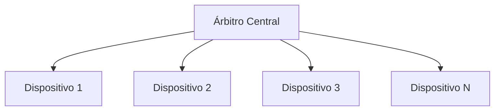
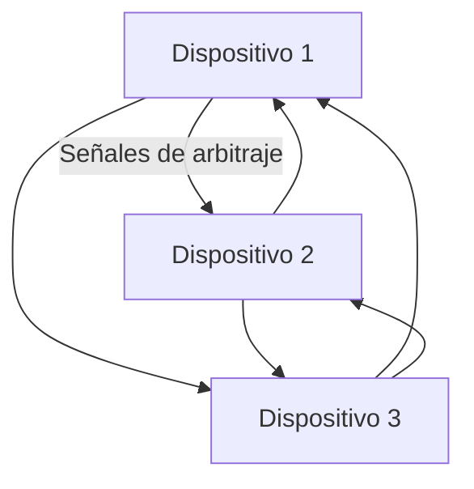
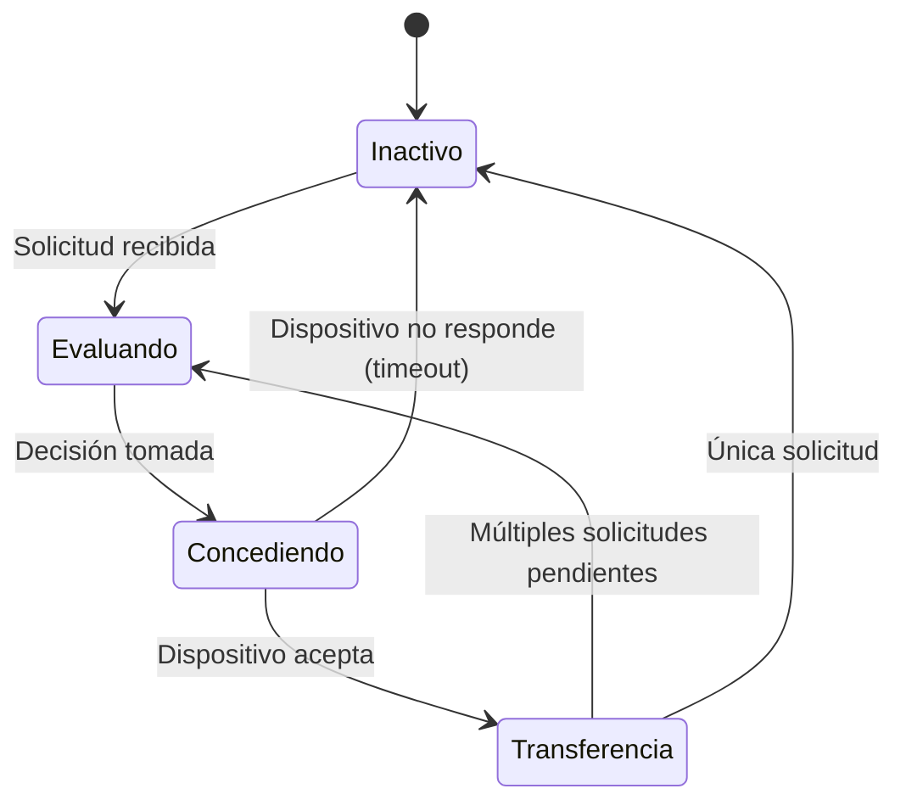

# Organización y Arquitectura de Computadoras - Entrada/Salida y canales

## 10.2 Esquemas de arbitraje de canal

---

Los esquemas de arbitraje de canal son mecanismos que determinan cómo se asigna el control del bus o canal cuando múltiples dispositivos solicitan acceso simultáneamente. Estos protocolos son esenciales para garantizar un funcionamiento eficiente y justo del sistema de entrada/salida.

### Conceptos Fundamentales

#### Definición de Arbitraje de Canal

El arbitraje de canal es el proceso mediante el cual se resuelven conflictos cuando dos o más dispositivos solicitan simultáneamente el uso de un canal de E/S compartido. El árbitro decide qué dispositivo obtendrá acceso al canal según un algoritmo específico.

#### Componentes del Sistema de Arbitraje

- **Solicitantes**: Dispositivos que requieren acceso al canal
- **Árbitro**: Módulo hardware que decide qué solicitante obtiene acceso
- **Señales de control**: Líneas used para comunicación entre solicitantes y árbitro

### Esquemas de Arbitraje Principales

#### Arbitraje Centralizado vs Distribuido

##### Arbitraje Centralizado

Un único módulo árbitro toma todas las decisiones de asignación.



##### Arbitraje Distribuido

Cada dispositivo participa en el proceso de decisión.



#### Algoritmos de Arbitraje

##### 1. Prioridad Fija

Cada dispositivo tiene una prioridad preasignada. En caso de conflicto, gana el dispositivo con mayor prioridad.

**Ventaja**: Simplicidad de implementación
**Desventaja**: Puede causar inanición de dispositivos de baja prioridad

##### 2. Round Robin (Turno Rotatorio)

Los dispositivos obtienen acceso al canal en orden circular.

**Ventaja**: Equitativo, evita inanición
**Desventaja**: Puede ser ineficiente si dispositivos tienen diferentes necesidades

##### 3. Por Prioridad Dinámica

La prioridad de los dispositivos cambia dinámicamente basándose en factores como:

- Tiempo de espera
- Historial de uso reciente
- Urgencia de la transferencia

##### 4. Por Tiempo de Espera (Aging)

Aumenta la prioridad de dispositivos que llevan mucho tiempo esperando.

$$Prioridad_{nueva} = Prioridad_{base} + k \times T_{espera}$$

Donde:

- $Prioridad_{base}$ = Prioridad inicial del dispositivo
- $k$ = Factor de incremento
- $T_{espera}$ = Tiempo que ha estado esperando el dispositivo

### Implementación Hardware de Arbitraje

#### Daisy Chain (Cadena de Margarita)


- Señal de concesión se propaga en cadena
- El dispositivo más cercano al árbitro tiene mayor prioridad
- Implementación simple pero con prioridad fija

#### Arbitraje con Encuesta (Polling)

El árbitro sondea secuencialmente a los dispositivos para determinar quién necesita el canal.

$$T_{arbitraje} = N \times T_{ciclo-polling}$$

Donde:

- $N$ = Número de dispositivos
- $T_{ciclo-polling}$ = Tiempo para interrogar un dispositivo

#### Arbitraje por Contienda

Los dispositivos compiten por el canal y resuelven colisiones mediante algoritmos específicos.

### Parámetros de Rendimiento

#### Tiempo de Arbitraje

$$ T_{arbitraje} = T_{\text{detección}} + T_{\text{decisión}} + T_{\text{concesión}}$$

#### Ancho de Banda Efectivo Considerando Arbitraje

$$B_{efectivo} = \frac{N}{T_{transferencia} + T_{arbitraje}}$$

#### Eficiencia del Canal

$$ \eta = \frac{T_{transferencia}}{T_{transferencia} + T_{arbitraje}} \times 100\% $$

### Ejemplos de Implementación

#### Ejemplo 1: Arbitraje con Prioridad Fija

```verilog
// Ejemplo en Verilog de árbitro de prioridad fija
module arbitro_prioridad_fija (
    input clk,
    input reset,
    input [3:0] request,
    output reg [3:0] grant
);

always @(posedge clk or posedge reset) begin
    if (reset) begin
        grant <= 4'b0000;
    end else begin
        // Prioridad: device0 > device1 > device2 > device3
        if (request[0]) grant <= 4'b0001;
        else if (request[1]) grant <= 4'b0010;
        else if (request[2]) grant <= 4'b0100;
        else if (request[3]) grant <= 4'b1000;
        else grant <= 4'b0000;
    end
end

endmodule
```

#### Ejemplo 2: Arbitraje Round Robin

```python
# Implementación de árbitro round robin en Python
class RoundRobinArbiter:
    def __init__(self, num_devices):
        self.num_devices = num_devices
        self.current_device = 0
        self.requests = [False] * num_devices

    def set_request(self, device_id, state):
        if 0 <= device_id < self.num_devices:
            self.requests[device_id] = state

    def get_grant(self):
        # Buscar desde el último dispositivo atendido
        start = self.current_device
        device_id = (start + 1) % self.num_devices

        while device_id != start:
            if self.requests[device_id]:
                self.current_device = device_id
                return device_id
            device_id = (device_id + 1) % self.num_devices

        # Si no hay solicitudes, return -1
        return -1
```

### Ejercicios Propuestos

#### Ejercicio 1: Análisis de Prioridades

Un sistema tiene 4 dispositivos con prioridades fijas (0: máxima, 3: mínima). Durante un intervalo de tiempo, se observan los siguientes patrones de solicitud:

| Tiempo (ms) | Solicitudes   |
| ----------- | ------------- |
| 0-10        | Dispositivo 1 |
| 5-15        | Dispositivo 2 |
| 10-20       | Dispositivo 0 |
| 12-18       | Dispositivo 3 |

Determine:
a) Qué dispositivo obtiene el canal en cada intervalo
b) El tiempo total de acceso para cada dispositivo
c) El tiempo de espera para cada dispositivo

#### Ejercicio 2: Cálculo de Eficiencia

Un canal de E/S tiene una tasa de transferencia de 100 MB/s. El tiempo de arbitraje es de 200 ns por operación. Calcule la eficiencia del canal cuando se transfieren:

a) Bloques de 64 bytes
b) Bloques de 1 KB
c) Bloques de 4 KB

#### Ejercicio 3: Diseño de Arbitro con Aging

Diseñe un algoritmo de arbitraje con aging donde:

- Prioridad base: dispositivo 0: 3, dispositivo 1: 2, dispositivo 2: 1, dispositivo 3: 0
- El factor de aging k = 0.1 por milisegundo de espera

Calcule la prioridad dinámica de cada dispositivo después de:
a) 5 ms de espera
b) 10 ms de espera
c) 15 ms de espera

### Diagrama de Estados del Árbitro



### Caso de Estudio: PCI Express Arbitration

PCI Express utiliza un esquema de arbitraje complejo con:

- Arbitration basado en créditos (credit-based)
- Prioridades diferenciadas (VC/Virtual Channels)
- Round robin dentro de cada prioridad

#### Fórmula de Asignación de Ancho de Banda en PCIe

$$AnchoBanda_{asignado} = \frac{Prioridad_{normalizada}}{\sum Prioridades} \times AnchoBanda_{total}$$

### Referencias

#### Bibliografía Básica

1. Patterson, David A. y John L. Hennessy. _Computer Organization and Design: The Hardware/Software Interface_, 4a Ed. (Capítulo 8.4: Bus Arbitration)
2. Hennessy, John L. y David A. Patterson. _Computer Architecture: A Quantitative Approach_, 4a Ed. (Capítulo 6: Storage Systems)

#### Bibliografía Complementaria

1. Stallings, William. _Computer Organization and Architecture: Designing for Performance_ (Capítulo 7.3: Bus Arbitration)
2. Tanenbaum, Andrew S. _Structured Computer Organization_, 5a Ed. (Capítulo 5.3: Bus Arbitration Techniques)

#### Artículos Técnicos Recomendados

- "A Fair Arbitration Protocol for Multi-Master Bus Systems" (IEEE Transactions)
- "Efficient Bus Arbitration for SoC Architectures" (ACM Journal)
- "Comparative Analysis of Bus Arbitration Algorithms" (Springer Verlag)

### Tendencias Actuales en Arbitraje de Canal

- Arbitraje basado en machine learning para predecir patrones de acceso
- Protocolos de arbitraje para sistemas heterogéneos (CPU/GPU/FPGA)
- Arbitraje adaptativo en tiempo real para sistemas embebidos
- Técnicas de arbitraje para computación cuántica
