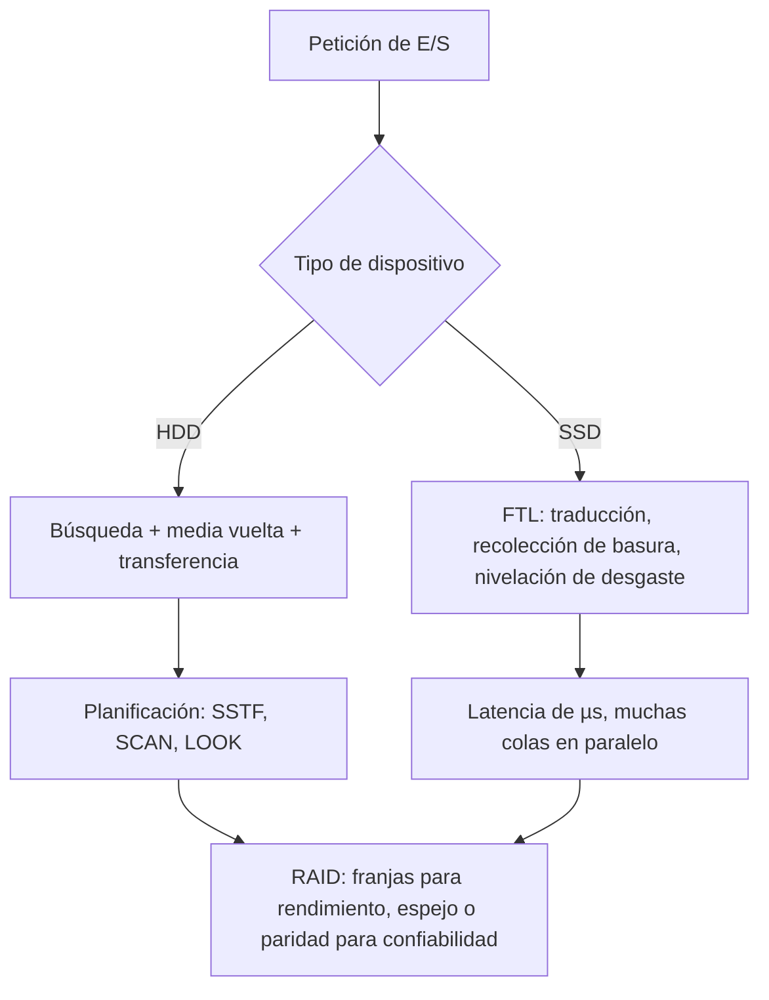

# Organización y Arquitectura de Computadoras - Entrada/Salida y canales

## 10.3 Dispositivos de almacenamiento secundario, medidas de desempeño

---

El almacenamiento secundario guarda los datos de forma **persistente**: sobreviven al apagado, a diferencia de la DRAM. Durante décadas fue sinónimo de **disco magnético** (HDD), un dispositivo mecánico cuyo tiempo de acceso se mide en milisegundos; hoy los **discos de estado sólido** (SSD), basados en memoria flash, lo han desplazado en la mayoría de los usos por su latencia cien veces menor. Este tema estudia cómo funcionan ambos, cómo se mide su desempeño (latencia, ancho de banda, operaciones por segundo), los algoritmos de planificación de las peticiones a disco y los arreglos RAID, que combinan varios discos para ganar rendimiento y confiabilidad.

### El disco magnético

Un HDD tiene uno o varios **platos** que giran a velocidad constante (5400 a 15 000 RPM), con **cabezas** en un brazo que se mueve radialmente. Cada superficie se divide en **pistas** concéntricas, y cada pista en **sectores** (512 bytes o 4 KiB); el conjunto de pistas a la misma distancia del eje en todas las superficies es un **cilindro**.

El tiempo de acceso a un sector tiene cuatro componentes:

$$ T = t_{\text{búsqueda}} + t_{\text{rotación}} + t_{\text{transferencia}} + t_{\text{controlador}} $$

- **Búsqueda** (_seek_): mover el brazo a la pista; de 3 a 15 ms en promedio, según el disco.
- **Latencia rotacional:** esperar a que el sector pase bajo la cabeza; en promedio **media vuelta**, $\frac{1}{2} \cdot \frac{60}{\text{RPM}}$ s. A 7200 RPM, 4.17 ms.
- **Transferencia:** tamaño entre tasa de transferencia; para un sector, microsegundos.
- **Controlador:** típicamente menos de 1 ms, y a veces se oculta con la caché del disco.

Para accesos aleatorios pequeños dominan la búsqueda y la rotación: un HDD hace unas **100 operaciones por segundo** (IOPS), aunque su ancho de banda secuencial sea de más de 100 MB/s. Por eso la **localidad** de los datos en el disco es crucial.

### Planificación de las peticiones

Con varias peticiones pendientes, el controlador o el sistema operativo eligen el orden para reducir el movimiento del brazo:

| Algoritmo | Regla | Propiedades |
| --- | --- | --- |
| FCFS | orden de llegada | justo, pero mucho movimiento |
| SSTF | la petición más cercana a la posición actual | poco movimiento; puede dejar sin atender a las peticiones lejanas |
| SCAN (ascensor) | barrer en un sentido hasta el extremo y volver | sin inanición; favorece los cilindros centrales |
| C-SCAN | barrer en un sentido, volver al principio sin atender | tiempos de espera más uniformes |
| LOOK y C-LOOK | como SCAN y C-SCAN, pero solo hasta la última petición | evitan recorrer el disco hasta el extremo |

Los discos actuales hacen además una planificación que tiene en cuenta la rotación (_shortest positioning time first_) con su cola interna de comandos (NCQ).

### Discos de estado sólido

Un SSD guarda los bits como cargas en celdas de **memoria flash NAND**, sin partes móviles. Su organización impone restricciones:

- Se lee y escribe por **páginas** (4 a 16 KiB), pero solo se puede **borrar** por **bloques** de cientos de páginas, y una página no se puede reescribir sin borrar su bloque.
- Cada bloque soporta un número limitado de borrados (de cientos a decenas de miles de ciclos, según el número de bits por celda).

Por eso el SSD tiene un procesador con una **capa de traducción** (FTL) que escribe siempre en páginas libres, mantiene una tabla de correspondencia lógica-física, recoge la basura de las páginas obsoletas y reparte los borrados entre todos los bloques (**nivelación de desgaste**). Las escrituras internas adicionales se miden con la **amplificación de escritura**. Un SSD tiene latencias de decenas a cientos de µs y, con muchas peticiones en paralelo, cientos de miles de IOPS; la interfaz NVMe sobre PCI Express le permite usar muchas colas en paralelo.

### Medidas de desempeño

- **Latencia** o tiempo de respuesta de una operación.
- **Ancho de banda** (MB/s) para transferencias grandes y secuenciales.
- **IOPS** para operaciones pequeñas y aleatorias: $\text{IOPS} \approx 1 / T_{\text{acceso}}$ con una petición a la vez.
- **Confiabilidad:** tiempo medio entre fallos (MTTF) y tasa anual de fallos. Si los fallos son independientes, un conjunto de $n$ discos sin redundancia tiene un MTTF $n$ veces menor.

### RAID

Un **arreglo redundante de discos independientes** (Patterson, Gibson y Katz, 1988) combina varios discos:

| Nivel | Organización | Capacidad útil con $n$ discos | Tolera |
| --- | --- | --- | --- |
| RAID 0 | datos repartidos en franjas (_striping_) | $n$ | ningún fallo |
| RAID 1 | espejo: cada dato en dos discos | $n/2$ | un fallo por par |
| RAID 5 | franjas con paridad distribuida | $n - 1$ | un fallo |
| RAID 6 | dos paridades distribuidas | $n - 2$ | dos fallos |

La **paridad** es el XOR de los bloques de una franja: si un disco falla, cada bloque perdido es el XOR de los demás bloques y la paridad. El costo es que cada escritura pequeña en RAID 5 requiere leer el dato y la paridad viejos y escribir los nuevos (cuatro accesos).



### Implementación en Python

El programa resuelve los ejercicios 1 a 3 (con cilindros de 0 a 255 para los algoritmos que llegan al extremo) y calcula la capacidad útil y la tolerancia a fallos de varios niveles de RAID.

```python
# Ejercicio 1: disco de 10 000 RPM, búsqueda media 5 ms, 200 MB/s, sectores de 4096 bytes
rpm, busqueda, tasa, sector = 10_000, 5e-3, 200e6, 4096
vuelta = 60 / rpm
rot = vuelta / 2
tx = sector / tasa
print(f"ejercicio 1: una vuelta {vuelta * 1e3:.1f} ms, latencia rotacional media {rot * 1e3:.1f} ms,"
      f" transferencia de un sector {tx * 1e6:.2f} µs")
print(f"   (a) 1 sector aleatorio: {(busqueda + rot + tx) * 1e3:.3f} ms")
print(f"   (b) 10 contiguos: {(busqueda + rot + 10 * tx) * 1e3:.3f} ms")
print(f"   (c) 100 en pistas distintas: {100 * (busqueda + rot + tx) * 1e3:.1f} ms")

# Ejercicio 2: HDD de 7200 RPM, búsqueda 8 ms, 120 MB/s; SSD con 0.1 ms de latencia y 500 MB/s
hdd = lambda n: 8e-3 + 0.5 * 60 / 7200 + n / 120e6
ssd = lambda n: 0.1e-3 + n / 500e6
for nombre, n in (("lectura aleatoria de 4 KiB", 4096), ("lectura secuencial de 1 MiB", 2**20),
                  ("escritura aleatoria de 256 KiB", 256 * 1024)):
    h, s = hdd(n), ssd(n)
    print(f"ejercicio 2, {nombre:30s}: HDD {h * 1e3:6.2f} ms, SSD {s * 1e3:5.3f} ms, SSD {h / s:5.1f} veces más rápido")
print(f"   IOPS aleatorias de 4 KiB: HDD {1 / hdd(4096):.0f}, SSD (una cola) {1 / ssd(4096):.0f}")


# Ejercicio 3: planificación de las peticiones; cilindros de 0 a 255, cabeza en 50, hacia arriba
def planificar(pet, inicio, alg, maximo=255):
    pet, pos, orden = list(pet), inicio, []
    if alg == "FCFS":
        orden = pet
    elif alg == "SSTF":
        while pet:
            sig = min(pet, key=lambda c: (abs(c - pos), c))
            orden.append(sig); pet.remove(sig); pos = sig
    else:
        arriba = sorted(c for c in pet if c >= inicio)
        abajo = sorted((c for c in pet if c < inicio), reverse=True)
        if alg == "SCAN":
            orden = arriba + [maximo] + abajo
        elif alg == "LOOK":
            orden = arriba + abajo
        elif alg == "C-SCAN":
            orden = arriba + [maximo, 0] + sorted(abajo)
        elif alg == "C-LOOK":
            orden = arriba + sorted(abajo)
    pos, total = inicio, 0
    for c in orden:
        total += abs(c - pos)
        pos = c
    return orden, total


pet = [45, 120, 30, 90, 15, 160, 75, 200]
for alg in ("FCFS", "SSTF", "SCAN", "C-SCAN", "LOOK", "C-LOOK"):
    orden, total = planificar(pet, 50, alg)
    print(f"ejercicio 3, {alg:6s}: {total:4d} cilindros, orden {orden}")

# RAID con 4 discos de 2 TB y tiempo medio entre fallos (MTTF) de 1 000 000 h por disco
n, cap, mttf = 4, 2, 1_000_000
for nivel, util, tolera in (("RAID 0", n * cap, 0), ("RAID 1 (dos espejos)", n * cap / 2, 1),
                            ("RAID 5", (n - 1) * cap, 1), ("RAID 6", (n - 2) * cap, 2)):
    print(f"{nivel:22s}: {util:.0f} TB útiles, tolera {tolera} fallo(s)")
print(f"MTTF de un arreglo RAID 0 de {n} discos: {mttf / n:,.0f} h".replace(",", " "))
```

Salida:

```text
ejercicio 1: una vuelta 6.0 ms, latencia rotacional media 3.0 ms, transferencia de un sector 20.48 µs
   (a) 1 sector aleatorio: 8.020 ms
   (b) 10 contiguos: 8.205 ms
   (c) 100 en pistas distintas: 802.0 ms
ejercicio 2, lectura aleatoria de 4 KiB    : HDD  12.20 ms, SSD 0.108 ms, SSD 112.8 veces más rápido
ejercicio 2, lectura secuencial de 1 MiB   : HDD  20.90 ms, SSD 2.197 ms, SSD   9.5 veces más rápido
ejercicio 2, escritura aleatoria de 256 KiB: HDD  14.35 ms, SSD 0.624 ms, SSD  23.0 veces más rápido
   IOPS aleatorias de 4 KiB: HDD 82, SSD (una cola) 9243
ejercicio 3, FCFS  :  660 cilindros, orden [45, 120, 30, 90, 15, 160, 75, 200]
ejercicio 3, SSTF  :  220 cilindros, orden [45, 30, 15, 75, 90, 120, 160, 200]
ejercicio 3, SCAN  :  445 cilindros, orden [75, 90, 120, 160, 200, 255, 45, 30, 15]
ejercicio 3, C-SCAN:  505 cilindros, orden [75, 90, 120, 160, 200, 255, 0, 15, 30, 45]
ejercicio 3, LOOK  :  335 cilindros, orden [75, 90, 120, 160, 200, 45, 30, 15]
ejercicio 3, C-LOOK:  365 cilindros, orden [75, 90, 120, 160, 200, 15, 30, 45]
RAID 0                : 8 TB útiles, tolera 0 fallo(s)
RAID 1 (dos espejos)  : 4 TB útiles, tolera 1 fallo(s)
RAID 5                : 6 TB útiles, tolera 1 fallo(s)
RAID 6                : 4 TB útiles, tolera 2 fallo(s)
MTTF de un arreglo RAID 0 de 4 discos: 250 000 h
```

### Ejercicios Propuestos

1. **Tiempo de acceso.** Un disco gira a 10 000 RPM, con búsqueda media de 5 ms, 200 MB/s y sectores de 4096 bytes. Calcula el tiempo para leer: (a) un sector aleatorio; (b) 10 sectores contiguos; (c) 100 sectores en pistas distintas.

2. **HDD frente a SSD.** Compara un HDD de 7200 RPM, búsqueda de 8 ms y 120 MB/s con un SSD de 0.1 ms de latencia y 500 MB/s en: (a) lectura aleatoria de 4 KiB; (b) lectura secuencial de 1 MiB; (c) escritura aleatoria de 256 KiB.

3. **Planificación.** Con peticiones a los cilindros 45, 120, 30, 90, 15, 160, 75 y 200 y la cabeza en el 50, calcula el movimiento total con FCFS, SSTF, SCAN (hacia arriba), C-SCAN y LOOK.

4. **Paridad.** En RAID 5 con cuatro discos, la franja tiene los bloques de datos `1011`, `0110` y `1100`. Calcula la paridad y reconstruye el segundo bloque si su disco falla.

### Soluciones

**Ejercicio 1.** Una vuelta dura $60/10\,000 = 6$ ms, así que la latencia media es 3 ms; un sector se transfiere en 20.48 µs. (a) $5 + 3 + 0.02 \approx 8.02$ ms. (b) $5 + 3 + 0.205 \approx 8.21$ ms: casi lo mismo que un solo sector. (c) Cada uno paga búsqueda y rotación: unos 802 ms. Los accesos contiguos son 100 veces más eficientes.

**Ejercicio 2.** (a) HDD 12.2 ms, SSD 0.108 ms: el SSD es más de 100 veces más rápido. (b) HDD 20.9 ms, SSD 2.2 ms: solo unas 10 veces, porque en la transferencia secuencial el HDD es competitivo. (c) HDD 14.3 ms, SSD 0.62 ms. En IOPS aleatorias de 4 KiB, unas 82 frente a 9000 con una sola petición pendiente, y muchas más en el SSD con varias colas.

**Ejercicio 3.** FCFS: 660 cilindros. SSTF: 220 (45, 30, 15 y luego hacia arriba). SCAN: sube hasta 200, sigue hasta el extremo 255 y baja hasta 15: 445. C-SCAN: sube hasta 255, vuelve a 0 (contando el regreso) y sube hasta 45: 505. LOOK: sube hasta 200 y baja hasta 15: 335. SSTF gana en este caso, pero sin garantía de que una petición lejana no espere indefinidamente.

**Ejercicio 4.** Paridad: $1011 \oplus 0110 \oplus 1100 = 0001.$ Si se pierde el segundo bloque: $1011 \oplus 1100 \oplus 0001 = 0110,$ que es el dato original, porque cada bit de la paridad hace que el número de unos de su posición sea par.

### Referencias

1. Hennessy, J. L., and Patterson, D. A., _Computer Architecture: A Quantitative Approach_. Morgan Kaufmann, 2019. Apéndice D.
2. Arpaci-Dusseau, R. H., and Arpaci-Dusseau, A. C., _Operating Systems: Three Easy Pieces_. Arpaci-Dusseau Books, 2018. Capítulos 37, 38 y 44.
3. Patterson, D. A., Gibson, G., and Katz, R. H., A case for redundant arrays of inexpensive disks (RAID). _SIGMOD_, 1988.
4. Silberschatz, A., Galvin, P. B., and Gagne, G., _Fundamentos de sistemas operativos_. McGraw-Hill, 2006. Capítulo 12.
