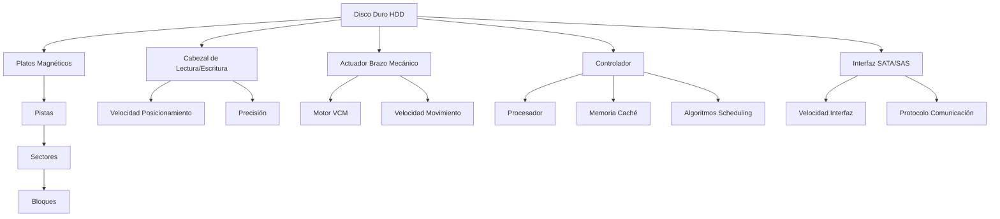
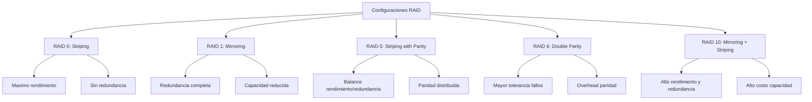

# Organización y Arquitectura de Computadoras - Entrada/Salida y canales

## 10.3 Dispositivos de almacenamiento secundario, medidas de desempeño

---

El almacenamiento secundario se refiere a los dispositivos no volátiles que almacenan datos de forma persistente, complementando la memoria principal. Estos dispositivos tienen características únicas que impactan directamente en el desempeño del sistema computacional.

### Tipos de Dispositivos de Almacenamiento Secundario

#### Discos Duros Magnéticos (HDD)

- Almacenamiento basado en platos magnéticos giratorios
- Acceso mecánico mediante cabezales de lectura/escritura
- Alta capacidad y bajo costo por gigabyte

#### Unidades de Estado Sólido (SSD)

- Almacenamiento basado en memoria flash NAND
- Sin partes móviles, acceso completamente electrónico
- Mayor velocidad pero menor durabilidad en escrituras

#### Almacenamiento Híbrido (SSHD)

- Combina HDD y SSD en un mismo dispositivo
- Usa SSD como caché para datos frecuentes

#### Almacenamiento Óptico y Cintas

- Medios removibles para backup y archivado
- Mayor latencia pero muy bajo costo

### Medidas de Desempeño Clave

#### 1. Tiempo de Acceso (Access Time)

El tiempo total para ubicar y transferir datos:

$$ T\_{acceso} = T\_{\text{búsqueda}} + T\_{\text{rotación}} + T\_{transferencia}$$

Donde:

- $T\_{\text{búsqueda}}$ = Tiempo de posicionamiento del cabezal
- $T\_{\text{rotación}}$ = Tiempo de rotación hasta el sector deseado
- $T\_{transferencia}$ = Tiempo para leer/transferir los datos

#### 2. Tasa de Transferencia (Throughput)

Velocidad a la que se pueden transferir datos:

$$ Throughput = \frac{\text{Tamaño de transferencia}}{Tiempo total}$$

#### 3. Operaciones de Entrada/Salida por Segundo (IOPS)

Número de operaciones de lectura/escritura que puede realizar el dispositivo:

$$IOPS = \frac{1}{T\_{acceso promedio} + \frac{\text{Tamaño de transferencia}}{Velocidad de transferencia}}$$

#### 4. Latencia

Tiempo entre la solicitud y el inicio de la transferencia:

$$Latencia = T\_{comando} + T\_{\text{búsqueda}} + T\_{\text{rotación}}$$

### Parámetros Específicos de HDD

#### Tiempo de Búsqueda (Seek Time)

$$T\_{\text{búsqueda}} = a + b\sqrt{n-1}$$

Donde:

- $a$ = Tiempo constante (overhead)
- $b$ = Coeficiente de velocidad
- $n$ = Número de pistas a recorrer

#### Tiempo de Rotación Latency

$$T\_{\text{rotación}} = \frac{1}{2} \times \frac{60}{RPM} \times 1000\,ms$$

Para disco girando a $RPM$ revoluciones por minuto.

#### Ejemplo Cálculo HDD

Para un disco de 7200 RPM, tiempo de búsqueda promedio 9ms, transferencia 160 MB/s:

$$T\_{\text{rotación}} = \frac{1}{2} \times \frac{60}{7200} \times 1000 = 4.17 ms$$
$$T\_{acceso} = 9 + 4.17 + \frac{512_{KB}}{160_{MB/s}} \approx 13.17 + 3.2 = 16.37 ms$$

### Parámetros Específicos de SSD

#### Características Únicas

- Sin tiempos de búsqueda o rotación
- Latencia consistente pero con degradación por wear-leveling
- Paralelismo interno mediante múltiples chips NAND

#### Fórmula de Rendimiento SSD

$$IOPS_{SSD} = \frac{N_{canales} \times N_{chips} \times IOPS_{chip}}{Factor_{sobrecarga}}$$

### Diagrama de Componentes de HDD



### Técnicas de Mejora de Desempeño

#### 1. Disk Scheduling Algorithms

##### FCFS (First-Come, First-Served)

- Atención en orden de llegada
- Simple pero ineficiente

##### SSTF (Shortest Seek Time First)

- Atiende la solicitud más cercana
- Puede causar inanición

##### SCAN (Elevator Algorithm)

- Barre el disco en una dirección
- Invierte dirección al llegar al final

##### C-SCAN (Circular SCAN)

- Solo barre en una dirección
- Retorna rápidamente al inicio

##### LOOK y C-LOOK

- Versiones optimizadas que no llegan a extremos físicos

#### 2. RAID (Redundant Array of Independent Disks)



#### 3. Caching y Buffering

Uso de memoria rápida para almacenar datos frecuentes:

$$T_{acceso\,efectivo} = Hit\,Ratio \times T_{cache} + (1 - Hit\,Ratio) \times T_{disco}$$

### Métricas de Evaluación Comparativa

#### 1. Benchmarks Sintéticos

- CrystalDiskMark, ATTO, Iometer
- Mediciones controladas de IOPS y throughput

#### 2. Benchmarks de Aplicación Real

- Tiempos de carga de aplicaciones
- Velocidad de transferencia de archivos
- Tiempos de renderizado

#### 3. Métricas de Consistencia

- Variabilidad en tiempos de respuesta
- Comportamiento bajo carga sostenida

### Ejercicios Propuestos

#### Ejercicio 1: Cálculo de Tiempo de Acceso

Un disco duro tiene las siguientes características:

- Velocidad de rotación: 10,000 RPM
- Tiempo de búsqueda promedio: 5ms
- Tasa de transferencia: 200 MB/s
- Sectores por pista: 500
- Bytes por sector: 4096

Calcule el tiempo de acceso para:
a) Leer 1 sector aleatorio
b) Leer 10 sectores contiguos
c) Leer 100 sectores en pistas diferentes

#### Ejercicio 2: Análisis Comparativo HDD vs SSD

Compare el rendimiento de:

- HDD: 7,200 RPM, seek time 8ms, transferencia 120 MB/s
- SSD: Latencia 0.1ms, transferencia 500 MB/s

Para operaciones de:
a) 4KB random read
b) 1MB sequential read
c) 256KB random write

#### Ejercicio 3: Optimización de Scheduling

Dadas las siguientes solicitudes de sectores: 45, 120, 30, 90, 15, 160, 75, 200
Posición inicial del cabezal: sector 50

Calcule la distancia total recorrida usando:
a) FCFS
b) SSTF
c) SCAN (hacia sectores mayores inicialmente)
d) C-SCAN
e) LOOK

### Código de Simulación de Disk Scheduling

```python
import numpy as np
from typing import List, Callable

def simulate_disk_scheduling(requests: List[int], initial: int,
                           algorithm: Callable, **kwargs) -> dict:
    """
    Simula algoritmos de disk scheduling
    """
    positions = [initial] + requests
    total_distance = 0
    current = initial
    order = [initial]

    for request in algorithm(requests, current, **kwargs):
        distance = abs(request - current)
        total_distance += distance
        current = request
        order.append(request)

    return {
        'total_distance': total_distance,
        'average_distance': total_distance / len(requests),
        'order': order
    }

def fcfs(requests: List[int], current: int) -> List[int]:
    """First-Come, First-Served"""
    return requests

def sstf(requests: List[int], current: int) -> List[int]:
    """Shortest Seek Time First"""
    sorted_requests = []
    remaining = requests.copy()

    while remaining:
        # Encontrar la solicitud más cercana
        closest = min(remaining, key=lambda x: abs(x - current))
        sorted_requests.append(closest)
        remaining.remove(closest)
        current = closest

    return sorted_requests

# Implementaciones similares para SCAN, C-SCAN, LOOK, etc.
```

### Referencias

#### Bibliografía Básica

1. Patterson, David A. y John L. Hennessy. _Computer Organization and Design: The Hardware/Software Interface_, 4a Ed. (Capítulo 8: Storage Systems)
2. Hennessy, John L. y David A. Patterson. _Computer Architecture: A Quantitative Approach_, 4a Ed. (Capítulo 6: Storage Systems)

#### Bibliografía Complementaria

1. Stallings, William. _Computer Organization and Architecture: Designing for Performance_ (Capítulo 7: External Memory)
2. Tanenbaum, Andrew S. _Structured Computer Organization_, 5a Ed. (Capítulo 5: Input/Output)

#### Artículos Técnicos Recomendados

- "Performance Analysis of Storage Systems" (ACM Computing Surveys)
- "SSD vs HDD: Performance Comparison" (IEEE Transactions on Storage)
- "RAID Reliability and Performance Trade-offs" (USENIX Conference Proceedings)

### Tendencias Actuales en Almacenamiento

- Almacenamiento NVMe sobre PCIe para mayor throughput
- Tecnología 3D NAND para mayores densidades en SSD
- Storage Class Memory (SCM) que blurrea línea entre memoria y almacenamiento
- Algoritmos de machine learning para optimización de caching
- Almacenamiento computational (procesamiento en el dispositivo)
