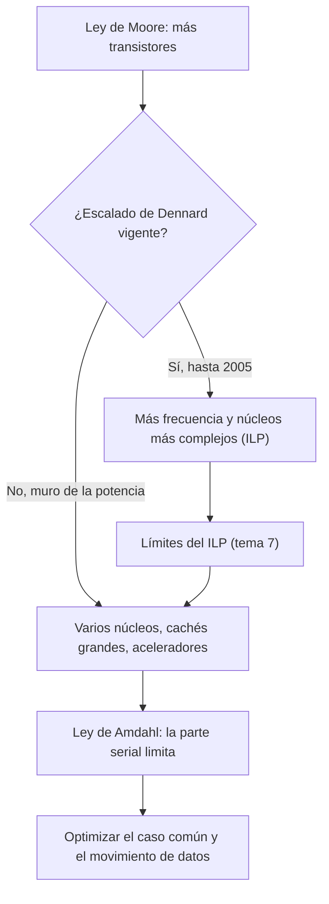

# Organización y Arquitectura de Computadoras - Principios cuantitativos del diseño de arquitecturas

## 1.1 Tendencias tecnológicas y de uso.

---

El diseño de computadoras está guiado por lo que la tecnología permite construir y por lo que los programas necesitan. Las dos cosas cambian rápido, pero de forma bastante predecible: el número de transistores por chip ha crecido exponencialmente durante medio siglo, mientras que la frecuencia de reloj se estancó hacia 2005 por razones de consumo de energía. Este tema cuantifica esas tendencias (la ley de Moore, el escalado de Dennard y su fin, la potencia, el costo de los chips) y presenta la **ley de Amdahl**, que dice cuánto se gana al mejorar una parte de un sistema y que explica los límites del paralelismo.

### La ley de Moore

En 1965 Gordon Moore observó que el número de componentes por circuito integrado se duplicaba cada año, y en 1975 corrigió el período a unos dos años. Si $n_0$ es el número de transistores en el año $t_0$ y $T$ el período de duplicación,

$$ n(t) = n_0 \cdot 2^{(t - t_0)/T} $$

Con $T = 2$ años, el número de transistores crece un $2^{1/2} - 1 \approx 41\,\%$ al año y se multiplica por 32 en una década. No es una ley física, sino una observación empírica que la industria convirtió en un objetivo de planificación. Desde mediados de la década de 2010 el ritmo se ha frenado y el costo por transistor ha dejado de bajar tan rápido (tema 11.4).

**Otras tecnologías.** No todo mejora al mismo ritmo, y ese desequilibrio guía el diseño:

| Tecnología | Mejora de capacidad o ancho de banda | Mejora de latencia |
| --- | --- | --- |
| lógica (procesadores) | muy rápida | rápida hasta 2005, lenta después |
| DRAM | capacidad x2 cada 3 o 4 años (más lenta en la última década) | lenta: unos pocos % al año |
| discos magnéticos | capacidad muy rápida hasta 2010 | muy lenta |
| memoria flash | rápida | moderada |
| redes | ancho de banda rápido | lenta |

La regla general (Patterson) es que **el ancho de banda mejora mucho más rápido que la latencia**: aproximadamente, cuando el ancho de banda se duplica, la latencia mejora entre un 20 % y un 40 %. De ahí la importancia de las cachés (tema 9) y de la segmentación (tema 7), que ocultan la latencia.

### El escalado de Dennard y el muro de la potencia

**Potencia dinámica.** Cada vez que un transistor conmuta, carga o descarga una capacidad. La potencia dinámica de un chip es

$$ P_{\text{din}} = \alpha\, C\, V^2 f $$

donde $\alpha$ es la fracción de transistores que conmutan en cada ciclo, $C$ la capacidad total, $V$ el voltaje y $f$ la frecuencia. A esto se suma la potencia **estática** por corrientes de fuga, $P_{\text{est}} = V\, I_{\text{fuga}},$ que se paga aunque el circuito no haga nada.

**Escalado de Dennard (1974).** Si todas las dimensiones del transistor y el voltaje se reducen por un factor $s$ (típicamente $s \approx 0.7$ por generación), entonces:

- la capacidad de cada transistor se reduce a $s C,$
- el voltaje se reduce a $s V,$
- el retardo de conmutación se reduce en $s,$ así que la frecuencia puede crecer a $f/s,$
- la potencia por transistor queda $s C \cdot (sV)^2 \cdot f/s = s^2 \cdot C V^2 f,$
- el área por transistor se reduce a $s^2,$ así que caben $1/s^2$ veces más transistores en la misma área.

La **densidad de potencia** (potencia por unidad de área) queda igual: $s^2 \cdot \frac{1}{s^2} = 1.$ Durante 30 años, cada generación dio el doble de transistores, un 40 % más de frecuencia y el mismo consumo por $\text{cm}^2.$

**El fin del escalado (hacia 2005).** Por debajo de 1 V, el voltaje ya no se pudo seguir bajando: el voltaje umbral de los transistores no puede reducirse sin que las corrientes de fuga crezcan exponencialmente. Con $V$ fijo, la potencia por transistor ya no baja, porque $sC \cdot V^2 \cdot f/s = C V^2 f,$ y la densidad de potencia se **duplica** en cada generación. Como un chip solo puede disipar unos 100 a 200 W con refrigeración razonable, se llegó al **muro de la potencia**: la frecuencia se estancó alrededor de 3 a 4 GHz y la industria pasó a usar los transistores adicionales en **varios núcleos** más lentos (tema 11.6), en cachés más grandes y en aceleradores especializados. Hoy no se pueden encender a la vez todos los transistores de un chip a plena frecuencia: es el **silicio oscuro**.

**Técnicas de ahorro.** Apagar el reloj de las unidades que no se usan (_clock gating_), bajar voltaje y frecuencia cuando la carga es baja (DVFS, que aprovecha que $P \propto V^2 f:$ bajar ambos un 15 % reduce la potencia a $0.85^3 \approx 61\,\%$ de la original) y apagar por completo partes del chip (_power gating_) contra la potencia estática.

### El costo de un circuito integrado

Los chips se fabrican en **obleas** circulares de silicio (hoy de 300 mm). El número de **dados** que caben en una oblea de diámetro $d$ con dados de área $A$ es aproximadamente

$$ \text{dados por oblea} = \frac{\pi (d/2)^2}{A} - \frac{\pi d}{\sqrt{2A}} $$

donde el segundo término descuenta los dados incompletos del borde. No todos funcionan: con una densidad de defectos $D$ por $\text{cm}^2,$ el **rendimiento** de los dados es aproximadamente $Y = \frac{1}{(1 + D A)^N},$ con $N$ un parámetro de complejidad del proceso (entre 10 y 15 en los procesos actuales). Como el número de dados baja con $A$ y el rendimiento también, el **costo por dado bueno crece mucho más rápido que el área**: un chip el doble de grande cuesta mucho más del doble. Por eso los diseños grandes recientes se dividen en varios dados más pequeños (_chiplets_).

### La ley de Amdahl

Si una mejora acelera una fracción $F$ del tiempo de ejecución por un factor $s,$ el tiempo nuevo es $T_{\text{nuevo}} = T \left( (1 - F) + \frac{F}{s} \right),$ y la **aceleración** (_speedup_) es

$$ \text{Speedup} = \frac{T}{T_{\text{nuevo}}} = \frac{1}{(1 - F) + \dfrac{F}{s}} $$

**Consecuencia.** Aunque $s \to \infty,$ la aceleración está acotada por $\frac{1}{1 - F}:$ la parte no mejorada limita el resultado. Aplicada al paralelismo con $N$ núcleos, con $F$ la fracción paralelizable, $\text{Speedup}(N) = \frac{1}{(1 - F) + F/N}.$

**Ejemplo.** Si el 90 % de un programa es paralelizable, con 10 núcleos la aceleración es $\frac{1}{0.1 + 0.09} \approx 5.26,$ y ni con infinitos núcleos pasa de 10. Para aprovechar 1000 núcleos haría falta que la parte serial fuera menor que el 0.1 %.

**Principio de diseño: hacer rápido el caso común.** La ley de Amdahl justifica invertir el esfuerzo en lo que más tiempo consume. Su contraparte es la **ley de Gustafson** (1988): si al tener más procesadores se resuelven problemas más grandes, la parte paralela crece con $N$ y la aceleración escalada es $(1 - F) + F N,$ mucho más optimista. Las dos son correctas, para preguntas distintas: tamaño fijo frente a tiempo fijo.

### Tendencias de uso

- **Computación personal móvil.** Teléfonos y tabletas superan en número a las computadoras personales; en ellos importan la **energía por tarea** y el costo, más que el rendimiento máximo. De ahí los diseños heterogéneos con núcleos grandes y pequeños (big.LITTLE).
- **Centros de datos y la nube.** Miles de servidores con cargas de muchos usuarios independientes: importan el rendimiento por vatio, el costo total y la latencia de cola (el percentil 99), no solo el promedio.
- **Aprendizaje automático y aceleradores.** Como ya no se puede subir la frecuencia, se diseñan unidades especializadas (GPU, TPU, NPU) para cargas con mucho paralelismo de datos, a menudo en precisión reducida.
- **El costo del movimiento de datos.** Leer un dato de la DRAM consume cientos de veces más energía que una suma: el diseño se orienta a reutilizar datos (cachés, tema 9) y a acercar el cómputo a la memoria.



### Implementación en Python

El programa ajusta por mínimos cuadrados el período de duplicación de la ley de Moore a partir del número de transistores de algunos microprocesadores de Intel, resuelve los ejercicios 1 y 2, calcula los factores del escalado de Dennard con y sin reducción de voltaje, el ahorro de DVFS, y el número de dados buenos por oblea según el tamaño del dado.

```python
import math

# Ley de Moore: ajuste por mínimos cuadrados de log2(transistores) contra el año
datos = [("4004", 1971, 2_300), ("8086", 1978, 29_000), ("80486", 1989, 1_200_000),
         ("Pentium", 1993, 3_100_000), ("Pentium III", 1999, 9_500_000), ("Core 2 Duo", 2006, 291_000_000)]
xs = [a for _, a, _ in datos]
ys = [math.log2(n) for _, _, n in datos]
mx, my = sum(xs) / len(xs), sum(ys) / len(ys)
pend = sum((x - mx) * (y - my) for x, y in zip(xs, ys)) / sum((x - mx) ** 2 for x in xs)
print(f"Moore: pendiente {pend:.3f} duplicaciones por año -> período de duplicación {1 / pend:.2f} años")
print(f"   crecimiento anual equivalente: {2 ** pend - 1:.1%}")

# Ejercicio 1: 2.5e9 transistores en 2023, duplicación cada 2.5 años, ¿en 2035?
n2035 = 2.5e9 * 2 ** ((2035 - 2023) / 2.5)
print(f"ejercicio 1: {n2035:.3e} transistores (factor {2 ** (12 / 2.5):.2f})")

# Escalado de Dennard con factor s = 0.7 por generación
s = 0.7
C, V, f = s, s, 1 / s          # capacidad, voltaje y frecuencia relativos
p_tr = C * V**2 * f
print("Dennard, s = 0.7: densidad x", round(1 / s**2, 3), "| frecuencia x", round(f, 3),
      "| potencia por transistor x", round(p_tr, 3), "| densidad de potencia x", round(p_tr / s**2, 3))
# Sin escalar el voltaje (después de ~2006): V fijo
p_tr = C * 1.0**2 * f
print("   sin bajar V: potencia por transistor x", round(p_tr, 3), "| densidad de potencia x", round(p_tr / s**2, 3))

# Potencia dinámica: P = α C V² f
def potencia(alfa, C, V, f):
    return alfa * C * V**2 * f


p0 = potencia(0.1, 1e-7, 1.0, 3e9)
print(f"potencia dinámica base: {p0:.2f} W;  bajando V y f un 15 %: {potencia(0.1, 1e-7, 0.85, 2.55e9):.2f} W"
      f" ({potencia(0.1, 1e-7, 0.85, 2.55e9) / p0:.1%})")

# Ley de Amdahl (ejercicio 2)
def amdahl(P, N):
    return 1 / ((1 - P) + P / N)


print(f"ejercicio 2a: P = 0.7, N = 4: speedup {amdahl(0.7, 4):.3f}; máximo {1 / 0.3:.3f}")
S = (16 / 8 - 1) / 15
print(f"ejercicio 2b: fracción serial máxima para speedup 8 con 16 núcleos: S = {S:.4f}; comprobación {amdahl(1 - S, 16):.3f}")
print("speedup con P = 0.9:", ", ".join(f"N = {N}: {amdahl(0.9, N):.2f}" for N in (2, 4, 8, 16, 64, 1024)))

# Costo: dados por oblea y rendimiento (Hennessy y Patterson)
def dados_por_oblea(diam_cm, area_cm2):
    return math.pi * (diam_cm / 2) ** 2 / area_cm2 - math.pi * diam_cm / math.sqrt(2 * area_cm2)


def rendimiento(defectos_cm2, area_cm2, N=13.5):
    return 1 / (1 + defectos_cm2 * area_cm2) ** N


for lado in (1.0, 1.5, 2.0):
    A = lado**2
    d = int(dados_por_oblea(30, A))
    y = rendimiento(0.031, A)
    print(f"dado de {lado} cm x {lado} cm: {d} dados por oblea, rendimiento {y:.3f}, dados buenos {int(d * y)}")
```

Salida:

```text
Moore: pendiente 0.462 duplicaciones por año -> período de duplicación 2.17 años
   crecimiento anual equivalente: 37.7%
ejercicio 1: 6.964e+10 transistores (factor 27.86)
Dennard, s = 0.7: densidad x 2.041 | frecuencia x 1.429 | potencia por transistor x 0.49 | densidad de potencia x 1.0
   sin bajar V: potencia por transistor x 1.0 | densidad de potencia x 2.041
potencia dinámica base: 30.00 W;  bajando V y f un 15 %: 18.42 W (61.4%)
ejercicio 2a: P = 0.7, N = 4: speedup 2.105; máximo 3.333
ejercicio 2b: fracción serial máxima para speedup 8 con 16 núcleos: S = 0.0667; comprobación 8.000
speedup con P = 0.9: N = 2: 1.82, N = 4: 3.08, N = 8: 4.71, N = 16: 6.40, N = 64: 8.77, N = 1024: 9.91
dado de 1.0 cm x 1.0 cm: 640 dados por oblea, rendimiento 0.662, dados buenos 423
dado de 1.5 cm x 1.5 cm: 269 dados por oblea, rendimiento 0.402, dados buenos 108
dado de 2.0 cm x 2.0 cm: 143 dados por oblea, rendimiento 0.206, dados buenos 29
```

Los datos de 1971 a 2006 dan un período de duplicación de unos 2.2 años, muy cerca de la formulación de Moore. Al pasar de un dado de 1 cm² a uno de 4 cm² el número de dados buenos por oblea cae de 423 a 29: el costo por chip se multiplica por casi 15 aunque el área solo se multiplica por 4.

### Ejercicios Propuestos

1. **Ley de Moore.** Un chip tiene 2 500 millones de transistores en 2023. Si el período de duplicación fuera de 2.5 años, ¿cuántos transistores tendría un chip en 2035?

2. **Ley de Amdahl.** (a) Un programa tarda 100 s en un procesador y el 70 % es paralelizable. ¿Cuál es la aceleración con 4 procesadores y cuál la máxima teórica? (b) ¿Cuál es la fracción serial máxima que permite una aceleración de 8 con 16 procesadores?

3. **Muro de la potencia.** Explica, con la fórmula de la potencia dinámica y el escalado de Dennard, por qué la industria pasó a los procesadores multinúcleo hacia 2005 en lugar de seguir subiendo la frecuencia. ¿Qué dice la ley de Amdahl sobre el éxito de esa estrategia?

4. **Mejora de una unidad.** Un programa pasa el 40 % del tiempo en operaciones de punto flotante. Se puede hacer 10 veces más rápida la unidad de punto flotante, o 1.5 veces más rápido todo lo demás. ¿Cuál opción conviene?

5. **Costo.** Con obleas de 30 cm, defectos $D = 0.031$ por cm² y $N = 13.5,$ compara el número de dados buenos para dados de 1, 2.25 y 4 cm².

### Soluciones

**Ejercicio 1.** Entre 2023 y 2035 hay 12 años, es decir $12/2.5 = 4.8$ duplicaciones: $2.5 \times 10^9 \cdot 2^{4.8} \approx 2.5 \times 10^9 \cdot 27.86 \approx 7.0 \times 10^{10}$ transistores.

**Ejercicio 2.** (a) $\frac{1}{0.3 + 0.7/4} = \frac{1}{0.475} \approx 2.11,$ y como máximo $\frac{1}{0.3} \approx 3.33.$ El tiempo pasa de 100 s a 47.5 s. (b) Con $S = 1 - F,$ hay que resolver $S + \frac{1 - S}{16} = \frac{1}{8},$ es decir $16S + 1 - S = 2,$ de donde $S = \frac{1}{15} \approx 6.7\,\%.$

**Ejercicio 3.** Mientras el voltaje bajaba con cada generación, la potencia por transistor bajaba como $s^2$ y compensaba el aumento de densidad, de modo que se podía subir la frecuencia sin aumentar la densidad de potencia. Al no poder bajar más el voltaje, subir la frecuencia aumenta la potencia linealmente, y aumentar el voltaje para alcanzar esa frecuencia la aumenta cuadráticamente. Con dos núcleos a una frecuencia y un voltaje algo menores se obtiene casi el doble de trabajo por el mismo consumo. Pero, por la ley de Amdahl, esa ganancia solo se materializa si el software tiene una fracción paralela grande: el problema pasó del hardware al software.

**Ejercicio 4.** Opción A: $\frac{1}{0.6 + 0.4/10} = \frac{1}{0.64} \approx 1.56.$ Opción B: $\frac{1}{0.4 + 0.6/1.5} = \frac{1}{0.8} = 1.25.$ Conviene la A, aunque solo mejore el 40 % del tiempo, porque la mejora es mucho mayor.

**Ejercicio 5.** Según el programa: 640, 269 y 143 dados por oblea, con rendimientos de 0.66, 0.40 y 0.21, es decir 423, 108 y 29 dados buenos.

### Referencias

1. Hennessy, J. L., and Patterson, D. A., _Computer Architecture: A Quantitative Approach_. Morgan Kaufmann, 2019. Capítulo 1.
2. Patterson, D. A., and Hennessy, J. L., _Computer Organization and Design: The Hardware/Software Interface_. Morgan Kaufmann, 2020. Capítulo 1.
3. Moore, G. E., Cramming more components onto integrated circuits. _Electronics_ 38(8), 1965.
4. Dennard, R. H., et al., Design of ion-implanted MOSFET's with very small physical dimensions. _IEEE Journal of Solid-State Circuits_ 9(5), 1974.
5. Amdahl, G. M., Validity of the single processor approach to achieving large scale computing capabilities. _AFIPS Conference Proceedings_, 1967.
