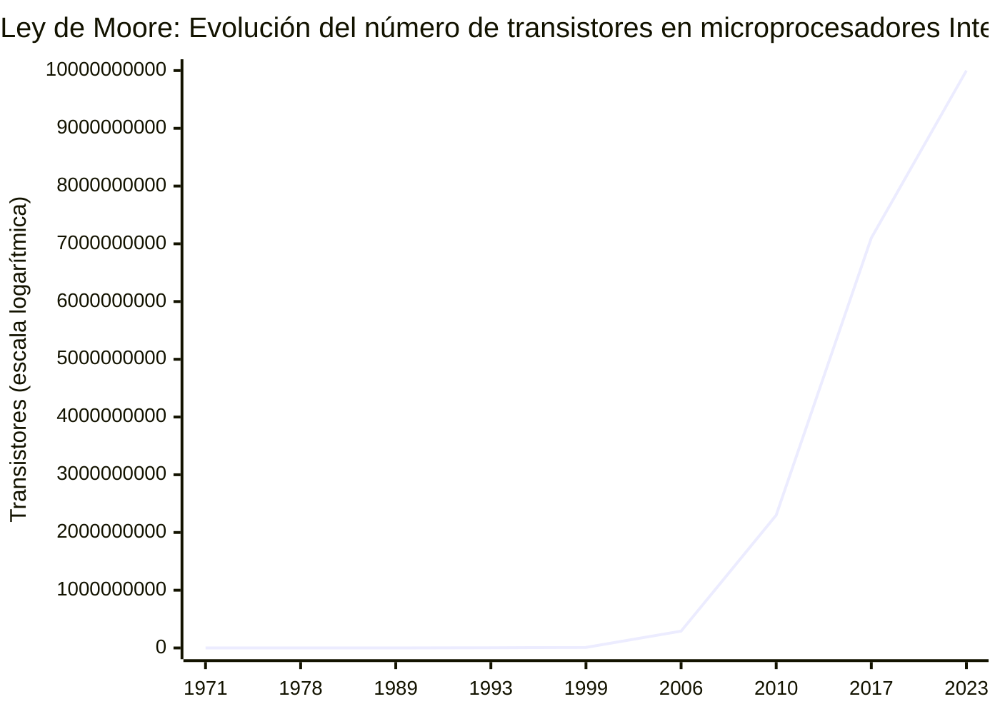
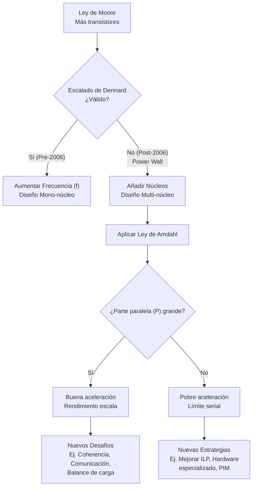

# Organización y Arquitectura de Computadoras - Principios cuantitativos del diseño de arquitecturas

## 1.1 Tendencias tecnológicas y de uso.

---

### 1. Introducción

El diseño de computadoras no ocurre en un vacío. Está impulsado y limitado por las tecnologías disponibles y por cómo los usuarios (y las aplicaciones) utilizan las máquinas. Comprender estas tendencias es crucial para tomar decisiones de diseño acertadas, prever el futuro del hardware y aplicar correctamente los principios cuantitativos.

### 2. Definición y Objetivo

Las **Tendencias Tecnológicas y de Uso** se refieren a la evolución predecible a lo largo del tiempo de los parámetros clave de la tecnología de semiconductores (como la densidad de transistores, la frecuencia y el consumo de energía) y de los patrones de comportamiento del software y las cargas de trabajo.

El **objetivo** de estudiar estas tendencias es:

- **Cuantificar** el progreso tecnológico.
- **Predecir** el punto óptimo de diseño (e.g., paralelismo vs. frecuencia).
- **Identificar** futuros cuellos de botella y desafíos.
- **Justificar** decisiones de arquitectura (e.g., multi-núcleo, aceleradores especializados).

### 3. Ley de Moore (La Tendencia Tecnológica Fundamental)

Formulada por Gordon Moore (cofundador de Intel) en 1965, es una **observación empírica** que se ha convertido en la regla de oro de la industria de los semiconductores.

- **Enunciado Original:** "El número de transistores en un circuito integrado denso se duplica aproximadamente cada dos años".
- **Formulación Cuantitativa:**
  Si \( n \) es el número de transistores en el año \( t \), entonces:

  $$ n(t + \Delta t) = n(t) \times 2 $$
  
  donde $( \Delta t )$ es aproximadamente 2 años. Esto implica un **crecimiento exponencial**.

**Consecuencias para el Diseño:**

- Permite aumentar la complejidad del hardware (más núcleos, más caché, unidades especializadas) sin aumentar el área del chip proporcionalmente.
- **Nota:** La Ley de Moore se ha ralentizado en el siglo XXI debido a limitaciones físicas y económicas, pero sigue siendo un principio rector.

### 4. Escalado de Dennard (y su Fin)

Formulado por Robert Dennard y sus colegas en IBM en 1974, describe el **efecto del escalado de los transistores** en su consumo de energía y velocidad.

- **Premisa:** Al reducir las dimensiones del transistor (canal, óxido de puerta) por un factor \( s \) (e.g., \( s = 0.7 \)):
  1.  La **densidad de transistores** aumenta en un factor \( \approx 1/s^2 \).
  2.  La **velocidad de conmutación** aumenta en un factor \( \approx s \) (la frecuencia \( f \) aumenta).
  3.  La **potencia disipada por transistor** disminuye en un factor \( \approx s^2 \).

- **Conclusión clave (La Era Dorada):** La **densidad de potencia** (potencia por unidad de área, e.g., W/cm²) se mantiene **constante**. Si se duplican los transistores, el área se reduce a la mitad, pero la potencia total se mantiene. Esto permitió aumentar la frecuencia (\( f \)) sin que los chips se quemaran.

- **El Fin del Escalado de Dennard (≈ 2006):** A partir de los ~65 nm, las corrientes de fuga (subthreshold leakage, gate leakage) dejaron de ser despreciables. La potencia ya no escala con \( s^2 \). La densidad de potencia **dejó de ser constante y comenzó a aumentar**.

**Implicación Crítica:** Se volvió físicamente imposible encender todos los transistores de un chip a la máxima frecuencia simultáneamente sin que se derritiera. Este "**Power Wall**" o "Muro de la Energía" es la razón principal del cambio de diseño:

- **De:** Aumentar la frecuencia de un solo núcleo (e.g., Pentium 4).
- **A:** Añadir más núcleos que funcionen a frecuencias moderadas (e.g., Core 2 Duo, procesadores multi-core).

### 5. La Ley de Amdahl (La Tendencia de Uso)

Formulada por Gene Amdahl en 1967, es una **ley fundamental** que cuantifica la **aceleración máxima** esperada de un sistema cuando solo una parte de él se mejora o paraleliza. Es crucial para decidir dónde invertir los recursos de diseño.

- **Fórmula:**
  Sea:
  - \( S \) = Fracción del programa que es **serial** (no paralelizable), donde \( 0 \leq S \leq 1 \).
  - \( P \) = Fracción del programa que es **paralelizable**, \( P = 1 - S \).
  - \( N \) = Número de procesadores o núcleos.

  La aceleración (\( Speedup \)) está dada por:

  $$
  Speedup(N) = \frac{Tiempo_{old}}{Tiempo_{new}} = \frac{1}{S + \frac{P}{N}} = \frac{1}{(1 - P) + \frac{P}{N}}
  $$

- **Interpretación:** Incluso con un número infinito de procesadores (\( N \to \infty \)), el speedup máximo está limitado por la parte serial:

  $$
  Speedup_{max} = \lim_{N \to \infty} \left( \frac{1}{S + \frac{P}{N}} \right) = \frac{1}{S}
  $$

**Ejemplo Práctico:**
Supongamos que el 90% de un programa es paralelizable (\( P = 0.9, S = 0.1 \)).

- Con 10 núcleos: $Speedup(10) = \frac{1}{0.1 + \frac{0.9}{10}} = \frac{1}{0.1 + 0.09} = \frac{1}{0.19} \approx 5.26x$
- Límite máximo: $Speedup_{max} = \frac{1}{0.1} = 10x$ (¡Solo 10x incluso con recursos infinitos!)

**Conclusión para el Diseño:** Mejorar (paralelizar) la parte común (el "common case") es crucial, pero eventualmente, la parte serial se convierte en el cuello de botella. Esto justifica la investigación en técnicas para reducir la overhead de la parte serial.

### 6. Otras Tendencias de Uso Clave

- **El Cambio hacia el Paralelismo a Nivel de Datos (DLP) e Instrucción (ILP):** Aplicaciones como el procesamiento de imágenes, machine learning y simulaciones científicas son inherentemente paralelas. Esto impulsa el diseño de GPUs, TPUs y arrays de procesadores SIMD.
- **El Auge de los Dispositivos Móviles y el IoT:** La **eficiencia energética** (rendimiento por vatio) se volvió la métrica principal por encima del rendimiento bruto. Esto impulsa arquitecturas heterogéneas (big.LITTLE), procesadores de bajo consumo y estados de sueño profundos.
- **El "Data-Centric" Computing:** El costo de mover datos es mucho mayor que el de realizar operaciones. Las arquitecturas están evolucionando para llevar la computación a los datos (Processing-in-Memory, Near-Data Processing) en lugar de llevar los datos a la CPU.

### 7. Ejercicios Propuestos

1.  **Ley de Moore:** Un chip tiene 2.5 mil millones de transistores en 2023. Asumiendo que la Ley de Moore se mantiene con un período de duplicación de 2.5 años, ¿cuántos transistores tendrá un chip en 2035?
2.  **Ley de Amdahl:**
    a) Un programa tarda 100 segundos en ejecutarse en un único procesador. El 70% del código se puede paralelizar. ¿Cuál es el speedup esperado al usar 4 procesadores? ¿Y el speedup máximo teórico?
    b) Se quiere lograr un speedup de 8x en un sistema de 16 procesadores. ¿Cuál es la fracción serial máxima (\( S \)) que el programa puede tener para alcanzar este objetivo?
3.  **Análisis Crítico:** Explica por qué, tras el fin del escalado de Dennard, la industria se volcó al multi-núcleo en lugar de seguir aumentando la frecuencia de reloj de los mono-núcleos. Usa los conceptos de densidad de potencia y Ley de Amdahl en tu respuesta.

### 8. Diagrama de Flujo: Impacto de las Tendencias en el Diseño

### 9. Resumen de Fórmulas Clave

| Concepto                    | Fórmula                                                                    | Variables                                                          |
| :-------------------------- | :------------------------------------------------------------------------- | :----------------------------------------------------------------- |
| **Ley de Moore**            | $n(t + \Delta t) \approx n(t) \times 2$                                    | $n:$ nº de transistores, $\Delta t:$ ~2 años                       |
| **Ley de Amdahl**           | $Speedup(N) = \frac{1}{S + \frac{P}{N}} = \frac{1}{(1 - P) + \frac{P}{N}}$ | $S:$ Fracción serial, $P:$ Fracción paralela $(1-S),$ $N:$ Núcleos |
| **Speedup Máximo (Amdahl)** | $Speedup_{max} = \frac{1}{S}$                                              | $S:$ Fracción serial                                               |

### 10. Referencias

- **Bibliografía Básica:**
  1.  Hennessy & Patterson, _Computer Architecture: A Quantitative Approach_ (Cap. 1, Sección 1.1 "Introduction", y Cap. 4 sobre paralelismo a nivel de instrucción). La "biblia" del tema.
  2.  Patterson & Hennessy, _Computer Organization and Design_ (Cap. 1, "The Computer Revolution" y "Below Your Program"). Explica estos conceptos de forma más accesible.
- **Bibliografía Complementaria:**
  1.  Stallings, _Computer Organization and Architecture_ (Cap. 2, "Computer Evolution and Performance"). Ofrece una perspectiva histórica excelente que ilustra estas tendencias.
- **Artículos Seminales (Recomendados):**
  - Moore, Gordon E. (1965). "Cramming more components onto integrated circuits". _Electronics Magazine_.
  - Amdahl, Gene M. (1967). "Validity of the Single Processor Approach to Achieving Large-Scale Computing Capabilities". _AFIPS Conference Proceedings_.
