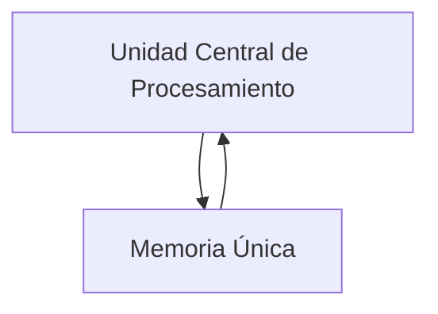
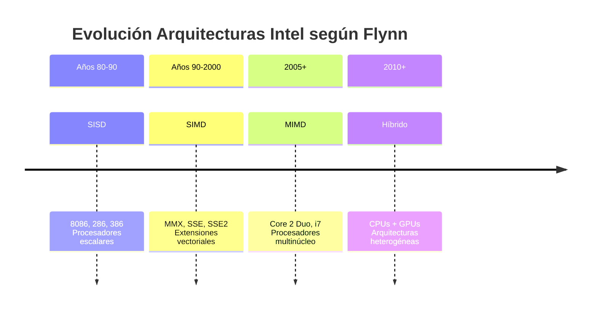

# Organización y Arquitectura de Computadoras - Sistemas multiprocesador

## 11.1 Clasificación de Flynn

---

La Clasificación de Flynn es una taxonomía propuesta por Michael J. Flynn en 1966 que categoriza las arquitecturas de computadoras según el número de flujos de instrucciones y flujos de datos que pueden procesar simultáneamente. Esta clasificación es fundamental para entender las diferentes arquitecturas multiprocesador y sus capacidades de procesamiento paralelo.

### Conceptos Fundamentales

**Flujo de instrucciones (Instruction Stream):** Secuencia de instrucciones ejecutadas por el procesador.

**Flujo de datos (Data Stream):** Secuencia de datos manipulados por las instrucciones.

### Las Cuatro Categorías de Flynn

#### SISD (Single Instruction, Single Data)

- **Definición:** Un solo flujo de instrucciones que opera sobre un solo flujo de datos.
- **Características:** Computadora monoprocesador tradicional (arquitectura Von Neumann).
- **Ejemplo:** Procesador Intel 8086, AMD Athlon de un solo núcleo.



#### SIMD (Single Instruction, Multiple Data)

- **Definición:** Un solo flujo de instrucciones que opera sobre múltiples flujos de datos simultáneamente.
- **Características:** Ideal para procesamiento vectorial y aplicaciones con alto paralelismo de datos.
- **Fórmula:** $T_{SIMD} \approx \frac{T_{SISD}}{N}$ donde $N$ es el número de elementos de datos procesados.
- **Ejemplo:** Arquitecturas GPU, procesadores vectoriales, extensiones MMX/SSE/AVX.


#### MISD (Multiple Instruction, Single Data)

- **Definición:** Múltiples flujos de instrucciones operan sobre un solo flujo de datos.
- **Características:** Arquitectura poco común, principalmente teórica.
- **Ejemplo:** Sistemas de tolerancia a fallos donde múltiples unidades procesan los mismos datos para verificar resultados.


#### MIMD (Multiple Instruction, Multiple Data)

- **Definición:** Múltiples flujos de instrucciones operan sobre múltiples flujos de datos.
- **Características:** Arquitectura multiprocesador más común y flexible.
- **Subclasificación:**
  - **Memoria Compartida (UMA/NUMA)**
  - **Memoria Distribuida (Clusters)**
- **Ejemplo:** Multicomputadoras, clusters, sistemas multinúcleo.


### Comparativa de Arquitecturas

| Arquitectura | Ventajas                                       | Desventajas                            | Aplicaciones Típicas               |
| ------------ | ---------------------------------------------- | -------------------------------------- | ---------------------------------- |
| **SISD**     | Simple de programar                            | Limitado por ley de Amdahl             | Aplicaciones generales             |
| **SIMD**     | Alto rendimiento en operaciones paralelizables | No flexible para código condicional    | Procesamiento multimedia, gráficos |
| **MISD**     | Redundancia para tolerancia a fallos           | Poco práctica, compleja de implementar | Sistemas críticos (aeroespacial)   |
| **MIMD**     | Máxima flexibilidad, escalabilidad             | Complejidad de programación            | Servidores, supercomputadoras      |

### Ejemplo de Código SIMD

```cpp
#include <immintrin.h> // Para instrucciones AVX

// Suma de dos arrays usando SIMD (AVX)
void vector_add(float* a, float* b, float* c, int size) {
    for (int i = 0; i < size; i += 8) {
        // Cargar 8 floats (256 bits)
        __m256 va = _mm256_load_ps(&a[i]);
        __m256 vb = _mm256_load_ps(&b[i]);

        // Realizar suma SIMD
        __m256 vc = _mm256_add_ps(va, vb);

        // Almacenar resultado
        _mm256_store_ps(&c[i], vc);
    }
}
```

### Ejercicios Propuestos

1. **Problema:** Calcule la aceleración teórica de una operación SIMD que procesa 16 elementos simultáneamente, considerando que el 20% del código no es paralelizable.

   **Solución aplicando Ley de Amdahl:**

   $$
   S = \frac{1}{(1 - P) + \frac{P}{N}}
   $$

   Donde:
   - $P = 0.8$ (fracción paralelizable)
   - $N = 16$ (número de procesadores)

   $$
   S = \frac{1}{(1 - 0.8) + \frac{0.8}{16}} = \frac{1}{0.2 + 0.05} = \frac{1}{0.25} = 4
   $$

2. **Problema:** Identifique la clasificación de Flynn para las siguientes arquitecturas:
   - a) Una GPU moderna
   - b) Un cluster de computadoras
   - c) Un procesador con extensiones SSE
   - d) Un sistema triple modular redundante

3. **Problema:** Diseñe un diagrama Mermaid para un sistema MIMD con 4 procesadores y memoria compartida.

### Limitaciones y Extensiones de la Taxonomía de Flynn

La clasificación de Flynn, aunque fundamental, tiene limitaciones:

- No considera la jerarquía de memoria
- No diferencia entre arquitecturas de memoria compartida y distribuida
- No captura completamente las arquitecturas híbridas modernas

### Caso de Estudio: Evolución de Arquitecturas Intel



### Referencias

#### Bibliografía Básica

1. Hennessy, J. L. & Patterson, D. A. (2006). _Computer Architecture: A Quantitative Approach_ (4th ed.). Capítulo 4: Multiprocesadores y paralelismo a nivel de hilo.
2. Patterson, D. A. & Hennessy, J. L. (2008). _Computer Organization and Design: The Hardware/Software Interface_ (4th ed.). Sección 6.6: Clasificación de Flynn.

#### Bibliografía Complementaria

1. Stallings, W. (2009). _Computer Organization and Architecture: Designing for Performance_. Capítulo 16: Procesamiento paralelo.
2. Tanenbaum, A. S. (2005). _Structured Computer Organization_ (5th ed.). Sección 8.1: Multiprocesadores.

#### Recursos Adicionales

- Flynn, M. J. (1972). "Some Computer Organizations and Their Effectiveness". _IEEE Transactions on Computers_.
- Tutoriales sobre programación SIMD: Intel Intrinsics Guide

### Conclusión

La clasificación de Flynn proporciona un marco fundamental para entender las arquitecturas multiprocesador, pero debe complementarse con conocimientos sobre coherencia de caché, técnicas de sincronización y modelos de programación paralela para un entendimiento completo de los sistemas multiprocesador modernos.
