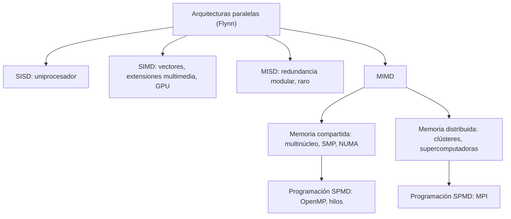
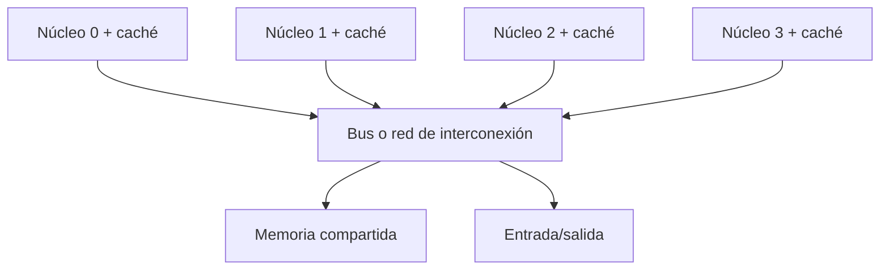

# Organización y Arquitectura de Computadoras - Sistemas multiprocesador

## 11.1 Clasificación de Flynn

---

Las computadoras paralelas son muy variadas: procesadores con instrucciones vectoriales, tarjetas gráficas con miles de unidades, servidores con decenas de núcleos que comparten memoria, supercomputadoras con millones de núcleos conectados por una red. Michael Flynn propuso en 1966 una clasificación sencilla que sigue siendo el punto de partida: contar cuántos **flujos de instrucciones** y cuántos **flujos de datos** procesa la máquina a la vez. Este tema presenta las cuatro categorías, sus ejemplos actuales y sus límites, y las refina con las distinciones que hoy importan: el modelo de programación SPMD, el paralelismo de datos frente al de tareas, y la organización de la memoria que se estudia en los temas 11.2 y 11.3.

### Las cuatro categorías

| | Un flujo de datos | Varios flujos de datos |
| --- | --- | --- |
| **un flujo de instrucciones** | SISD | SIMD |
| **varios flujos de instrucciones** | MISD | MIMD |

**SISD** (_single instruction, single data_): el uniprocesador clásico de von Neumann. Puede tener segmentación y emisión múltiple (paralelismo a nivel de instrucción, tema 7), pero conceptualmente ejecuta un programa sobre un dato a la vez.

**SIMD** (_single instruction, multiple data_): una misma instrucción opera sobre muchos datos a la vez, con una unidad de control y varias unidades de proceso (**carriles**). Explota el **paralelismo de datos**: aplicar la misma operación a todos los elementos de un arreglo. Ejemplos: las **extensiones multimedia** de los procesadores (SSE y AVX en x86, NEON y SVE en ARM, la extensión V de RISC-V), los **procesadores vectoriales** (Cray-1) y, con matices, las **GPU**, cuyos grupos de 32 hilos (_warps_) ejecutan la misma instrucción con máscaras para las ramas divergentes (NVIDIA llama a esto SIMT).

**MISD** (_multiple instruction, single data_): varias instrucciones sobre el mismo dato. Casi no tiene ejemplos prácticos; se suele citar la **redundancia modular triple** de sistemas críticos (tres unidades calculan lo mismo y un votante elige por mayoría) y algunos arreglos sistólicos, aunque ambos encajan solo parcialmente.

**MIMD** (_multiple instruction, multiple data_): varios procesadores independientes, cada uno con su programa y sus datos. Es la categoría de todos los multinúcleos, servidores, clústeres y supercomputadoras. Se subdivide según la memoria:

- **Memoria compartida** (tema 11.3): todos los procesadores ven el mismo espacio de direcciones y se comunican con cargas y almacenamientos. Puede ser UMA (tiempo de acceso uniforme) o NUMA.
- **Memoria distribuida** (tema 11.2): cada procesador tiene su memoria privada y se comunica con **mensajes**.

### Más allá de Flynn

- **SPMD** (_single program, multiple data_): el modelo de programación dominante en MIMD. Todos los procesadores ejecutan el **mismo programa**, cada uno sobre su parte de los datos y siguiendo caminos distintos según su identificador. Es el modelo de MPI, de OpenMP y de CUDA.
- **Paralelismo de datos frente a paralelismo de tareas:** el primero reparte los datos (todos hacen lo mismo con partes distintas); el segundo reparte funciones distintas (un hilo lee, otro procesa, otro escribe).
- **Sistemas híbridos:** un supercomputador actual es MIMD (nodos que se comunican por mensajes), cada nodo es MIMD de memoria compartida (varios núcleos), cada núcleo tiene unidades SIMD y está segmentado. La clasificación de Flynn describe un nivel cada vez.



### SIMD y la ley de Amdahl

Con $N$ carriles, la parte vectorizable se acelera $N$ veces, pero la parte escalar no. Además, en SIMD los datos deben estar contiguos (o hacen falta instrucciones de recolección y dispersión, _gather/scatter_) y las ramas condicionales dentro de un bucle vectorizado se ejecutan con **máscaras**: si los carriles divergen, se ejecutan las dos ramas y cada carril desactiva la que no le corresponde, perdiendo eficiencia.

### Implementación en Python

El programa simula SAXPY, la operación $y = ax + y,$ en los modelos SISD, SIMD con 4 y 16 carriles y MIMD con 4 procesadores, contando las instrucciones del camino más largo; muestra un votante de redundancia modular triple, la aceleración del ejercicio 1 según el número de carriles y la pérdida de eficiencia por divergencia en un grupo SIMD de 32 hilos.

```python
# Clasificación de Flynn: un intérprete muy simple de los cuatro modelos sobre SAXPY: y = a*x + y
a = 2.0
x = [float(i) for i in range(16)]
y = [1.0] * 16


def sisd(x, y):
    """Un flujo de instrucciones, un dato por instrucción."""
    instr, y = 0, list(y)
    for i in range(len(x)):
        y[i] = a * x[i] + y[i]
        instr += 4               # cargar x, cargar y, multiplicar-sumar, almacenar
    return y, instr


def simd(x, y, carriles):
    """Un flujo de instrucciones que opera sobre `carriles` datos a la vez."""
    instr, y = 0, list(y)
    for i in range(0, len(x), carriles):
        bloque = range(i, min(i + carriles, len(x)))
        for k in bloque:         # los carriles trabajan en paralelo: cuenta como una instrucción
            y[k] = a * x[k] + y[k]
        instr += 4
    return y, instr


def mimd(x, y, procesadores):
    """Varios flujos de instrucciones, cada uno con su parte de los datos (SPMD)."""
    y = list(y)
    partes = [range(p, len(x), procesadores) for p in range(procesadores)]
    instr_por_proc = []
    for parte in partes:
        n = 0
        for i in parte:
            y[i] = a * x[i] + y[i]
            n += 4
        instr_por_proc.append(n)
    return y, max(instr_por_proc)


ref, n1 = sisd(x, y)
for nombre, (res, n) in (("SISD", (ref, n1)), ("SIMD, 4 carriles", simd(x, y, 4)),
                         ("SIMD, 16 carriles", simd(x, y, 16)), ("MIMD, 4 procesadores", mimd(x, y, 4))):
    print(f"{nombre:22s}: resultado correcto {res == ref}, instrucciones en el camino más largo {n:3d},"
          f" aceleración ideal {n1 / n:.0f}")


# MISD: redundancia modular triple, tres unidades con el mismo dato y un votante
def votar(r1, r2, r3):
    return r1 if r1 == r2 or r1 == r3 else r2


print("MISD (TMR): resultados 42, 42, 17 (una unidad falla) -> votado:", votar(42, 42, 17))

# Ejercicio 1 y efecto del número de carriles con un 20 % de código escalar
for carriles in (4, 8, 16, 64, 10**9):
    s = 1 / (0.2 + 0.8 / carriles)
    print(f"ejercicio 1: {carriles if carriles < 10**9 else 'infinitos':>9} carriles: aceleración {s:.2f}")

# Divergencia en SIMD/GPU: un if dentro de un warp de 32 hilos ejecuta ambas ramas con máscara
for verdaderos in (32, 16, 1):
    eficiencia = (verdaderos * 1 + (32 - verdaderos) * 1) / (32 * (2 if 0 < verdaderos < 32 else 1))
    print(f"warp de 32 con {verdaderos:2d} hilo{'s' if verdaderos > 1 else ' '} en la rama 'si': eficiencia {eficiencia:.0%}")
```

Salida:

```text
SISD                  : resultado correcto True, instrucciones en el camino más largo  64, aceleración ideal 1
SIMD, 4 carriles      : resultado correcto True, instrucciones en el camino más largo  16, aceleración ideal 4
SIMD, 16 carriles     : resultado correcto True, instrucciones en el camino más largo   4, aceleración ideal 16
MIMD, 4 procesadores  : resultado correcto True, instrucciones en el camino más largo  16, aceleración ideal 4
MISD (TMR): resultados 42, 42, 17 (una unidad falla) -> votado: 42
ejercicio 1:         4 carriles: aceleración 2.50
ejercicio 1:         8 carriles: aceleración 3.33
ejercicio 1:        16 carriles: aceleración 4.00
ejercicio 1:        64 carriles: aceleración 4.71
ejercicio 1: infinitos carriles: aceleración 5.00
warp de 32 con 32 hilos en la rama 'si': eficiencia 100%
warp de 32 con 16 hilos en la rama 'si': eficiencia 50%
warp de 32 con  1 hilo  en la rama 'si': eficiencia 50%
```

### Ejercicios Propuestos

1. **SIMD y Amdahl.** Una operación SIMD procesa 16 elementos a la vez y el 20 % del código no se puede vectorizar. ¿Cuál es la aceleración teórica?

2. **Clasificación.** ¿En qué categoría de Flynn está: (a) una GPU moderna; (b) un clúster de computadoras; (c) un procesador con extensiones SSE; (d) un sistema con redundancia modular triple?

3. **MIMD.** Dibuja un sistema MIMD de 4 procesadores con memoria compartida.

4. **Divergencia.** ¿Por qué un `if` dentro de un núcleo de GPU puede reducir el rendimiento a la mitad?

### Soluciones

**Ejercicio 1.** $S = \frac{1}{0.2 + 0.8/16} = \frac{1}{0.25} = 4.$ Aunque la parte vectorizable se acelere 16 veces, el total no pasa de 4, y ni con infinitos carriles de 5.

**Ejercicio 2.** (a) SIMD en cada grupo de hilos (SIMT), y MIMD entre los multiprocesadores de la GPU, que ejecutan grupos distintos de forma independiente. (b) MIMD de memoria distribuida. (c) SIMD dentro de cada núcleo; si el procesador es multinúcleo, MIMD entre núcleos. (d) Se suele citar como MISD: las tres unidades procesan el mismo dato; aunque si ejecutan el mismo programa, es más bien una replicación de un SISD.

**Ejercicio 3.**



Cada núcleo tiene su contador de programa y ejecuta su propio flujo de instrucciones; las cachés se mantienen coherentes (tema 9.5).

**Ejercicio 4.** Los 32 hilos de un grupo comparten la unidad de control. Si unos toman la rama "sí" y otros la "no", el grupo ejecuta ambas ramas una tras otra, desactivando en cada una los hilos que no corresponden. Con ramas de igual longitud, la eficiencia baja al 50 %, sin importar cuántos hilos tomen cada rama, mientras haya al menos uno en cada una.

### Referencias

1. Flynn, M. J., Very high-speed computing systems. _Proceedings of the IEEE_ 54(12), 1966.
2. Hennessy, J. L., and Patterson, D. A., _Computer Architecture: A Quantitative Approach_. Morgan Kaufmann, 2019. Capítulos 4 y 5.
3. Patterson, D. A., and Hennessy, J. L., _Computer Organization and Design: The Hardware/Software Interface_. Morgan Kaufmann, 2020. Capítulo 6.
4. Stallings, W., _Organización y arquitectura de computadores_. Pearson, 2006. Capítulo 18.
