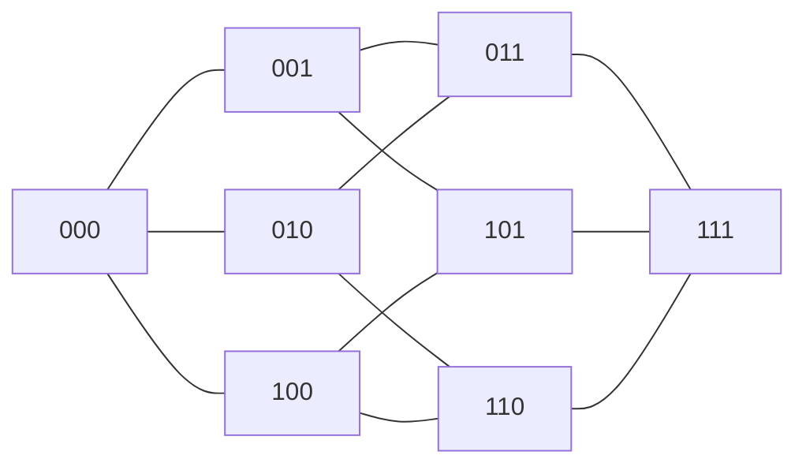

# Organización y Arquitectura de Computadoras - Sistemas multiprocesador

## 11.2 Arquitecturas paralelas con memoria distribuida

---

En una arquitectura de **memoria distribuida**, cada procesador (o cada nodo, que puede tener varios núcleos) tiene su propia memoria privada, y ningún procesador puede leer directamente la memoria de otro: para compartir datos se envían **mensajes** por una **red de interconexión**. Es la organización de los clústeres y de las supercomputadoras, que escalan a millones de núcleos porque no necesitan coherencia de cachés entre nodos. Este tema estudia el modelo de paso de mensajes, las topologías de red con sus medidas, el costo de la comunicación y su efecto sobre la aceleración y la eficiencia.

### Paso de mensajes

Los programas se escriben en estilo SPMD (tema 11.1) con una biblioteca de comunicación, casi siempre **MPI** (_Message Passing Interface_):

- **Comunicación punto a punto:** `MPI_Send` y `MPI_Recv` envían y reciben un bloque de datos entre dos procesos. Pueden ser bloqueantes o no bloqueantes, para solapar comunicación y cálculo.
- **Comunicaciones colectivas:** difusión (`MPI_Bcast`), reducción (`MPI_Reduce`, por ejemplo una suma global), dispersión y recolección, barrera. La biblioteca las implementa con algoritmos en árbol o en anillo adaptados a la red.

El programador debe **repartir explícitamente** los datos y decidir qué se comunica: más trabajo que con memoria compartida, pero con un costo visible y controlable.

### Redes de interconexión

Una red se describe con un grafo: nodos (procesadores o conmutadores) y enlaces. Medidas:

- **Diámetro:** la mayor distancia mínima entre dos nodos; acota la latencia en el peor caso.
- **Distancia media:** la latencia típica.
- **Número de enlaces:** el costo.
- **Ancho de bisección:** el mínimo número de enlaces que hay que cortar para dividir la red en dos mitades iguales; acota el ancho de banda cuando la mitad de los nodos se comunica con la otra mitad.

| Topología con $p$ nodos | Diámetro | Enlaces | Ancho de bisección |
| --- | --- | --- | --- |
| anillo | $\lfloor p/2 \rfloor$ | $p$ | 2 |
| malla $\sqrt{p} \times \sqrt{p}$ | $2(\sqrt{p} - 1)$ | $2(p - \sqrt{p})$ | $\sqrt{p}$ |
| toro $\sqrt{p} \times \sqrt{p}$ | $2 \lfloor \sqrt{p}/2 \rfloor$ | $2p$ | $2\sqrt{p}$ |
| hipercubo de dimensión $d = \log_2 p$ | $\log_2 p$ | $\frac{p}{2} \log_2 p$ | $p/2$ |
| completa | 1 | $\frac{p(p-1)}{2}$ | $p^2/4$ |

**Hipercubo.** Los nodos se numeran con $d$ bits y dos nodos están conectados si sus números difieren en exactamente un bit. La distancia entre dos nodos es el número de bits en que difieren (la distancia de Hamming), así que el diámetro es $d.$ Encaminar un mensaje es corregir los bits distintos uno por uno.

Las redes reales de los centros de datos y supercomputadoras usan **árboles gruesos** (_fat trees_), redes en libélula (_dragonfly_) y toros de 3 a 6 dimensiones, construidos con conmutadores, que ofrecen gran ancho de bisección a un costo razonable.



### Costo de la comunicación

Un modelo sencillo y útil para un mensaje de $n$ bytes es

$$ T(n) = \alpha + \frac{n}{\beta} $$

con **latencia** $\alpha$ (de 1 a 10 µs en una red de supercómputo, incluido el software) y **ancho de banda** $\beta.$ Los mensajes cortos pagan casi solo la latencia, así que conviene **agrupar** los datos en pocos mensajes grandes. Una suma global de $p$ valores enviada nodo por nodo a uno central cuesta $(p - 1)\, T,$ pero organizada en árbol cuesta $\lceil \log_2 p \rceil\, T.$

**Aceleración y eficiencia.** Con la ley de Amdahl, $S(p) = \frac{1}{(1 - F) + F/p},$ y la **eficiencia** es $E = S/p,$ la fracción del trabajo potencial de los procesadores que se aprovecha. La comunicación añade un término que **crece** con $p:$ a partir de cierto número de procesadores, añadir más hace el programa más lento. Por eso en memoria distribuida importa la **escalabilidad débil** (ley de Gustafson): aumentar el tamaño del problema con el número de procesadores, para que el cálculo por nodo crezca más que la comunicación.

### Implementación en Python

El programa construye cinco topologías de 16 nodos y calcula, por búsqueda en anchura y por fuerza bruta, su diámetro, su distancia media, sus enlaces y su ancho de bisección; resuelve los ejercicios 1 a 3 y aplica el modelo $\alpha + n/\beta$ a la reducción global y a mensajes de distintos tamaños.

```python
from collections import deque
from itertools import combinations
from math import log2


def anillo(p):
    return {i: {(i - 1) % p, (i + 1) % p} for i in range(p)}


def malla(k, toro=False):
    g = {}
    for x in range(k):
        for y in range(k):
            v = set()
            for dx, dy in ((1, 0), (-1, 0), (0, 1), (0, -1)):
                nx, ny = x + dx, y + dy
                if toro:
                    v.add((nx % k) * k + ny % k)
                elif 0 <= nx < k and 0 <= ny < k:
                    v.add(nx * k + ny)
            g[x * k + y] = v
    return g


def hipercubo(d):
    return {i: {i ^ (1 << b) for b in range(d)} for i in range(2 ** d)}


def completo(p):
    return {i: set(range(p)) - {i} for i in range(p)}


def metricas(g):
    p = len(g)
    dist_total, diametro = 0, 0
    for s in g:
        d = {s: 0}
        q = deque([s])
        while q:
            u = q.popleft()
            for w in g[u]:
                if w not in d:
                    d[w] = d[u] + 1
                    q.append(w)
        diametro = max(diametro, max(d.values()))
        dist_total += sum(d.values())
    enlaces = sum(len(v) for v in g.values()) // 2
    # ancho de bisección: mínimo de enlaces cortados al partir en dos mitades iguales (fuerza bruta)
    nodos = sorted(g)
    biseccion = min(sum(1 for u in mitad for w in g[u] if w not in mitad)
                    for mitad in map(set, combinations(nodos[1:], p // 2 - 1)) for mitad in [mitad | {nodos[0]}])
    return diametro, dist_total / (p * (p - 1)), enlaces, biseccion


print(f"{'topología (16 nodos)':22s} diámetro  distancia media  enlaces  bisección")
for nombre, g in (("anillo", anillo(16)), ("malla 4x4", malla(4)), ("toro 4x4", malla(4, True)),
                  ("hipercubo de 4 dim.", hipercubo(4)), ("completa", completo(16))):
    d, m, e, b = metricas(g)
    print(f"{nombre:22s} {d:8d} {m:16.2f} {e:8d} {b:10d}")
d, m, e, b = metricas(hipercubo(3))
print(f"ejercicio 3, hipercubo de 8 nodos: diámetro {d}, {e} enlaces, bisección {b}; vecinos de 000:",
      sorted(format(v, '03b') for v in hipercubo(3)[0]))

# Ejercicio 1
P, N = 0.85, 32
S = 1 / ((1 - P) + P / N)
print(f"ejercicio 1: aceleración {S:.2f}, eficiencia {S / N:.1%}")
# Ejercicio 2: el sobrecosto de comunicación se toma como el 5 % del tiempo secuencial
T = 100 * 0.30 + 100 * 0.70 / 8 + 0.05 * 100
print(f"ejercicio 2: T = 30 + 8.75 + 5 = {T:.2f} s, aceleración {100 / T:.2f}")

# Costo de comunicación: T = alfa + n / beta; suma global de p valores
alfa, beta = 2e-6, 10e9                     # 2 µs de latencia, 10 GB/s
for p in (8, 64, 1024):
    lineal = (p - 1) * (alfa + 8 / beta)    # todos envían a un nodo raíz, uno tras otro
    arbol = int(log2(p)) * (alfa + 8 / beta)
    print(f"reducción de {p:4d} números: lineal {lineal * 1e6:8.1f} µs, en árbol {arbol * 1e6:5.1f} µs")
for n in (8, 8_000, 8_000_000):
    t = alfa + n / beta
    tam = f"{n:,}".replace(",", " ")
    print(f"mensaje de {tam:>9} bytes: {t * 1e6:9.2f} µs, ancho de banda efectivo {n / t / 1e9:.3f} GB/s")
```

Salida:

```text
topología (16 nodos)   diámetro  distancia media  enlaces  bisección
anillo                        8             4.27       16          2
malla 4x4                     6             2.67       24          4
toro 4x4                      4             2.13       32          8
hipercubo de 4 dim.           4             2.13       32          8
completa                      1             1.00      120         64
ejercicio 3, hipercubo de 8 nodos: diámetro 3, 12 enlaces, bisección 4; vecinos de 000: ['001', '010', '100']
ejercicio 1: aceleración 5.66, eficiencia 17.7%
ejercicio 2: T = 30 + 8.75 + 5 = 43.75 s, aceleración 2.29
reducción de    8 números: lineal     14.0 µs, en árbol   6.0 µs
reducción de   64 números: lineal    126.1 µs, en árbol  12.0 µs
reducción de 1024 números: lineal   2046.8 µs, en árbol  20.0 µs
mensaje de         8 bytes:      2.00 µs, ancho de banda efectivo 0.004 GB/s
mensaje de     8 000 bytes:      2.80 µs, ancho de banda efectivo 2.857 GB/s
mensaje de 8 000 000 bytes:    802.00 µs, ancho de banda efectivo 9.975 GB/s
```

Con 16 nodos, el toro de $4 \times 4$ y el hipercubo de dimensión 4 dan las mismas medidas: son el mismo grafo con los nodos renumerados. Con 1024 procesadores, la reducción en árbol es 100 veces más rápida que la lineal.

### Ejercicios Propuestos

1. **Eficiencia.** Un programa es paralelizable en un 85 %. Calcula la aceleración máxima con 32 procesadores y la eficiencia.

2. **Comunicación.** Un programa tarda 100 s en un procesador y el 70 % es paralelizable. ¿Cuánto tardará con 8 procesadores si la comunicación añade un 5 % del tiempo secuencial?

3. **Hipercubo.** Diseña un hipercubo de 8 procesadores y calcula su diámetro. ¿Por qué camino va un mensaje de 000 a 101?

4. **Mensajes.** Con $\alpha = 2$ µs y $\beta = 10$ GB/s, ¿a partir de qué tamaño de mensaje se aprovecha más de la mitad del ancho de banda?

### Soluciones

**Ejercicio 1.** $S = \frac{1}{0.15 + 0.85/32} \approx 5.66$ y $E = 5.66 / 32 \approx 17.7\,\%:$ más del 80 % de la capacidad de los procesadores se desperdicia por la parte serial.

**Ejercicio 2.** $30 + 70/8 + 5 = 43.75$ s, una aceleración de 2.29, frente a $100 / 38.75 \approx 2.58$ sin comunicación.

**Ejercicio 3.** Nodos numerados de 000 a 111, con enlaces entre los que difieren en un bit: 12 enlaces, cada nodo con 3 vecinos, diámetro 3. De 000 a 101 los números difieren en los bits 0 y 2: el mensaje va, por ejemplo, de 000 a 001 y de 001 a 101, en 2 saltos.

**Ejercicio 4.** El ancho de banda efectivo es $\frac{n}{\alpha + n/\beta},$ que es la mitad de $\beta$ cuando $n/\beta = \alpha,$ es decir $n = \alpha \beta = 2 \times 10^{-6} \cdot 10^{10} = 20\,000$ bytes. Es el **tamaño de medio rendimiento**: mensajes más cortos están dominados por la latencia.

### Referencias

1. Hennessy, J. L., and Patterson, D. A., _Computer Architecture: A Quantitative Approach_. Morgan Kaufmann, 2019. Capítulo 6 y apéndice F.
2. Grama, A., Gupta, A., Karypis, G., and Kumar, V., _Introduction to Parallel Computing_. Addison-Wesley, 2003. Capítulos 2 y 4.
3. Pacheco, P., _An Introduction to Parallel Programming_. Morgan Kaufmann, 2011. Capítulo 3.
4. Dally, W. J., and Towles, B., _Principles and Practices of Interconnection Networks_. Morgan Kaufmann, 2004.
