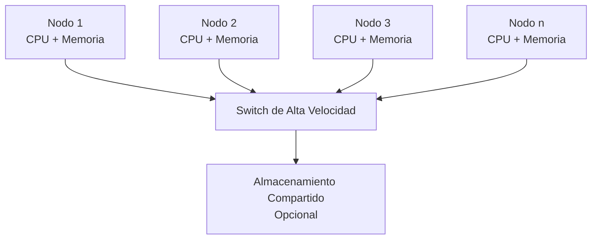
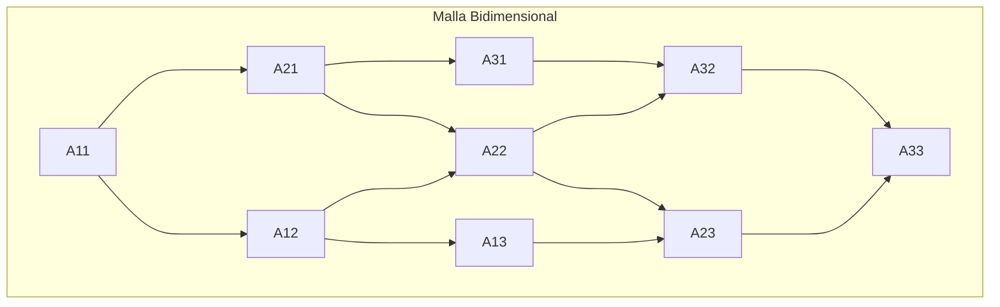
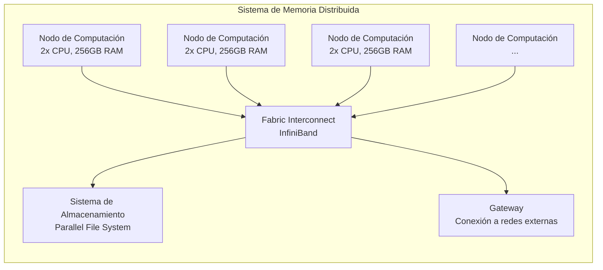

# Organización y Arquitectura de Computadoras - Sistemas multiprocesador

## 11.2 Arquitecturas paralelas con memoria distribuida

---

Las arquitecturas paralelas con memoria distribuida son sistemas multiprocesador donde cada procesador tiene su propia memoria privada y se comunican mediante el paso de mensajes a través de una red de interconexión. Esta arquitectura contrasta con los sistemas de memoria compartida y ofrece ventajas en escalabilidad y coste.

### Conceptos Fundamentales

**Memoria distribuida:** Arquitectura donde cada procesador tiene su propio espacio de direccionamiento privado y no existe memoria global compartida.

**Pasaje de mensajes:** Mecanismo de comunicación entre procesadores donde los datos se transfieren explícitamente entre memorias locales.

### Características Principales

#### Ventajas

- Mayor escalabilidad que los sistemas de memoria compartida
- Menores conflictos de acceso a memoria
- Coste más reducido al usar componentes estándar
- Mayor tolerancia a fallos

#### Desventajas

- Mayor complejidad de programación
- Sobrecarga por comunicación entre nodos
- Dificultad en la distribución y balanceo de carga

### Modelos de Arquitectura

#### Clusters de Computadoras

Sistemas construidos con computadoras comerciales interconectadas mediante redes de alta velocidad.



#### Multicomputadoras

Sistemas diseñados específicamente con múltiples procesadores interconectados, cada uno con memoria local.

#### Sistemas Massivamente Paralelos (MPP)

Sistemas con miles de procesadores diseñados para aplicaciones de alto rendimiento.

### Redes de Interconexión

#### Topologías Comunes



#### Parámetros de Rendimiento

- **Latencia:** Tiempo para transferir un mensaje entre dos nodos
- **Ancho de banda:** Máxima tasa de transferencia de datos
- **Diámetro:** Máxima distancia entre dos nodos en la red

### Modelos de Programación

#### Paso de Mensajes (MPI)

Interfaz estándar para programación en sistemas de memoria distribuida.

```cpp
#include <mpi.h>
#include <iostream>

int main(int argc, char** argv) {
    MPI_Init(&argc, &argv);

    int world_size, world_rank;
    MPI_Comm_size(MPI_COMM_WORLD, &world_size);
    MPI_Comm_rank(MPI_COMM_WORLD, &world_rank);

    // Ejemplo de comunicación
    if (world_rank == 0) {
        int data = 42;
        MPI_Send(&data, 1, MPI_INT, 1, 0, MPI_COMM_WORLD);
    } else if (world_rank == 1) {
        int received_data;
        MPI_Recv(&received_data, 1, MPI_INT, 0, 0,
                 MPI_COMM_WORLD, MPI_STATUS_IGNORE);
        std::cout << "Proceso 1 recibió: " << received_data << std::endl;
    }

    MPI_Finalize();
    return 0;
}
```

#### Modelo Cliente-Servidor

Arquitectura donde procesos servidores proveen servicios a procesos clientes.

### Métricas de Rendimiento

#### Ley de Amdahl

Define la aceleración máxima considerando la fracción paralelizable de un programa:

$$
S = \frac{1}{(1 - P) + \frac{P}{N}}
$$

Donde:

- $S:$ Aceleración máxima
- $P:$ Fracción paralelizable del programa
- $N:$ Número de procesadores

#### Ley de Gustafson

Modela la aceleración cuando el tamaño del problema escala con el número de procesadores:

$$
S = N + (1 - N) \cdot s
$$

Donde:

- $s:$ Fracción serial del programa

#### Eficiencia

Medida de qué tan bien se utilizan los procesadores:

$$
E = \frac{S}{N} = \frac{1}{(1 - P) \cdot N + P}
$$

### Ejercicios Propuestos

1. **Problema:** Calcule la aceleración máxima de un programa que es 85% paralelizable en un sistema con 32 procesadores. ¿Cuál es la eficiencia del sistema?

   **Solución:**

   $$
   S = \frac{1}{(1 - 0.85) + \frac{0.85}{32}} = \frac{1}{0.15 + 0.02656} = \frac{1}{0.17656} \approx 5.66
   $$

   $$
   E = \frac{5.66}{32} \approx 0.177 \text{ (17.7\%)}
   $$

2. **Problema:** Un programa tarda 100 segundos en ejecutarse secuencialmente. Si el 70% es paralelizable, ¿cuánto tardará en un sistema con 8 procesadores, asumiendo una sobrecarga de comunicación del 5%?

3. **Problema:** Diseñe una topología de hipercubo para 8 procesadores y calcule su diámetro.

### Técnicas de Optimización

#### Balanceo de Carga

Distribución equitativa del trabajo entre procesadores para maximizar la utilización.

#### Reducción de Comunicación

Técnicas para minimizar la sobrecarga por transferencia de mensajes:

- Agrupamiento de mensajes
- Solapamiento de cálculo y comunicación
- Uso de operaciones colectivas eficientes

#### Particionamiento de Datos

Estrategias para distribuir los datos entre los nodos:

- Particionamiento por bloques
- Particionamiento cíclico
- Particionamiento por grafos

### Caso de Estudio: Supercomputadoras Modernas



### Retos y Soluciones

#### Coherencia de Datos

En memoria distribuida, los datos deben ser explícitamente sincronizados mediante:

- Semáforos distribuidos
- Protocolos de consenso
- Transacciones distribuidas

#### Tolerancia a Fallos

Técnicas para manejar fallos de nodos o comunicación:

- Checkpointing y restart
- Réplicas de datos
- Algoritmos de recuperación

### Aplicaciones Típicas

1. **Simulaciones científicas** (clima, física)
2. **Procesamiento de grandes datos** (big data analytics)
3. **Renderizado gráfico** (animaciones, efectos visuales)
4. **Modelado financiero** (análisis de riesgo)

### Referencias

#### Bibliografía Básica

1. Hennessy, J. L. & Patterson, D. A. (2006). _Computer Architecture: A Quantitative Approach_ (4th ed.). Capítulo 8: Sistemas multiprocesador y clústers.
2. Patterson, D. A. & Hennessy, J. L. (2008). _Computer Organization and Design: The Hardware/Software Interface_ (4th ed.). Sección 6.9: Sistemas con memoria distribuida.

#### Bibliografía Complementaria

1. Stallings, W. (2009). _Computer Organization and Architecture: Designing for Performance_. Capítulo 18: Arquitecturas paralelas.
2. Tanenbaum, A. S. (2005). _Structured Computer Organization_ (5th ed.). Sección 8.4: Multicomputadoras.

#### Recursos Adicionales

- Message Passing Interface Forum. (2021). _MPI: A Message-Passing Interface Standard_.
- Pacheco, P. (2011). _An Introduction to Parallel Programming_. Morgan Kaufmann.

### Conclusión

Las arquitecturas paralelas con memoria distribuida representan la solución más escalable para computación de alto rendimiento, aunque presentan desafíos en la programación y gestión de la comunicación. El entendimiento de sus principios es fundamental para el diseño de sistemas modernos de computación paralela, desde clústers de computadoras hasta supercomputadoras de clase mundial.
