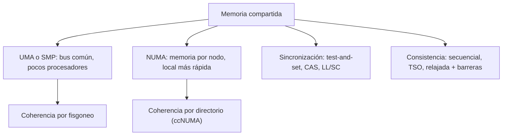

# Organización y Arquitectura de Computadoras - Sistemas multiprocesador

## 11.3 Arquitecturas paralelas con memoria centralizada

---

En un multiprocesador de **memoria compartida** todos los procesadores ven un único espacio de direcciones: un dato escrito por uno puede ser leído por los demás con una carga ordinaria. Es el modelo de los procesadores multinúcleo y de los servidores con varios zócalos, y el más cómodo de programar, porque no hay que repartir explícitamente los datos. A cambio, el hardware debe resolver tres problemas: el ancho de banda de la memoria compartida, la **coherencia** de las cachés (tema 9.5) y la **sincronización** entre procesadores, que exige instrucciones atómicas y un modelo de **consistencia** de memoria bien definido. Este tema estudia esas cuestiones.

### UMA y NUMA

**UMA** (_Uniform Memory Access_) o **SMP** (multiprocesador simétrico): todos los procesadores acceden a una memoria centralizada con el mismo tiempo, a través de un bus o una red común. Es sencillo, pero el bus se satura con pocos procesadores: si cada procesador genera una demanda de ancho de banda $d$ por sus fallos de caché y el bus ofrece $B,$ no caben más de $B/d$ procesadores. Las cachés grandes son imprescindibles para reducir $d.$

**NUMA** (_Non-Uniform Memory Access_): la memoria está repartida entre los nodos (cada zócalo con sus módulos de memoria), pero sigue habiendo un único espacio de direcciones; acceder a la memoria **local** es más rápido que a la **remota**, que pasa por la red entre zócalos. Escala mucho más, y el sistema operativo intenta colocar los datos de cada hilo en la memoria de su nodo (política de primer contacto, migración de páginas). Con coherencia de cachés por directorio se llama **ccNUMA**, la organización de los servidores actuales.

### Sincronización

Para coordinar hilos (cerrojos, barreras, contadores compartidos) hacen falta operaciones de **lectura-modificación-escritura atómicas**: nadie puede acceder a la posición entre la lectura y la escritura.

- **Test-and-set** y **intercambio atómico** (`xchg` en x86).
- **Comparar e intercambiar** (CAS, `cmpxchg`): escribe un valor nuevo solo si la posición tiene el valor esperado; base de las estructuras de datos sin cerrojos.
- **Carga enlazada y almacenamiento condicional** (LL/SC, en MIPS, ARM y RISC-V): `ll` lee y marca la dirección; `sc` escribe solo si nadie la modificó desde entonces, y devuelve si tuvo éxito. Se reintenta en un bucle.

**Cerrojos y coherencia.** Un cerrojo que espera haciendo test-and-set continuamente genera una escritura (y una transacción de coherencia) en cada intento, aunque el cerrojo esté ocupado: la línea rebota entre las cachés. La versión **test-and-test-and-set** espera **leyendo** su copia local, que no genera tráfico, y solo intenta la operación atómica cuando ve el cerrojo libre.

```c
while (1) {
    while (cerrojo != 0) { }                 /* esperar leyendo la copia de la caché */
    if (atomic_exchange(&cerrojo, 1) == 0)   /* intentar tomarlo */
        break;
}
```

### Consistencia de memoria

La coherencia garantiza el orden de las escrituras a **una** dirección. El **modelo de consistencia** dice en qué orden pueden verse las operaciones a direcciones **distintas**.

- **Consistencia secuencial** (Lamport, 1979): el resultado es como si las operaciones de todos los hilos se intercalaran en algún orden que respeta el orden de cada hilo. Es intuitiva, pero impide muchas optimizaciones del hardware.
- **TSO** (_Total Store Order_, la de x86): cada procesador tiene un **búfer de escritura**, y una lectura posterior puede adelantar a una escritura anterior que aún está en el búfer.
- **Modelos relajados** (ARM, RISC-V, POWER): casi cualquier reordenamiento es posible, y el programador o el compilador insertan **barreras** (`fence`, `dmb`) donde el orden importa. Los lenguajes ofrecen operaciones atómicas con semántica de adquisición y liberación que el compilador traduce a las barreras necesarias.

**Ejemplo (store buffering).** Con $x = y = 0,$ el hilo 0 hace `x = 1; r0 = y;` y el hilo 1 hace `y = 1; r1 = x;`. Con consistencia secuencial es imposible que ambos lean 0, porque alguna escritura ocurre antes de las dos lecturas. Con TSO sí es posible: cada escritura puede seguir en el búfer de su procesador cuando el otro lee. Este es exactamente el motivo por el que el algoritmo de Peterson para exclusión mutua falla en x86 sin una barrera.



### Implementación en Python

El programa resuelve los ejercicios 1 y 2, calcula cuántos procesadores soporta un bus según su ancho de banda, el tiempo medio de acceso en NUMA según la fracción de accesos remotos, enumera los resultados posibles de la prueba de _store buffering_ bajo consistencia secuencial y bajo TSO, y estima el tráfico de un cerrojo.

```python
from itertools import permutations

# Ejercicio 1 y 2
print(f"ejercicio 1: aceleración con 80 % paralelo y 8 procesadores = {1 / (0.2 + 0.8 / 8):.2f}")
print(f"ejercicio 2: AMAT = 5 + 0.10 x 100 = {5 + 0.10 * 100:.0f} ns")

# ¿Cuántos procesadores soporta un bus? 2 GHz, CPI 1, 0.01 fallos por instrucción, líneas de 64 B
demanda = 2e9 * 0.01 * 64
for bus in (12.8e9, 25.6e9, 51.2e9):
    print(f"bus de {bus / 1e9:4.1f} GB/s: cada procesador pide {demanda / 1e9:.2f} GB/s -> como máximo {int(bus // demanda)} procesadores")

# NUMA: acceso local 80 ns, remoto 140 ns
for remoto in (0.0, 0.3, 0.75):
    print(f"NUMA con {remoto:.0%} de accesos remotos: {(1 - remoto) * 80 + remoto * 140:.0f} ns de media")


# Consistencia de memoria: prueba de "store buffering"
#   hilo 0: x = 1; r0 = y        hilo 1: y = 1; r1 = x        (x = y = 0 al inicio)
def resultados_sc():
    """Consistencia secuencial: todas las intercalaciones que respetan el orden de cada hilo."""
    ops = [("h0", "w", "x"), ("h0", "r", "y"), ("h1", "w", "y"), ("h1", "r", "x")]
    res = set()
    for orden in permutations(range(4)):
        if orden.index(0) > orden.index(1) or orden.index(2) > orden.index(3):
            continue
        mem, r = {"x": 0, "y": 0}, {}
        for i in orden:
            hilo, tipo, var = ops[i]
            if tipo == "w":
                mem[var] = 1
            else:
                r[hilo] = mem[var]
        res.add((r["h0"], r["h1"]))
    return res


def resultados_tso():
    """TSO (x86): cada escritura entra primero a un búfer y llega a memoria más tarde."""
    res = set()
    # eventos: la escritura entra al búfer al ejecutarse; "f" es el momento en que el búfer la vacía a memoria
    ev = [("h0", "r", "y"), ("h0", "f", "x"), ("h1", "r", "x"), ("h1", "f", "y")]
    for orden in permutations(range(4)):
        mem, r = {"x": 0, "y": 0}, {}
        for i in orden:
            hilo, tipo, var = ev[i]
            if tipo == "f":
                mem[var] = 1
            else:
                r[hilo] = mem[var]          # cada hilo lee una variable que no está en su búfer: va a memoria
        res.add((r["h0"], r["h1"]))
    return res


print("store buffering, resultados (r0, r1) posibles:")
print("   consistencia secuencial:", sorted(resultados_sc()))
print("   TSO con búferes de escritura:", sorted(resultados_tso()))


# Cerrojo: transacciones del bus mientras n procesadores esperan y el dueño lo retiene `espera` iteraciones.
# test-and-set: cada intento es una escritura atómica que necesita la línea en exclusiva (BusRdX).
# test-and-test-and-set: se espera leyendo la copia de la caché (sin tráfico); al liberarse el cerrojo,
# cada procesador vuelve a leer la línea (BusRd) e intenta un test-and-set (BusRdX).
def trafico(n, variante, espera=10):
    if variante == "test-and-set":
        return n * espera
    return n + n


for n in (2, 8, 32):
    print(f"cerrojo con {n:2d} procesadores esperando: test-and-set ~{trafico(n, 'test-and-set'):4d} transacciones,"
          f" test-and-test-and-set ~{trafico(n, 'tts'):3d}")
```

Salida:

```text
ejercicio 1: aceleración con 80 % paralelo y 8 procesadores = 3.33
ejercicio 2: AMAT = 5 + 0.10 x 100 = 15 ns
bus de 12.8 GB/s: cada procesador pide 1.28 GB/s -> como máximo 10 procesadores
bus de 25.6 GB/s: cada procesador pide 1.28 GB/s -> como máximo 20 procesadores
bus de 51.2 GB/s: cada procesador pide 1.28 GB/s -> como máximo 40 procesadores
NUMA con 0% de accesos remotos: 80 ns de media
NUMA con 30% de accesos remotos: 98 ns de media
NUMA con 75% de accesos remotos: 125 ns de media
store buffering, resultados (r0, r1) posibles:
   consistencia secuencial: [(0, 1), (1, 0), (1, 1)]
   TSO con búferes de escritura: [(0, 0), (0, 1), (1, 0), (1, 1)]
cerrojo con  2 procesadores esperando: test-and-set ~  20 transacciones, test-and-test-and-set ~  4
cerrojo con  8 procesadores esperando: test-and-set ~  80 transacciones, test-and-test-and-set ~ 16
cerrojo con 32 procesadores esperando: test-and-set ~ 320 transacciones, test-and-test-and-set ~ 64
```

La enumeración confirma el razonamiento: el resultado $(0, 0)$ aparece solo con búferes de escritura.

### Ejercicios Propuestos

1. **Aceleración.** Calcula la aceleración máxima de un programa paralelizable en un 80 % con 8 procesadores UMA.

2. **Tiempo de acceso.** En un sistema UMA de 4 procesadores, la memoria tarda 100 ns; cada procesador tiene una caché de 5 ns con 90 % de aciertos. Calcula el tiempo medio de acceso.

3. **MESI.** ¿Qué ocurre en MESI cuando: (a) un procesador lee una línea que otra caché tiene en estado M; (b) un procesador escribe en una línea que tiene en estado S?

4. **Cerrojos.** Explica por qué un cerrojo con test-and-test-and-set genera menos tráfico que uno con test-and-set.

### Soluciones

**Ejercicio 1.** $\frac{1}{0.2 + 0.8/8} = \frac{1}{0.3} \approx 3.33.$

**Ejercicio 2.** $5 + 0.1 \cdot 100 = 15$ ns. Con 4 procesadores compartiendo el bus, la penalización real sería mayor por la contención si los fallos coinciden.

**Ejercicio 3.** (a) La caché que tiene la línea en M ve el `BusRd`, entrega el dato (directamente o escribiéndolo en memoria), y ambas copias quedan en S. (b) Emite `BusUpgr` (o `BusRdX`) para invalidar las demás copias, y su línea pasa a M.

**Ejercicio 4.** Con test-and-set, cada intento es una escritura que invalida las copias de los demás: con $n$ procesadores esperando, la línea rebota continuamente y el bus se satura, retrasando incluso al dueño del cerrojo cuando quiere liberarlo. Con test-and-test-and-set, mientras el cerrojo está ocupado todos leen su copia en estado S sin tráfico; solo al liberarse hay una ráfaga de unas $2n$ transacciones.

### Referencias

1. Hennessy, J. L., and Patterson, D. A., _Computer Architecture: A Quantitative Approach_. Morgan Kaufmann, 2019. Capítulo 5.
2. Sorin, D. J., Hill, M. D., and Wood, D. A., _A Primer on Memory Consistency and Cache Coherence_. Morgan and Claypool, 2011. Capítulos 3 a 5.
3. Lamport, L., How to make a multiprocessor computer that correctly executes multiprocess programs. _IEEE Transactions on Computers_ C-28(9), 1979.
4. Herlihy, M., and Shavit, N., _The Art of Multiprocessor Programming_. Morgan Kaufmann, 2012. Capítulo 7.
