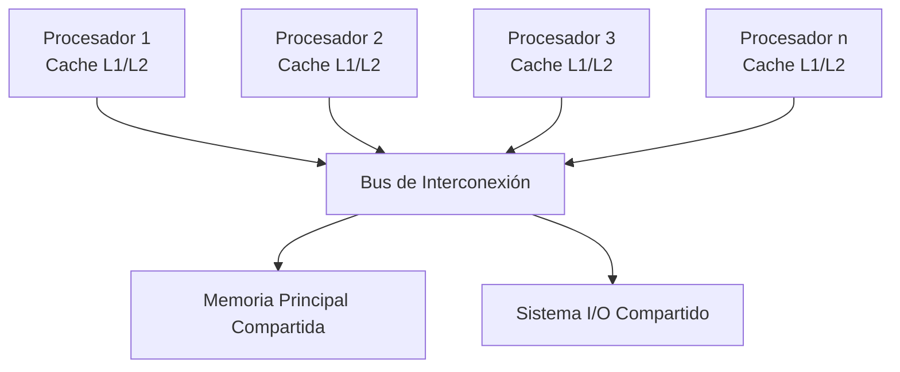
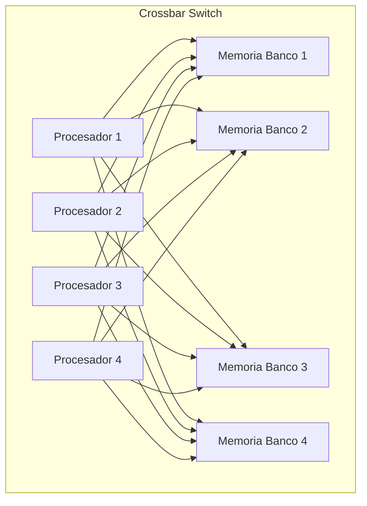

# Organización y Arquitectura de Computadoras - Sistemas multiprocesador

## 11.3 Arquitecturas paralelas con memoria centralizada

---

Las arquitecturas paralelas con memoria centralizada, también conocidas como multiprocesadores de memoria compartida, son sistemas donde múltiples procesadores acceden a una memoria común a través de un bus o sistema de interconexión. Esta arquitectura permite comunicación implícita entre procesadores a través de la memoria compartida.

### Conceptos Fundamentales

**Memoria centralizada:** Arquitectura donde todos los procesadores comparten un espacio de direcciones único y acceden a una memoria común.

**Tiempo de acceso uniforme a memoria (UMA):** Característica donde todos los procesadores tienen el mismo tiempo de acceso a cualquier posición de memoria.

### Modelos de Arquitectura

#### Multiprocesadores UMA (Uniform Memory Access)



#### Características de UMA

- Todos los procesadores tienen igual acceso a memoria
- Tiempo de acceso uniforme para cualquier posición de memoria
- Escalabilidad limitada por el ancho de banda del bus
- Sincronización mediante variables compartidas

### Ventajas y Desventajas

#### Ventajas

- Modelo de programación más simple
- Comunicación implícita a través de memoria compartida
- Facilita el balanceo de carga dinámico
- Compatible con programas secuenciales existentes

#### Desventajas

- Cuello de botella en el bus de memoria
- Limitaciones de escalabilidad
- Problemas de coherencia de caché
- Contención en acceso a memoria compartida

### Protocolos de Coherencia de Caché

#### Problema de Coherencia

Cuando múltiples procesadores tienen copias locales de una misma dirección de memoria, se deben mantener consistentes.

#### Protocolo MESI

Estados de una línea de caché:

- **Modified (M):** La línea está modificada solo en esta caché
- **Exclusive (E):** La línea está solo en esta caché pero no modificada
- **Shared (S):** La línea está en múltiples cachés pero no modificada
- **Invalid (I):** La línea no es válida

#### Operaciones de Coherencia

- **Read Hit:** Acceso directo a la caché local
- **Read Miss:** Solicitud al bus para obtener la línea
- **Write Hit:** Actualización de la línea local
- **Write Miss:** Solicitud de exclusividad para escribir

### Modelos de Consistencia de Memoria

#### Consistencia Secuencial

Resultado de ejecución igual a alguna ejecución secuencial de las instrucciones de todos los procesadores.

#### Consistencia de Processor (PC)

Las escrituras de cada procesador se ven en el mismo orden por todos los procesadores.

### Ejemplo de Programación con Memoria Compartida

```cpp
#include <iostream>
#include <thread>
#include <vector>
#include <mutex>

// Variable compartida
int counter = 0;
std::mutex mtx;

void increment_counter(int id, int iterations) {
    for (int i = 0; i < iterations; ++i) {
        std::lock_guard<std::mutex> lock(mtx); // Sincronización
        counter++; // Acceso a memoria compartida
    }
}

int main() {
    const int num_threads = 4;
    const int iterations_per_thread = 100000;

    std::vector<std::thread> threads;

    for (int i = 0; i < num_threads; ++i) {
        threads.emplace_back(increment_counter, i, iterations_per_thread);
    }

    for (auto& t : threads) {
        t.join();
    }

    std::cout << "Valor final del contador: " << counter << std::endl;
    std::cout << "Valor esperado: " << num_threads * iterations_per_thread << std::endl;

    return 0;
}
```

### Métricas de Rendimiento

#### Aceleración (Speedup)

$$
S = \frac{T_1}{T_n}
$$

Donde:

- $T_1$: Tiempo de ejecución con 1 procesador
- $T_n$: Tiempo de ejecución con n procesadores

#### Eficiencia

$$
E = \frac{S}{n} = \frac{T_1}{n \cdot T_n}
$$

#### Ley de Amdahl

$$
S = \frac{1}{(1 - f) + \frac{f}{n}}
$$

Donde:

- $f$: Fracción paralelizable del código
- $n$: Número de procesadores

### Ejercicios Propuestos

1. **Problema:** Calcule la aceleración máxima de un programa que es 80% paralelizable en un sistema con 8 procesadores UMA.

   **Solución:**

   $$
   S = \frac{1}{(1 - 0.8) + \frac{0.8}{8}} = \frac{1}{0.2 + 0.1} = \frac{1}{0.3} \approx 3.33
   $$

2. **Problema:** Un sistema UMA con 4 procesadores tiene un tiempo de acceso a memoria de 100 ns. Cada procesador tiene una caché con tasa de aciertos del 90% y tiempo de acceso de 5 ns. Calcule el tiempo promedio de acceso a memoria.

3. **Problema:** Explique qué sucede en el protocolo MESI cuando:
   - a) Un procesador quiere leer una línea en estado Modified en otra caché
   - b) Un procesador quiere escribir en una línea en estado Shared

### Técnicas de Optimización

#### Reducción de Contención

- **Replicación de datos de solo lectura**
- **False sharing avoidance:** Alinear datos para evitar que diferentes procesadores accedan a la misma línea de caché
- **Prefetching de datos**

#### Sincronización Eficiente

- **Spinlocks adaptativos**
- **Barreras de memoria**
- **Operaciones atómicas**

### Arquitecturas Avanzadas

#### Multiprocesadores con Conmutador de Cruzamiento (Crossbar)



#### Jerarquías de Interconexión

- **Bus compartido:** Para pocos procesadores
- **Bus múltiple:** Mayor ancho de banda
- **Crossbar switch:** Conexión completa pero costosa
- **Redes multietapa:** Compromiso entre coste y rendimiento

### Caso de Estudio: SMP (Symmetric Multiprocessing)

#### Características de SMP

- Todos los procesadores son idénticos
- Comparten misma memoria y recursos E/S
- Sistema operativo simétrico que planifica en cualquier procesador
- Común en servidores y estaciones de trabajo

#### Ejemplos de Implementación

- Intel Xeon multiprocesador
- AMD Opteron con HyperTransport
- Sun SPARC con capacidad SMP

### Retos de Diseño

#### Coherencia de Caché

Mecanismos hardware para mantener consistencia:

- **Snooping protocol:** Los cachés monitorizan el bus
- **Directory-based protocol:** Directorio central tracking estados

#### Ancho de Banda de Memoria

Técnicas para aumentar el ancho de banda:

- **Memoria interleaved:** Bancos de memoria independientes
- **Cachés de mayor tamaño**
- **Prefetching agresivo**

### Aplicaciones Típicas

1. **Servidores de bases de datos**
2. **Entornos de transacciones comerciales**
3. **Estaciones de trabajo gráficas**
4. **Servidores de aplicaciones empresariales**

### Referencias

#### Bibliografía Básica

1. Hennessy, J. L. & Patterson, D. A. (2006). _Computer Architecture: A Quantitative Approach_ (4th ed.). Capítulo 4: Multiprocesadores y paralelismo a nivel de hilo.
2. Patterson, D. A. & Hennessy, J. L. (2008). _Computer Organization and Design: The Hardware/Software Interface_ (4th ed.). Sección 6.4-6.6: Multiprocesadores con memoria compartida.

#### Bibliografía Complementaria

1. Stallings, W. (2009). _Computer Organization and Architecture: Designing for Performance_. Capítulo 17: Procesamiento paralelo.
2. Tanenbaum, A. S. (2005). _Structured Computer Organization_ (5th ed.). Sección 8.1-8.3: Multiprocesadores.

#### Recursos Adicionales

- Censier, L. M. & Feautrier, P. (1978). "A New Solution to Coherence Problems in Multicache Systems". IEEE Transactions on Computers.
- Papamarcos, M. S. & Patel, J. H. (1984). "A Low-Overhead Coherence Solution for Multiprocessors with Private Cache Memories".

### Conclusión

Las arquitecturas paralelas con memoria centralizada representan un modelo importante en la evolución de los sistemas multiprocesador. Aunque enfrentan desafíos de escalabilidad debido a los cuellos de botella en el acceso a memoria, su modelo de programación simplificado y la compatibilidad con software existente los hacen adecuados para muchas aplicaciones comerciales y científicas. El entendimiento de los protocolos de coherencia y las técnicas de optimización es esencial para el diseño eficiente de estos sistemas.
