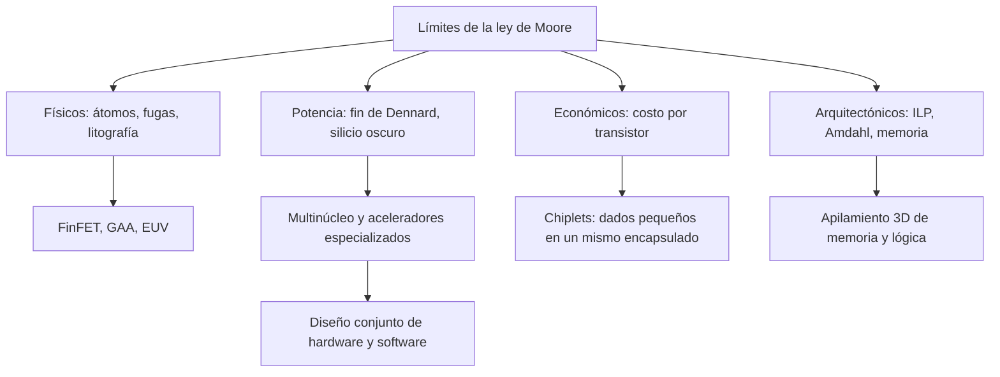

# Organización y Arquitectura de Computadoras - Sistemas multiprocesador

## 11.4 Factores limitantes de la ley de Moore

---

La ley de Moore (tema 1.1) describió durante medio siglo la duplicación periódica del número de transistores por chip. Esa tendencia se ha frenado, y además dejó de traducirse automáticamente en procesadores más rápidos. Los límites no son uno solo: son **físicos** (el tamaño de los átomos y las corrientes de fuga), **térmicos** (la potencia que se puede disipar), **económicos** (el costo de las fábricas y de cada nueva generación) y **arquitectónicos** (cuánto paralelismo pueden aprovechar los programas). Este tema los revisa con cálculos sencillos y explica cómo han cambiado el diseño de los procesadores: multinúcleo, especialización, empaquetado en tres dimensiones y chiplets.

### Límites físicos

- **Tamaño atómico.** La distancia entre átomos vecinos en el silicio es de unos 0.235 nm. Una estructura de 5 nm abarca apenas unas 20 distancias atómicas: la variación de unos pocos átomos de dopante cambia el comportamiento de un transistor. Los nombres comerciales de los procesos ("3 nm") ya no corresponden a ninguna dimensión física concreta.
- **Corrientes de fuga.** Con aislantes de puerta de pocos átomos y canales muy cortos, los electrones atraviesan barreras por **efecto túnel** y los transistores no se apagan del todo. La potencia estática dejó de ser despreciable, y el voltaje umbral no puede bajar más sin multiplicar la fuga: es la causa del fin del escalado de Dennard.
- **Nuevas estructuras de transistor.** Para controlar mejor el canal se pasó de transistores planos a **FinFET** (canal en forma de aleta, 2011) y a transistores de **puerta envolvente** (GAA, nanohojas, desde 2022), y se exploran apilamientos verticales.
- **Litografía.** Imprimir estructuras mucho menores que la longitud de onda de la luz requiere técnicas de varias exposiciones y, desde 2019, litografía de **ultravioleta extremo** (13.5 nm), con máquinas de costo enorme.
- **Interconexiones.** Al reducir los cables, su resistencia aumenta y su retardo deja de mejorar: los cables largos de un chip ya cuestan más tiempo y energía que la lógica.

### El muro de la potencia y el silicio oscuro

Sin escalado de voltaje, cada generación duplica la densidad de transistores mientras que la potencia por transistor solo baja un poco (tema 1.1). Con un presupuesto de potencia fijo, la **fracción del chip que puede funcionar a la vez** a plena frecuencia disminuye en cada generación: es el **silicio oscuro** (_dark silicon_). Las respuestas son: núcleos más simples y más eficientes, frecuencia variable según cuántos núcleos están activos (modo turbo), y sobre todo **aceleradores especializados** que hacen una tarea concreta con mucha menos energía, encendidos solo cuando se usan.

**El límite térmico.** El calor generado en el chip debe atravesar el encapsulado, el material de interfaz térmica y el disipador. En una capa de espesor $L,$ área $A$ y conductividad $k,$ la ley de Fourier (tema 7.1) da un flujo $q = k A \Delta T / L.$ Con densidades de potencia de 50 a 100 W/cm², comparables a las de una placa de cocina, la refrigeración es un factor de diseño de primer orden.

### Límites económicos

La **ley de Rock** dice que el costo de una fábrica de semiconductores se duplica cada cuatro años: hoy supera los 20 000 millones de dólares, y solo tres empresas fabrican los procesos más avanzados. Si cada generación duplica la densidad pero la oblea cuesta casi el doble, el **costo por transistor** deja de bajar, y con él el principal motor económico de la ley de Moore. Diseñar un chip en un proceso avanzado también cuesta cientos de millones de dólares, lo que solo se justifica con volúmenes enormes.

### Límites arquitectónicos

Aunque haya transistores, convertirlos en rendimiento es cada vez más difícil:

- El **paralelismo a nivel de instrucción** se agotó con IPC de 3 a 5 en programas de enteros (tema 7.1).
- La **ley de Amdahl** limita a los multinúcleos: con un 95 % de código paralelo, 64 núcleos dan una aceleración de solo 15.4, y ni infinitos pasarían de 20.
- El **muro de la memoria:** el ancho de banda y la latencia de la DRAM mejoran mucho más despacio que la capacidad de cálculo.

### Respuestas de la industria



- **Especialización:** GPU, TPU y NPU para aprendizaje automático, unidades de video y de cifrado, que ofrecen órdenes de magnitud más rendimiento por vatio en su dominio.
- **Chiplets:** dividir el sistema en varios dados pequeños (mejor rendimiento de fabricación, tema 1.1) unidos dentro del encapsulado, cada uno en el proceso más conveniente.
- **Integración 3D:** apilar memoria sobre lógica (HBM, caché apilada) para acercar los datos al cálculo.
- **Eficiencia energética:** la **ley de Koomey** observó que los cálculos por julio se duplicaban cada 1.6 años hasta el año 2000; desde entonces el ritmo es de unos 2.6 años.

### Implementación en Python

El programa resuelve los ejercicios 1 a 3, estima la fracción de silicio que puede estar activa en generaciones sucesivas sin escalado de voltaje, cuenta cuántas distancias atómicas abarca una estructura según su tamaño, calcula cómo cambia el costo por transistor según el costo de la oblea y la mejora de eficiencia en una década con la ley de Koomey.

```python
# Ejercicio 1
print(f"ejercicio 1: 2e9 * 2^(4/2) = {2e9 * 2 ** (4 / 2):.1e} transistores en 2027")
# Ejercicio 2
print(f"ejercicio 2: aceleración = {1 / (0.05 + 0.95 / 64):.2f} (máximo con infinitos núcleos: {1 / 0.05:.0f})")
# Ejercicio 3: conducción a través de una capa: q = k A dT / L  ->  k = q L / (A dT)
q, A, dT, L = 100, 2e-4, 85 - 25, 1e-3
print(f"ejercicio 3: k mínima = {q * L / (A * dT):.2f} W/(m·K); densidad de potencia {q / 2:.0f} W/cm²")

# Silicio oscuro: presupuesto de potencia fijo, densidad x2 por generación, potencia por transistor x0.75
# (después de Dennard el voltaje casi no baja; solo baja la capacidad)
activo = 1.0
for gen in range(6):
    print(f"generación {gen}: fracción del chip que puede estar activa a plena frecuencia = {min(1, activo):.0%}")
    activo /= 2 * 0.75

# Límite atómico: la distancia entre átomos vecinos en el silicio es de unos 0.235 nm
for ancho in (100, 20, 5, 1):
    print(f"una estructura de {ancho:3d} nm abarca unas {ancho / 0.235:4.0f} distancias atómicas")

# Costo: si cada generación duplica la densidad pero la oblea cuesta un 40 % más, el costo por transistor baja 30 %;
# si además la oblea cuesta el doble, deja de bajar.
for aumento in (1.4, 1.8, 2.0):
    print(f"oblea x{aumento}: costo por transistor x{aumento / 2:.2f} por generación")

# Ley de Koomey: cálculos por julio se duplicaban cada ~1.57 años hasta 2000 y cada ~2.6 años después
for periodo in (1.57, 2.6):
    print(f"duplicación cada {periodo} años: mejora en una década = x{2 ** (10 / periodo):.0f}")
```

Salida:

```text
ejercicio 1: 2e9 * 2^(4/2) = 8.0e+09 transistores en 2027
ejercicio 2: aceleración = 15.42 (máximo con infinitos núcleos: 20)
ejercicio 3: k mínima = 8.33 W/(m·K); densidad de potencia 50 W/cm²
generación 0: fracción del chip que puede estar activa a plena frecuencia = 100%
generación 1: fracción del chip que puede estar activa a plena frecuencia = 67%
generación 2: fracción del chip que puede estar activa a plena frecuencia = 44%
generación 3: fracción del chip que puede estar activa a plena frecuencia = 30%
generación 4: fracción del chip que puede estar activa a plena frecuencia = 20%
generación 5: fracción del chip que puede estar activa a plena frecuencia = 13%
una estructura de 100 nm abarca unas  426 distancias atómicas
una estructura de  20 nm abarca unas   85 distancias atómicas
una estructura de   5 nm abarca unas   21 distancias atómicas
una estructura de   1 nm abarca unas    4 distancias atómicas
oblea x1.4: costo por transistor x0.70 por generación
oblea x1.8: costo por transistor x0.90 por generación
oblea x2.0: costo por transistor x1.00 por generación
duplicación cada 1.57 años: mejora en una década = x83
duplicación cada 2.6 años: mejora en una década = x14
```

Los supuestos del modelo de silicio oscuro (densidad doble y potencia por transistor un 25 % menor por generación) son ilustrativos: el resultado cualitativo es que, en pocas generaciones, la mayor parte del chip debe estar apagada o funcionando a baja frecuencia en cada momento.

### Ejercicios Propuestos

1. **Moore.** Un chip tiene 2 000 millones de transistores en 2023. ¿Cuántos tendría en 2027 con duplicación cada 2 años?

2. **Amdahl.** ¿Cuál es la aceleración máxima de una aplicación paralelizable en un 95 % con 64 núcleos?

3. **Disipación.** Un procesador disipa 100 W en 2 cm². Si su temperatura máxima es 85 °C y la del ambiente 25 °C, ¿cuál debe ser la conductividad térmica mínima de un material de interfaz de 1 mm de espesor, suponiendo que toda la diferencia de temperatura cae en él?

4. **Especialización.** ¿Por qué el silicio oscuro favorece a los aceleradores especializados frente a añadir más núcleos de propósito general?

### Soluciones

**Ejercicio 1.** $2 \times 10^9 \cdot 2^{4/2} = 8 \times 10^9$ transistores.

**Ejercicio 2.** $\frac{1}{0.05 + 0.95/64} \approx 15.42,$ con una eficiencia de solo el 24 %.

**Ejercicio 3.** $k = \frac{q L}{A\, \Delta T} = \frac{100 \cdot 0.001}{2 \times 10^{-4} \cdot 60} \approx 8.33$ W/(m·K). Es mucho más que las pastas térmicas habituales (de 1 a 10 W/(m·K)), por lo que en la práctica la capa se hace mucho más delgada y el calor se reparte con un difusor de cobre antes de llegar al disipador.

**Ejercicio 4.** Si solo una fracción del chip puede encenderse a la vez, conviene que esa fracción haga el máximo trabajo útil por julio. Un acelerador diseñado para una tarea (multiplicar matrices, codificar video) elimina la búsqueda y decodificación de instrucciones y el movimiento de datos genérico, y puede ser de 10 a 1000 veces más eficiente. Más núcleos de propósito general no ayudan si no se pueden encender todos ni hay suficiente paralelismo para ellos.

### Referencias

1. Hennessy, J. L., and Patterson, D. A., _Computer Architecture: A Quantitative Approach_. Morgan Kaufmann, 2019. Capítulos 1 y 7.
2. Esmaeilzadeh, H., Blem, E., St. Amant, R., Sankaralingam, K., and Burger, D., Dark silicon and the end of multicore scaling. _ISCA_, 2011.
3. Hennessy, J. L., and Patterson, D. A., A new golden age for computer architecture. _Communications of the ACM_ 62(2), 2019.
4. Koomey, J., Berard, S., Sanchez, M., and Wong, H., Implications of historical trends in the electrical efficiency of computing. _IEEE Annals of the History of Computing_ 33(3), 2011.
