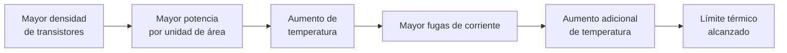
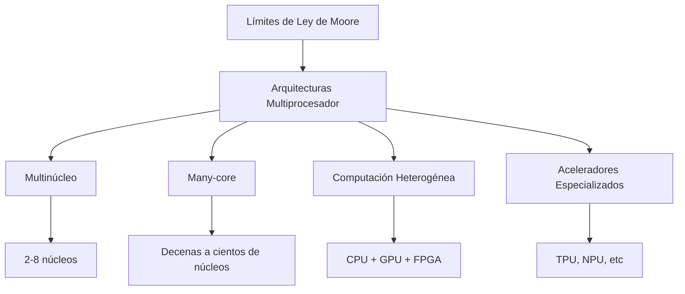
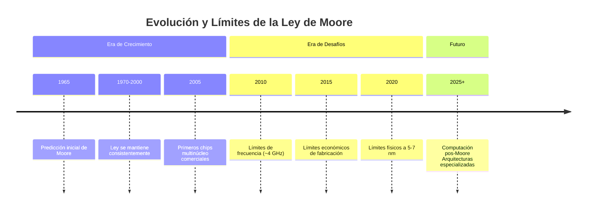

# Organización y Arquitectura de Computadoras - Sistemas multiprocesador

## 11.4 Factores limitantes de la ley de Moore

---

La Ley de Moore, formulada por Gordon Moore en 1965, establecía que el número de transistores en un chip se duplicaría aproximadamente cada dos años. Aunque esta predicción se ha mantenido durante décadas, en los últimos años varios factores físicos, técnicos y económicos han comenzado a limitar su continuidad, llevando a la industria hacia arquitecturas multiprocesador como alternativa al escalado tradicional.

### La Ley de Moore: Formulación Original

La observación original de Moore se puede expresar como:

$$
N(t) = N_0 \cdot 2^{\frac{t}{T_2}}
$$

Donde:

- $N(t)$: Número de transistores en el tiempo $t$
- $N_0$: Número inicial de transistores
- $T_2$: Período de duplicación (aproximadamente 2 años)

### Factores Limitantes Principales

#### 1. Límites Físicos Fundamentales

##### Límite de Escalado de Canal

Cuando el tamaño del canal del transistor se aproxima a los 5 nm, efectos cuánticos como el túneling se vuelven significativos:

$$
P_{\text{túneling}} \propto e^{-\frac{4\pi d}{h}\sqrt{2m\phi}}
$$

Donde:

- $d$: Ancho de la barrera de potencial
- $h$: Constante de Planck reducida
- $m$: Masa efectiva del electrón
- $\phi$: Altura de la barrera de potencial

##### Disipación de Potencia y Densidad de Potencia

La densidad de potencia se vuelve prohibitiva:

$$
P_{\text{densidad}} = \frac{P_{\text{total}}}{A} = C \cdot V^2 \cdot f \cdot N
$$

Donde:

- $C$: Capacitancia
- $V$: Voltaje
- $f$: Frecuencia
- $N$: Número de dispositivos

#### 2. Limitaciones Térmicas

La ecuación de transferencia de calor:

$$
\frac{dQ}{dt} = k \cdot A \cdot \frac{\Delta T}{d}
$$

Donde:

- $k$: Conductividad térmica del material
- $A$: Área de transferencia
- $\Delta T$: Diferencia de temperatura
- $d$: Distancia

#### 3. Limitaciones Económicas

##### Ley de Rock

El costo de las fábricas de semiconductores (fabs) crece exponencialmente:

$$
C_{\text{fab}} \propto e^{k \cdot t}
$$

El costo de un fab de última generación supera los $20 mil millones de dólares.

##### Rendimiento de Fabricación

El rendimiento (yield) disminuye con la complejidad:

$$
Y = \frac{1}{(1 + D \cdot A)^n}
$$

Donde:

- $D$: Densidad de defectos
- $A$: Área del chip
- $n$: Complejidad del proceso

### Alternativas al Escalado Tradicional

#### Arquitecturas Multiprocesador

#### Ley de Amdahl y Escalabilidad

La aceleración máxima está limitada por la fracción serial:

$$
S = \frac{1}{(1 - p) + \frac{p}{n}}
$$

Donde:

- $S$: Speedup máximo
- $p$: Fracción paralelizable
- $n$: Número de procesadores

#### Ley de Gustafson

Para cargas de trabajo que escalan con el tamaño del problema:

$$
S = n + (1 - n) \cdot s
$$

Donde $s$ es la fracción serial.

### Ejercicios Propuestos

1. **Problema:** Si un chip tiene 2 mil millones de transistores en 2023, ¿cuántos debería tener en 2027 según la Ley de Moore tradicional? Asuma un período de duplicación de 2 años.

   **Solución:**

   $$
   N(2027) = 2 \times 10^9 \cdot 2^{\frac{4}{2}} = 2 \times 10^9 \cdot 2^2 = 8 \times 10^9 \text{ transistores}
   $$

2. **Problema:** Calcule el speedup máximo según la Ley de Amdahl para una aplicación con 95% de código paralelizable en un sistema de 64 núcleos.

   **Solución:**

   $$
   S = \frac{1}{(1 - 0.95) + \frac{0.95}{64}} = \frac{1}{0.05 + 0.01484} = \frac{1}{0.06484} \approx 15.42
   $$

3. **Problema:** Un procesador disipa 100W en un área de 2 cm². Si la temperatura máxima permitida es 85°C y la ambiente es 25°C, ¿cuál debe ser la conductividad térmica mínima del material de interfaz? Asuma un espesor de 1 mm.

### Técnicas para Superar los Límites

#### Nuevos Materiales

- Semiconductores III-V (GaAs, InP)
- Grafeno y materiales 2D
- Nanotubos de carbono

#### Nuevas Arquitecturas

- Computación cuántica
- Computación neuromórfica
- Computación en memoria (in-memory computing)

#### Empaquetado Avanzado

- 2.5D y 3D integration
- Silicon interposers
- Chiplets y diseño modular

### Impacto en el Diseño de Software

#### Programación Paralela

Necesidad de nuevos modelos de programación:

- OpenMP, MPI, CUDA
- Lenguajes específicos de dominio
- Frameworks para computación heterogénea

#### Optimización Energética

Enfoque en eficiencia energética (operaciones por watt):

$$
\text{EFICIENCIA} = \frac{\text{OPERACIONES}}{\text{SEGUNDO} \cdot \text{WATT}}
$$

### Cronología de la Ley de Moore

### Referencias

#### Bibliografía Básica

1. Hennessy, J. L. & Patterson, D. A. (2006). _Computer Architecture: A Quantitative Approach_ (4th ed.). Capítulo 1: Fundamentos de diseño de computadoras.
2. Patterson, D. A. & Hennessy, J. L. (2008). _Computer Organization and Design: The Hardware/Software Interface_ (4th ed.). Apéndice sobre tendencias tecnológicas.

#### Bibliografía Complementaria

1. Stallings, W. (2009). _Computer Organization and Architecture: Designing for Performance_. Capítulo 2: Evolución y rendimiento de computadoras.
2. Thompson, S. E. & Parthasarathy, S. (2006). "Moore's law: the future of Si microelectronics". Materials Today.

#### Recursos Adicionales

- Moore, G. E. (1965). "Cramming more components onto integrated circuits". Electronics Magazine.
- The International Technology Roadmap for Semiconductors (ITRS) reports
- Journal of Applied Physics: números especiales sobre escalado de dispositivos

### Conclusión

La Ley de Moore ha sido el principio rector de la industria de semiconductores durante décadas, pero está enfrentando límites fundamentales físicos, térmicos y económicos. Estos factores limitantes han impulsado la transición hacia arquitecturas multiprocesador y la búsqueda de nuevas tecnologías más allá del CMOS tradicional. El futuro del progreso computacional dependerá cada vez más de la especialización, el paralelismo masivo y las innovaciones en materiales y empaquetado, más que del simple escalado dimensional.
