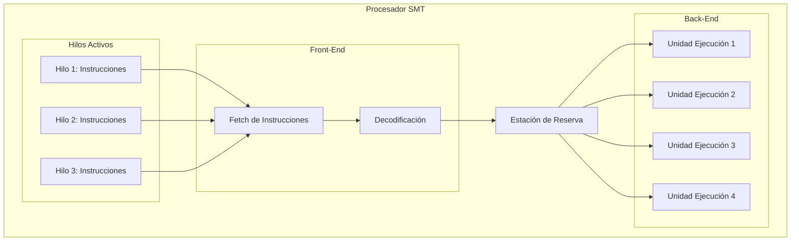
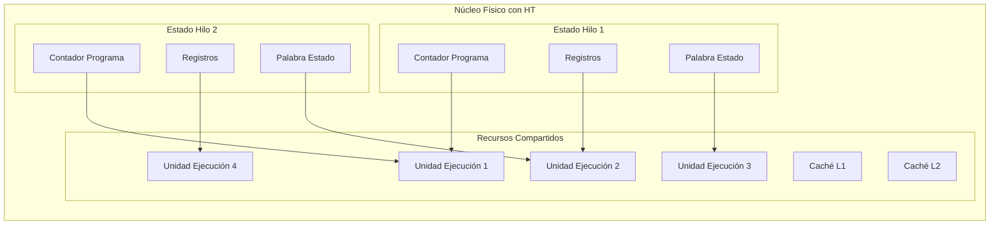

# Organización y Arquitectura de Computadoras - Sistemas multiprocesador

## 11.5 Paralelismo a nivel de hilo de ejecución (Thread Level Parallelism)

---

El Paralelismo a Nivel de Hilo (TLP, por sus siglas en inglés) es una forma de paralelismo que permite la ejecución concurrente de múltiples hilos de ejecución dentro de un mismo proceso. A diferencia del paralelismo a nivel de instrucción (ILP), el TLP explota la independencia entre diferentes flujos de control dentro de una aplicación.

### Conceptos Fundamentales

**Hilo de ejecución:** Un flujo de control secuencial dentro de un proceso que comparte el espacio de direcciones pero tiene su propio contador de programa, registros y pila.

**Thread Level Parallelism (TLP):** Capacidad de un sistema para ejecutar múltiples hilos concurrentemente, ya sea en un único procesador (multihilo) o en múltiples procesadores (multiprocesamiento).

### Clasificación de Arquitecturas Multihilo

#### Multihilo con Cambio Fino (Fine-Grained)

- El procesador cambia entre hilos en cada ciclo de instrucción
- Elimina stalls por dependencias de datos
- Ejemplo: Arquitectura Tera MTA

#### Multihilo con Cambio Grueso (Coarse-Grained)

- Cambia de hilo sólo cuando ocurre un stall costoso
- Menor overhead que el cambio fino
- Ejemplo: Sun UltraSPARC T1

#### Multihilo Simultáneo (SMT)

- Ejecuta instrucciones de múltiples hilos en el mismo ciclo
- Maximiza la utilización de unidades funcionales
- Ejemplo: Intel Hyper-Threading

### Modelo de Ejecución SMT



### Ventajas del TLP

#### Mejor Utilización de Recursos

- Reduce los stalls por dependencias de datos
- Mejora el throughput del sistema
- Mejor balance entre unidades funcionales

#### Escalabilidad

- Puede explotar múltiples núcleos de procesamiento
- Escala con el número de hilos independientes

### Implementación en Hardware

#### Estructuras de Estado por Hilo

Cada hilo requiere:

- Contador de programa (PC)
- Registros de propósito general
- Registros de punto flotante
- Registro de estado (PSW)
- Pila de ejecución

#### Compartición de Recursos

Recursos compartidos entre hilos:

- Caché L1/L2/L3
- Unidades funcionales
- Memoria principal
- Recursos de E/S

### Modelos de Programación

#### Modelo de Memoria Compartida

```cpp
#include <iostream>
#include <thread>
#include <vector>
#include <mutex>

std::mutex mtx;
int shared_counter = 0;

void increment_thread(int id, int iterations) {
    for (int i = 0; i < iterations; ++i) {
        std::lock_guard<std::mutex> lock(mtx);
        shared_counter++;
        // Simular trabajo adicional
        std::this_thread::sleep_for(std::chrono::microseconds(10));
    }
    std::cout << "Hilo " << id << " completado\n";
}

int main() {
    const int num_threads = 4;
    const int iterations = 100;

    std::vector<std::thread> threads;

    for (int i = 0; i < num_threads; ++i) {
        threads.emplace_back(increment_thread, i, iterations);
    }

    for (auto& t : threads) {
        t.join();
    }

    std::cout << "Valor final: " << shared_counter << std::endl;
    return 0;
}
```

#### Modelo de Paso de Mensajes (MPI)

```cpp
#include <mpi.h>
#include <iostream>

int main(int argc, char** argv) {
    MPI_Init(&argc, &argv);

    int world_size, world_rank;
    MPI_Comm_size(MPI_COMM_WORLD, &world_size);
    MPI_Comm_rank(MPI_COMM_WORLD, &world_rank);

    int local_data = world_rank * 100;
    int global_sum = 0;

    // Operación de reducción (suma)
    MPI_Reduce(&local_data, &global_sum, 1, MPI_INT,
               MPI_SUM, 0, MPI_COMM_WORLD);

    if (world_rank == 0) {
        std::cout << "Suma global: " << global_sum << std::endl;
    }

    MPI_Finalize();
    return 0;
}
```

### Métricas de Rendimiento

#### Speedup y Eficiencia

$$
S(n) = \frac{T(1)}{T(n)} \quad \text{(Speedup con n hilos)}
$$

$$
E(n) = \frac{S(n)}{n} \quad \text{(Eficiencia)}
$$

#### Ley de Amdahl

$$
S = \frac{1}{(1 - p) + \frac{p}{n}}
$$

Donde:

- $p:$ Fracción paralelizable del código
- $n:$ Número de hilos/procesadores

#### Ley de Gustafson

$$
S = n + (1 - n) \cdot s
$$

Donde $s$ es la fracción serial que no escala.

### Ejercicios Propuestos

1. **Problema:** Calcule el speedup máximo según Amdahl para una aplicación con 90% de código paralelizable usando 8 hilos.

   **Solución:**

   $$
   S = \frac{1}{(1 - 0.9) + \frac{0.9}{8}} = \frac{1}{0.1 + 0.1125} = \frac{1}{0.2125} \approx 4.71
   $$

2. **Problema:** Un programa tarda 100 segundos en ejecutarse secuencialmente. Si el 80% es paralelizable, ¿cuánto tardará con 4 hilos? Asuma overhead de sincronización del 5%.

3. **Problema:** Explique la diferencia entre multihilo a nivel fino (fine-grained) y multihilo simultáneo (SMT).

### Técnicas de Optimización

#### Balance de Carga

Distribución equitativa del trabajo entre hilos:

- Particionamiento estático y dinámico
- Work stealing algorithms

#### Reducción de Contención

- Uso de estructuras de datos lock-free
- Variables atómicas y operaciones CAS
- Minimización de secciones críticas

#### Localidad de Datos

- Affinity de hilos a núcleos específicos
- Alineamiento de datos para evitar false sharing
- Prefetching consciente del acceso concurrente

### Retos del TLP

#### Sincronización y Race Conditions

Problemas comunes:

- Condiciones de carrera (race conditions)
- Deadlocks y livelocks
- Priority inversion

#### Coherencia de Memoria

Modelos de consistencia:

- Consistencia secuencial
- Consistencia de processor
- Modelo de memoria relaxed

#### Overhead de Gestión

Costos asociados:

- Creación y destrucción de hilos
- Cambio de contexto
- Sincronización y comunicación

### Caso de Estudio: Intel Hyper-Threading



### Aplicaciones del TLP

#### Servidores y Bases de Datos

- Múltiples conexiones concurrentes
- Procesamiento de transacciones paralelo
- Consultas concurrentes

#### Procesamiento Científico

- Simulaciones paralelas
- Análisis de datos a gran escala
- Modelado computacional

#### Aplicaciones Gráficas y Multimedia

- Renderizado paralelo
- Procesamiento de video
- Motores de juego multihilo

### Referencias

#### Bibliografía Básica

1. Hennessy, J. L. & Patterson, D. A. (2006). _Computer Architecture: A Quantitative Approach_ (4th ed.). Capítulo 3: Paralelismo a nivel de hilo.
2. Patterson, D. A. & Hennessy, J. L. (2008). _Computer Organization and Design: The Hardware/Software Interface_ (4th ed.). Sección 6.4: Multihilo.

#### Bibliografía Complementaria

1. Stallings, W. (2009). _Computer Organization and Architecture: Designing for Performance_. Capítulo 4: Procesamiento paralelo.
2. Tanenbaum, A. S. (2005). _Structured Computer Organization_ (5th ed.). Sección 8.2: Multihilo.

#### Recursos Adicionales

- Sutter, H. (2005). "The Free Lunch Is Over: A Fundamental Turn Toward Concurrency in Software"
- Intel® 64 and IA-32 Architectures Optimization Reference Manual
- OpenMP Architecture Review Board. (2018). _OpenMP Application Programming Interface_

### Conclusión

El Paralelismo a Nivel de Hilo es una técnica fundamental para explotar la capacidad de cómputo de los procesadores modernos. A través de diversas implementaciones hardware y modelos de programación, el TLP permite mejorar significativamente el rendimiento y la eficiencia de las aplicaciones. Sin embargo, su implementación efectiva requiere un cuidadoso diseño para manejar los desafíos de sincronización, balance de carga y coherencia de memoria. El dominio del TLP es esencial para el desarrollo de software de alto rendimiento en sistemas multiprocesador contemporáneos.
