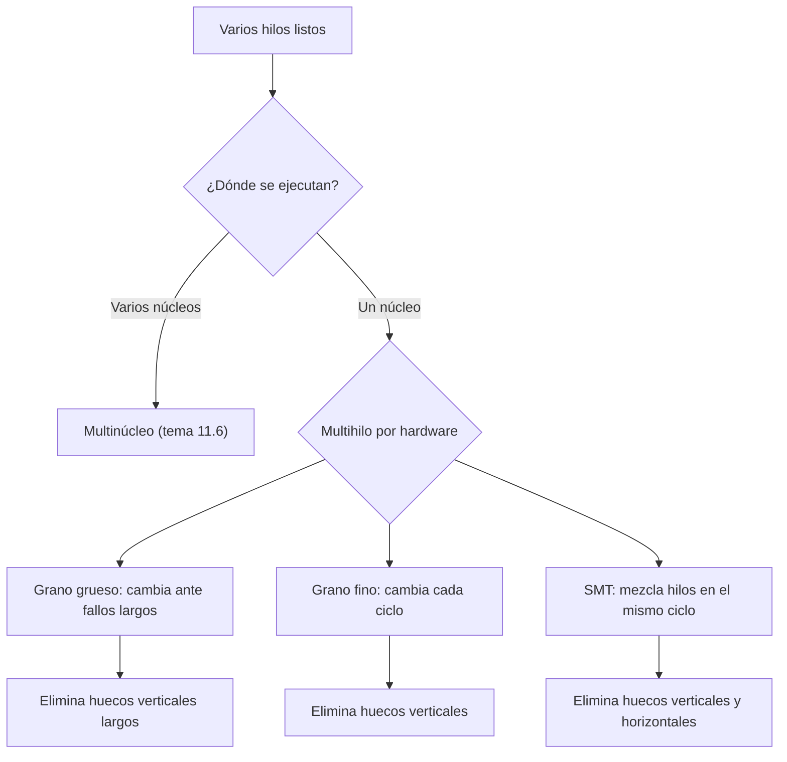

# Organización y Arquitectura de Computadoras - Sistemas multiprocesador

## 11.5 Paralelismo a nivel de hilo de ejecución (Thread Level Parallelism)

---

El **paralelismo a nivel de hilo** (TLP) consiste en ejecutar a la vez varios **hilos** (flujos de instrucciones independientes, cada uno con su contador de programa y sus registros), ya sean de un mismo programa paralelo o de programas distintos. A diferencia del paralelismo a nivel de instrucción, que el hardware extrae automáticamente de un solo flujo, el TLP lo expresa el programador o el sistema operativo. Este tema presenta las formas de aprovecharlo: varios núcleos, y dentro de un mismo núcleo el **multihilo** de grano grueso, de grano fino y **simultáneo** (SMT), y los problemas de programación que aparecen: condiciones de carrera, sincronización y sobrecosto.

### Hilos y procesos

Un **proceso** tiene su propio espacio de direcciones; los **hilos** de un mismo proceso comparten la memoria y los archivos abiertos, pero cada uno tiene su pila, su contador de programa y sus registros. Crear y cambiar entre hilos es más barato que entre procesos, y comunicarse es tan simple como leer y escribir variables compartidas, lo que obliga a sincronizar (tema 11.3).

**Programación.** Con **pthreads** o los hilos de C++ y Java el programador crea y coordina los hilos explícitamente. Con **OpenMP**, anota los bucles y regiones paralelas y el compilador genera el código; la cláusula `reduction` resuelve el caso común de acumular un resultado sin condiciones de carrera.

### Multihilo en un mismo núcleo

Un núcleo superescalar pasa mucho tiempo sin poder emitir instrucciones: por dependencias dentro del hilo (pocas instrucciones listas por ciclo) o por fallos de caché largos (cientos de ciclos sin nada que hacer). El **multihilo por hardware** mantiene el estado de varios hilos (varios bancos de registros y contadores de programa) y los alterna para ocupar esos huecos:

| Técnica | Cuándo cambia de hilo | Llena huecos de | Ejemplos |
| --- | --- | --- | --- |
| **grano grueso** | solo ante un evento largo (fallo de L2 o L3) | latencias largas | Itanium Montecito, algunos procesadores de red |
| **grano fino** | en cada ciclo, en turno rotatorio | latencias cortas y largas | Sun Niagara, GPU |
| **simultáneo (SMT)** | no cambia: en un mismo ciclo emite instrucciones de varios hilos | ranuras verticales y horizontales | Intel Hyper-Threading, AMD Zen, IBM POWER (hasta 8 hilos por núcleo) |

Las ranuras desperdiciadas se llaman **verticales** si un ciclo completo queda vacío y **horizontales** si en un ciclo se emiten menos instrucciones que el ancho del procesador. El grano grueso y el fino solo eliminan las verticales; SMT, que aprovecha los recursos del procesador superescalar fuera de orden (renombrado, estaciones de reserva) para mezclar instrucciones de varios hilos, elimina también las horizontales.

El costo de SMT es pequeño en área (del orden del 5 %), pero los hilos **compiten** por las cachés, las unidades funcionales y el predictor de saltos, de modo que cada hilo individual va más lento; la productividad total sube típicamente entre un 20 % y un 30 % con dos hilos. También abre canales laterales de seguridad entre hilos que comparten núcleo.



### Sobrecosto del paralelismo

Crear hilos, repartir el trabajo, sincronizar y combinar resultados tiene un costo que no existe en la versión secuencial. Si es una fracción $o$ del tiempo secuencial,

$$ T(p) = T_1 \left( (1 - F) + \frac{F}{p} + o \right) $$

Con trabajos pequeños el sobrecosto puede superar a la ganancia: por eso OpenMP no paraleliza bucles cortos de forma rentable, y conviene que cada hilo reciba bloques de trabajo grandes.

### Implementación en Python

El programa resuelve los ejercicios 1 y 2 y simula un procesador de 4 vías con 4 hilos cuyos instantes de bloqueo y número de instrucciones listas por ciclo son aleatorios, comparando un solo hilo con el multihilo de grano grueso, de grano fino y SMT.

```python
import random

# Ejercicios 1 y 2
print(f"ejercicio 1: aceleración con 90 % paralelo y 8 hilos = {1 / (0.1 + 0.9 / 8):.2f}")
T = 20 + 80 / 4 + 5
print(f"ejercicio 2: T = 20 + 80/4 + 5 = {T:.0f} s, aceleración {100 / T:.2f}")


# Uso de las ranuras de emisión de un procesador de 4 vías con 4 hilos.
# Cada hilo, en cada ciclo, tiene entre 0 y 4 instrucciones listas; con probabilidad 0.02
# empieza un fallo de caché largo (30 ciclos sin instrucciones listas).
def hilo(rng, ciclos):
    listo, bloqueo = [], 0
    for _ in range(ciclos):
        if bloqueo:
            bloqueo -= 1
            listo.append(0)
        elif rng.random() < 0.02:
            bloqueo = 29
            listo.append(0)
        else:
            listo.append(rng.choice([0, 1, 1, 2, 2, 3, 4]))
    return listo


def simular(modo, n_hilos=4, ancho=4, ciclos=20000, semilla=7):
    rng = random.Random(semilla)
    h = [hilo(rng, ciclos) for _ in range(n_hilos)]
    emitidas, actual = 0, 0
    for c in range(ciclos):
        if modo == "un hilo":
            emitidas += min(ancho, h[0][c])
        elif modo == "grano fino":                      # cambia de hilo cada ciclo, saltando los bloqueados
            for k in range(n_hilos):
                t = (actual + k) % n_hilos
                if h[t][c] > 0:
                    emitidas += min(ancho, h[t][c])
                    break
            actual = (actual + 1) % n_hilos
        elif modo == "grano grueso":                    # cambia de hilo solo cuando el actual se bloquea
            if h[actual][c] == 0 and c > 0 and h[actual][c - 1] == 0:
                actual = (actual + 1) % n_hilos         # el cambio cuesta el ciclo en que se detecta
            else:
                emitidas += min(ancho, h[actual][c])
        else:                                           # SMT: llena las ranuras con instrucciones de todos
            libres = ancho
            for t in sorted(range(n_hilos), key=lambda t: (t - c) % n_hilos):
                tomar = min(libres, h[t][c])
                emitidas += tomar
                libres -= tomar
    return emitidas / ciclos


for modo in ("un hilo", "grano grueso", "grano fino", "SMT"):
    ipc = simular(modo)
    print(f"{modo:13s}: IPC {ipc:.2f}, uso de las ranuras {ipc / 4:.0%}")
```

Salida:

```text
ejercicio 1: aceleración con 90 % paralelo y 8 hilos = 4.71
ejercicio 2: T = 20 + 80/4 + 5 = 45 s, aceleración 2.22
un hilo      : IPC 1.17, uso de las ranuras 29%
grano grueso : IPC 1.73, uso de las ranuras 43%
grano fino   : IPC 2.07, uso de las ranuras 52%
SMT          : IPC 3.22, uso de las ranuras 80%
```

Con un solo hilo se aprovecha menos de un tercio de las ranuras; SMT llega al 80 % porque casi siempre hay algún hilo con instrucciones listas para completar el ciclo.

### Hilos en la práctica

Un programa en C con OpenMP suma los enteros de 1 a $10^7$ con 4 hilos usando una reducción, y hace $10^5$ incrementos de un contador compartido con operaciones atómicas. Sin `reduction` o sin `atomic`, los incrementos simultáneos de distintos hilos se pisarían (una **condición de carrera**) y el resultado sería incorrecto y distinto en cada ejecución.

```c
#include <omp.h>
#include <stdio.h>

int main(void) {
    const long n = 10000000;
    long suma = 0, contador = 0;
    int hilos = 0;

    #pragma omp parallel
    {
        #pragma omp single
        hilos = omp_get_num_threads();
    }

    /* Correcto: cada hilo acumula en una copia privada y al final se combinan */
    #pragma omp parallel for reduction(+:suma)
    for (long i = 1; i <= n; i++)
        suma += i;

    /* Cada incremento de la variable compartida es atómico (correcto, pero lento) */
    #pragma omp parallel for
    for (long i = 1; i <= 100000; i++) {
        #pragma omp atomic
        contador += 1;
    }

    printf("hilos: %d\n", hilos);
    printf("suma de 1 a %ld con reducción: %ld (esperado %ld)\n", n, suma, n * (n + 1) / 2);
    printf("100000 incrementos atómicos: %ld\n", contador);
    return 0;
}
```

Compilado con `gcc -O2 -fopenmp` y ejecutado con `OMP_NUM_THREADS=4`:

```text
hilos: 4
suma de 1 a 10000000 con reducción: 50000005000000 (esperado 50000005000000)
100000 incrementos atómicos: 100000
```

### Ejercicios Propuestos

1. **Amdahl.** Calcula la aceleración máxima de una aplicación paralelizable en un 90 % con 8 hilos.

2. **Sobrecosto.** Un programa tarda 100 s en un hilo y el 80 % es paralelizable. ¿Cuánto tarda con 4 hilos si la sincronización añade un 5 % del tiempo secuencial?

3. **Grano fino y SMT.** Explica la diferencia entre el multihilo de grano fino y el simultáneo.

4. **Condición de carrera.** ¿Por qué `contador++` ejecutado por dos hilos a la vez puede perder incrementos?

### Soluciones

**Ejercicio 1.** $\frac{1}{0.1 + 0.9/8} = \frac{1}{0.2125} \approx 4.71.$

**Ejercicio 2.** $T = 100 \,(0.2 + 0.8/4 + 0.05) = 20 + 20 + 5 = 45$ s, una aceleración de 2.22 en lugar de 2.5.

**Ejercicio 3.** En grano fino, en cada ciclo se emiten instrucciones de **un solo** hilo, distinto en cada ciclo: se ocultan las latencias, pero si ese hilo tiene pocas instrucciones listas el ciclo queda medio vacío. En SMT, en un mismo ciclo se emiten instrucciones de **varios** hilos, llenando también esas ranuras horizontales; requiere un núcleo superescalar con recursos de renombrado y planificación dinámica.

**Ejercicio 4.** `contador++` son tres operaciones: cargar, sumar y almacenar. Si dos hilos cargan el mismo valor antes de que alguno almacene, ambos almacenan el mismo resultado y se pierde un incremento. Se evita con una operación atómica, un cerrojo o una reducción.

### Referencias

1. Hennessy, J. L., and Patterson, D. A., _Computer Architecture: A Quantitative Approach_. Morgan Kaufmann, 2019. Capítulos 3 y 5.
2. Tullsen, D. M., Eggers, S. J., and Levy, H. M., Simultaneous multithreading: maximizing on-chip parallelism. _ISCA_, 1995.
3. Pacheco, P., _An Introduction to Parallel Programming_. Morgan Kaufmann, 2011. Capítulos 4 y 5.
4. OpenMP Architecture Review Board, _OpenMP Application Programming Interface_. Versión 5.2, 2021.
