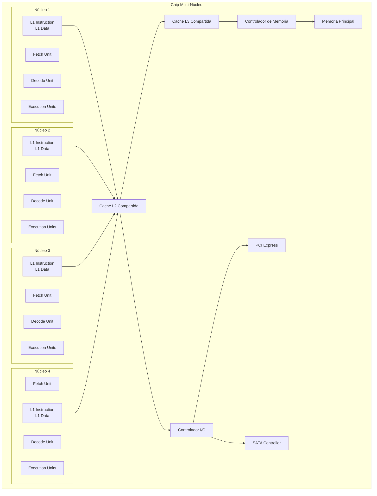
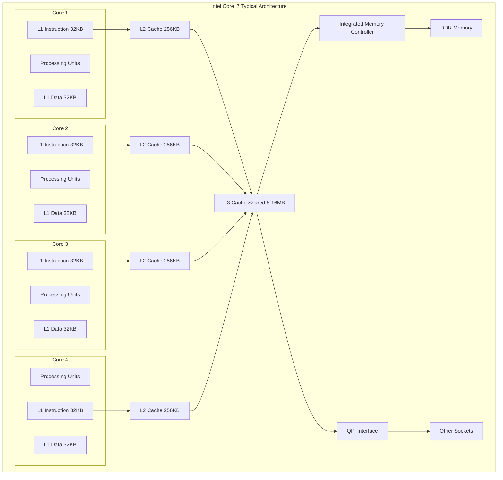

# Organización y Arquitectura de Computadoras - Sistemas multiprocesador

## 11.6 Arquitecturas multi-núcleo

---

Las arquitecturas multi-núcleo representan la evolución natural de los procesadores ante los límites físicos y térmicos del escalado de frecuencia. Consisten en integrar múltiples núcleos de procesamiento en un único chip, permitiendo ejecución paralela real y mejorando el rendimiento mediante el paralelismo a nivel de hilo (TLP).

### Conceptos Fundamentales

**Núcleo (Core):** Una unidad de procesamiento independiente capaz de ejecutar instrucciones de forma autónoma, con sus propios registros y unidades funcionales.

**Arquitectura Multi-Núcleo:** Diseño que integra múltiples núcleos de procesamiento en un solo circuito integrado, compartiendo recursos como memoria caché y interfaces de sistema.

### Clasificación de Arquitecturas Multi-Núcleo

#### Por Organización de Memoria

- **Memoria Compartida (UMA):** Todos los núcleos acceden a una memoria común con igual latencia
- **Memoria Distribuida (NUMA):** Cada núcleo tiene memoria local con diferentes tiempos de acceso

#### Por Homogeneidad

- **Homogéneos:** Todos los núcleos son idénticos
- **Heterogéneos:** Núcleos con diferentes características y capacidades

### Arquitectura Básica de un Procesador Multi-Núcleo



### Ventajas de las Arquitecturas Multi-Núcleo

#### Mejor Desempeño por Watt

$$
\text{Eficiencia Energética} = \frac{\text{Operaciones por Segundo}}{\text{Vatios Consumidos}}
$$

#### Mayor Throughput

Capacidad de ejecutar múltiples hilos simultáneamente:

$$
\text{Throughput} = \sum_{i=1}^{n} \text{IPC}_i
$$

Donde $n$ es el número de núcleos y $\text{IPC}_i$ es las instrucciones por ciclo del núcleo $i.$

#### Escalabilidad

Mayor facilidad para incrementar el rendimiento añadiendo más núcleos en lugar de aumentar la frecuencia.

### Jerarquía de Memoria en Multi-Núcleo

#### Cachés Privadas vs Compartidas

- **L1:** Generalmente privada por núcleo
- **L2:** Puede ser privada, compartida por grupos de núcleos, o completamente compartida
- **L3:** Usualmente compartida entre todos los núcleos

#### Protocolos de Coherencia

Sistemas para mantener la consistencia de datos entre cachés:

- Protocolo MESI (Modified, Exclusive, Shared, Invalid)
- Protocolo MOESI (añade Owned)
- Protocolo MESIF (añade Forward)

### Programación para Multi-Núcleo

#### Modelo de Memoria Compartida

```cpp
#include <iostream>
#include <thread>
#include <vector>
#include <atomic>

std::atomic<int> counter(0);
const int NUM_THREADS = 4;
const int ITERATIONS = 1000000;

void increment_counter(int thread_id) {
    for (int i = 0; i < ITERATIONS; ++i) {
        counter.fetch_add(1, std::memory_order_relaxed);
    }
    std::cout << "Hilo " << thread_id << " completado\n";
}

int main() {
    std::vector<std::thread> threads;

    // Lanzar múltiples hilos
    for (int i = 0; i < NUM_THREADS; ++i) {
        threads.emplace_back(increment_counter, i);
    }

    // Esperar a que todos los hilos terminen
    for (auto& t : threads) {
        t.join();
    }

    std::cout << "Valor final del contador: " << counter << std::endl;
    std::cout << "Valor esperado: " << NUM_THREADS * ITERATIONS << std::endl;

    return 0;
}
```

#### Optimización de Localidad de Datos

```cpp
#include <vector>
#include <thread>

// Estructura para evitar false sharing
struct alignas(64) PaddedCounter {
    std::atomic<int> value;
    char padding[64 - sizeof(std::atomic<int>)];
};

void parallel_sum(const std::vector<int>& data, std::vector<PaddedCounter>& partial_sums,
                 int thread_id, int start, int end) {
    int sum = 0;
    for (int i = start; i < end; ++i) {
        sum += data[i];
    }
    partial_sums[thread_id].value = sum;
}
```

### Métricas de Rendimiento

#### Speedup y Eficiencia

$$
S(n) = \frac{T(1)}{T(n)} \quad \text{Speedup con n núcleos}
$$

$$
E(n) = \frac{S(n)}{n} \quad \text{Eficiencia}
$$

#### Ley de Amdahl

$$
S = \frac{1}{(1 - p) + \frac{p}{n}}
$$

Donde $p$ es la fracción paralelizable y $n$ el número de núcleos.

#### Ley de Gustafson

$$
S = n + (1 - n) \cdot s
$$

Donde $s$ es la fracción serial que no escala.

### Ejercicios Propuestos

1. **Problema:** Calcule el speedup máximo según Amdahl para una aplicación con 85% de código paralelizable en un procesador de 8 núcleos.

   **Solución:**

   $$
   S = \frac{1}{(1 - 0.85) + \frac{0.85}{8}} = \frac{1}{0.15 + 0.10625} = \frac{1}{0.25625} \approx 3.90
   $$

2. **Problema:** Un algoritmo tarda 120 segundos en ejecutarse en un solo núcleo. Si el 75% es paralelizable, ¿cuánto tardará en 4 núcleos? Asuma overhead de comunicación del 8%.

3. **Problema:** Diseñe un diagrama de la jerarquía de memoria para un procesador de 6 núcleos con L1 privada, L2 compartida por pares de núcleos, y L3 compartida.

### Retos de Diseño Multi-Núcleo

#### Coherencia de Caché

Mecanismos para mantener la consistencia:

- Protocolos basados en snooping
- Protocolos basados en directorio
- Transacciones de memoria atómicas

#### Balance de Carga

Técnicas para distribuir el trabajo equitativamente:

- Planificación estática y dinámica
- Work stealing algorithms
- Affinity scheduling

#### Comunicación entre Núcleos

Mecanismos de bajo latency:

- Interrupts inter-processor (IPIs)
- Spinlocks optimizados
- Colas lock-free

### Caso de Estudio: Intel Core i7



### Tendencias Futuras

#### Arquitecturas Heterogéneas

Combinación de núcleos de diferentes características:

- Núcleos de alto rendimiento y alta eficiencia
- Aceleradores especializados (GPU, AI, etc.)

#### Chiplet Design

Enfoque modular donde diferentes componentes se fabrican por separado y se integran:

- Mejor yield manufacturing
- Flexibilidad en diseño
- Integración de tecnologías heterogéneas

#### Memoria no Volátil

Integración de memoria persistente en la jerarquía:

- Memoria 3D XPoint
- Storage class memory

### Referencias

#### Bibliografía Básica

1. Hennessy, J. L. & Patterson, D. A. (2006). _Computer Architecture: A Quantitative Approach_ (4th ed.). Capítulo 4: Multiprocesadores y paralelismo a nivel de hilo.
2. Patterson, D. A. & Hennessy, J. L. (2008). _Computer Organization and Design: The Hardware/Software Interface_ (4th ed.). Sección 6.4-6.8: Arquitecturas multi-núcleo.

#### Bibliografía Complementaria

1. Stallings, W. (2009). _Computer Organization and Architecture: Designing for Performance_. Capítulo 17: Procesamiento paralelo.
2. Tanenbaum, A. S. (2005). _Structured Computer Organization_ (5th ed.). Sección 8.1: Procesadores multi-núcleo.

#### Recursos Adicionales

- Intel® 64 and IA-32 Architectures Software Developer Manuals
- AMD64 Architecture Programmer's Manual
- Sutter, H. (2005). "The Free Lunch Is Over: A Fundamental Turn Toward Concurrency in Software"

### Conclusión

Las arquitecturas multi-núcleo representan el paradigma dominante en el diseño de procesadores modernos, permitiendo mejorar el rendimiento mediante el paralelismo a nivel de hilo mientras se mantiene controlado el consumo energético. El diseño efectivo de software para estas arquitecturas requiere entender profundamente los principios de programación paralela, la jerarquía de memoria y los mecanismos de sincronización. A medida que avanzamos hacia arquitecturas con mayor número de núcleos y mayor heterogeneidad, estos conceptos se vuelven cada vez más críticos para el desarrollo de aplicaciones de alto rendimiento.
