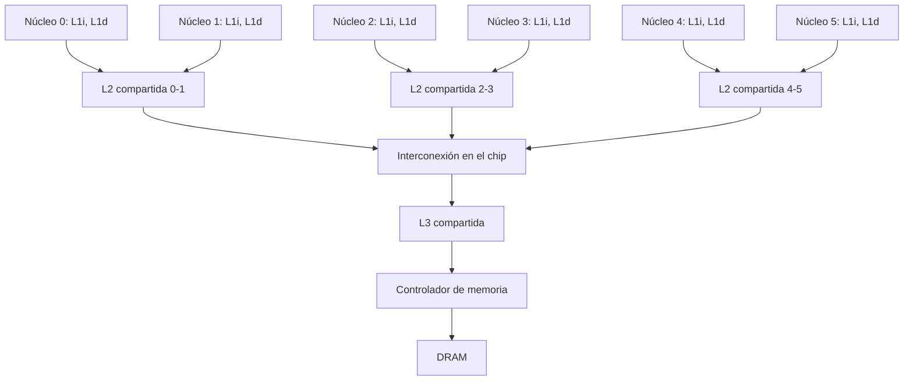

# Organización y Arquitectura de Computadoras - Sistemas multiprocesador

## 11.6 Arquitecturas multi-núcleo

---

Un procesador **multinúcleo** integra en un mismo chip varios núcleos completos (cada uno con su segmentación, sus unidades funcionales y sus cachés privadas) que comparten niveles de caché, el controlador de memoria y las interfaces de E/S. Desde 2005 es la forma estándar de usar los transistores que sigue dando la ley de Moore, porque el muro de la potencia impidió seguir subiendo la frecuencia (temas 1.1 y 11.4). Este tema describe la organización de un multinúcleo, su jerarquía de memoria e interconexión, el diseño de núcleos homogéneos y heterogéneos con el modelo de Hill y Marty, y el modelo **roofline** para saber si un programa está limitado por el cálculo o por la memoria.

### Organización

- **Núcleos:** pueden ser idénticos (homogéneos) o de varios tipos (heterogéneos, tema siguiente). Cada núcleo puede ejecutar uno o varios hilos por SMT (tema 11.5).
- **Cachés:** L1 de instrucciones y de datos privadas por núcleo; L2 privada o compartida por un grupo de núcleos; L3 (_last-level cache_) compartida por todos, a menudo dividida en porciones junto a cada núcleo. La coherencia se mantiene por fisgoneo o por directorio (tema 9.5), y la L3 suele ser **inclusiva** o mantener un directorio de las cachés privadas.
- **Interconexión en el chip:** un bus para pocos núcleos; un **anillo** (Intel, hasta unos 10 núcleos); una **malla** bidimensional para decenas de núcleos (servidores Intel Xeon, ARM Neoverse).
- **Memoria:** uno o varios controladores de memoria integrados; en chips grandes, cada controlador es más cercano a unos núcleos que a otros, y el chip es NUMA internamente.



### ¿Núcleos grandes o pequeños?

Con un presupuesto fijo de área (o de potencia), se pueden poner pocos núcleos grandes y rápidos o muchos pequeños. Hill y Marty (2008) lo modelaron así: el chip tiene $n$ unidades básicas (BCE); un núcleo hecho con $r$ unidades rinde $\text{perf}(r),$ que crece más despacio que $r:$ la regla de Pollack sugiere $\sqrt{r}.$ Para una fracción paralela $f:$

$$ S_{\text{simétrico}}(f, n, r) = \frac{1}{\dfrac{1 - f}{\text{perf}(r)} + \dfrac{f\, r}{\text{perf}(r)\, n}}, \qquad S_{\text{asimétrico}}(f, n, r) = \frac{1}{\dfrac{1 - f}{\text{perf}(r)} + \dfrac{f}{\text{perf}(r) + n - r}} $$

El diseño **asimétrico**, con un núcleo grande para la parte serial y muchos pequeños para la paralela, supera al simétrico en casi todos los casos: ataca a la vez los dos términos de la ley de Amdahl.

**Heterogeneidad en la práctica.** ARM big.LITTLE y DynamIQ, Apple (núcleos de rendimiento y de eficiencia) e Intel (P-cores y E-cores) combinan núcleos grandes fuera de orden con núcleos pequeños y eficientes; el sistema operativo asigna los hilos según la carga. Además, los chips integran GPU y aceleradores (NPU, codificadores de video), que son la forma extrema de heterogeneidad.

### El modelo roofline

El rendimiento de un programa en un multinúcleo está limitado por el **pico de cálculo** $P$ (FLOP/s) o por el **ancho de banda de memoria** $B$ (bytes/s), según su **intensidad aritmética** $I$ (operaciones por byte traído de memoria):

$$ \text{rendimiento alcanzable} = \min(P,\; I \cdot B) $$

El punto de equilibrio está en $I = P / B.$ Los programas con intensidad menor (sumar vectores, recorrer grafos) están limitados por la memoria, y añadir núcleos no los acelera; los de intensidad mayor (multiplicar matrices por bloques) aprovechan todos los núcleos. Aumentar la intensidad con reutilización de datos en caché (tema 9.1) es la principal optimización.

### Amdahl y Gustafson

Con tamaño de problema fijo, la ley de Amdahl limita la aceleración. Pero en la práctica, con más núcleos se resuelven problemas más grandes, y la parte paralela crece mientras la serial no: la **ley de Gustafson** da una aceleración escalada $S = (1 - f) + f\, p,$ casi lineal. Ambas son correctas para preguntas distintas.

### Implementación en Python

El programa resuelve los ejercicios 1 y 2, aplica el modelo de Hill y Marty para encontrar el mejor tamaño de núcleo en diseños simétricos y asimétricos con 256 unidades, compara Amdahl y Gustafson, evalúa el modelo roofline para cuatro tipos de programa, y compara el tiempo y la energía de una tarea en un núcleo grande y en uno pequeño.

```python
from math import sqrt

# Ejercicios 1 y 2
print(f"ejercicio 1: aceleración con 85 % paralelo y 8 núcleos = {1 / (0.15 + 0.85 / 8):.2f}")
T = 120 * (0.25 + 0.75 / 4 + 0.08)
print(f"ejercicio 2: T = 30 + 22.5 + 9.6 = {T:.1f} s, aceleración {120 / T:.2f}")

# Ley de Amdahl para multinúcleos (Hill y Marty, 2008): un chip con n unidades básicas (BCE).
# Un núcleo hecho con r BCE rinde perf(r) = sqrt(r).
perf = sqrt


def simetrico(f, n, r):
    return 1 / ((1 - f) / perf(r) + f * r / (perf(r) * n))


def asimetrico(f, n, r):      # un núcleo grande de r BCE y n - r núcleos pequeños de 1 BCE
    return 1 / ((1 - f) / perf(r) + f / (perf(r) + n - r))


n = 256
for f in (0.9, 0.975, 0.999):
    rs = [2 ** k for k in range(9)]
    mejor_s = max(rs, key=lambda r: simetrico(f, n, r))
    mejor_a = max(rs, key=lambda r: asimetrico(f, n, r))
    print(f"f = {f}: simétrico, mejor con núcleos de {mejor_s:3d} BCE -> {simetrico(f, n, mejor_s):6.1f};"
          f" asimétrico, núcleo grande de {mejor_a:3d} BCE -> {asimetrico(f, n, mejor_a):6.1f}")

# Ley de Gustafson: el problema crece con los núcleos
for p in (4, 16, 64):
    print(f"{p:2d} núcleos con 5 % serial: Amdahl {1 / (0.05 + 0.95 / p):5.2f}, Gustafson {0.05 + 0.95 * p:5.2f}")

# Modelo roofline: rendimiento = min(pico de cálculo, intensidad aritmética x ancho de banda)
pico, ancho = 500e9, 50e9                  # 500 GFLOP/s y 50 GB/s
nucleos = {"suma de vectores (1 FLOP / 24 B)": 1 / 24, "SAXPY (2 FLOP / 24 B)": 2 / 24,
           "estencil 2D (~0.5 FLOP/B)": 0.5, "multiplicación de matrices por bloques (~20 FLOP/B)": 20}
print(f"roofline: punto de equilibrio en {pico / ancho:.0f} FLOP/B")
for nombre, I in nucleos.items():
    r = min(pico, I * ancho)
    limite = "memoria" if I * ancho < pico else "cálculo"
    print(f"   {nombre:52s}: {r / 1e9:6.1f} GFLOP/s (limitado por {limite})")

# Núcleos heterogéneos: un núcleo grande (3x rendimiento, 6 W) y uno pequeño (1x, 0.75 W)
for nombre, rendimiento, potencia in (("grande", 3, 6.0), ("pequeño", 1, 0.75)):
    t = 1 / rendimiento
    print(f"tarea en el núcleo {nombre:7s}: tiempo {t:.2f}, energía {potencia * t:.2f} J (unidades relativas)")
```

Salida:

```text
ejercicio 1: aceleración con 85 % paralelo y 8 núcleos = 3.90
ejercicio 2: T = 30 + 22.5 + 9.6 = 62.1 s, aceleración 1.93
f = 0.9: simétrico, mejor con núcleos de  32 BCE ->   26.6; asimétrico, núcleo grande de 128 BCE ->   65.4
f = 0.975: simétrico, mejor con núcleos de   8 BCE ->   51.0; asimétrico, núcleo grande de  64 BCE ->  125.0
f = 0.999: simétrico, mejor con núcleos de   1 BCE ->  204.0; asimétrico, núcleo grande de   8 BCE ->  230.6
 4 núcleos con 5 % serial: Amdahl  3.48, Gustafson  3.85
16 núcleos con 5 % serial: Amdahl  9.14, Gustafson 15.25
64 núcleos con 5 % serial: Amdahl 15.42, Gustafson 60.85
roofline: punto de equilibrio en 10 FLOP/B
   suma de vectores (1 FLOP / 24 B)                    :    2.1 GFLOP/s (limitado por memoria)
   SAXPY (2 FLOP / 24 B)                               :    4.2 GFLOP/s (limitado por memoria)
   estencil 2D (~0.5 FLOP/B)                           :   25.0 GFLOP/s (limitado por memoria)
   multiplicación de matrices por bloques (~20 FLOP/B) :  500.0 GFLOP/s (limitado por cálculo)
tarea en el núcleo grande : tiempo 0.33, energía 2.00 J (unidades relativas)
tarea en el núcleo pequeño: tiempo 1.00, energía 0.75 J (unidades relativas)
```

Con $f = 0.975,$ el mejor diseño simétrico usa núcleos de unas 8 unidades y logra una aceleración de 51; el asimétrico, con un núcleo grande de 64 unidades y 192 pequeños, llega a 125. El núcleo pequeño tarda el triple, pero gasta casi tres veces menos energía: por eso las tareas de fondo se envían a los núcleos de eficiencia.

### Ejercicios Propuestos

1. **Amdahl.** Calcula la aceleración máxima de una aplicación paralelizable en un 85 % en un procesador de 8 núcleos.

2. **Sobrecosto.** Un algoritmo tarda 120 s en un núcleo y el 75 % es paralelizable. ¿Cuánto tarda en 4 núcleos si la comunicación añade un 8 % del tiempo secuencial?

3. **Jerarquía.** Dibuja la jerarquía de memoria de un procesador de 6 núcleos con L1 privadas, L2 compartida por pares de núcleos y L3 compartida.

4. **Roofline.** En un procesador de 500 GFLOP/s con 50 GB/s de memoria, ¿cuál es el rendimiento máximo de SAXPY en doble precisión, la operación $y = a x + y?$ ¿Mejoraría con el doble de núcleos?

### Soluciones

**Ejercicio 1.** $\frac{1}{0.15 + 0.85/8} = \frac{1}{0.25625} \approx 3.90.$

**Ejercicio 2.** $120 \,(0.25 + 0.75/4 + 0.08) = 30 + 22.5 + 9.6 = 62.1$ s, una aceleración de 1.93.

**Ejercicio 3.** Es el diagrama de la sección de organización: seis núcleos con sus L1, tres L2 compartidas por pares, una interconexión y la L3 compartida con el controlador de memoria. Los núcleos de un mismo par se comunican a través de su L2; los de pares distintos, a través de la L3.

**Ejercicio 4.** Cada elemento requiere 2 operaciones y mover 24 bytes, pues hay que leer $x$ e $y$ y escribir $y:$ $I = 1/12$ FLOP/B, y el rendimiento máximo es $50 \cdot 1/12 \approx 4.2$ GFLOP/s, menos del 1 % del pico. Duplicar los núcleos no ayuda: el límite es la memoria. Ayudaría más ancho de banda o fusionar SAXPY con otras operaciones sobre los mismos datos mientras están en caché.

### Referencias

1. Hill, M. D., and Marty, M. R., Amdahl's law in the multicore era. _IEEE Computer_ 41(7), 2008.
2. Williams, S., Waterman, A., and Patterson, D., Roofline: an insightful visual performance model for multicore architectures. _Communications of the ACM_ 52(4), 2009.
3. Hennessy, J. L., and Patterson, D. A., _Computer Architecture: A Quantitative Approach_. Morgan Kaufmann, 2019. Capítulos 5 y 7.
4. Gustafson, J. L., Reevaluating Amdahl's law. _Communications of the ACM_ 31(5), 1988.
