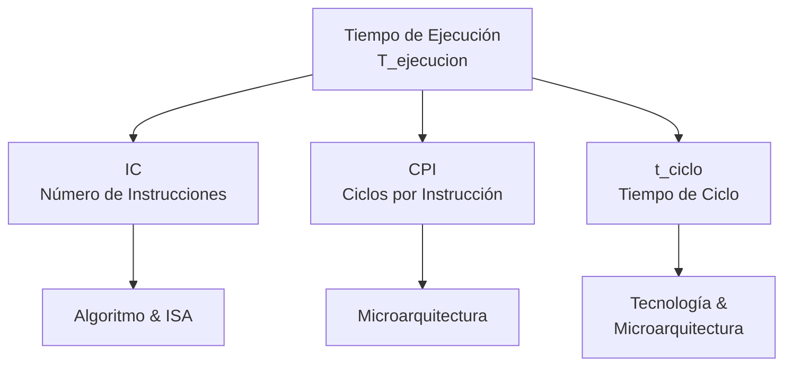

# Organización y Arquitectura de Computadoras - Principios cuantitativos del diseño de arquitecturas

## 1.2 Medidas de desempeño de equipo de cómputo.

---

### 1. Introducción

Evaluar el rendimiento de una computadora es fundamental para arquitectos, diseñadores y compradores. La elección de la **métrica correcta** es crucial, ya que una mala elección puede llevar a decisiones de diseño o compra equivocadas. Este tema se centra en las definiciones cuantitativas y las fórmulas utilizadas para medir y comparar el desempeño.

### 2. Definición y Objetivo

Las **Medidas de Desempeño** son métricas cuantitativas utilizadas para evaluar, comparar y predecir el comportamiento de un sistema computacional bajo una carga de trabajo específica.

El **objetivo** es:

- **Cuantificar** la efectividad de una arquitectura.
- **Comparar** diferentes máquinas de manera objetiva.
- **Identificar** cuellos de botella.
- **Guiar** las optimizaciones y el diseño de nuevas generaciones de hardware.

### 3. Tiempo de Ejecución: La Medida Fundamental

La medida más directa y fiable del desempeño es el **tiempo total que tarda una computadora en completar una tarea específica**.

- **Definición:** Tiempo que transcurre entre el inicio y la finalización de la ejecución de un programa o una carga de trabajo. También se le llama **tiempo de respuesta** o **tiempo transcurrido** (elapsed time).
- **Fórmula (Genérica):**

  $$ T_{ejecucion} = T_{final} - T_{inicio} $$

- **Importancia:** Es lo que el usuario experimenta directamente. Una computadora es más rápida que otra si ejecuta la misma carga de trabajo en **menos tiempo**.

### 4. Throughput (Ancho de Banda) vs. Tiempo de Respuesta

Estos son dos conceptos clave que a menudo se confunden, especialmente en sistemas con múltiples programas.

| Concepto                | Definición                                             | Ejemplo                    |
| :---------------------- | :----------------------------------------------------- | :------------------------- |
| **Tiempo de Respuesta** | Tiempo para completar **una sola tarea**.              | Segundos por transacción.  |
| **Throughput**          | Número de tareas completadas **por unidad de tiempo**. | Transacciones por segundo. |

- **Relación:** Mejorar (reducir) el tiempo de respuesta generalmente mejora (aumenta) el throughput. Sin embargo, en sistemas complejos (e.g., con planificación de procesos), no siempre es una relación lineal. Un sistema puede optimizarse para alto throughput (e.g., un servidor de lotes) a expensas del tiempo de respuesta individual, o viceversa (e.g., una estación de trabajo interactiva).

### 5. Frecuencia de Reloj (Clock Rate) y CPI

El tiempo de ejecución se puede descomponer en factores más fundamentales de la arquitectura. Esta descomposición es la **Ecuación Fundamental del Desempeño del CPU**.

- **Frecuencia de Reloj $(f)$:** Velocidad a la que opera el procesador, medida en Hertz (Hz). Es el inverso del **tiempo de ciclo de reloj $(t_{ciclo})$**.

  $$ t_{ciclo} = \frac{1}{f} \quad \text{o} \quad f = \frac{1}{t_{ciclo}} $$

  - Ejemplo: Un CPU a 3 GHz tiene $t_{ciclo} = \frac{1}{3 \times 10^9} \approx 0.333$ ns.

- **Ciclos por Instrucción (CPI):** Número promedio de ciclos de reloj que toma ejecutar una instrucción para un programa dado. **No es una constante**; depende de la mezcla de instrucciones (ISA) y de la eficiencia de la arquitectura (peligros, cachés, etc.).

- **Número de Instrucciones (IC):** Número total de instrucciones ejecutadas por el programa.

#### **La Ecuación Fundamental del Desempeño del CPU**

El tiempo de ejecución del CPU se puede expresar como:

$$ T_{ejecucion} = IC \times CPI \times t_{ciclo} = \frac{IC \times CPI}{f} $$

**Análisis:** Esta ecuación muestra que el desempeño depende de **tres factores**:

1.  **IC:** Depende del **compilador** y la **arquitectura del conjunto de instrucciones (ISA)**.
2.  **CPI:** Depende de la **microarquitectura** del procesador (pipeline, cachés, branch prediction).
3.  **$t_{ciclo}$ o $f$:** Depende de la **tecnología** de fabricación y de la microarquitectura.

### 6. MIPS y MFLOPS: Medidas Clásicas (¡Usar con Precaución!)

- **MIPS (Millones de Instrucciones Por Segundo):**

  $$ \text{MIPS} = \frac{IC}{T_{ejecucion} \times 10^6} = \frac{f}{CPI \times 10^6} $$

  - **Problema:** Depende de la ISA. Comparar MIPS entre arquitecturas diferentes (e.g., RISC vs. CISC) es engañoso porque el `IC` y el `CPI` varían enormemente. Una máquina con menos MIPS podría ser más rápida si su ISA es más potente (e.g., una instrucción hace el trabajo de varias).

- **MFLOPS (Millones de Operaciones de Punto Flotante Por Segundo):**

  $$ \text{MFLOPS} = \frac{\text{Número de operaciones FLOP}}{T_{ejecucion} \times 10^6} $$

  - **Ventaja:** Más útil para comparar máquinas en aplicaciones científicas intensivas en cálculos.
  - **Problema:** Depende de la operación específica (suma vs. división) y del mix de operaciones. No mide el rendimiento general del sistema.

### 7. Benchmarks: La Práctica Standard

Como las métricas sintéticas como MIPS son problemáticas, la industria utiliza **benchmarks**: programas estándar utilizados para medir y comparar el rendimiento.

- **Tipos:**
  - **Kernels:** Pequeños bucles críticos extraídos de programas reales (e.g., Livermore Loops).
  - **Programas de Juguete:** Pequeños y portables (e.g., Sieve, Quicksort). Son de utilidad limitada.
  - **Suites de Benchmarks:** Conjuntos de programas reales que representan una carga de trabajo típica.
    - **SPEC (Standard Performance Evaluation Corporation):** La suite más importante para estaciones de trabajo y servidores (e.g., SPEC CPU2017). Reporta una **puntuación geométrica** para comparar rendimientos normalizados.
    - **TPC (Transaction Processing Performance Council):** Benchmarks para sistemas de bases de datos (e.g., TPC-C).

- **Métrica de un Benchmark:** El resultado suele ser el **tiempo de ejecución** total o una **puntuación relativa** normalizada (e.g., "La máquina X es 1.5 veces más rápida que la máquina de referencia en la suite SPEC").

### 8. Ejercicios Propuestos

1.  **Cálculo de CPI:** Se tiene un programa que se ejecuta en una máquina con arquitectura load-store. La mezcla de instrucciones y sus CPI son:
    - Loads: 20%, CPI = 4
    - Stores: 10%, CPI = 3
    - ALU: 50%, CPI = 2
    - Branches: 20%, CPI = 3
      a) Calcula el CPI promedio para este programa.
      b) Si se ejecutan 10,000 instrucciones y la frecuencia del CPU es de 2 GHz, ¿cuál es el tiempo de ejecución?

2.  **Comparación de Desempeño:**
    La computadora A ejecuta un programa en 10 segundos. La computadora B ejecuta el mismo programa en 15 segundos.
    - a) ¿Cuánto más rápida es A respecto a B?
    - b) Si queremos que la computadora B ejecute el programa en 9 segundos, ¿en qué factor debemos mejorar su rendimiento?

3.  **Análisis de Mejora:** Un programa tarda 100 segundos en ejecutarse. El 80% de ese tiempo es ejecutado por operaciones de punto flotante (FP). Se está considerando una mejora que hará que las operaciones FP se ejecuten 5 veces más rápido.
    - a) ¿Cuál es el speedup total que se obtendría con esta mejora? (Usa la Ley de Amdahl).
    - b) Si la mejora solo afecta al 60% de las operaciones FP, ¿cuál es el nuevo speedup?

### 9. Resumen de Fórmulas Clave

| Concepto                | Fórmula                                                                                             | Variables                                                   |
| :---------------------- | :-------------------------------------------------------------------------------------------------- | :---------------------------------------------------------- |
| **Tiempo de Ejecución** | $T_{ejecucion} = T_{final} - T_{inicio}$                                                            |                                                             |
| **Ecuación del CPU**    | $T_{ejecucion} = IC \times CPI \times t_{ciclo} = \frac{IC \times CPI}{f}$                          | `IC`: Instrucciones, `CPI`: Ciclos/Inst., `f`: Frecuencia   |
| **Speedup**             | $Speedup = \frac{Tiempo_{viejo}}{Tiempo_{nuevo}} = \frac{Rendimiento_{nuevo}}{Rendimiento_{viejo}}$ |                                                             |
| **CPI Promedio**        | $CPI_{promedio} = \sum_{i} (CPI_i \times Frecuencia_i)$                                             | $Frecuencia_i:$ % de ocurrencia de cada tipo de instrucción |
| **MIPS**                | $MIPS = \frac{IC}{T_{ejecucion} \times 10^6} = \frac{f}{CPI \times 10^6}$                           |                                                             |

### 10. Referencias

- **Bibliografía Básica:**
  1.  Hennessy & Patterson, _Computer Architecture: A Quantitative Approach_ (Cap. 1, Secciones 1.6 a 1.9). La referencia definitiva para métricas cuantitativas.
  2.  Patterson & Hennessy, _Computer Organization and Design_ (Cap. 1, Secciones 1.5 a 1.9 y Apéndice B). Explica los conceptos de CPI, tiempo de ejecución y benchmarks de manera muy clara.
- **Bibliografía Complementaria:**
  1.  Stallings, _Computer Organization and Architecture_ (Cap. 2, "Performance Issues"). Ofrece una muy buena explicación sobre las limitaciones de MIPS y MFLOPS.
  2.  Tanenbaum, _Structured Computer Organization_ (Cap. 1, "Introduction"). Incluye una discusión concisa sobre medidas de desempeño.
