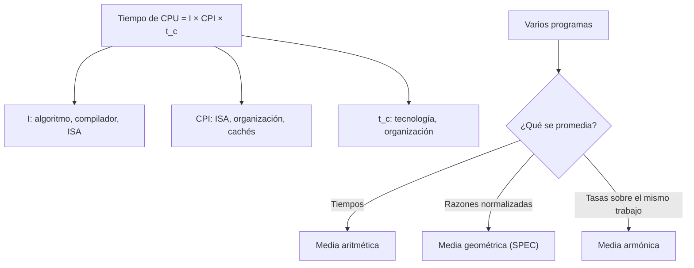

# Organización y Arquitectura de Computadoras - Principios cuantitativos del diseño de arquitecturas

## 1.2 Medidas de desempeño de equipo de cómputo.

---

¿Qué significa que una computadora sea "más rápida" que otra? Depende de a quién se le pregunte: al usuario le interesa cuánto tarda su programa (**tiempo de respuesta**), al administrador de un servidor cuántas peticiones atiende por segundo (**productividad** o _throughput_). Este tema define las medidas correctas, deduce la **ecuación del desempeño del procesador**, que separa el tiempo de ejecución en tres factores, explica por qué medidas populares como la frecuencia de reloj o los MIPS engañan, y cómo se resumen los resultados de un conjunto de programas de prueba.

### Tiempo de ejecución y desempeño

La única medida fiable es el **tiempo** que tarda un programa real. Se distingue el tiempo total transcurrido (_wall-clock time_), que incluye entrada y salida y otros programas, del **tiempo de CPU**, el que el procesador dedica al programa. Se define el **desempeño** como el inverso del tiempo, y se dice que $X$ es $n$ veces más rápida que $Y$ si

$$ n = \frac{\text{Desempeño}_X}{\text{Desempeño}_Y} = \frac{T_Y}{T_X} $$

Si $A$ tarda 10 s y $B$ 15 s, $A$ es 1.5 veces más rápida que $B.$ Se evita decir "un 50 % más rápida", que se presta a confusión.

### La ecuación del desempeño del procesador

Un procesador funciona al ritmo de un **reloj** de frecuencia $f$ (ciclos por segundo, Hz), con período o **tiempo de ciclo** $t_c = 1/f.$ A 3 GHz, $t_c \approx 0.333$ ns. El tiempo de CPU es el número de ciclos por el tiempo de ciclo, y el número de ciclos es el número de instrucciones ejecutadas, $I,$ por el promedio de **ciclos por instrucción**, $\text{CPI}:$

$$ T_{\text{CPU}} = I \times \text{CPI} \times t_c = \frac{I \times \text{CPI}}{f} $$

Si las instrucciones se dividen en clases $i$ con frecuencia relativa $F_i$ y ciclos $\text{CPI}_i,$ el CPI promedio es $\text{CPI} = \sum_i F_i\, \text{CPI}_i.$

**De qué depende cada factor.**

| | Instrucciones $I$ | CPI | Tiempo de ciclo $t_c$ |
| --- | --- | --- | --- |
| algoritmo | ✓ | ✓ | |
| lenguaje y compilador | ✓ | ✓ | |
| conjunto de instrucciones (ISA) | ✓ | ✓ | ✓ |
| organización (segmentación, cachés) | | ✓ | ✓ |
| tecnología de fabricación | | | ✓ |

Ninguno de los factores por separado mide el desempeño, y mejorar uno suele empeorar otro: instrucciones más potentes reducen $I$ pero pueden aumentar el CPI o el tiempo de ciclo. Solo el producto importa. Es el marco cuantitativo de todo el curso.

### Medidas engañosas

**La frecuencia de reloj.** Un procesador a 4 GHz con CPI de 2 es más lento que uno a 3 GHz con CPI de 1 ejecutando las mismas instrucciones. El Pentium 4 llegó a 3.8 GHz con una segmentación muy profunda, y fue superado por procesadores de menor frecuencia y mayor IPC (instrucciones por ciclo, el inverso del CPI).

**Los MIPS.** Millones de instrucciones por segundo:

$$ \text{MIPS} = \frac{I}{T \times 10^6} = \frac{f}{\text{CPI} \times 10^6} $$

Tiene tres defectos: no sirve para comparar procesadores con conjuntos de instrucciones distintos, varía entre programas del mismo procesador y puede variar **en sentido contrario** al desempeño. En el ejemplo del programa, un compilador genera más instrucciones sencillas: el CPI baja, los MIPS suben de 2 800 a 3 200 y, sin embargo, el programa tarda un 50 % más. Los **MFLOPS** (operaciones de punto flotante por segundo) tienen problemas análogos, aunque son útiles para comparar cálculo numérico.

### Programas de prueba (benchmarks)

Para comparar se usan programas reales representativos. El más conocido es **SPEC CPU** (_Standard Performance Evaluation Corporation_), con programas de enteros y de punto flotante. Para cada programa se calcula la **razón SPEC** $\frac{T_{\text{referencia}}}{T_{\text{máquina}}}$ y se resumen con la **media geométrica**

$$ G = \left( \prod_{i = 1}^{n} r_i \right)^{1/n} $$

**Propiedad.** El cociente de las medias geométricas de dos máquinas no depende de la máquina de referencia.

**Demostración.** Si $r_i^X = T_i^{\text{ref}} / T_i^X,$ entonces $\frac{G_X}{G_Y} = \left( \prod_i \frac{T_i^{\text{ref}} / T_i^X}{T_i^{\text{ref}} / T_i^Y} \right)^{1/n} = \left( \prod_i \frac{T_i^Y}{T_i^X} \right)^{1/n},$ donde los tiempos de referencia se cancelan. $\blacksquare$

La media aritmética de las razones no tiene esa propiedad: en el ejemplo del programa, cada máquina parece cinco veces peor que la otra según cuál se tome como referencia. La media aritmética es correcta para los **tiempos** (es proporcional al tiempo total de ejecutar todos los programas), y la **armónica** para promediar **tasas** sobre una misma cantidad de trabajo.

**Otros benchmarks.** TPC para bases de datos y transacciones, SPECpower para eficiencia energética, MLPerf para aprendizaje automático, LINPACK (la lista TOP500) para supercómputo, y Geekbench o similares para dispositivos personales. Los fabricantes tienden a optimizar específicamente para los benchmarks, por lo que conviene desconfiar de un resultado aislado.

### Energía y productividad

En dispositivos móviles y centros de datos importa la **energía por tarea**, $E = P \times T,$ más que la potencia. Un procesador que consume más pero termina antes puede gastar menos energía (40 J frente a 50 J en el ejemplo del programa), y luego apagarse: es la estrategia de "correr hasta terminar y dormir" (_race to idle_). Para servidores se mide el rendimiento por vatio y, para cargas interactivas, la **latencia de cola**, por ejemplo el percentil 99 del tiempo de respuesta.



### Implementación en Python

El programa resuelve los ejercicios 1 a 3, muestra la falacia de los MIPS con dos compiladores, compara las medias aritmética y geométrica de razones normalizadas a dos máquinas de referencia distintas, ilustra la media armónica y compara la energía de dos procesadores.

```python
from math import prod

# Ecuación del desempeño: T = instrucciones x CPI x tiempo de ciclo
def tiempo_cpu(instr, cpi, f_hz):
    return instr * cpi / f_hz


# Ejercicio 1: mezcla de instrucciones
mezcla = {"load": (0.20, 4), "store": (0.10, 3), "ALU": (0.50, 2), "salto": (0.20, 3)}
cpi = sum(frac * c for frac, c in mezcla.values())
print(f"ejercicio 1: CPI promedio = {cpi:.2f}; tiempo para 10 000 instrucciones a 2 GHz = "
      f"{tiempo_cpu(10_000, cpi, 2e9) * 1e6:.2f} µs")
for clase, (frac, c) in mezcla.items():
    print(f"   {clase:6s}: {frac * c / cpi:.1%} de los ciclos")

# Ejercicio 2
tA, tB = 10, 15
print(f"ejercicio 2: A es {tB / tA:.2f} veces más rápida; B debe mejorar en un factor {tB / 9:.3f}")

# Ejercicio 3 (Amdahl)
amdahl = lambda F, s: 1 / ((1 - F) + F / s)
print(f"ejercicio 3: (a) {amdahl(0.8, 5):.3f}  (b) {amdahl(0.8 * 0.6, 5):.3f}")

# La falacia de los MIPS: dos compiladores para el mismo programa (reloj de 4 GHz)
cpi_clase = {"A": 1, "B": 2, "C": 3}
compiladores = {"compilador 1": {"A": 5e9, "B": 1e9, "C": 1e9},
                "compilador 2": {"A": 10e9, "B": 1e9, "C": 1e9}}
for nombre, cuenta in compiladores.items():
    ciclos = sum(n * cpi_clase[k] for k, n in cuenta.items())
    instr = sum(cuenta.values())
    t = ciclos / 4e9
    print(f"{nombre}: {instr / 1e9:.0f}e9 instrucciones, CPI {ciclos / instr:.3f}, tiempo {t:.2f} s, "
          f"MIPS {instr / t / 1e6:.0f}")

# Medias: dos máquinas, dos programas (tiempos en segundos)
tiempos = {"M1": [1, 1000], "M2": [10, 100]}
print("media aritmética de los tiempos:", {m: sum(v) / 2 for m, v in tiempos.items()})
for ref in ("M1", "M2"):
    norm = {m: [t / r for t, r in zip(v, tiempos[ref])] for m, v in tiempos.items()}
    arit = {m: round(sum(v) / 2, 3) for m, v in norm.items()}
    geom = {m: round(prod(v) ** 0.5, 3) for m, v in norm.items()}
    print(f"normalizado a {ref}: media aritmética {arit}, media geométrica {geom}")

# Media armónica para tasas: 100 km a 50 km/h y 100 km a 100 km/h
v = [50, 100]
print(f"velocidad promedio real = {2 / sum(1 / x for x in v):.2f} km/h (armónica); aritmética {sum(v) / 2:.1f}")

# Energía: un procesador más rápido puede gastar menos energía por tarea
for nombre, potencia, t in (("rápido", 40, 1.0), ("lento", 25, 2.0)):
    print(f"procesador {nombre}: {potencia} W x {t} s = {potencia * t:.0f} J")
```

Salida:

```text
ejercicio 1: CPI promedio = 2.70; tiempo para 10 000 instrucciones a 2 GHz = 13.50 µs
   load  : 29.6% de los ciclos
   store : 11.1% de los ciclos
   ALU   : 37.0% de los ciclos
   salto : 22.2% de los ciclos
ejercicio 2: A es 1.50 veces más rápida; B debe mejorar en un factor 1.667
ejercicio 3: (a) 2.778  (b) 1.623
compilador 1: 7e9 instrucciones, CPI 1.429, tiempo 2.50 s, MIPS 2800
compilador 2: 12e9 instrucciones, CPI 1.250, tiempo 3.75 s, MIPS 3200
media aritmética de los tiempos: {'M1': 500.5, 'M2': 55.0}
normalizado a M1: media aritmética {'M1': 1.0, 'M2': 5.05}, media geométrica {'M1': 1.0, 'M2': 1.0}
normalizado a M2: media aritmética {'M1': 5.05, 'M2': 1.0}, media geométrica {'M1': 1.0, 'M2': 1.0}
velocidad promedio real = 66.67 km/h (armónica); aritmética 75.0
procesador rápido: 40 W x 1.0 s = 40 J
procesador lento: 25 W x 2.0 s = 50 J
```

La media aritmética de las razones hace parecer peor a la máquina que no se usa como referencia; la geométrica da 1 para ambas siempre, porque una máquina es 10 veces más rápida en un programa y 10 veces más lenta en el otro.

### Ejercicios Propuestos

1. **CPI.** En una máquina load-store, la mezcla de instrucciones es: loads 20 % con CPI 4, stores 10 % con CPI 3, ALU 50 % con CPI 2 y saltos 20 % con CPI 3. (a) Calcula el CPI promedio. (b) ¿Cuánto tardan 10 000 instrucciones a 2 GHz?

2. **Comparación.** La computadora $A$ ejecuta un programa en 10 s y la $B$ en 15 s. (a) ¿Cuántas veces más rápida es $A?$ (b) ¿En qué factor hay que mejorar $B$ para que tarde 9 s?

3. **Mejora del punto flotante.** Un programa tarda 100 s, el 80 % en operaciones de punto flotante. Una mejora las hace 5 veces más rápidas. (a) ¿Cuál es la aceleración total? (b) ¿Y si la mejora solo afecta al 60 % de las operaciones de punto flotante?

4. **MIPS.** Explica, con el ejemplo de los dos compiladores, por qué un compilador puede aumentar los MIPS y a la vez empeorar el tiempo de ejecución.

5. **Media geométrica.** Demuestra que la media geométrica de las razones SPEC da la misma comparación entre dos máquinas sea cual sea la máquina de referencia.

### Soluciones

**Ejercicio 1.** (a) $\text{CPI} = 0.2 \cdot 4 + 0.1 \cdot 3 + 0.5 \cdot 2 + 0.2 \cdot 3 = 2.7.$ (b) $T = \frac{10^4 \cdot 2.7}{2 \times 10^9} = 13.5$ µs. Aunque las loads son solo el 20 % de las instrucciones, consumen casi el 30 % de los ciclos.

**Ejercicio 2.** (a) $15/10 = 1.5$ veces. (b) El desempeño de $B$ debe multiplicarse por $15/9 \approx 1.67.$

**Ejercicio 3.** (a) $\frac{1}{0.2 + 0.8/5} = \frac{1}{0.36} \approx 2.78;$ el tiempo baja a 36 s. (b) La fracción mejorada es $0.8 \times 0.6 = 0.48,$ y la aceleración $\frac{1}{0.52 + 0.48/5} = \frac{1}{0.616} \approx 1.62.$

**Ejercicio 4.** El compilador 2 genera $5 \times 10^9$ instrucciones de clase A (CPI 1) más que el 1. Eso baja el CPI promedio de 1.43 a 1.25 y por tanto sube los MIPS, pero el número total de ciclos pasa de $10 \times 10^9$ a $15 \times 10^9:$ el programa tarda 3.75 s en lugar de 2.5 s. Los MIPS premian ejecutar muchas instrucciones sencillas, no terminar antes.

**Ejercicio 5.** Es la demostración del tema: los tiempos de la máquina de referencia aparecen en el numerador de las razones de las dos máquinas y se cancelan en el cociente.

### Referencias

1. Hennessy, J. L., and Patterson, D. A., _Computer Architecture: A Quantitative Approach_. Morgan Kaufmann, 2019. Secciones 1.8 y 1.9.
2. Patterson, D. A., and Hennessy, J. L., _Computer Organization and Design: The Hardware/Software Interface_. Morgan Kaufmann, 2020. Secciones 1.6 a 1.11.
3. Fleming, P. J., and Wallace, J. J., How not to lie with statistics: the correct way to summarize benchmark results. _Communications of the ACM_ 29(3), 1986.
4. Stallings, W., _Organización y arquitectura de computadores_. Pearson, 2006. Capítulo 2.
