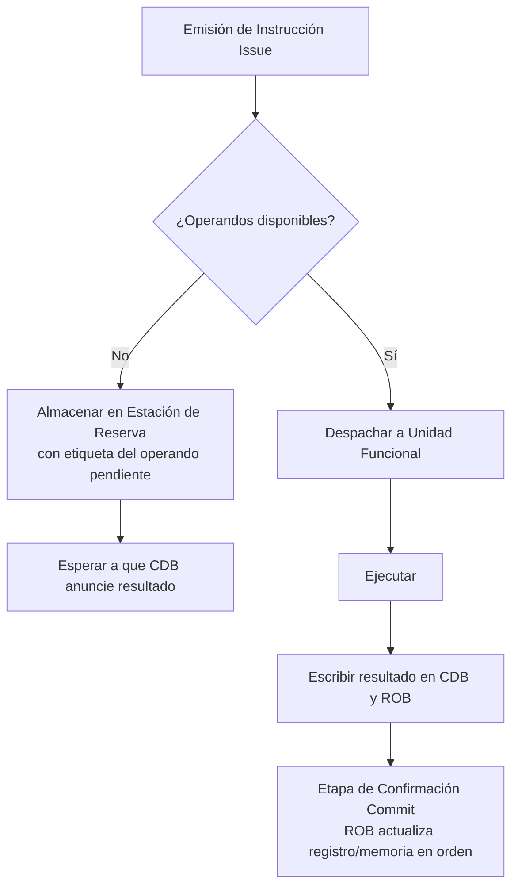

# Organización y Arquitectura de Computadoras - Arquitecturas de vanguardia

## 12.1 Ejecución fuera de orden, despacho dinámico

---

La **Ejecución Fuera de Orden (Out-of-Order Execution, OoO)** es una técnica avanzada de paralelismo a nivel de instrucción (ILP) utilizada en microprocesadores de alto rendimiento para mitigar los efectos de los riesgos de datos y de control. Su objetivo es mantener ocupadas todas las unidades de ejecución de la CPU, incluso cuando las instrucciones posteriores en el flujo del programa están listas para ejecutarse antes que las instrucciones anteriores que están bloqueadas (por ejemplo, esperando una lectura de memoria lenta).

El **Despacho Dinámico** es el mecanismo de hardware que hace posible la ejecución fuera de orden. Se encarga de determinar cuándo una instrucción está realmente lista para ejecutarse (sus operandos están disponibles) y de enviarla a una unidad de ejecución libre.

### Conceptos Fundamentales

#### 1. Arquitectura Base: Ejecución Speculativa

La ejecución fuera de orden suele ir acompañada de **ejecución speculativa**, donde la CPU predice el resultado de una bifurcación (ej. un `if` o un `loop`) y comienza a ejecutar instrucciones por la rama predicha antes de saber con certeza si la predicción fue correcta. Si la predicción es incorrecta, el trabajo speculativo debe ser descartado.

#### 2. El Mecanismo de Tomasulo

El algoritmo de Tomasulo, descrito originalmente para el IBM 360/91, es la base de la mayoría de las implementaciones modernas de despacho dinámico. Su objetivo es minimizar los riesgos de datos (WAR y WAW) mediante el uso de **registros renombrados**.

##### Componentes Clave del Algoritmo de Tomasulo

1.  **Estaciones de Reserva (Reservation Stations):** Son búfers que almacenan las instrucciones que han sido leídas (emitidas) pero que aún no pueden ejecutarse. Cada estación de reserva contiene:
    - La operación a realizar (ej. `ADD`, `LOAD`).
    - Los valores de los operandos, si están disponibles.
    - Etiquetas (Tags) que indican qué unidad funcional producirá el operando, si aún no está disponible.
    - Un campo para la dirección de cálculo efectivo (para accesos a memoria).

2.  **Buffer de Reorden (Reorder Buffer, ROB):** Es una estructura circular que garantiza que la finalización (commit) de las instrucciones se realice en el orden original del programa, manteniendo así la semántica secuencial. Cada entrada en el ROB contiene:
    - El tipo de instrucción.
    - El estado de la instrucción (Ejecutando, Completada, Confirmada).
    - El valor de destino (registro o dirección de memoria).
    - El valor resultante una vez que la instrucción se completa.

3.  **Registro de Archivo (Register File) y Renombrado de Registros:** Para evitar riesgos de escritura-anteproyecto (WAR) y escritura-escritura (WAW), los registros arquitectónicos (los que ve el programador, ej. `R1`, `R2`) se mapean a un conjunto más grande de **registros físicos**. Una instrucción que escribe en `R1` en realidad escribe en un registro físico nuevo, eliminando así las falsas dependencias.

##### Diagrama de Flujo Simplificado (Algoritmo de Tomasulo)



- **CDB (Common Data Bus):** Un bus compartido a través del cual las unidades funcionales anuncian su resultado. Todas las estaciones de reserva escuchan el CDB. Si una estación está esperando un operando con la etiqueta que se anuncia, captura el valor del bus.

#### 3. Proceso de Ejecución de una Instrucción en una CPU OoO

El procesamiento de una instrucción en una microarquitectura OoO moderna se divide en estas etapas:

1.  **Fetch (Captura):** Leer la siguiente instrucción de la memoria/caché de instrucciones. La dirección viene dada por el predictor de saltos.
2.  **Decode/Issue (Decodificación/Emisión):** Decodificar la instrucción y asignarle una entrada en el ROB y una estación de reserva. Se realiza el **renombrado de registros**.
3.  **Dispatch (Despacho):** Una vez que los operandos de origen de la instrucción están disponibles (ya sea en el registro físico o anunciándose en el CDB), la instrucción es **despachada** a la unidad funcional adecuada. Esta es la etapa clave del "despacho dinámico".
4.  **Execute (Ejecución):** La unidad funcional realiza la operación. Esto puede tomar múltiples ciclos.
5.  **Write-back (Escritura):** El resultado se escribe en el CDB y se envía al ROB y a cualquier estación de reserva que lo esté esperando.
6.  **Commit (Confirmación):** Cuando una instrucción llega a la cabeza del ROB y su resultado está listo, se **confirma**: su resultado se escribe permanentemente en el registro arquitectónico o en la memoria. Esto se hace **estrictamente en orden** para garantizar la corrección del programa.

### Ejemplo Ilustrativo

Considera el siguiente fragmento de código ensamblador y un procesador con 1 unidad de enteros, 1 unidad de multiplicación (5 ciclos) y 1 unidad de carga (2 ciclos).

```assembly
LD   F2, 0(R1)    ; Carga el valor de la dirección [R1+0] en F2
MULD F4, F2, F0   ; F4 = F2 * F0 (Multiplicación de punto flotante)
SUBI R1, R1, #8   ; R1 = R1 - 8
BNEZ R1, LOOP     ; Si R1 != 0, salta a LOOP
```

Sin OoO, la multiplicación (`MULD`) tendría que esperar a que la carga (`LD`) termine, bloqueando las instrucciones posteriores (`SUBI`, `BNEZ`), a pesar de que no dependen de la multiplicación.

Con OoO y despacho dinámico:

1.  La instrucción `LD` se emite. Como su operando `R1` está disponible, se despacha de inmediato a la unidad de carga.
2.  La instrucción `MULD` se emite, pero su operando `F2` no está disponible (lo producirá `LD`). Se almacena en una estación de reserva de multiplicación con una etiqueta que apunta al resultado de `LD`.
3.  Las instrucciones `SUBI` y `BNEZ` se emiten. Sus operandos (`R1`) **están disponibles inmediatamente**. No tienen dependencias con `LD` o `MULD`. Por lo tanto, son **despachadas y ejecutadas de inmediato**, mucho antes de que `LD` o `MULD` terminen. Esto es **ejecución fuera de orden**.
4.  Cuando `LD` completa, anuncia el valor de `F2` en el CDB. La estación de reserva de `MULD` captura este valor y, ahora con todos sus operandos, puede ser despachada a la unidad de multiplicación.
5.  Finalmente, `MULD` completa y su resultado se escribe en el ROB. Todas las instrucciones se confirman en orden (`LD`, `MULD`, `SUBI`, `BNEZ`), ocultando por completo el hecho de que `SUBI` y `BNEZ` se ejecutaron antes.

### Fórmulas y Métricas de Desempeño

El beneficio de la ejecución OoO se mide por la mejora en el **CPI (Ciclos Por Instrucción)**.

- **CPI ideal:** Es el CPI mínimo achievable para un programa en una microarquitectura dada, asumiendo que no hay riesgos de ningún tipo ni fallos de caché. Suele ser $\leq 1.$
- **CPI real:** Es el CPI real medido. La diferencia con el CPI ideal se debe a los **riesgos** y **fallos**.

La ejecución OoO reduce el CPI real acercándolo al ideal. La **profundidad del ROB** (número de instrucciones que pueden estar en vuelo simultáneamente) es un factor limitante clave. El paralelismo teórico máximo disponible en un segmento de código se puede aproximar por el **límite de datos** impuesto por el **grafo de dependencias**.

El speedup teórico de usar un ROB más grande (más instrucciones en vuelo) está limitado por el paralelismo disponible en el programa $(PLP):$

$$ \text{Speedup} \leq \min(\text{Número de Unidades Funcionales}, PLP) $$

### Ejercicios Propuestos

1.  **Análisis de Dependencias:** Para el siguiente código, identifica todas las dependencias verdaderas (RAW), antidependencias (WAR) y dependencias de salida (WAW).

    ```assembly
    LD R1, A
    ADD R2, R1, R5
    SUB R3, R1, R6
    MUL R4, R2, R3
    ADD R5, R1, R2 ; ¡Cuidado con esta línea!
    ```

    _¿Cómo resolvería el renombrado de registros las antidependencias y las dependencias de salida?_

2.  **Simulación Mental:** Asume una CPU con 2 unidades de enteros, 1 de carga/almacenamiento y un ROB de 4 entradas. Traza los primeros ciclos de ejecución del código del ejercicio anterior, mostrando el estado de las estaciones de reserva y el ROB en cada ciclo. Asume que una carga tarda 2 ciclos y una multiplicación 3.

3.  **Pregunta Conceptual:** ¿Por qué es absolutamente necesario que la etapa de **confirmación (commit)** se realice en orden estricto, a pesar de que la ejecución es fuera de orden? Explica qué podría salir mal si las instrucciones se confirmaran fuera de orden.

### Código (Simulación Conceptual)

El siguiente pseudocódigo ilustra la lógica del despacho dinámico desde las estaciones de reserva.

```pascal
// Pseudocódigo para la lógica de despacho
for each clock cycle do
    for each reservation station do
        if reservation_station.busy and
           reservation_station.op1_ready and
           reservation_station.op2_ready and
           functional_unit_available then

            // ¡La instrucción está lista para ejecutarse!
            dispatch_instruction(reservation_station)
            reservation_station.busy := false
            mark_functional_unit_busy()
        end if
    end for

    // ... (lógica para escribir resultados en el CDB, etc.)
end for
```

### Referencias

#### Bibliografía Básica

1.  Hennessy, John L. y David A. Patterson. _Computer Architecture: A Quantitative Approach_, 4th Ed. (Capítulo 3 - "Instruction-Level Parallelism and Its Dynamic Exploitation"). **Esta es la referencia principal para este tema.**
2.  Patterson, David A. y John L. Hennessy. _Computer Organization and Design: The Hardware/Software Interface_, 4th Ed. (Apéndice C - "Review of Memory Hierarchy", secciones sobre procesadores avanzados).

#### Bibliografía Complementaria

1.  Stallings, William. _Computer Organization and Architecture: Designing for Performance_ (Capítulo 16 - "Processor Structure and Function").
