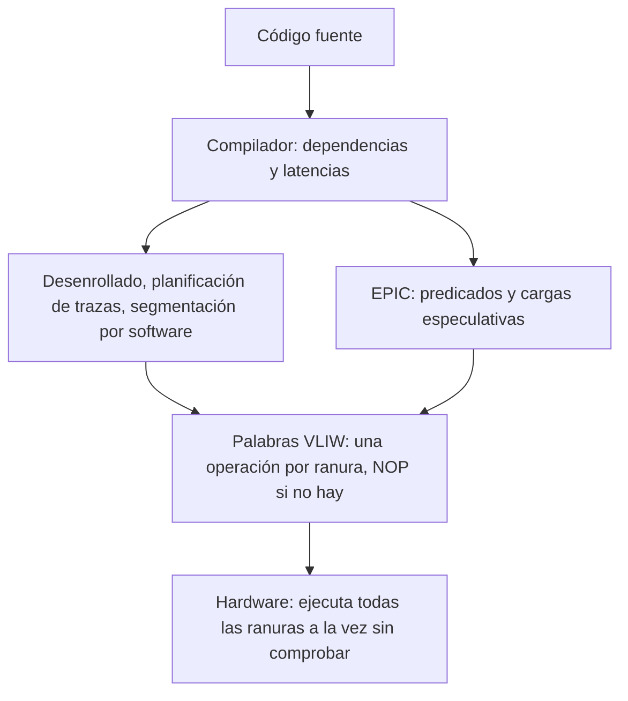

# Organización y Arquitectura de Computadoras - Arquitecturas de vanguardia

## 12.2 Arquitecturas VLIW y EPIC

---

Un procesador superescalar fuera de orden (tema 12.1) descubre el paralelismo a nivel de instrucción **en tiempo de ejecución**, con hardware costoso. La alternativa es que lo descubra el **compilador**: las arquitecturas **VLIW** (_Very Long Instruction Word_) empaquetan en una sola instrucción larga varias operaciones independientes, una por unidad funcional, que el hardware ejecuta en paralelo sin comprobar dependencias. **EPIC** (_Explicitly Parallel Instruction Computing_), la filosofía del Intel Itanium, extendió la idea con predicación, especulación controlada por el compilador y otros mecanismos para superar las debilidades de VLIW. Este tema describe ambos enfoques, la planificación de instrucciones que exigen y sus ventajas e inconvenientes frente a la planificación dinámica.

### VLIW

Una instrucción VLIW tiene una **ranura** fija para cada unidad funcional: por ejemplo, dos operaciones enteras, dos de memoria, dos de punto flotante y un salto. El compilador decide qué operación va en cada ranura de cada ciclo, respetando las dependencias y las latencias de las unidades; si no encuentra operaciones para una ranura, pone un **NOP**.

- El hardware es sencillo: no hay detección de riesgos, renombrado ni estaciones de reserva, y la emisión de muchas operaciones por ciclo no cuesta más lógica de control.
- El compilador necesita mucho paralelismo para llenar las ranuras. Lo encuentra con **desenrollado de bucles**, **segmentación por software** (tema 12.3) y **planificación de trazas** (mover operaciones a través de saltos a lo largo del camino más probable).

**Planificación de listas.** El algoritmo básico recorre las operaciones en orden de prioridad (por ejemplo, la longitud del camino crítico) y coloca cada una en el primer ciclo en que sus operandos estarán listos y hay una ranura libre de su tipo.

### Problemas de VLIW

- **Tamaño del código:** las ranuras vacías ocupan espacio. Se mitiga con formatos comprimidos que no guardan los NOP.
- **Compatibilidad binaria:** el código está ligado al número de unidades y a sus latencias; una nueva generación con más unidades o latencias distintas requiere recompilar.
- **Latencias impredecibles:** un fallo de caché dura un tiempo que el compilador no conoce; como el hardware no planifica, todo el procesador se detiene.
- **Saltos:** el código entre saltos tiene poco paralelismo, y mover operaciones a través de ellos requiere código de compensación.

VLIW triunfó en los **procesadores digitales de señales** (DSP, como la familia TMS320C6000 de Texas Instruments) y en aceleradores, donde el código es regular, las latencias predecibles y la compatibilidad binaria importa poco.

### EPIC

EPIC (Intel y HP, Itanium, 2001) agrupó las operaciones en **paquetes** de 128 bits con tres operaciones y una **plantilla** que indica el tipo de unidad de cada una y dónde termina un grupo de operaciones independientes, de modo que el paralelismo no depende del número exacto de unidades. Añadió:

- **Predicación completa:** casi cualquier instrucción lleva un registro de predicado de 1 bit (había 64) y solo modifica el estado si el predicado es verdadero. Permite eliminar saltos (tema 12.3).
- **Especulación de control y de datos explícita:** cargas especulativas que pueden subirse por encima de un salto o de un almacenamiento, con instrucciones de comprobación que repiten el trabajo si la especulación falla.
- **Muchos registros** (128 enteros y 128 de punto flotante) y **registros rotatorios** para la segmentación por software.

Itanium no logró desplazar a x86: los compiladores no encontraban suficiente paralelismo en programas de propósito general, los fallos de caché impredecibles lo penalizaban, y los x86 fuera de orden avanzaron más rápido. Se dejó de fabricar en 2021. Sus ideas sobreviven en los DSP y en los aceleradores de aprendizaje automático.

| Aspecto | VLIW y EPIC | Superescalar fuera de orden |
| --- | --- | --- |
| quién encuentra el paralelismo | el compilador | el hardware, en ejecución |
| complejidad del hardware | baja | alta |
| energía de control | baja | alta |
| adaptación a latencias variables | mala | buena |
| compatibilidad entre generaciones | difícil | total |
| tamaño de código | mayor | menor |



### Implementación en Python

El programa implementa un planificador de listas para una VLIW con una ranura de memoria, una entera y una de salto, lo aplica al bucle del ejercicio 1 y a la versión desenrollada dos veces, comprueba que la versión predicada del ejercicio 2 equivale al `if` original y compara el tamaño del código.

```python
# Planificación de listas para una VLIW con una ranura de memoria, una entera y una de salto (latencia 1)
UNIDAD = {"LD": "mem", "ST": "mem", "ADD": "ent", "SUBI": "ent", "BNZ": "salto"}
RANURAS = ["mem", "ent", "salto"]


def planificar(instr):
    """instr: lista de (texto, op, destino, fuentes). El salto va en la última palabra."""
    listo_en = {}
    ciclo_de = []
    palabras = {}
    for k, (texto, op, d, fs) in enumerate(instr):
        c = max([1] + [listo_en[f] for f in fs if f in listo_en])
        if op == "BNZ":
            c = max([c] + ciclo_de)              # el salto no puede adelantarse a nada del bucle
        while palabras.get(c, {}).get(UNIDAD[op]):
            c += 1
        palabras.setdefault(c, {})[UNIDAD[op]] = texto
        ciclo_de.append(c)
        if d:
            listo_en[d] = c + 1                  # latencia 1
    return palabras


def mostrar(palabras, titulo):
    n = max(palabras)
    usadas = sum(len(p) for p in palabras.values())
    print(f"{titulo}: {n} palabras, {usadas} de {3 * n} ranuras útiles ({usadas / (3 * n):.0%})")
    for c in range(1, n + 1):
        print((f"   {c}: " + " | ".join(f"{palabras.get(c, {}).get(r, 'NOP'):15s}" for r in RANURAS)).rstrip())


cuerpo = [("LD R2, A", "LD", "R2", []), ("ADD R3, R2, R1", "ADD", "R3", ["R2", "R1"]),
          ("ST B, R3", "ST", None, ["R3"]), ("SUBI R4, R4, #1", "SUBI", "R4", ["R4"]),
          ("BNZ R4, LOOP", "BNZ", None, ["R4"])]
mostrar(planificar(cuerpo), "ejercicio 1")

# Desenrollado 2 veces con registros renombrados por el compilador
desenrollado = [("LD R2, A", "LD", "R2", []), ("LD R5, A+4", "LD", "R5", []),
                ("ADD R3, R2, R1", "ADD", "R3", ["R2", "R1"]), ("ADD R6, R5, R1", "ADD", "R6", ["R5", "R1"]),
                ("ST B, R3", "ST", None, ["R3"]), ("ST B+4, R6", "ST", None, ["R6"]),
                ("SUBI R4, R4, #2", "SUBI", "R4", ["R4"]), ("BNZ R4, LOOP", "BNZ", None, ["R4"])]
mostrar(planificar(desenrollado), "desenrollado x2")


# Ejercicio 2: predicación. Ambas ramas se ejecutan; cada instrucción solo escribe si su predicado es verdadero
def predicado(x, y, z):
    p1 = (x == 0)          # CMP.EQ p1, p2 = x, 0
    p2 = not p1
    if p1: y = y + 1       # (p1) ADD y = y, 1
    if p1: z = 0           # (p1) MOV z = 0
    if p2: y = y - 1       # (p2) SUB y = y, 1
    return y, z


def original(x, y, z):
    if x == 0:
        y, z = y + 1, 0
    else:
        y = y - 1
    return y, z


casos = [(0, 5, 9), (3, 5, 9), (-1, 0, 0)]
print("ejercicio 2, predicación equivalente al if:", all(predicado(*c) == original(*c) for c in casos),
      [predicado(*c) for c in casos])

# Tamaño de código: palabras VLIW de 3 x 32 bits frente a código RISC de 32 bits
for nombre, p, n_instr in (("sin desenrollar", planificar(cuerpo), 5), ("desenrollado", planificar(desenrollado), 8)):
    print(f"código {nombre:15s}: VLIW {max(p) * 12} bytes, RISC {n_instr * 4} bytes"
          f" (iteraciones por pasada: {1 if n_instr == 5 else 2})")
```

Salida:

```text
ejercicio 1: 3 palabras, 5 de 9 ranuras útiles (56%)
   1: LD R2, A        | SUBI R4, R4, #1 | NOP
   2: NOP             | ADD R3, R2, R1  | NOP
   3: ST B, R3        | NOP             | BNZ R4, LOOP
desenrollado x2: 4 palabras, 8 de 12 ranuras útiles (67%)
   1: LD R2, A        | SUBI R4, R4, #2 | NOP
   2: LD R5, A+4      | ADD R3, R2, R1  | NOP
   3: ST B, R3        | ADD R6, R5, R1  | NOP
   4: ST B+4, R6      | NOP             | BNZ R4, LOOP
ejercicio 2, predicación equivalente al if: True [(6, 0), (4, 9), (-1, 0)]
código sin desenrollar: VLIW 36 bytes, RISC 20 bytes (iteraciones por pasada: 1)
código desenrollado   : VLIW 48 bytes, RISC 32 bytes (iteraciones por pasada: 2)
```

Desenrollando dos veces, el bucle procesa dos elementos en 4 ciclos en lugar de uno en 3, y aprovecha más ranuras; a cambio, el código ocupa más.

### Ejercicios Propuestos

1. **Planificación.** En una VLIW con una unidad entera, una de memoria y una de salto, todas de latencia 1, planifica el bucle:

   ```asm
   LOOP: LD   R2, A
         ADD  R3, R2, R1
         ST   B, R3
         SUBI R4, R4, #1
         BNZ  R4, LOOP
   ```

   ¿Cuántos ciclos y palabras se necesitan?

2. **Predicación.** Convierte en instrucciones predicadas, con los predicados `p1` y `p2`:

   ```c
   if (x == 0) { y = y + 1; z = 0; } else { y = y - 1; }
   ```

3. **Por qué predicar.** ¿Por qué la predicación es tan importante en VLIW y EPIC?

4. **Compatibilidad.** ¿Qué ocurriría al ejecutar el código del ejercicio 1 en una versión de la máquina cuyas cargas tardan 2 ciclos?

### Soluciones

**Ejercicio 1.** 3 palabras (3 ciclos), con 5 de 9 ranuras útiles: en el ciclo 1, `LD` y `SUBI`; en el 2, `ADD` (que necesita `R2`); en el 3, `ST` (que necesita `R3`) y el salto, que debe ir al final del cuerpo. Sin VLIW, una máquina escalar necesitaría al menos 5 ciclos.

**Ejercicio 2.**

```asm
      CMP.EQ p1, p2 = x, 0    ; p1 = (x == 0), p2 = no p1
(p1)  ADD    y = y, 1
(p1)  MOV    z = 0
(p2)  SUB    y = y, 1
```

Las cuatro instrucciones no tienen saltos; las tres últimas pueden ir en la misma palabra si hay unidades, porque las que escriben `y` tienen predicados excluyentes. El programa comprueba que el resultado coincide con el `if`.

**Ejercicio 3.** Los saltos dividen el código en bloques pequeños con poco paralelismo, y un salto mal predicho en un procesador sin planificación dinámica cuesta muchas ranuras vacías. La predicación convierte la dependencia de control en una dependencia de datos con el predicado: el compilador obtiene un bloque más grande que puede planificar libremente y desaparece la penalización por predicción incorrecta, a costa de ejecutar las operaciones de ambas ramas.

**Ejercicio 4.** El `ADD` del ciclo 2 leería `R2` antes de que la carga terminara, y obtendría un valor equivocado, porque el hardware VLIW no comprueba dependencias. Habría que recompilar con la nueva latencia, o el hardware tendría que detenerse ante operandos no listos (como hacen muchas VLIW con interbloqueos para las cargas), perdiendo parte de la sencillez.

### Referencias

1. Hennessy, J. L., and Patterson, D. A., _Computer Architecture: A Quantitative Approach_. Morgan Kaufmann, 2019. Sección 3.7 y apéndice H.
2. Fisher, J. A., Very long instruction word architectures and the ELI-512. _ISCA_, 1983.
3. Schlansker, M. S., and Rau, B. R., EPIC: explicitly parallel instruction computing. _IEEE Computer_ 33(2), 2000.
4. Fisher, J. A., Faraboschi, P., and Young, C., _Embedded Computing: A VLIW Approach to Architecture, Compilers and Tools_. Morgan Kaufmann, 2005.
