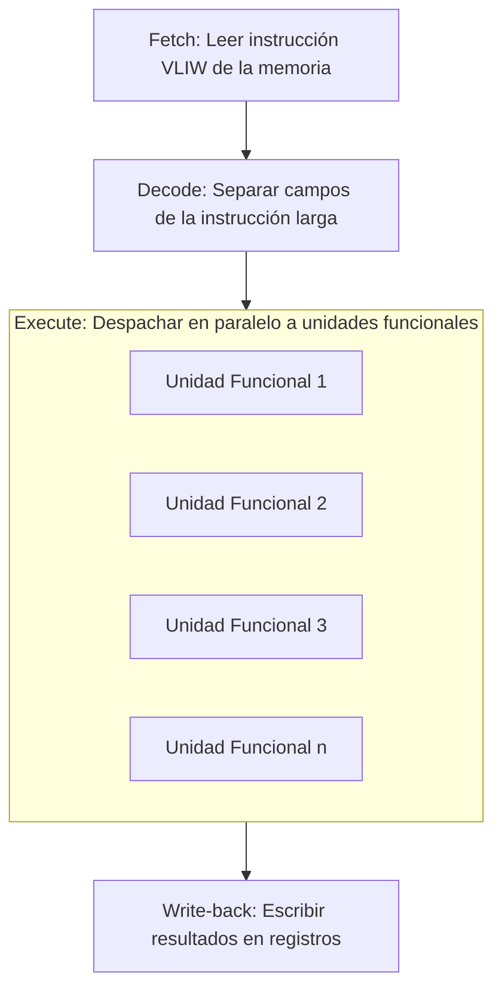

# Organización y Arquitectura de Computadoras - Arquitecturas de vanguardia

## 12.2 Arquitecturas VLIW y EPIC

---

### Introducción: Paralelismo a Nivel de Instrucción (ILP)

Las arquitecturas **VLIW (Very Long Instruction Word - Palabra de Instrucción Muy Larga)** y **EPIC (Explicitly Parallel Instruction Computing - Computación de Instrucciones Explícitamente Paralelas)** representan un enfoque radicalmente diferente para explotar el Paralelismo a Nivel de Instrucción (ILP) comparedo con las técnicas de ejecución fuera de orden (OoO).

Mientras que OoO depende de hardware complejo y costoso para descubrir y gestionar el paralelismo de forma dinámica durante la ejecución, VLIW y EPIC delegan esta responsabilidad al **compilador**. El compilador analiza el programa, encuentra las instrucciones que se pueden ejecutar en paralelo y las empaqueta explícitamente en una única instrucción larga.

### Arquitectura VLIW (Very Long Instruction Word)

#### Definición y Concepto Fundamental

Una arquitectura **VLIW** es un diseño de procesador en el que una única instrucción ("palabra muy larga") contiene múltiples **operaciones independientes** que deben ser ejecutadas en paralelo por las unidades funcionales de la CPU.

El compilador crea un **código estáticamente programado** donde las dependencias, los riesgos y la planificación de las unidades funcionales se resuelven en tiempo de compilación, no en tiempo de ejecución.

#### Estructura de una Instrucción VLIW

Una palabra de instrucción VLIW está dividida en varios **campos** o **slots**. Cada slot corresponde a una unidad funcional específica en el hardware (ALU, FPU, unidad de carga/almacenamiento, unidad de salto).

$$
\text{Instrucción VLIW} = [\text{Opcode}_1\ \text{Opcode}_2\ \ldots\ \text{Opcode}_n]
$$

Cada $\text{Opcode}_i$ es una operación completa para una unidad funcional. Si no hay una operación para llenar un slot, el compilador debe insertar una operación de **no-op** ( $\text{NOP}$ ), lo que puede llevar a una expansión significativa del código.

#### Diagrama de un Ciclo de Ejecución VLIW



#### Ventajas y Desventajas de VLIW

| Ventajas                                                                                                                                                                | Desventajas                                                                                                                                                                   |
| :---------------------------------------------------------------------------------------------------------------------------------------------------------------------- | :---------------------------------------------------------------------------------------------------------------------------------------------------------------------------- |
| ✔️ **Hardware más simple y barato:** Elimina la necesidad de hardware complejo para planificación dinámica (e.g., estaciones de reserva, ROB, renombrado de registros). | (X) **Código de tamaño grande:** La necesidad de rellenar con NOPs infla el tamaño del binario.                                                                               |
| ✔️ **Potencial de mayor eficiencia energética:** Menor lógica de control y circuitería.                                                                                 | (X) **Pobre portabilidad de código binario:** El código está ligado a la **latencia exacta** de las unidades funcionales y al layout de slots de una máquina específica.      |
| ✔️ **Ancho de banda predecible:** El compilador conoce el patrón de uso de las unidades funcionales.                                                                    | (X) **Dificultad del compilador:** La responsabilidad de encontrar ILP recae totalmente en el compilador, que es un problema NP-difícil.                                      |
|                                                                                                                                                                         | (X) **Manejo pobre de imprevistos:** Las cachés misses o las latencias variables (e.g., acceso a memoria) pueden desbaratar el schedule estático, dejando unidades inactivas. |

### Arquitectura EPIC (Explicitly Parallel Instruction Computing)

#### Definición y Evolución desde VLIW

**EPIC** es una evolución de los conceptos VLIW, impulsada principalmente por Intel e HP con la arquitectura **IA-64 (Itanium)**. EPIC mantiene la filosofía de que el compilador exponga el paralelismo, pero añade características para mitigar las principales desventajas de VLIW puro.

#### Características Clave de EPIC

1.  **Instrucciones Empaquetadas (Bundle):** Similar a VLIW, las instrucciones se agrupan en paquetes. Un paquete típico de IA-64 contiene tres instrucciones más un **template** que define las dependencias entre las instrucciones dentro del mismo paquete y con el paquete siguiente.

2.  **Registros Rotatorios:** Una gran cantidad de registros físicos (128 en Itanium) que pueden ser "rotados" para permitir el despliegue eficiente de bucles. Esto elimina la necesidad de renombrar registros por hardware y permite al compilador programar múltiples iteraciones de un bucle en paralelo (**software pipelining**).

3.  **Ejecución Speculativa y Predicación:** Características cruciales de EPIC.
    - **Predicación:** Casi todas las instrucciones son **predicadas**. Cada instrucción tiene un registro predicado como operando. Solo se ejecuta si el valor del predicado es verdadero. Esto permite eliminar branches (ramificaciones) convirtiendo los saltos en ejecución condicional de ambas ramas, lo que es ideal para mantener el pipeline lleno.
      ```cpp
      // Código C tradicional
      if (a > b) {
          x = 10;
      } else {
          x = 20;
      }

      // Equivalente predicado (pseudocódigo)
      p1 = (a > b)  // Comparación define el valor del registro predicado p1
      p2 = !p1      // p2 es la condición opuesta a p1

      (p1) x = 10;  // Esta instrucción se ejecuta solo si p1 es true
      (p2) x = 20;  // Esta instrucción se ejecuta solo si p2 es true
      ```
    - **Speculación:** Instrucciones de carga (**load**) pueden ser marcadas como "avanzadas" para traer datos de la memoria antes de que se necesiten, escondiendo la latencia.

#### Ejemplo de Bundle EPIC (IA-64)

Un bundle en IA-64 tiene 128 bits y contiene tres instrucciones de 41 bits y un campo de template de 5 bits.

```
| Instr 1 (41 bits) | Instr 2 (41 bits) | Instr 3 (41 bits) | Template (5 bits) |
```

El campo **Template** es crucial: le indica al hardware qué unidades funcionales puede usar cada instrucción y si existe una **parada** (stop) entre este bundle y el siguiente (es decir, si hay dependencias de datos entre bundles que impiden su ejecución en paralelo).

### Comparativa: VLIW/EPIC vs. Superscalar OoO

| Característica                 | Superscalar con OoO                                    | VLIW / EPIC                                                                  |
| :----------------------------- | :----------------------------------------------------- | :--------------------------------------------------------------------------- |
| **Detección de paralelismo**   | Dinámica (por hardware en ejecución)                   | Estática (por compilador)                                                    |
| **Planificación (Scheduling)** | Dinámica (hardware complejo)                           | Estática (compilador)                                                        |
| **Hardware**                   | Muy complejo, grande y consume mucha energía           | Más simple, más pequeño y eficiente                                          |
| **Flexibilidad**               | Alta, se adapta a dinámicas de ejecución imprevisibles | Baja, el schedule es fijo. Pobre con caminos de ejecución impredecibles.     |
| **Portabilidad binaria**       | Alta (ISA independiente de la microarquitectura)       | Muy baja (binario específico para una configuración de unidades funcionales) |

### Ejercicios Propuestos

1.  **Scheduling VLIW:** Dado el siguiente fragmento de código secuencial y una máquina VLIW hipotética con 1 unidad de enteros, 1 unidad de memoria y 1 unidad de salto (todas con latencia de 1 ciclo), encuentra el schedule de instrucciones para rellenar las palabras VLIW. ¿Cuántos ciclos y cuántas palabras VLIW (incluyendo NOPs) se necesitan?

    ```
    LD R2, A
    ADD R3, R2, R1
    ST B, R3
    SUBI R4, R4, #1
    BNZ R4, LOOP
    ```

2.  **Predicación:** Convierte el siguiente código condicional en una secuencia de instrucciones predicadas. Asume que tienes registros predicados `p1` y `p2` disponibles.

    ```c
    if (x == 0) {
        y = y + 1;
        z = 0;
    } else {
        y = y - 1;
    }
    ```

3.  **Pregunta Conceptual:** Explica por qué la característica de **predicación** en EPIC es tan importante para mitigar una de las grandes desventajas de los diseños VLIW/EPIC: los riesgos de control derivados de los branches (saltos condicionales).

### Referencias

#### Bibliografía Básica

1.  **Hennessy y Patterson, Computer Architecture: A Quantitative Approach, 4th Ed.** (Capítulo 4 - "Data-Level Parallelism" y Apéndice H - "Computer Arithmetic by David Goldberg"). Este texto discute los límites de ILP y las alternativas arquitectónicas.
2.  **Patterson y Hennessy, Computer Organization and Design: The Hardware/Software Interface, 4th Ed.** (Capítulo 4 - "The Processor", secciones sobre avances y limitaciones). Ofrece una comparativa entre enfoques.

#### Bibliografía Complementaria

1.  **Stallings, William, Computer Organization and Architecture: Designing for Performance** (Capítulo 16 - "Processor Structure and Function"). Incluye secciones sobre procesadores RISC, CISC y VLIW.
2.  **Tanenbaum, Andrew S., Structured Computer Organization, 5th Ed.** (Capítulo 4 - "The Microarchitecture Level"). Proporciona una visión general de diferentes diseños de microarquitectura.
