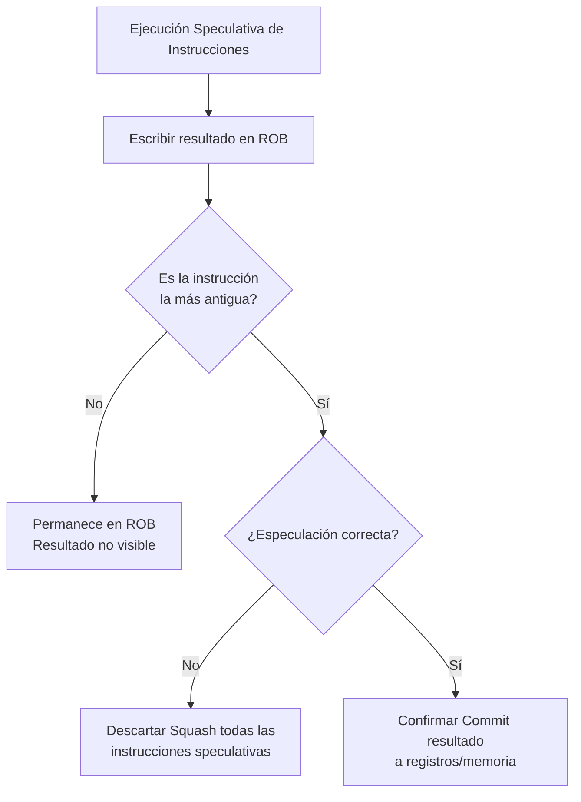

# Organización y Arquitectura de Computadoras - Arquitecturas de vanguardia

## 12.3 Especulación, predicación, soporte para software pipeline

---

Las técnicas de **Especulación** y **Predicación** son mecanismos hardware y software avanzados para explotar el Paralelismo a Nivel de Instrucción (ILP) al lidiar con los principales obstáculos: los riesgos de control (saltos condicionales) y los riesgos de datos (dependencias). El **Software Pipelining** es una técnica de compilación que reorganiza los bucles para explotar el paralelismo entre iteraciones, requiriendo soporte arquitectónico específico.

### 1. Especulación

#### Definición

La **especulación** es una técnica que permite ejecutar instrucciones antes de saber si realmente deben ser ejecutadas. Su objetivo es evitar que el pipeline se detenga, manteniendo las unidades funcionales ocupadas con trabajo que, con alta probabilidad, será útil.

#### Tipos de Especulación

1.  **Especulación de Control (Control Speculation):**
    - Se utiliza para **riesgos de control**. La CPU **predice la dirección de un salto** (branch prediction) y comienza a buscar, decodificar y ejecutar instrucciones por la rama predicha.
    - Si la predicción es correcta, se gana un gran rendimiento. Si es incorrecta, el trabajo speculativo debe ser **descartado** (flushing del pipeline), incurriendo en una penalización.

2.  **Especulación de Datos (Data Speculation):**
    - Se utiliza para **riesgos de datos**, particularmente dependencias de memoria (dependencias entre load y store cuya dirección no se conoce con certeza).
    - La CPU puede **asumir que un load no depende de un store anterior** y cargar el dato speculativamente. Esto se conoce como _load speculation_ o _memory disambiguation_.
    - Si se descubre un error (el load dependía del store), la carga speculativa y sus dependientes deben ser anuladas.

#### Mecanismo de Recuperación: El Buffer de Reorden (ROB)

La ejecución speculativa requiere un mecanismo para **confirmar (commit)** o **descartar (squash)** los resultados de forma ordenada. El **Buffer de Reorden (Reorder Buffer - ROB)** es la estructura clave que hace esto posible.

- Las instrucciones se ejecutan de manera speculativa y escriben sus resultados en el ROB.
- Solo cuando una instrucción llega a la cabeza del ROB y se confirma que no es speculativa (ej., un salto previo se resolvió correctamente), su resultado se hace visible y permanente (se escribe en el registro arquitectónico o memoria).
- Si se detecta una mala especulación, todas las instrucciones speculativas posteriores al punto del error son marcadas como inválidas en el ROB y sus resultados son descartados.



### 2. Predicación (Predication)

#### Definición

La **predicación** es una técnica que **convierte un riesgo de control en un riesgo de datos**. En lugar de tener dos caminos de ejecución separados por un salto condicional, ambas ramas del `if` se convierten en instrucciones predicadas que se ejecutan condicionalmente en base al valor de un **registro predicado**.

#### Cómo Funciona

1.  Una instrucción de comparación (`CMP`) calcula una condición (ej., `R1 == R2`) y establece el valor de uno o más **registros predicado** (`P1`, `P2`, ...).
2.  Las instrucciones en las ramas del `if` y `else` se convierten en instrucciones predicadas. Cada instrucción tiene un registro predicado como operando adicional.
3.  **Solo se ejecutan** las instrucciones cuyo registro predicado sea VERDADERO. Las instrucciones con predicado FALSO se convierten en efectivamente en **NOPs** (operaciones de no-op) y no modifican el estado arquitectónico.
4.  El flujo de instrucciones es lineal y secuencial, eliminando el salto y, por lo tanto, el riesgo de control.

#### Ejemplo

Código original con salto:

```asm
    CMP R1, R2
    BNE ELSE
    ADD R3, R4, #1  ; Rama THEN
    B ENDIF
ELSE:
    SUB R3, R4, #1  ; Rama ELSE
ENDIF:
    ...
```

Código equivalente con predicación (ej., ARM AArch64, IA-64):

```asm
    CMP   R1, R2       ; Compara R1 y R2
    CSET  P1, EQ       ; P1 = 1 si son iguales (EQ), 0 en otro caso
    CSET  P2, NE       ; P2 = 1 si no son iguales (NE), 0 en otro caso (P2 = !P1)

(P1) ADD R3, R4, #1   ; Se ejecuta solo si P1 es verdadero
(P2) SUB R3, R4, #1   ; Se ejecuta solo si P2 es verdadero
```

#### Ventajas y Desventajas

| Ventajas                                                              | Desventajas                                                                                                     |
| :-------------------------------------------------------------------- | :-------------------------------------------------------------------------------------------------------------- |
| ✔️ Elimina los saltos y sus penalizaciones por predicción incorrecta. | (X) **Ejecuta más instrucciones:** Siempre se ejecutan ambas ramas (aunque los resultados de una se descarten). |
| ✔️ Simplifica el hardware de predicción de saltos.                    | (X) **Desperdicia recursos de ejecución:** Ciclos y energía en instrucciones que no se necesitan.               |
| ✔️ Es muy efectiva cuando las ramas del `if` son cortas.              | (X) **Puede introducir falsas dependencias** a través de los registros predicados.                              |

### 3. Software Pipelining

#### Definición

El **Software Pipelining** es una técnica de compilación de bucles que solapa la ejecución de múltiples iteraciones de un bucle, análogo a cómo el hardware pipeline solapa las etapas de una instrucción. El compilador reorganiza el código del bucle para explotar el paralelismo entre iteraciones.

#### Ejemplo Conceptual

Considera un bucle donde cada iteración `i` tiene tres etapas: `A[i]`, `B[i]`, `C[i]`.

**Código original:**

```
Iteración i:   A[i] -> B[i] -> C[i]
Iteración i+1: A[i+1] -> B[i+1] -> C[i+1]
```

**Con Software Pipelining:**

```
Ciclo 1: A[i]
Ciclo 2: B[i]   A[i+1]
Ciclo 3: C[i]   B[i+1]   A[i+2]
Ciclo 4:        C[i+1]   B[i+2]   A[i+3]
Ciclo 5:                C[i+2]   B[i+3]
```

Este patrón de ejecución se conoce como **kernel steady-state** (núcleo de estado estable).

#### Soporte Arquitectónico: Registros Rotatorios

Implementar Software Pipelining de manera eficiente requiere muchos registros y una forma de evitar escribir sobre los registros de una iteración anterior que aún se están usando. Las arquitecturas como **IA-64 (EPIC)** introdujeron **registros rotatorios** para este propósito.

- Se dispone de un gran banco de registros físicos (ej., 128 registros).
- El compilador asigna registros lógicos para una iteración.
- Al inicio de cada nueva iteración, el hardware "rota" la asignación de registros: el registro físico `PRi` se mapea al registro lógico `PR((i+1) mod N)`.
- Esto permite que la iteración `i+1` use registros "nuevos" automáticamente, sin sobreescribir los valores que la iteración `i` aún necesita, eliminando la necesidad de renombrado de registros por hardware y permitiendo un despliegue muy eficiente del bucle.

### Ejercicios Propuestos

1.  **Predicación vs. Especulación:** Para el siguiente código, muestra cómo se transformaría usando (a) predicación y (b) cómo lo manejaría un procesador con ejecución speculativa y predicción de saltos. Asume que la predicción es "no tomado".

    ```c
    if (a != 0) {
        b = c / a;
    } else {
        b = d + 1;
    }
    ```

2.  **Software Pipelining:** Dado el bucle `for (i=0; i<n; i++) { A[i] = B[i] * c + K; }`, descompón la operación dentro del bucle en 3 etapas (LOAD B[i], MULT * c, ADD +K / STORE A[i]). Dibuja un diagrama de cómo se solaparían 4 iteraciones del bucle aplicando Software Pipelining. ¿Cuántos ciclos se ahorran respecto a la ejecución secuencial para `n=100`?

3.  **Pregunta Conceptual:** Explica por qué la técnica de **predicación** es más adecuada para arquitecturas VLIW/EPIC, mientras que la **especulación** es el pilar de las arquitecturas superscalares con ejecución fuera de orden.

### Fórmula de Speedup

El speedup potencial de usar Software Pipelining para un bucle con $k$ etapas y $n$ iteraciones grandes se puede aproximar por la reducción en el número de ciclos. Sin pipeline, los ciclos son aproximadamente $n \times k$. Con pipeline, los ciclos son $n + k - 1$ (etapa de llenado + estado estable + etapa de vaciado).

El speedup $S$ es:

$$
S = \frac{n \times k}{n + k - 1}
$$

Para $n \gg k$, $S \approx k$, lo que significa una aceleración lineal con el número de etapas paralelizables.

### Referencias

#### Bibliografía Básica

1.  **Hennessy y Patterson, Computer Architecture: A Quantitative Approach, 4th Ed.** (Capítulo 3 - "Instruction-Level Parallelism and Its Dynamic Exploitation"). Cubre especulación y predicación de saltos en profundidad.
2.  **Patterson y Hennessy, Computer Organization and Design: The Hardware/Software Interface, 4th Ed.** (Capítulo 4 - "The Processor"). Explica los riesgos de control y las técnicas básicas de manejo.

#### Bibliografía Complementaria

1.  **Stallings, William, Computer Organization and Architecture: Designing for Performance** (Capítulo 16 - "Processor Structure and Function"). Aborda conceptos de pipeline avanzado.
2.  **Tanenbaum, Andrew S., Structured Computer Organization, 5th Ed.** (Capítulo 4 - "The Microarchitecture Level"). Ofrece una visión general de las técnicas de mejora del pipeline.
