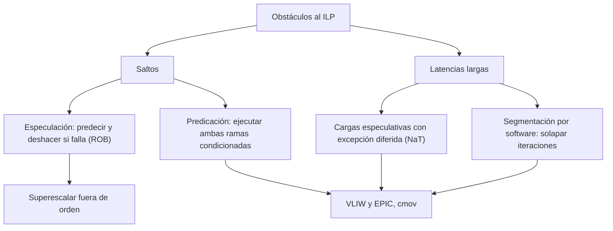

# Organización y Arquitectura de Computadoras - Arquitecturas de vanguardia

## 12.3 Especulación, predicación, soporte para software pipeline

---

Los saltos y las latencias largas son los dos grandes obstáculos para explotar el paralelismo a nivel de instrucción. Este tema estudia tres técnicas para superarlos. La **especulación** ejecuta instrucciones antes de saber si deben ejecutarse, apostando por el resultado de un salto o por la independencia de dos accesos a memoria, y deshace el trabajo si la apuesta falla. La **predicación** elimina los saltos ejecutando ambos caminos con instrucciones condicionadas. La **segmentación por software** reorganiza los bucles para que iteraciones distintas se solapen, como en una segmentación hecha por el compilador. Se verá qué soporte necesita cada una del hardware y del conjunto de instrucciones.

### Especulación

**Especulación de control en hardware.** Un procesador fuera de orden predice cada salto (tema 7.4) y sigue buscando, emitiendo y ejecutando instrucciones del camino predicho. Esas instrucciones son **especulativas**: sus resultados quedan en el ROB (tema 12.1) y solo se confirman cuando el salto se resuelve a su favor. Si la predicción falla, se descartan todas las instrucciones posteriores al salto y se reanuda por el camino correcto. Las excepciones de las instrucciones especulativas tampoco se atienden hasta su confirmación: si estaban en el camino equivocado, nunca ocurren.

**Especulación de datos.** Una carga puede ejecutarse antes que un almacenamiento anterior cuya dirección aún no se conoce, apostando a que no coinciden. Si al calcular la dirección del almacenamiento resulta que sí, la carga y las instrucciones que usaron su valor se vuelven a ejecutar. Los procesadores modernos usan predictores de dependencias de memoria para decidir cuándo apostar.

**Especulación por el compilador** (EPIC). El compilador puede subir una carga por encima de un salto para ocultar su latencia, pero si la carga fallara (por ejemplo, un puntero nulo en el camino que no se toma) produciría una excepción que el programa original no tenía. La solución de Itanium es la **excepción diferida**: la carga especulativa (`ld.s`) no lanza la excepción, sino que marca el registro destino con un bit **NaT** (_Not a Thing_), que se propaga a los resultados que lo usan; en el punto original de la carga, una instrucción de comprobación (`chk.s`) salta a código de recuperación si el registro es NaT.

**El costo de especular:** energía gastada en instrucciones que se descartan y, como mostraron los ataques **Spectre** y **Meltdown** (2018), efectos observables de la ejecución especulativa en las cachés que pueden filtrar información.

### Predicación

Una instrucción **predicada** lleva un registro de predicado (un bit) y solo modifica el estado si el predicado es verdadero; si es falso, se comporta como un NOP (y no produce excepciones). Un `if` se convierte en una comparación que fija dos predicados complementarios y las instrucciones de ambas ramas, cada una con su predicado: la **conversión de saltos** (_if-conversion_).

- **Ventajas:** desaparecen el salto y sus fallos de predicción; el compilador obtiene un bloque más grande para planificar.
- **Desventajas:** siempre se ejecutan las instrucciones de ambas ramas, y la duración depende de la rama más larga.

Conviene para ramas cortas y **difíciles de predecir**. La forma limitada que tienen casi todas las ISA es el **movimiento condicional** (`cmov` en x86, `csel` en ARM, `movz`/`movn` en MIPS), que elige entre dos valores sin saltar.

### Segmentación por software

En un bucle cuyo cuerpo tiene una cadena de dependencias (cargar, operar, almacenar), cada iteración tiene poco paralelismo, pero iteraciones distintas son independientes. La **segmentación por software** (_software pipelining_) reorganiza el bucle para que cada vuelta del nuevo cuerpo ejecute etapas de iteraciones **distintas**: el almacenamiento de la iteración $i,$ la operación de la $i + 1$ y la carga de la $i + 2.$ Necesita:

- un **prólogo** que inicia las primeras iteraciones y un **epílogo** que termina las últimas;
- registros distintos para los valores de iteraciones que están en vuelo a la vez. Itanium tiene **registros rotatorios**, que se renombran automáticamente en cada vuelta, y predicados que activan o desactivan etapas para eliminar el prólogo y el epílogo explícitos.

Con $k$ etapas de un ciclo y $n$ iteraciones, la ejecución secuencial tarda $k n$ ciclos y la segmentada $n + k - 1:$ la misma fórmula de la segmentación del hardware (tema 7.1). A diferencia del desenrollado, no multiplica el tamaño del cuerpo, y las dos técnicas se combinan.



### Implementación en Python

El programa construye el calendario de la segmentación por software del ejercicio 2 y cuenta los ciclos, compara con un modelo sencillo el costo de la predicción de saltos (1 ciclo por instrucción y 10 por fallo, prediciendo "no tomado") frente a la predicación para el ejercicio 1 según cuán predecible es el salto, y simula una carga especulativa con excepción diferida.

```python
import random

# Ejercicio 2: segmentación por software de A[i] = B[i] * c + K con 3 etapas de un ciclo
ETAPAS = ["LD B[i]", "MUL *c", "ADD+ST"]


def calendario(n, segmentado):
    filas = {}
    for i in range(n):
        inicio = i if segmentado else 3 * i
        for e in range(3):
            filas.setdefault(inicio + e, []).append(f"{ETAPAS[e]}({i})")
    return filas


f = calendario(4, True)
print("ejercicio 2, 4 iteraciones segmentadas por software:")
for c in sorted(f):
    fase = "prólogo" if c < 2 else ("epílogo" if c > 3 else "núcleo")
    print(f"   ciclo {c + 1}: {', '.join(f[c]):38s} ({fase})")
for n in (4, 100):
    sec, seg = max(calendario(n, False)) + 1, max(calendario(n, True)) + 1
    print(f"   n = {n:3d}: secuencial {sec} ciclos, segmentado {seg} ciclos, ahorro {sec - seg}")


# Ejercicio 1: if (a != 0) b = c / a; else b = d + 1;
def con_prediccion(a, c, d, prediccion_tomado=False):
    """Especulación por predicción: ciclos = 1 por instrucción + 10 por fallo de predicción."""
    tomado = (a == 0)               # el salto va a la rama else cuando a == 0
    fallo = tomado != prediccion_tomado
    b = d + 1 if tomado else c // a
    return b, 3 + (10 if fallo else 0)


def con_predicacion(a, c, d):
    """Ambas ramas se ejecutan con predicados; la división con predicado falso no ocurre (sin excepción)."""
    p1, p2 = a != 0, a == 0
    b = None
    if p1:
        b = c // a
    if p2:
        b = d + 1
    return b, 4                     # comparación + 2 operaciones predicadas + 1 de sobrecosto, sin saltos


rng = random.Random(4)
for prob_cero in (0.05, 0.5):
    casos = [(0 if rng.random() < prob_cero else rng.randint(1, 9), 100, 7) for _ in range(1000)]
    assert all(con_prediccion(*x)[0] == con_predicacion(*x)[0] for x in casos)
    c1 = sum(con_prediccion(*x)[1] for x in casos) / len(casos)
    c2 = sum(con_predicacion(*x)[1] for x in casos) / len(casos)
    print(f"ejercicio 1, a == 0 con probabilidad {prob_cero:.0%}: predicción de saltos {c1:.2f} ciclos,"
          f" predicación {c2:.2f} ciclos")


# Carga especulativa con excepción diferida (bit NaT de Itanium)
def carga_especulativa(memoria, direccion):
    """ld.s: si la carga fallaría, no lanza la excepción; marca el registro como NaT."""
    return ("NaT", None) if direccion not in memoria else ("ok", memoria[direccion])


def comprobar(estado, valor, recuperar):
    """chk.s: si el registro es NaT, ejecuta el código de recuperación (la carga normal)."""
    return recuperar() if estado == "NaT" else valor


mem = {100: 42}
for p, direccion in ((True, 100), (False, 999)):
    estado, v = carga_especulativa(mem, direccion)      # subida por encima del salto
    if p:                                               # el camino donde el valor sí se usa
        print(f"carga especulativa de {direccion}: estado {estado}, valor usado {comprobar(estado, v, lambda: mem[direccion])}")
    else:
        print(f"carga especulativa de {direccion}: estado {estado}; el camino no la usa, la excepción nunca se produce")
```

Salida:

```text
ejercicio 2, 4 iteraciones segmentadas por software:
   ciclo 1: LD B[i](0)                             (prólogo)
   ciclo 2: MUL *c(0), LD B[i](1)                  (prólogo)
   ciclo 3: ADD+ST(0), MUL *c(1), LD B[i](2)       (núcleo)
   ciclo 4: ADD+ST(1), MUL *c(2), LD B[i](3)       (núcleo)
   ciclo 5: ADD+ST(2), MUL *c(3)                   (epílogo)
   ciclo 6: ADD+ST(3)                              (epílogo)
   n =   4: secuencial 12 ciclos, segmentado 6 ciclos, ahorro 6
   n = 100: secuencial 300 ciclos, segmentado 102 ciclos, ahorro 198
ejercicio 1, a == 0 con probabilidad 5%: predicción de saltos 3.38 ciclos, predicación 4.00 ciclos
ejercicio 1, a == 0 con probabilidad 50%: predicción de saltos 8.27 ciclos, predicación 4.00 ciclos
carga especulativa de 100: estado ok, valor usado 42
carga especulativa de 999: estado NaT; el camino no la usa, la excepción nunca se produce
```

Cuando el caso $a = 0$ es raro, el salto se predice bien y la versión con salto es más rápida; cuando es impredecible, la predicación gana con claridad, porque su costo no depende de los datos.

### Ejercicios Propuestos

1. **Predicación y especulación.** Para el código siguiente, muestra cómo se transformaría con predicación y cómo lo ejecutaría un procesador especulativo que predice "no tomado":

   ```c
   if (a != 0) b = c / a; else b = d + 1;
   ```

2. **Segmentación por software.** Descompón `A[i] = B[i] * c + K` en tres etapas (cargar `B[i]`, multiplicar, sumar y almacenar) y muestra cómo se solapan 4 iteraciones. ¿Cuántos ciclos se ahorran con $n = 100?$

3. **Dónde conviene cada una.** ¿Por qué la predicación es más adecuada para VLIW y EPIC y la especulación es el pilar de los superescalares fuera de orden?

4. **Excepciones.** ¿Qué problema tendría ejecutar especulativamente `b = c / a` cuando $a = 0$ y cómo se resuelve?

### Soluciones

**Ejercicio 1.** Con predicación:

```asm
      CMP.NE p1, p2 = a, 0
(p1)  DIV    b = c, a
(p2)  ADD    b = d, 1
```

Sin saltos; la división con $p1$ falso no se ejecuta y no produce excepción. Un procesador especulativo predice "no tomado" (la rama `a != 0`) y empieza a ejecutar la división antes de resolver la comparación; si $a = 0,$ descubre el error, descarta la división (y su excepción, que nunca se confirma) y ejecuta la rama `else`.

**Ejercicio 2.** El calendario del programa: en los ciclos 1 y 2 se llena la segmentación (prólogo), en los 3 y 4 hay tres iteraciones en vuelo (núcleo) y en los 5 y 6 se vacía (epílogo). Con $n = 100,$ $300$ ciclos secuenciales frente a $102,$ un ahorro de 198 ciclos.

**Ejercicio 3.** En VLIW y EPIC el hardware no puede deshacer trabajo ni planifica dinámicamente, así que un salto mal manejado es caro, y el compilador puede predicar libremente para formar bloques grandes. Los superescalares fuera de orden ya tienen el ROB y la recuperación de errores de predicción, y predictores muy precisos: especular es más barato que ejecutar ambas ramas, y la predicación añadiría dependencias de datos (con el predicado) que retrasarían a las instrucciones.

**Ejercicio 4.** La división especulativa lanzaría una excepción de división entre cero que el programa original nunca produce. En un superescalar, la excepción se anota en el ROB y solo se atiende si la instrucción se confirma, cosa que no ocurre porque estaba en el camino equivocado. En EPIC, se usa una división (o carga) especulativa que marca el resultado como NaT en lugar de lanzar la excepción, y una comprobación en el punto original.

### Referencias

1. Hennessy, J. L., and Patterson, D. A., _Computer Architecture: A Quantitative Approach_. Morgan Kaufmann, 2019. Secciones 3.6 y 3.7 y apéndice H.
2. Lam, M., Software pipelining: an effective scheduling technique for VLIW machines. _PLDI_, 1988.
3. Mahlke, S. A., et al., Effective compiler support for predicated execution using the hyperblock. _MICRO_, 1992.
4. Kocher, P., et al., Spectre attacks: exploiting speculative execution. _IEEE Symposium on Security and Privacy_, 2019.
