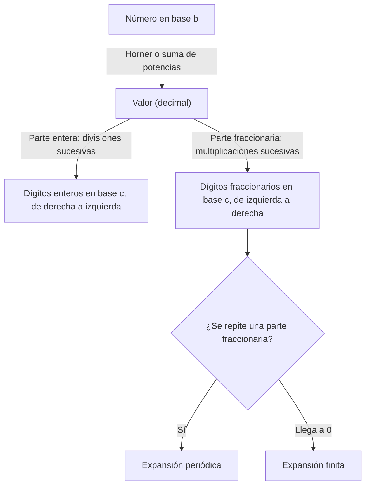

# Organización y Arquitectura de Computadoras - Representación de datos en una computadora digital

## 2.1 Sistemas numéricos posicionales.

---

Una computadora solo almacena patrones de bits; para que representen números hace falta un **sistema de numeración**. Los sistemas **posicionales**, en los que el valor de cada dígito depende de su posición, permiten escribir cualquier número con un conjunto finito de símbolos y hacen que los algoritmos de suma y multiplicación sean sencillos. Este tema define los sistemas posicionales en una base $b$ cualquiera, demuestra que la representación existe y es única, deduce los algoritmos de conversión entre bases y explica por qué algunas fracciones son finitas en una base y periódicas en otra, el origen de que $0.1 + 0.2 \neq 0.3$ en una computadora.

### Definición

Un sistema posicional de **base** (o raíz) $b \geq 2$ usa los dígitos $0, 1, \ldots, b - 1.$ La cadena $(d_{n-1} \ldots d_1 d_0 . d_{-1} \ldots d_{-m})_b$ representa el número

$$ N = \sum_{i = -m}^{n - 1} d_i\, b^i = d_{n-1} b^{n-1} + \cdots + d_1 b + d_0 + d_{-1} b^{-1} + \cdots + d_{-m} b^{-m} $$

El dígito $d_{n-1}$ es el **más significativo** y $d_{-m}$ el **menos significativo**; el punto separa la parte entera de la fraccionaria. Por ejemplo, $(2A.4)_{16} = 2 \cdot 16 + 10 + \frac{4}{16} = 42.25.$

| Base | Nombre | Dígitos | Uso |
| --- | --- | --- | --- |
| 2 | binario | 0, 1 | el hardware: dos niveles de voltaje |
| 8 | octal | 0 a 7 | permisos de archivos en Unix, sistemas antiguos |
| 10 | decimal | 0 a 9 | uso humano |
| 16 | hexadecimal | 0 a 9, A a F | direcciones de memoria, volcados, colores |

Hay sistemas posicionales que no usan una base fija, como el de la hora (60, 60, 24), llamados de **base mixta**, y variantes como el **ternario balanceado**, con dígitos $-1, 0, 1,$ que representa negativos sin signo.

### Existencia y unicidad

**Teorema.** Todo entero $N \geq 0$ tiene una única representación $N = \sum_{i = 0}^{n - 1} d_i\, b^i$ con $0 \leq d_i \lt b$ y, si $N > 0,$ $d_{n-1} \neq 0.$

**Demostración.** *Existencia*, por inducción fuerte: para $N \lt b$ basta un dígito. Si $N \geq b,$ por el algoritmo de la división $N = q b + r$ con $0 \leq r \lt b$ y $q \lt N;$ por hipótesis de inducción $q$ tiene una representación, y $N$ se escribe con los dígitos de $q$ seguidos de $r.$ *Unicidad*: si $\sum d_i b^i = \sum e_i b^i,$ tomando ambos lados módulo $b$ resulta $d_0 = e_0;$ restando, dividiendo entre $b$ y repitiendo, todos los dígitos coinciden. $\blacksquare$

**Número de dígitos.** Como $b^{n-1} \leq N \lt b^n,$ un entero $N \geq 1$ necesita $n = \lfloor \log_b N \rfloor + 1$ dígitos. Un millón necesita 20 bits, porque $2^{19} \leq 10^6 \lt 2^{20},$ y $n$ bits representan los enteros sin signo de $0$ a $2^n - 1.$

### Conversiones

**De base $b$ a decimal.** Se evalúa la suma. Para la parte entera conviene el **esquema de Horner**, que evita calcular potencias: $(d_{n-1} \ldots d_0)_b = (\cdots((d_{n-1} \cdot b + d_{n-2}) \cdot b + d_{n-3}) \cdots) \cdot b + d_0.$ Por ejemplo, $(101101)_2 = ((((1 \cdot 2 + 0) 2 + 1) 2 + 1) 2 + 0) 2 + 1 = 45.$

**De decimal a base $b,$ parte entera: divisiones sucesivas.** Los residuos de dividir repetidamente entre $b$ son los dígitos, del menos al más significativo. Es la demostración de existencia convertida en algoritmo.

$$ 255 = 31 \cdot 8 + 7, \quad 31 = 3 \cdot 8 + 7, \quad 3 = 0 \cdot 8 + 3 \quad \Rightarrow \quad 255 = (377)_8 $$

**Parte fraccionaria: multiplicaciones sucesivas.** Si $x = (0.d_{-1} d_{-2} \ldots)_b,$ entonces $b x = d_{-1} + (0.d_{-2} \ldots)_b:$ la parte entera de $bx$ es el primer dígito. Se repite con la parte fraccionaria.

$$ 0.6875 \times 2 = 1.375, \quad 0.375 \times 2 = 0.75, \quad 0.75 \times 2 = 1.5, \quad 0.5 \times 2 = 1.0 \quad \Rightarrow \quad 0.6875 = (0.1011)_2 $$

**Entre dos bases cualesquiera** se pasa por decimal, salvo cuando una base es potencia de la otra, como 2, 8 y 16, en cuyo caso basta agrupar dígitos (tema 2.2).



### Fracciones finitas y periódicas

**Teorema.** Un racional $p/q$ en forma reducida tiene expansión **finita** en base $b$ si y solo si todos los factores primos de $q$ dividen a $b.$ En otro caso la expansión es **periódica**.

**Demostración.** Si la expansión tiene $m$ dígitos, $p/q = k / b^m$ para un entero $k,$ así que $q$ divide a $b^m$ y sus primos dividen a $b.$ Recíprocamente, si los primos de $q$ dividen a $b,$ $q$ divide a $b^m$ para $m$ suficientemente grande, y $p/q = k / b^m$ tiene $m$ dígitos. Si la expansión no es finita, el algoritmo de multiplicaciones sucesivas solo puede producir partes fraccionarias de la forma $j/q$ con $0 \lt j \lt q,$ que son finitas en número, así que alguna se repite y a partir de ahí los dígitos se repiten. $\blacksquare$

**Consecuencia.** $0.1 = 1/10$ tiene denominador con el factor 5, que no divide a 2: en binario es $0.0\overline{0011},$ periódico, y una computadora solo puede guardar una aproximación. Por eso $0.1 + 0.2$ da $0.30000000000000004$ en punto flotante binario, y por eso las aplicaciones financieras usan aritmética decimal o enteros de centavos.

### Implementación en Python

El programa implementa las conversiones con aritmética racional exacta (el módulo `fractions`), incluida la detección del período en las expansiones fraccionarias, resuelve los ejercicios y comprueba el criterio de las fracciones finitas.

```python
from fractions import Fraction
from math import gcd

DIG = "0123456789ABCDEF"


def a_decimal(cadena, b):
    """Valor de una cadena en base b (con parte fraccionaria opcional), exacto."""
    ent, _, frac = cadena.partition(".")
    v = 0
    for d in ent:                      # esquema de Horner
        v = v * b + DIG.index(d)
    f = Fraction(0)
    for k, d in enumerate(frac, 1):
        f += Fraction(DIG.index(d), b**k)
    return v + f


def de_entero(n, b):
    if n == 0:
        return "0"
    digs = []
    while n > 0:                       # divisiones sucesivas
        n, r = divmod(n, b)
        digs.append(DIG[r])
    return "".join(reversed(digs))


def de_fraccion(x, b, max_dig=20):
    """Multiplicaciones sucesivas; detecta el período si la expansión es periódica."""
    vistos, digs = {}, []
    while x != 0 and len(digs) < max_dig:
        if x in vistos:
            i = vistos[x]
            return "".join(digs[:i]) + "(" + "".join(digs[i:]) + ")"
        vistos[x] = len(digs)
        x *= b
        d = int(x)
        digs.append(DIG[d])
        x -= d
    return "".join(digs) if x == 0 else "".join(digs) + "..."


def convertir(x, b):
    x = Fraction(x)
    ent = int(x)
    frac = x - ent
    return de_entero(ent, b) + ("." + de_fraccion(frac, b) if frac else "")


print("ejercicio 1:", [str(a_decimal(c, b)) for c, b in (("101101", 2), ("2A.4", 16), ("37.2", 8))],
      "=", [float(a_decimal(c, b)) for c, b in (("101101", 2), ("2A.4", 16), ("37.2", 8))])
x = Fraction("255.6875")
print("ejercicio 2:", {b: convertir(x, b) for b in (2, 8, 16)})
print("ejercicio 3a:", convertir(a_decimal("110011010101.111101", 2), 16),
      "| 3b:", convertir(a_decimal("F0C.A", 16), 2))
print("ejercicio 4: 16 bits sin signo: 0 ..", 2**16 - 1, "=", de_entero(2**16 - 1, 2), "=", de_entero(2**16 - 1, 16))
print("ejercicio 5: 0xAF =", a_decimal("AF", 16), "= (" + de_entero(0xAF, 8) + ")_8")

# Fracciones finitas o periódicas
for q in (Fraction(1, 10), Fraction(1, 3), Fraction(3, 8)):
    print(f"{q}: base 2 -> {convertir(q, 2)}, base 3 -> {convertir(q, 3)}, base 10 -> {convertir(q, 10)}")


def finita(q, b):
    d = q.denominator
    g = gcd(d, b)
    while g > 1:
        while d % g == 0:
            d //= g
        g = gcd(d, b)
    return d == 1


print("¿finita? 1/10 en base 2:", finita(Fraction(1, 10), 2), "| 1/10 en base 20:", finita(Fraction(1, 10), 20),
      "| 1/12 en base 6:", finita(Fraction(1, 12), 6))
print("0.1 + 0.2 en punto flotante binario:", 0.1 + 0.2, "| exacto:", Fraction(1, 10) + Fraction(2, 10))

# Número de dígitos: floor(log_b n) + 1
n = 1_000_000
print("dígitos de 10^6:", {b: len(de_entero(n, b)) for b in (2, 8, 10, 16)})
```

Salida:

```text
ejercicio 1: ['45', '169/4', '125/4'] = [45.0, 42.25, 31.25]
ejercicio 2: {2: '11111111.1011', 8: '377.54', 16: 'FF.B'}
ejercicio 3a: CD5.F4 | 3b: 111100001100.101
ejercicio 4: 16 bits sin signo: 0 .. 65535 = 1111111111111111 = FFFF
ejercicio 5: 0xAF = 175 = (257)_8
1/10: base 2 -> 0.0(0011), base 3 -> 0.(0022), base 10 -> 0.1
1/3: base 2 -> 0.(01), base 3 -> 0.1, base 10 -> 0.(3)
3/8: base 2 -> 0.011, base 3 -> 0.(10), base 10 -> 0.375
¿finita? 1/10 en base 2: False | 1/10 en base 20: True | 1/12 en base 6: True
0.1 + 0.2 en punto flotante binario: 0.30000000000000004 | exacto: 3/10
dígitos de 10^6: {2: 20, 8: 7, 10: 7, 16: 5}
```

Los paréntesis en la salida marcan el período: $1/10 = (0.0\overline{0011})_2,$ $1/3 = (0.\overline{01})_2,$ y $3/8,$ cuyo denominador es potencia de 2, es finito en binario pero periódico en base 3.

### Ejercicios Propuestos

1. **A decimal.** Convierte a decimal $(101101)_2,$ $(2A.4)_{16}$ y $(37.2)_8.$

2. **Desde decimal.** Convierte $(255.6875)_{10}$ a binario, octal y hexadecimal.

3. **Binario y hexadecimal.** Convierte $(110011010101.111101)_2$ a hexadecimal y $(F0C.A)_{16}$ a binario.

4. **Rango.** ¿Qué enteros sin signo se pueden representar con 16 bits? Exprésalo en decimal, binario y hexadecimal.

5. **Patrones de bits.** Un registro de 8 bits contiene `0xAF`. ¿Cuál es su valor en decimal y en octal?

6. **Fracciones.** ¿En cuáles de las bases 2, 3, 10 y 20 es finita la expansión de $1/10?$ ¿Y la de $1/12$ en base 6?

### Soluciones

**Ejercicio 1.** $(101101)_2 = 32 + 8 + 4 + 1 = 45;$ $(2A.4)_{16} = 32 + 10 + 0.25 = 42.25;$ $(37.2)_8 = 24 + 7 + \frac{2}{8} = 31.25.$

**Ejercicio 2.** La parte entera es $255 = 2^8 - 1 = (11111111)_2 = (377)_8 = (FF)_{16},$ y la fraccionaria $0.6875 = \frac{11}{16} = (0.1011)_2 = (0.54)_8 = (0.B)_{16}.$ Así, $255.6875 = (11111111.1011)_2 = (377.54)_8 = (FF.B)_{16}.$

**Ejercicio 3.** Agrupando de 4 en 4 desde el punto: $1100\ 1101\ 0101 . 1111\ 0100$ da $(CD5.F4)_{16}.$ Y $(F0C.A)_{16} = (1111\ 0000\ 1100.1010)_2.$

**Ejercicio 4.** De 0 a $2^{16} - 1 = 65535 = (1111111111111111)_2 = (FFFF)_{16}.$

**Ejercicio 5.** $\text{0xAF} = 10 \cdot 16 + 15 = 175 = (257)_8.$

**Ejercicio 6.** $10 = 2 \cdot 5:$ la expansión de $1/10$ es finita en base 10 y en base 20 (ambas divisibles por 2 y 5) y periódica en bases 2 y 3. $12 = 2^2 \cdot 3,$ cuyos primos dividen a 6: $1/12 = (0.03)_6,$ finita.

### Referencias

1. Knuth, D. E., _The Art of Computer Programming, Vol. 2: Seminumerical Algorithms_. Addison-Wesley, 1997. Sección 4.1.
2. Mano, M. M., and Ciletti, M. D., _Digital Design_. Pearson, 2018. Capítulo 1.
3. Patterson, D. A., and Hennessy, J. L., _Computer Organization and Design: The Hardware/Software Interface_. Morgan Kaufmann, 2020. Sección 2.4.
4. Goldberg, D., What every computer scientist should know about floating-point arithmetic. _ACM Computing Surveys_ 23(1), 1991.
